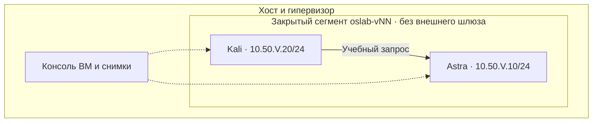
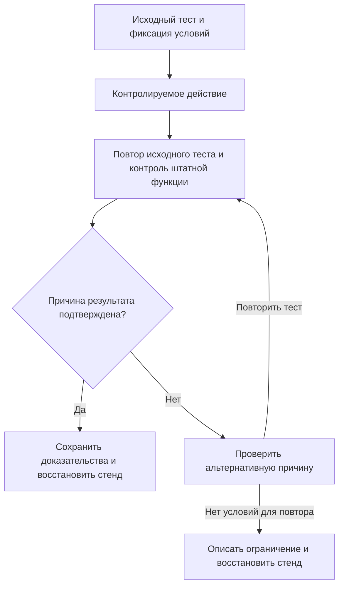

# Контрольная работа по операционным системам
## Инструкция по выполнению практической части

Выполните маршрут своего номера из файла [КР_ОС_27_вариантов.md](КР_ОС_27_вариантов.md). Номер задания определяет опыт. Имена ВМ и адреса определяются вариантом **ПР № 1**. Базовый стенд курса — Astra Linux Common Edition «Орёл» 2.12.22 и Kali Linux в закрытом сегменте. Запишите фактические версии и учитывайте их при выборе команд.

## Подготовка и порядок проверки

Проверьте паспорт стенда, соответствие адресов и отсутствие внешнего маршрута. Снимок текущего состояния сделайте в гипервизоре перед изменением системы. Оставьте доступ к консоли Astra, особенно для тем с SSH, sudo и сетевыми правилами. Защищаемый объект находится на Astra. Kali служит независимым клиентом в сетевых сценариях.

На рисунке 1 показана схема стенда из ПР № 1. В отчёте подставьте свои адреса.



*Рисунок 1 — Виртуальные машины и граница учебного сегмента.*

На обеих ВМ проверьте окружение. Введите номер **стенда** без ведущего нуля, когда нужны переменные `A` и `K`. Переменные задаются заново в каждом новом терминале.

```bash
read -rp 'Номер стенда V (1–27): ' V
A="10.50.${V}.10"
K="10.50.${V}.20"
hostname
date -u +%FT%TZ
cat /etc/os-release
uname -r
ip -br addr
ip -4 route
ip -6 route
```

На Astra заведите новый каталог. При повторном прогоне используйте новый каталог, чтобы сохранить исходные результаты первого.

```bash
umask 077
mkdir -p "$HOME/oslab"
W=$(mktemp -d "$HOME/oslab/kr.XXXXXX")
cd "$W"
pwd
```

Работайте в `W` обычным пользователем Astra, если в маршруте не указано иное. Команда `pwd` покажет фактический путь. В дополнительных терминалах Astra задайте `W` этим же путём и выполните `cd "$W"`. `sudo` применяйте к указанным действиям. Для системных изменений проверьте, что одноимённые учебные учётные записи, объекты и правила отсутствуют. При наличии снимка для чистого прогона используйте согласованное исходное состояние. Перед откатом перенесите доказательства разрешённым способом.

Проверьте нужные команды через `command -v`. Дополнительные пакеты перечислены в таблице 1. Ориентируйтесь на справочные страницы вашей версии: `man acl`, `man fifo`, `man systemd.exec`, `man apt-secure`, `man sshd`. Для отсутствующего пакета используйте подготовленный для данного выпуска подписанный локальный источник или комплект пакетов с зависимостями, предоставленный преподавателем. Проверьте `apt-cache policy ИМЯ` и `apt-get -s install ИМЯ` перед согласованной установкой. В учебных опытах не включайте внешний доступ и не используйте пакеты Kali на Astra.

**Таблица 1 — Зависимости сверх обычных утилит Bash, coreutils и iproute2**

| Вариант | Где и что проверить |
|---|---|
| 06, 07, 12, 16–20, 26 при проверке HTTP, 27 | Astra — `python3`; для 06 также полезен `readelf` из `binutils` |
| 09–10 | Astra — `acl`; файловая система должна поддерживать POSIX ACL |
| 13 | Astra — `e2fsprogs`, `util-linux`, поддержка loop |
| 15, 17 | Astra — `sudo`, `visudo` для 15, `systemd-run` для 17 |
| 18–20, 26 при проверке HTTP, 27 | Kali — `curl`; Astra — `curl` для локального контроля; 19–20 — `iptables` |
| 21–22 | Astra — `logger`, `journalctl`; для 22 — `auditd` или `inotify-tools` по доступной среде |
| 23 | Astra — APT, `gpg` и подписанный локальный репозиторий. Преподаватель выдаёт путь, строку источника, имя пакета и отпечаток ключа |
| 25 | Astra — `openssh-server`; Kali — `openssh-client` |

Перед запуском запишите гипотезу и план проб. В плане укажите проверяемый признак и условия, которые остаются сопоставимыми. Например, если проверяется действие сетевого правила, сохраняйте те же адрес, порт и работающий слушатель. Если исходная проба уже показывает отказ, сначала установите причину. При неожиданном результате сохраните наблюдение и проверьте альтернативное объяснение. Порядок проведения опыта показан на рисунке 2.



*Рисунок 2 — Порядок практической проверки.*

### Заготовки для нескольких вариантов

**Учебные пользователи.** Для вариантов 05, 08–11, 14–16 и 25 создавайте только необходимые записи. Варианты 05, 08–10 и 16 используют текущего владельца и `krguest`; 11 использует `krguest` и `krreader`; 14–15 — `krreader`. Для 25 создайте `krssh` по шагам этого варианта. Пример для локального гостя: `sudo adduser --disabled-password --gecos '' krguest`, затем `id krguest`. Файлы, к которым обращается другой пользователь, размещайте в отдельной области `D` с доступным проходом. Этот блок запускайте только для 05, 08–11 и 16.

```bash
D=$(mktemp -d /var/tmp/kr.XXXXXX)
chmod 755 "$D"
printf 'training\n' > "$D/data"
chmod 644 "$D/data"
```

После опыта удалите созданные объекты и только те записи и группы, которые добавили для него. При необходимости сохраните обезличенный вывод и восстановите снимок.

**Учебный HTTP.** Для 18–20, сетевого резерва 26 и 27 создайте каталог `www` внутри `W`. Запускайте сервер из этого каталога в отдельном терминале Astra; записывайте PID или используйте Ctrl+C именно в терминале сервера. Подставьте фактический IP Astra.

```bash
mkdir -p "$W/www"
printf 'training-ok\n' > "$W/www/index.html"
cd "$W/www"
python3 -m http.server 18080 --bind "$A"
```

Из другого терминала Astra проверьте `ss -ltnp`. На Kali выполните `curl --noproxy '*' -fsS --connect-timeout 3 --max-time 5 "http://$A:18080/"`. Для проверки локальной привязки повторите с Astra к нужному адресу. Для второго порта запустите отдельный экземпляр в другом терминале, заменив 18080 на 18081. При конфликте выберите два свободных порта и последовательно замените их в командах.

**Временное сетевое правило для 19–20.** Пример для стенда с `iptables`. На Astra проверьте действующий фильтр и наличие исходного ответа с Kali. Выполните через консоль Astra. Массив содержит параметры ровно одного учебного правила. Если проверка `-C` уже находит такое правило, остановитесь и выясните, кем оно создано.

```bash
RULE=(-s "$K" -d "$A" -p tcp --dport 18080 -j DROP)
sudo iptables -C INPUT "${RULE[@]}"
# Только если правила нет и команда распознана:
sudo iptables -I INPUT 1 "${RULE[@]}"
sudo iptables -L INPUT -n -v --line-numbers
```

После теста снимите счётчик и удалите ровно своё правило: `sudo iptables -D INPUT "${RULE[@]}"`. Повторите клиентский запрос. На стенде с другой системой фильтрации используйте согласованный эквивалент с теми же адресами, портом и счётчиком. Полный сброс таблиц не требуется.

## Маршруты по вариантам

- [01. Контроль целостности конфигурации и восстановление доверенного состояния Linux](#v01)
- [02. Жизненный цикл файла в Linux: имена, inode и открытые дескрипторы](#v02)
- [03. Управление окружением процессов и воспроизводимость запуска в Linux](#v03)
- [04. Управление состояниями процессов Linux посредством сигналов](#v04)
- [05. Именованные каналы Linux: синхронизация и разграничение доступа](#v05)
- [06. Рандомизация адресного пространства процессов и её наблюдаемость в Linux](#v06)
- [07. Ограничение файловых дескрипторов как механизм управления ресурсами Linux](#v07)
- [08. Разграничение доступа к файлам при разрешении пути в Linux](#v08)
- [09. Эффективные разрешения в модели POSIX ACL](#v09)
- [10. Политика наследования прав при создании файлов с POSIX ACL](#v10)
- [11. Защита файлов пользователей в общих каталогах Linux](#v11)
- [12. Безопасное разрешение путей при работе с символическими ссылками](#v12)
- [13. Политика монтирования файловых систем и границы защиты съёмных носителей](#v13)
- [14. Групповые полномочия процессов и отзыв доступа в Linux](#v14)
- [15. Делегирование административных полномочий и принцип наименьших привилегий в sudo](#v15)
- [16. Дискреционная и мандатная модели управления доступом: основания принятия решений](#v16)
- [17. Изоляция системных служб Linux средствами systemd](#v17)
- [18. Адресная привязка сокетов и сетевая доступность служб Linux](#v18)
- [19. Фильтрация входящего трафика и сохранение штатной доступности сервисов](#v19)
- [20. Диагностика недоступности TCP-служб на основе наблюдений клиента и сервера](#v20)
- [21. Корреляция событий в системном журнале Linux](#v21)
- [22. Наблюдение и аудит изменений метаданных файлов в Linux](#v22)
- [23. Модель доверия APT и выбор версии пакета из локального репозитория](#v23)
- [24. Контроль содержимого и метаданных при проверке целостности файлов](#v24)
- [25. Аутентификация SSH и ограничение полномочий ключа](#v25)
- [26. Сетевая изоляция виртуальных машин и проверка её границ](#v26)
- [27. Реагирование на нарушение целостности данных сетевой службы](#v27)

<a id="v01"></a>

### 01. Контроль целостности конфигурации и восстановление доверенного состояния Linux

**Что проверяется.** При каких условиях эталон хешей позволяет обнаружить и локализовать изменение конфигурации?

1. На Astra создайте `mkdir trusted live`, сохраните `printf 'mode=normal\n' > trusted/app.conf` и `printf 'limit=4\n' > trusted/limits.conf`. Скопируйте оба файла в `live/`. Выполните `(cd trusted && sha256sum app.conf limits.conf) > manifest.sha256`.
2. Проверьте `(cd live && sha256sum -c ../manifest.sha256)`. Измените только `live/app.conf`, например допишите `printf 'debug=yes\n' >> live/app.conf`. Повторите проверку. В отчёте укажите, почему результат для второго файла нужен для сравнения.
3. Сверьте доверенную копию командой `(cd trusted && sha256sum -c ../manifest.sha256)`, восстановите `cp -p trusted/app.conf live/app.conf` и снова проверьте оба файла. Для реального эталона объясните, кто должен иметь право его изменять.

**Обработка результатов.** Составьте матрицу для двух файлов в трёх состояниях. Укажите, какие объекты и полномочия требуется защищать, чтобы результат оставался достоверным.

<a id="v02"></a>

### 02. Жизненный цикл файла в Linux: имена, inode и открытые дескрипторы

**Что проверяется.** Когда удаление имени прекращает доступ к данным и когда открытый дескриптор его сохраняет?

1. В отдельном Bash Astra создайте `printf 'descriptor-data\n' > object.txt`, выполните `stat -c 'inode=%i links=%h' object.txt` и откройте дескриптор `exec 3<object.txt`. Проверьте `readlink "/proc/$$/fd/3"`.
2. Удалите имя `rm -- object.txt`. Проверьте `test -e object.txt` и код возврата, `readlink "/proc/$$/fd/3"` и `stat -Lc 'inode=%i links=%h' "/proc/$$/fd/3"`. Прочитайте `cat <&3`. Ожидается содержимое при отсутствии имени.
3. Закройте дескриптор `exec 3<&-` и повторите `readlink`. Зафиксируйте разницу между отсутствием имени и отсутствием открытого дескриптора.

**Обработка результатов.** Изобразите связи имени, inode и дескриптора на трёх этапах. Не делайте по этому опыту количественных выводов об освобождении места.

<a id="v03"></a>

### 03. Управление окружением процессов и воспроизводимость запуска в Linux

**Что проверяется.** Какие параметры окружения наследует дочерний процесс и как сделать запуск предсказуемым?

1. В отдельном Bash Astra выполните `unset KR_MODE; KR_MODE=training`. Проверьте видимость через `bash -c 'printf "%s\n" "${KR_MODE-unset}"'`. Затем `export KR_MODE` и повторите ту же команду.
2. Выполните `env -i /bin/bash -c 'printf "%s\n" "${KR_MODE-unset}"'`, затем `env -i KR_MODE=training /bin/bash -c 'printf "%s\n" "${KR_MODE-unset}"'`. Последняя команда проверяет явный контракт запуска.
3. Сохраните четыре результата. В родительской оболочке завершите опыт через `unset KR_MODE`. В отчёте объясните, почему в таких опытах используют искусственное значение без секрета.

**Обработка результатов.** В таблице четырёх запусков выделите изменённое условие. Объясните, какие переменные нужно явно задавать при запуске службы и почему.

<a id="v04"></a>

### 04. Управление состояниями процессов Linux посредством сигналов

**Что проверяется.** Как по наблюдаемым признакам отличить приостановку процесса от завершения?

1. На Astra запустите `sleep 180 & P=$!`, затем `sleep 180 & Q=$!`. Убедитесь, что оба процесса ваши: `ps -p "$P,$Q" -o pid,user,stat,comm`. Работайте до истечения 180 секунд.
2. Выполните `kill -STOP "$P"`, дождитесь состояния с признаком `T` у первого PID и сопоставьте второй. Затем `kill -CONT "$P"` и повторите `ps`.
3. Завершите только оба созданных процесса через `kill -TERM "$P" "$Q"` и дождитесь завершения через `wait "$P" "$Q"`. Сопоставьте исчезновение процессов с предыдущим состоянием остановки.

**Обработка результатов.** Постройте диаграмму переходов и соотнесите её со значениями STAT для обоих PID. Объясните роль контрольного процесса.

<a id="v05"></a>

### 05. Именованные каналы Linux: синхронизация и разграничение доступа

**Что проверяется.** Как отделить ожидание второго участника FIFO от отказа по правам доступа?

1. Используйте `D` и `krguest` из заготовки. На Astra выполните `mkfifo -m 644 "$D/channel"`. Запустите чтение в фоне: `sudo -u krguest -- timeout 8 cat "$D/channel" & R=$!`. Передайте `timeout 5 sh -c 'printf "fifo-ok\n" > "$1"' sh "$D/channel"`, затем `wait "$R"`.
2. Пока режим 644, без писателя выполните `sudo -u krguest -- timeout 2 cat "$D/channel"` и запишите код 124. Затем выполните `chmod 600 "$D/channel"` и `sudo -u krguest -- timeout 2 cat "$D/channel"`. Зафиксируйте ошибку и код: 124 указывает на тайм-аут, сообщение о правах — на отказ доступа.
3. Повторите передачу тем же способом, запустив читателя от владельца без `sudo -u`. Сохраните `stat "$D/channel"`, вывод и код тестов. Удалите FIFO после завершения всех процессов.

**Обработка результатов.** До смены режима проведите отдельную пробу читателя без писателя с тайм-аутом. Сопоставьте её с отказом после смены прав и успешной передачей владельцем.

<a id="v06"></a>

### 06. Рандомизация адресного пространства процессов и её наблюдаемость в Linux

**Что проверяется.** При каких условиях адреса стека и исполняемого кода изменяются между запусками?

1. На Astra снимите `sysctl kernel.randomize_va_space`. Выполните этот блок. Он фиксирует одинаковый тип сегмента Python и стек, дважды в каждом из пяти отдельных запусков.

```bash
for i in 1 2 3 4 5; do
  python3 - <<'PY'
import os
import sys

exe = os.path.realpath(sys.executable)
for _ in range(2):
    with open("/proc/self/maps") as maps:
        rows = [line.split(None, 5) for line in maps]
    text = next(r[0] for r in rows if len(r) == 6 and
                r[5].strip() == exe and "x" in r[1])
    stack = next(r[0] for r in rows if len(r) == 6 and r[5].strip() == "[stack]")
    print(os.getpid(), text, stack)
PY
done
```

2. При наличии `readelf` проверьте тип ELF через `readelf -h "$(readlink -f "$(command -v python3)")"`. Сопоставьте одинаковые PID и разные запуски. Неизменный сегмент при меняющемся стеке укажите как наблюдение; проверьте тип ELF. Глобальную настройку не меняйте.

**Обработка результатов.** Для каждого наблюдаемого сегмента укажите число уникальных начальных адресов среди пяти процессов и сопоставьте его с повторными чтениями внутри одного процесса.

<a id="v07"></a>

### 07. Ограничение файловых дескрипторов как механизм управления ресурсами Linux

**Что проверяется.** Как мягкий лимит определяет число новых открытий и как наследуется процессом?

1. В Astra запишите `ulimit -Sn` и `ulimit -Hn`. При исходном мягком лимите не выше 43 зафиксируйте ограничение исходного контроля.
2. Сравните три запуска. Открываются дескрипторы одного безвредного объекта, память и процессы не нагружаются.

```bash
cat > fd-limit.py <<'PYCODE'
import sys

files = []
try:
    for _ in range(int(sys.argv[1])):
        files.append(open("/dev/null"))
finally:
    print("opened:", len(files))
PYCODE
python3 fd-limit.py 40
(ulimit -Sn 32 && python3 fd-limit.py 40)
(ulimit -Sn 32 && python3 fd-limit.py 8)
ulimit -Sn
```

3. Зафиксируйте число открытий и ошибку. Объясните, почему вторая проба исчерпывает лимит раньше 32 новых открытий и почему родительский лимит не изменился.

**Обработка результатов.** Сопоставьте предел, число фактических открытий и ошибку, учтите уже открытые дескрипторы. Проверьте предел родительской оболочки после опыта.

<a id="v08"></a>

### 08. Разграничение доступа к файлам при разрешении пути в Linux

**Что проверяется.** Почему разрешение на чтение файла не гарантирует доступ по заданному пути?

1. С заготовкой `D` и `krguest` выполните `namei -l "$D/data"` и `sudo -u krguest -- cat "$D/data"`. Запишите права файла.
2. Выполните `chmod 700 "$D"`, повторите чтение гостем и `cat "$D/data"` владельцем. Повторите `namei -l`. Найдите компонент, блокирующий проход.
3. Верните `chmod 755 "$D"` и подтвердите исходное чтение. Удалите только каталог опыта и учебную запись.

**Обработка результатов.** Докажите неизменность прав файла и назовите конкретный компонент пути, изменение которого повлияло на гостя.

<a id="v09"></a>

### 09. Эффективные разрешения в модели POSIX ACL

**Что проверяется.** Как маска влияет на именованную запись ACL и права владельца?

1. С заготовкой `D` установите `chmod 600 "$D/data"`, затем `setfacl -m u:krguest:r-- "$D/data"`. Выполните `getfacl "$D/data"` и чтение через `sudo -u krguest -- cat "$D/data"`.
2. Установите `setfacl -m m::--- "$D/data"` и повторите чтение гостем и владельцем. Сопоставьте вывод `getfacl` до и после, включая `effective`.
3. Верните `setfacl -m m::r-- "$D/data"`, проверьте чтение гостем. Удалите учебные объекты.

**Обработка результатов.** Рассчитайте ожидаемые права обоих субъектов до и после изменения маски. Сверьте расчёт с ACL и результатами чтения.

<a id="v10"></a>

### 10. Политика наследования прав при создании файлов с POSIX ACL

**Что проверяется.** Какие свойства каталога и операции создания определяют ACL нового файла?

1. В каталоге `D` выполните `(umask 077; printf 'old\n' > "$D/old")`. Проверьте отказ чтения от `krguest`.
2. Выполните `setfacl -m d:u:krguest:r-- "$D"`, затем `(umask 077; printf 'new\n' > "$D/new")`. Снимите `getfacl "$D" "$D/old" "$D/new"` и сравните чтение обоих файлов гостем.
3. Дополнительно создайте файл с явно ограниченным режимом: `install -m 600 /dev/null "$D/explicit"`. Проверьте его ACL и чтение. Сохраните результаты и удалите объекты опыта.

**Обработка результатов.** Сравните старый, новый и явно ограниченный файл. Различите наследование при создании и последующее изменение режима утилитой install.

<a id="v11"></a>

### 11. Защита файлов пользователей в общих каталогах Linux

**Что проверяется.** Как sticky bit меняет полномочия на удаление записей общего каталога?

1. В `D` с двумя учебными записями создайте `mkdir "$D/shared"; chmod 0777 "$D/shared"`. Выполните `sudo -u krreader -- touch "$D/shared/item"`, затем `sudo -u krguest -- rm -- "$D/shared/item"`. Ожидается удаление.
2. Создайте тот же файл от `krreader` заново, установите `chmod 1777 "$D/shared"` и повторите попытку `krguest`. Запишите `stat -c '%A %a %U %n' "$D/shared" "$D/shared/item"`.
3. Удалите файл от `krreader`. Сравните результаты и удалите каталог опыта. Оставлять общий учебный каталог доступным для записи после опыта не требуется.

**Обработка результатов.** Постройте матрицу удаления для двух режимов каталога и двух субъектов. Укажите, кто владеет каталогом и файлом в каждой пробе. Для четвёртой комбинации повторите удаление от имени владельца файла при режиме 0777. Перед каждой пробой создавайте файл заново от имени `krreader`.

<a id="v12"></a>

### 12. Безопасное разрешение путей при работе с символическими ссылками

**Что проверяется.** Как смена цели ссылки влияет на открытие файла и какую гарантию даёт O_NOFOLLOW?

1. На Astra создайте два файла `printf 'public\n' > public.txt`, `printf 'test-secret\n' > synthetic.txt` и ссылку `ln -s public.txt request.txt`. Проверьте `readlink request.txt` и `cat request.txt`.
2. Перенаправьте ссылку `ln -sfn synthetic.txt request.txt`, повторите чтение. Затем проверьте прямой файл и ссылку с одним и тем же вызовом:

```bash
for F in public.txt request.txt; do
  python3 -c 'import os,sys; fd=os.open(sys.argv[1],os.O_RDONLY|os.O_NOFOLLOW); print(os.read(fd,128).decode().strip()); os.close(fd)' "$F"
done
```

3. Ожидается успешное открытие прямого файла и отказ для ссылки. Укажите, что этот флаг относится к последнему компоненту пути. Удалите искусственные данные после сохранения вывода.

**Обработка результатов.** Покажите обычное чтение до и после смены цели, затем проверьте прямой путь и ссылку одинаковым защищённым вызовом. Ограничьте вывод последним компонентом.

<a id="v13"></a>

### 13. Политика монтирования файловых систем и границы защиты съёмных носителей

**Что проверяется.** Какие действия ограничивают параметры ro и noexec и какие действия сохраняются?

1. На Astra проверьте, что файл и каталог новые. Создайте образ `truncate -s 32M media.img`, отформатируйте **этот файл** командой `mkfs.ext4 -F media.img` и выполните `mkdir media`.
2. Смонтируйте `sudo mount -o loop,rw,nodev,nosuid,noexec "$W/media.img" "$W/media"`. Убедитесь через `mountpoint "$W/media"`, что монтирование успешно, затем создайте файл `printf '#!/bin/sh\necho media-ok\n' | sudo tee media/demo.sh >/dev/null` и `sudo chmod 755 media/demo.sh`. Снимите `findmnt -T "$W/media"`. Размонтируйте `sudo umount "$W/media"`.
3. Смонтируйте с `loop,ro,nodev,nosuid,noexec`. Сравните `cat media/demo.sh`, `./media/demo.sh`, `sh media/demo.sh` и `sudo touch "$W/media/write-test"`. Ожидаются чтение и запуск через интерпретатор, отказ прямого запуска и записи.
4. Размонтируйте образ, проверьте `mountpoint` и удалите образ. При ошибке монтирования остановите опыт до любых операций записи.

**Обработка результатов.** Сопоставьте монтирование, запись, чтение, прямой запуск и запуск через интерпретатор. Для nodev и nosuid зафиксируйте параметры монтирования.

<a id="v14"></a>

### 14. Групповые полномочия процессов и отзыв доступа в Linux

**Что проверяется.** Когда изменение членства в группе начинает влиять на доступ к объекту?

1. Создайте `krreader`, затем `sudo groupadd kr-role` и `sudo usermod -aG kr-role krreader`. Подготовьте `sudo install -d -o root -g kr-role -m 0750 /srv/kr-role`, выполните `printf "role-test\n" | sudo tee /srv/kr-role/data >/dev/null`, затем `sudo chown root:kr-role /srv/kr-role/data` и `sudo chmod 0640 /srv/kr-role/data`. В отдельной консоли Astra запустите `sudo -iu krreader`, проверьте `id` и чтение файла.
2. В административной консоли выполните `sudo gpasswd -d krreader kr-role`. В уже открытой сессии повторите `id` и чтение. В новой команде `sudo -u krreader -- id` и `sudo -u krreader -- cat /srv/kr-role/data` проверьте актуальные группы и результат доступа.
3. Завершите старую сессию, повторите новый тест. Удалите учебные объекты и группу, затем запись, если создана для опыта. Укажите, какие сессии следует завершать при срочном отзыве доступа.

**Обработка результатов.** Сравните id и чтение в старой и новой сессиях. Предложите процедуру немедленного отзыва на основе наблюдений.

<a id="v15"></a>

### 15. Делегирование административных полномочий и принцип наименьших привилегий в sudo

**Что проверяется.** Как ограничить делегирование конкретным действием и набором аргументов?

1. Создайте чистую запись `krreader` и проверьте `sudo -l -U krreader`. Создайте `printf 'status=ok\n' | sudo tee /srv/kr-status >/dev/null`, установите `sudo chmod 600 /srv/kr-status`. Проверьте исходный отказ через `sudo -u krreader -- cat /srv/kr-status`.
2. Проверьте `command -v cat`. Если путь отличается от `/usr/bin/cat`, используйте фактический путь во всех тестах. Убедитесь, что `sudoers` подключает `/etc/sudoers.d`. Через `sudo visudo -f /etc/sudoers.d/kr-status` добавьте строку:

```text
krreader ALL=(root) NOPASSWD: /usr/bin/cat /srv/kr-status
```

3. Проверьте `sudo visudo -c`, затем `sudo -u krreader -- sudo -n /usr/bin/cat /srv/kr-status`. Повторите вызов с аргументом `/srv/kr-other` и зафиксируйте отказ sudo. Удалите правило, повторите `visudo -c` и убедитесь, что прежде разрешённый вызов тоже отклоняется. Удалите учебный файл и запись.

**Обработка результатов.** Покажите исходный отказ, разрешённый вызов, отказ с другим аргументом и отказ после отзыва. Различите ошибку sudo и ошибку запущенной команды.

<a id="v16"></a>

### 16. Дискреционная и мандатная модели управления доступом: основания принятия решений

**Что проверяется.** Как меняется решение о чтении при изменении прав объекта, уровня или категории субъекта?

1. На Astra в каталоге `W` выполните следующий фрагмент. Учебное правило для чтения допускает запрос, если уровень субъекта не ниже уровня объекта и субъект обладает всеми категориями объекта. В наборе есть допуск и по одному отказу для каждой проверки.

```bash
python3 - <<'PYCODE'
object_level = 2
object_categories = {"lab"}
subjects = [
    ("researcher", 2, {"lab", "archive"}),
    ("trainee", 1, {"lab", "archive"}),
    ("visitor", 2, {"archive"}),
]
for name, level, categories in subjects:
    level_ok = level >= object_level
    categories_ok = object_categories <= categories
    decision = "ALLOW" if level_ok and categories_ok else "DENY"
    print(name, "level_ok=", level_ok,
          "categories_ok=", categories_ok, decision)
PYCODE
```

2. Объясните оба отказа по напечатанным условиям. Повторите опыт, изменив только уровень `trainee` с 1 на 2. Предскажите, у кого изменится решение, и сравните с выводом.
3. Проведите отдельную проверку дискреционного доступа (DAC). Возьмите `D` и `krguest` из общей заготовки. Выполните `sudo -u krguest -- cat "$D/data"` при режиме файла 644, затем установите `chmod 600 "$D/data"` и повторите чтение. Владелец по-прежнему должен прочитать файл. В отчёте укажите, какие решения получены программной моделью и какие операции проверены на реальном файле. Удалите учебные объекты после фиксации результатов.

**Обработка результатов.** Составьте две матрицы: для программной модели и для реального DAC. Объясните, какие случаи подтверждены моделью и какие проверены ядром.

<a id="v17"></a>

### 17. Изоляция системных служб Linux средствами systemd

**Что проверяется.** Как файловая изоляция службы изменяет доступ при одинаковых правах её пользователя?

1. На Astra проверьте `systemd --version` и локальную справку по `ProtectSystem=strict` и `ReadWritePaths=`. Проверьте фактический путь к `touch` через `command -v touch` и при необходимости подставьте его в блок. Создайте чистую системную запись `sudo useradd --system --user-group --no-create-home krsvc`, затем `sudo install -d -o krsvc -m 0700 /srv/kr-work /srv/kr-probe`. Проверьте, что DAC разрешает запись в обе области.
2. Выполните два запуска с разными именами unit. После исходного запуска проверьте журнал и удалите оба пробных файла перед усиленным запуском. Служба выводит код каждой операции в журнал. Приведённые команды не изменяют постоянную конфигурацию службы.

```bash
PROBE='for d in /srv/kr-work /srv/kr-probe; do /usr/bin/touch "$d/test"; rc=$?; printf "%s status=%s\n" "$d" "$rc"; done'
sudo systemd-run --unit=kr-base -p User=krsvc /bin/sh -c "$PROBE"
sudo journalctl -u kr-base.service -n 15 --no-pager
sudo rm -f /srv/kr-work/test /srv/kr-probe/test
sudo systemd-run --unit=kr-tight -p User=krsvc -p ProtectSystem=strict \
  -p ReadWritePaths=/srv/kr-work /bin/sh -c "$PROBE"
sudo journalctl -u kr-tight.service -n 15 --no-pager
```

3. Дождитесь выполнения каждой пробы. Ожидаются два успешных действия в исходном запуске и отказ записи в `/srv/kr-probe` в усиленном. Фиксируйте результаты текущего запуска по времени. Если версия не поддерживает временные свойства, создайте отдельный одноразовый unit с теми же параметрами и проверьте `systemd-analyze verify`. Удалите только учебные каталоги, запись и созданный unit, если использовали постоянный файл.

**Обработка результатов.** Сопоставьте две области записи в исходной и ограниченной конфигурациях. Подтвердите решение выводом службы и проверьте, что изменился только профиль.

<a id="v18"></a>

### 18. Адресная привязка сокетов и сетевая доступность служб Linux

**Что проверяется.** Как адрес слушателя ограничивает доступ к одному и тому же порту?

1. Запустите учебный HTTP на адресе Astra, порт 18080. Снимите `ss -ltnp '( sport = :18080 )'` и выполните штатный запрос с Kali. Получите `training-ok` до изменения.
2. Остановите сервер и из того же каталога выполните `python3 -m http.server 18080 --bind 127.0.0.1`. Повторите `ss` и запрос с Kali к прежнему IP. На Astra выполните `curl --noproxy '*' -fsS --max-time 5 http://127.0.0.1:18080/`.
3. С Astra также повторите запрос к собственному сетевому адресу `$A`. При привязке только к loopback ожидается отказ и с этого узла по сетевому адресу. Объясните, почему локальный ответ и удалённый отказ совместимы. Остановите сервер и подтвердите исчезновение слушателя.

**Обработка результатов.** Для двух привязок сопоставьте вывод ss и фактические запросы. Добавьте контроль с Astra по её сетевому адресу после перехода на loopback.

<a id="v19"></a>

### 19. Фильтрация входящего трафика и сохранение штатной доступности сервисов

**Что проверяется.** Как адресное правило меняет доступ к выбранному порту при неизменных слушателях?

1. Запустите два учебных HTTP-экземпляра с одинаковым содержимым на портах 18080 и 18081. С Kali запросите оба. На Astra снимите слушатели и локальный доступ к обоим портам.
2. Вставьте временное правило только для 18080 по общей заготовке. Повторите четыре запроса, с Kali и Astra. На Astra убедитесь, что оба слушателя активны, и снимите счётчик правила. Ожидается отказ только для запроса Kali к порту 18080.
3. Удалите правило точной командой из заготовки. Повторите запросы к обоим портам с Kali и Astra. Проверьте удаление правила через `sudo iptables -C INPUT "${RULE[@]}"`. После фиксации результата остановите оба сервера.

**Обработка результатов.** Заполните матрицу «источник × порт» до правила, при действии и после удаления. Сопоставьте её с двумя слушателями и счётчиком.

<a id="v20"></a>

### 20. Диагностика недоступности TCP-служб на основе наблюдений клиента и сервера

**Что проверяется.** Какие данные позволяют различить отсутствие слушателя и фильтрацию входящего трафика?

1. На Kali во всех трёх пробах измеряйте время одной и той же команды:

```bash
curl --noproxy '*' -fsS --connect-timeout 3 --max-time 5 \
  -w '\nconnect=%{time_connect} total=%{time_total}\n' "http://$A:18080/"
printf 'curl_exit=%s\n' "$?"
```

   Запустите HTTP на Astra и выполните исходный запрос с Kali. Остановите сервер и убедитесь через `ss`, что порт свободен. Повторите запрос; запишите сообщение, код и время. При действующем фильтре возможен тайм-аут даже без слушателя. Такое поведение отметьте и проверьте штатные правила.
2. Снова запустите сервер, подтвердите исходный доступ. Примените временное правило DROP для 18080. Повторите запрос с теми же тайм-аутами. Снимите `ss`, локальный ответ и счётчик правила. Отличайте клиентский симптом от причины, установленной на сервере.
3. Удалите правило, подтвердите HTTP с Kali и остановите учебный сервер.

**Обработка результатов.** Для трёх состояний сопоставьте клиентский вывод, длительность, наличие слушателя и счётчик. Укажите, какой вывод допустим при отсутствии серверных данных.

<a id="v21"></a>

### 21. Корреляция событий в системном журнале Linux

**Что проверяется.** Как отобрать события одного эксперимента и подтвердить их последовательность?

1. На Astra задайте уникальную метку `TAG="kr21-$(date +%s)"` и начало `START=$(date -u '+%F %T UTC')`. Выполните `logger -t "$TAG" 'begin lesson test'`, затем `logger -t "${TAG}-other" 'independent lesson event'` и `logger -t "$TAG" 'end lesson test'`.
2. Сравните `sudo journalctl --since "$START" --utc --no-pager` с `sudo journalctl --since "$START" --utc -t "$TAG" --no-pager`. При задержке доставки повторите просмотр. Дополните вывод через `-o verbose` для одного события и объясните поля `SYSLOG_IDENTIFIER`, `_HOSTNAME` и `_PID`.
3. В отчёт включите только строки опыта и временную шкалу. Чужие записи из широкого вывода не переносите. Журнал для очистки опыта не удаляйте.

**Обработка результатов.** Покажите широкую и точечную выборки, объясните исключение контрольной записи. Составьте шкалу в UTC и укажите неопределённость при равных метках.

<a id="v22"></a>

### 22. Наблюдение и аудит изменений метаданных файлов в Linux

**Что проверяется.** Как связать изменение атрибутов с событием наблюдения и когда можно установить субъекта?

1. На Astra создайте два файла `touch watched.txt control.txt`, затем `chmod 600 watched.txt control.txt`. Если доступен auditd, проверьте `sudo auditctl -s` и `sudo auditctl -l`. Убедитесь, что аудит активен, разрешены временные правила и свободен ключ `kr22_attr`.
2. Добавьте `sudo auditctl -w "$W/watched.txt" -p a -k kr22_attr`. Измените `chmod 640 watched.txt control.txt`. Проверьте `stat -c '%a %n' watched.txt control.txt` и `sudo ausearch -k kr22_attr -ts recent -i`. Найдите запись по времени и пути; сравните наличие события для обоих файлов. Удалите только это правило через `sudo auditctl -W "$W/watched.txt" -p a -k kr22_attr`, проверьте список.
3. На базовом образе без auditd используйте наблюдение через inotify. В первом терминале `timeout 30 inotifywait -m -e attrib "$W/watched.txt"`, во втором после сообщения об установке наблюдения измените права обоих файлов. Сохраните событие `ATTRIB` и вывод `stat`. Укажите, что inotify показывает изменение наблюдаемого объекта и не определяет UID инициатора. Дождитесь окончания наблюдения.

**Обработка результатов.** Сравните наблюдаемый и контрольный файлы. При auditd укажите поля субъекта, при inotify перечислите сведения, которых нет в полученном событии.

<a id="v23"></a>

### 23. Модель доверия APT и выбор версии пакета из локального репозитория

**Что проверяется.** Как подписанные метаданные влияют на доверие к источнику и план установки?

1. Получите у преподавателя исходные данные опыта: подписанный локальный `file:`-репозиторий, строку источника с `signed-by=`, открытый ключ архива, его контрольный отпечаток и имя учебного пакета. На Astra проверьте отпечаток ключа через `gpg --show-keys --with-fingerprint /путь/к/ключу.gpg` либо в старой версии через `gpg --with-fingerprint /путь/к/ключу.gpg`. Сравните полный отпечаток с выданным отдельно. Проверьте наличие `InRelease` либо пары `Release` и `Release.gpg` в используемом выпуске репозитория. Создайте отдельный профиль APT с пустым источником и новым каталогом индексов. Подставьте имя выданного пакета в `PKG`.

```bash
PKG=pr11-demo
APT_WORK=$(mktemp -d /var/tmp/kr-apt.XXXXXX)
chmod 755 "$APT_WORK"
mkdir "$APT_WORK/lists"
chmod 755 "$APT_WORK/lists"
touch "$APT_WORK/lab.list"
chmod 644 "$APT_WORK/lab.list"
APT_LAB=(-o "Dir::Etc::SourceList=$APT_WORK/lab.list"
         -o Dir::Etc::SourceParts=-
         -o "Dir::State::Lists=$APT_WORK/lists"
         -o Acquire::AllowInsecureRepositories=false)
dpkg-query -W "$PKG"
apt-cache "${APT_LAB[@]}" policy "$PKG"
apt-get "${APT_LAB[@]}" -s install "$PKG"
```

   Если пакет отсутствует, ошибка dpkg-query или отсутствие кандидата на этом этапе допустимы. Сохраните вывод. Если пакет уже установлен, зафиксируйте это и сопоставьте таблицу версий и происхождение кандидата после подключения репозитория.

2. После проверки отпечатка вставьте в блок ниже выданную строку с `signed-by=` и `file:`. Убедитесь, что указанные в ней ключ и каталог доступны для чтения APT. Обновляйте индексы только с параметрами учебного профиля. При ошибке подписи остановитесь и проверьте источник, ключ и время на ВМ.

```bash
printf '%s\n' 'deb [signed-by=/srv/oslab11/keys/oslab11-archive.gpg] file:/srv/oslab11/orel-lab orel-lab main' > "$APT_WORK/lab.list"
sudo apt-get "${APT_LAB[@]}" update
apt-cache "${APT_LAB[@]}" policy "$PKG"
apt-get "${APT_LAB[@]}" -s install "$PKG"
dpkg-query -W "$PKG"
```

3. Убедитесь, что индекс загружен без ошибки подписи, а APT обращался только к локальному учебному источнику. Сравните кандидат, источник и план. Состояние установки должно сохраниться. По завершении проверьте абсолютный путь `APT_WORK` и удалите только созданный временный каталог профиля. Репозиторий и открытый ключ после опыта оставьте в исходном состоянии.

**Обработка результатов.** Сопоставьте кандидат, источник и зависимости до и после подключения архива. Отдельно подтвердите неизменность установленной версии.

<a id="v24"></a>

### 24. Контроль содержимого и метаданных при проверке целостности файлов

**Что проверяется.** Какие изменения выявляют хеширование содержимого и сравнение атрибутов?

1. Создайте `printf 'alpha\n' > check.txt`, `chmod 600 check.txt`, `cp -p check.txt saved.txt`. Запишите `sha256sum check.txt` и `stat -c '%a %u %g %s %n' check.txt`.
2. Выполните `chmod 644 check.txt` и повторите обе команды. Затем, оставив режим 644, замените содержимое на строку той же длины через `printf 'omega\n' > check.txt` и повторите измерения.
3. Выполните `cp -p saved.txt check.txt`, подтвердите восстановление режима и хеша. В таблице покажите, почему совпадение размеров не доказывает неизменность содержимого.

**Обработка результатов.** Зафиксируйте исходное состояние, изменение режима, изменение содержимого при том же размере и восстановление. Для каждого этапа укажите сработавший признак.

<a id="v25"></a>

### 25. Аутентификация SSH и ограничение полномочий ключа

**Что проверяется.** Как принудительная команда ограничивает действия после входа и что меняется после отзыва ключа?

1. На Astra проверьте `systemctl status ssh.service`, `sudo /usr/sbin/sshd -t` и `sudo ss -ltnp`. Если служба установлена и настроена для учебного сегмента, но остановлена, запустите её через `sudo systemctl start ssh.service`; после опыта верните исходное состояние. Оставьте консоль гипервизора открытой. Создайте отдельную запись через `sudo adduser krssh`. Введите уникальный учебный пароль интерактивно. На Kali создайте ключ командой `ssh-keygen -t ed25519 -f "$HOME/.ssh/kr-control"`. При установленной фразе защиты добавьте ключ в агент через `ssh-add "$HOME/.ssh/kr-control"` для пробы с `BatchMode`.

   При стандартном `AuthorizedKeysFile .ssh/authorized_keys` подготовьте на Astra каталог командой `sudo install -d -o krssh -g "$(id -gn krssh)" -m 700 /home/krssh/.ssh`. Выведите на Kali `cat "$HOME/.ssh/kr-control.pub"` и перенесите только эту строку через консоль Astra. Откройте `sudoedit /home/krssh/.ssh/authorized_keys`, добавьте строку, затем задайте владельца `krssh`, его основную группу и режим 600. При ином пути используйте фактический `AuthorizedKeysFile`, проверив его через `sudo /usr/sbin/sshd -T -C "user=krssh,host=$K,addr=$K,laddr=$A,lport=22"`. Сверьте отпечаток сервера на первом подключении с выводом `sudo ssh-keygen -lf /etc/ssh/ssh_host_ed25519_key.pub` на Astra или с отпечатком другого фактически предъявленного ключа хоста. Если Kali предлагает принять неизвестный ключ, сначала сделайте обычный запуск без `BatchMode` и подтвердите только совпавший отпечаток. Затем сохраните результаты двух новых вызовов, поочерёдно с командами `id` и `hostname`.

```bash
ssh -o IdentitiesOnly=yes -o BatchMode=yes -o PreferredAuthentications=publickey \
  -i "$HOME/.ssh/kr-control" "krssh@$A" id
```

2. На Astra сохраните копию `authorized_keys` с правами. В начале строки **только учебного ключа** добавьте `command="/usr/bin/id",no-pty,no-agent-forwarding,no-port-forwarding,no-X11-forwarding` и пробел. Подставьте фактический абсолютный путь к `id`. Повторите оба вызова с Kali в новых соединениях: ожидается вывод `id` даже при запросе `hostname`. Перезагрузка SSH для изменения файла ключей не требуется.
3. Удалите строку этого ключа, повторите новый запрос с теми же параметрами. На Astra сверьте журнал `sudo journalctl -u ssh.service` за интервал опыта либо соответствующий `auth.log`, если его ведёт текущая конфигурация. Не используйте другие учётные записи в пробах. Удалите учебную пару ключей и запись, если она создана для опыта, либо верните снимки.

**Обработка результатов.** Сопоставьте запрошенные команды с фактическим выводом до и после ограничения и результатом нового подключения после отзыва.

<a id="v26"></a>

### 26. Сетевая изоляция виртуальных машин и проверка её границ

**Что проверяется.** Что показывает отключение виртуального канала и какие свойства изоляции из этого опыта вывести нельзя?

1. В гипервизоре подтвердите исходное подключение обеих ВМ к одному внутреннему сегменту. На обеих ВМ запишите маршруты и проверьте достижимость соседа коротким `ping -c 2 -W 1` по его учебному адресу. Если ICMP исходно ограничен, используйте учебный HTTP по общей заготовке.
2. Через гипервизор отключите виртуальный кабель Kali. Если это действие недоступно на работающей ВМ, штатно выключите Kali и отключите её учебный адаптер, затем запустите снова. С консоли Kali проверьте состояние интерфейса; повторите тест связи. На Astra в каждом состоянии выполните локальный контроль `hostname` и чтение выбранного учебного файла.
3. Восстановите исходное подключение в тот же сегмент. Повторите тесты и снимите маршруты. Сопоставьте границу отключения сетевого пути с сохранением локальной работы Astra.

**Обработка результатов.** На схеме отметьте разорванный путь. Сопоставьте состояние интерфейса, маршрут, достижимость и локальную функцию в трёх состояниях.

<a id="v27"></a>

### 27. Реагирование на нарушение целостности данных сетевой службы

**Что проверяется.** Какими наблюдениями подтверждаются обнаружение, локализация и восстановление после подмены файла?

1. На Astra запустите учебный HTTP. Сохраните доверенную копию `cp -p "$W/www/index.html" "$W/trusted-index"` вне каталога публикации. Зафиксируйте её хеш и исходный ответ с Kali. Запишите UTC.
2. Имитируйте подмену командой `printf 'simulated-change\n' > "$W/www/index.html"`. С Kali повторите запрос и сохраните вывод. На Astra сопоставьте хеши, сделайте копию изменённого файла за пределами `www` и сохраните время и строки журнала HTTP из терминала сервера.
3. Остановите только свой учебный HTTP. Подтвердите недоступность с Kali и отсутствие слушателя. Сверьте хеш доверенной копии с исходным, затем выполните `cp -p "$W/trusted-index" "$W/www/index.html"`. Снова запустите HTTP, подтвердите хеш, прежний ответ с Kali и сохраните итоговую временную шкалу. Остановите учебный экземпляр по завершении.

**Обработка результатов.** Постройте шкалу событий. Сопоставьте хеши и ответы клиента, обоснуйте момент восстановления и укажите, что позволяет установить журнал HTTP.

## Отчёт по практической части

Для каждого значимого действия приведите ВМ, пользователя, время и команду. Команды и фактический вывод оформляйте отдельно. При использовании скриншота оставьте читаемыми команду и её результат. Не включайте пароли, закрытые ключи и лишние записи журнала.

**Таблица 2 — Протокол проверки**

| Этап | ВМ, субъект, время | Команда или действие | Ожидание | Наблюдение, код выхода и ссылка на доказательство |
|---|---|---|---|---|
| Исходная проба | | | | |
| Изменение или переключение условия | | | | |
| Повторная проба | | | | |
| Контроль штатной функции | | | | |
| Восстановление и проверка | | | | |

После протокола представьте аналитический материал из своего варианта. Если в инструкции указан ожидаемый вывод, в отчёте приведите фактические данные своего опыта. В выводе ответьте на три вопроса. Какое свойство подтверждает наблюдение? Какая альтернативная причина могла дать похожий результат? Что осталось за границами опыта? Формат полного отчёта и шкала приведены в файле с вариантами.
