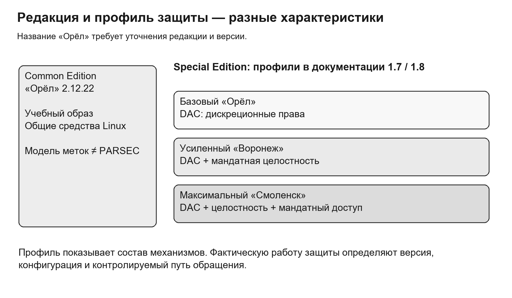
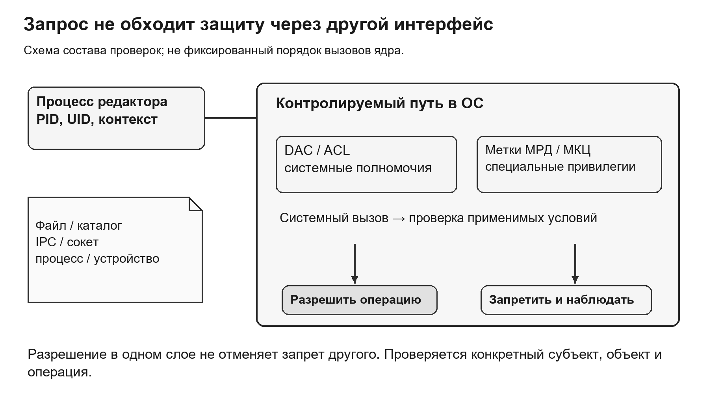
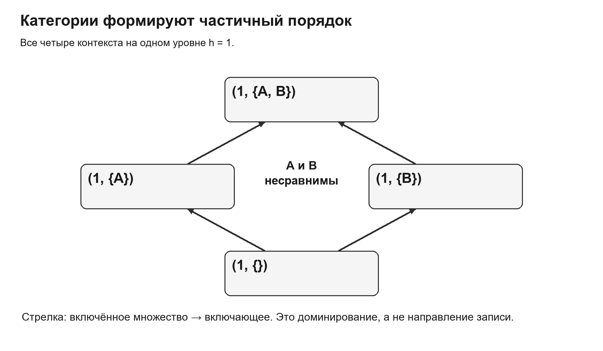
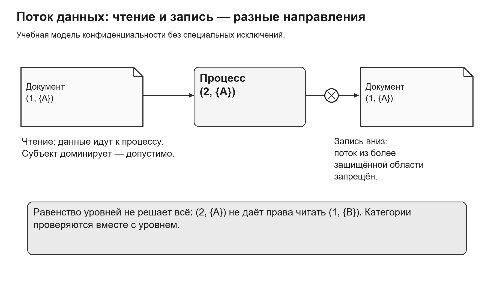
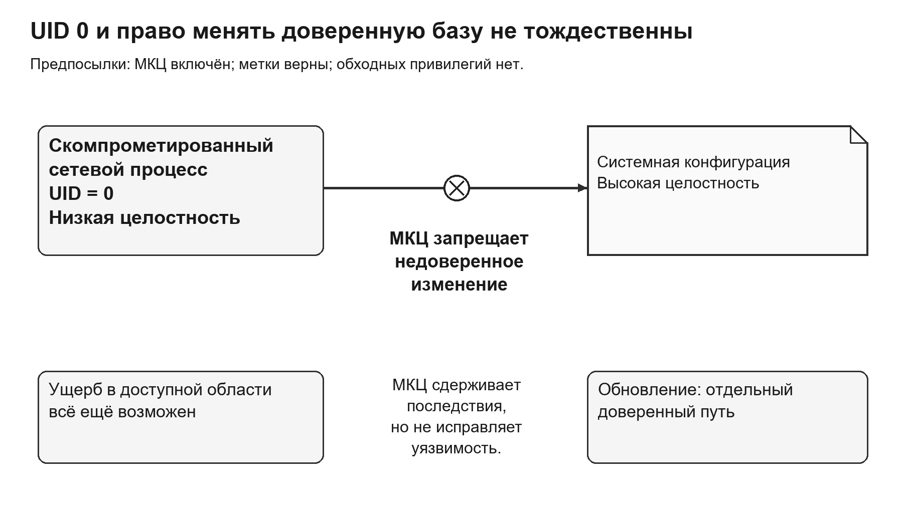
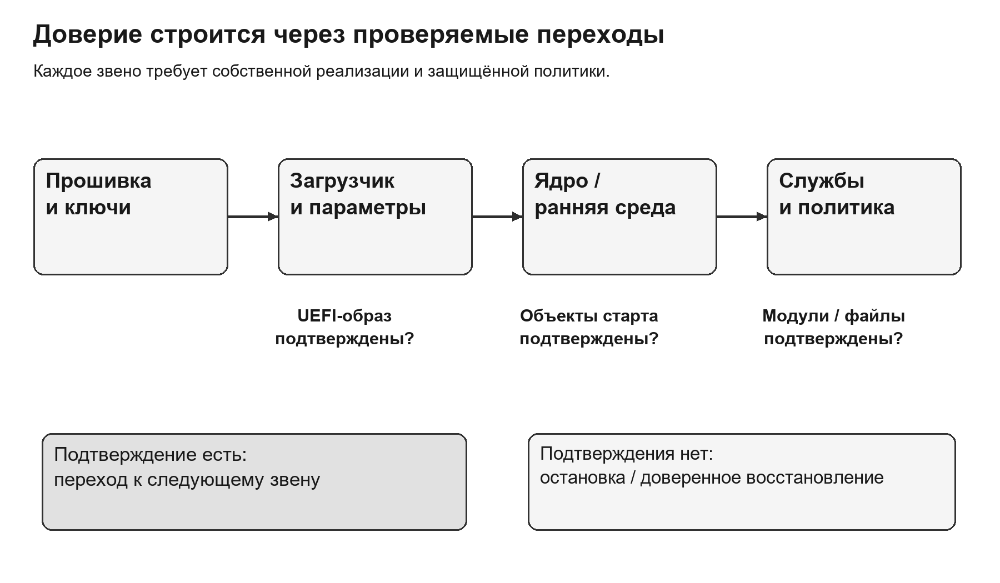
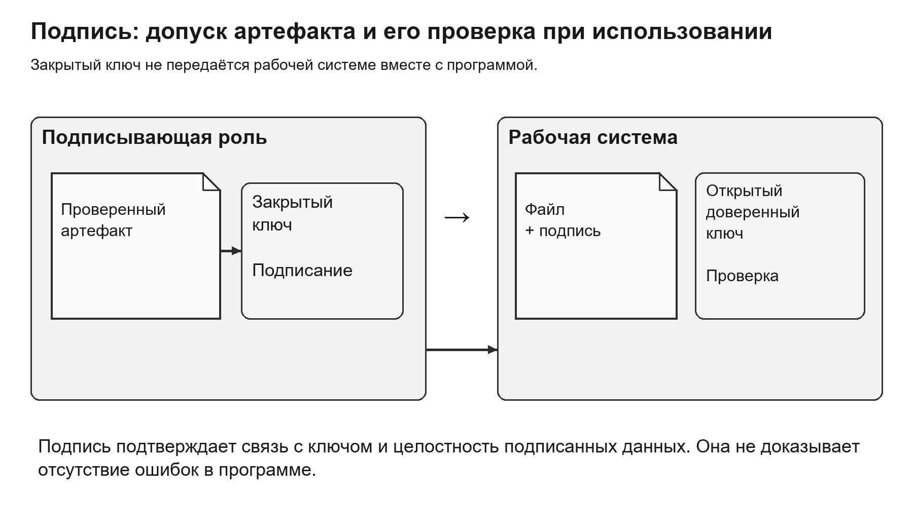
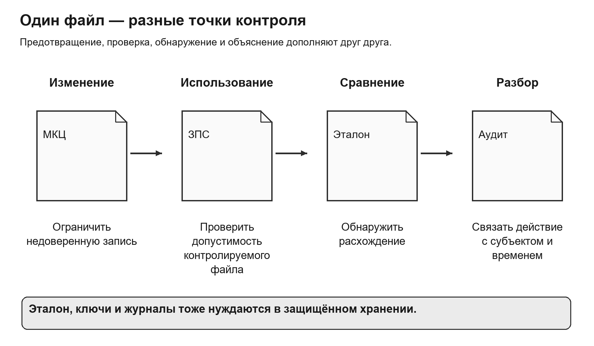
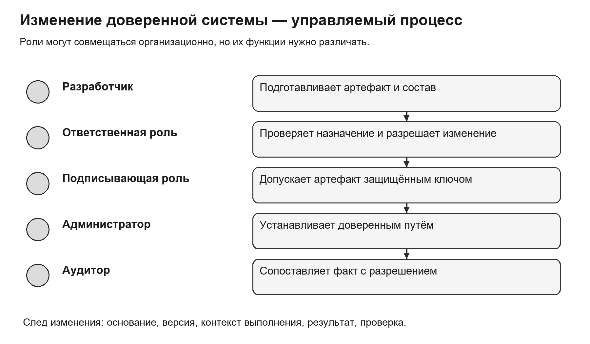

# Лекция 10. Архитектура безопасности Astra Linux

**Дисциплина:** «Операционные системы». **Специальность:** 10.05.01 «Компьютерная безопасность», специализация «Безопасность компьютерных систем и сетей». **Уровень:** университет, 3-й курс. **Продолжительность:** 2 академических часа, 90 минут.

В предыдущей лекции дискреционная, мандатная и ролевая модели рассматривались как способы описания допустимых действий. Теперь необходимо понять, каким образом эти правила становятся обязательными в конкретной операционной системе. Центральный вопрос лекции: почему правильно настроенная защищённая ОС может запретить действие, хотя обычные права файла его разрешают, пользователь успешно прошёл аутентификацию, а процесс даже работает от имени root?

Цель лекции — объяснить архитектуру принудительного выполнения политики безопасности Astra Linux и связь между разграничением доступа, целостностью доверенных компонентов, проверкой загружаемого кода и защищённым администрированием. После изучения материала студент должен различать редакцию и уровень защищённости ОС, объяснять назначение PARSEC, сравнивать метки конфиденциальности, анализировать ограничения процесса с низкой целостностью и оценивать, какие свойства подтверждаются доверенной загрузкой, подписью файла и аудитом.

Изложение опирается на общие механизмы и документацию Astra Linux Special Edition (SE). Упоминание веток 1.7 и 1.8 служит версионной привязкой известных примеров и не означает, что это единственные или последние выпуски продукта. Конкретные возможности, инструменты и допустимые конфигурации определяются документацией установленного обновления. Учебный образ Common Edition «Орёл» 2.12.22 из практикума не следует отождествлять с Special Edition в базовом режиме, также называемом «Орёл». Учебная программная модель меток на Common Edition демонстрирует правила модели, **но не является работой PARSEC**.

## Содержание

1. [Редакции, уровни защищённости и доверенная база](#edition)
2. [PARSEC и принятие решения о доступе](#parsec)
3. [Мандатный доступ и движение конфиденциальной информации](#mac)
4. [Мандатный контроль целостности и ограничение root](#mic)
5. [Доверенная загрузка и сохранение цепочки доверия](#boot)
6. [Замкнутая программная среда и проверка изменений](#cse)
7. [Администрирование, аудит и разбор целостного сценария](#admin)
8. [Вопросы для самоконтроля](#questions)
9. [Основные термины](#terms)
10. [Источники](#sources)

## 1. Редакции, уровни защищённости и доверенная база

Название дистрибутива не описывает полностью состояние его защиты. Для технического анализа необходимо знать редакцию, версию и обновление, выбранный уровень защищённости, реально включённые механизмы и действующую конфигурацию. Две машины с одинаковым оформлением рабочего стола могут выполнять разные проверки доступа. Даже наличие административной утилиты не доказывает, что соответствующая защита работает на пути интересующей операции.

Историческая Common Edition предназначалась для общего использования и не должна автоматически наделяться свойствами специальной защищённой поставки. Special Edition включает комплекс средств защиты, состав и применение которого зависят от выпуска и выбранного уровня. В документации SE встречаются базовый уровень «Орёл», усиленный «Воронеж» и максимальный «Смоленск». Важна связка полного названия и версии: слово «Орёл» без этих уточнений неоднозначно.

Для рассматриваемых в документации SE профилей базовый уровень использует дискреционное разграничение, усиленный добавляет мандатный контроль целостности, максимальный предусматривает также мандатное управление конфиденциальностью. Это характеристика профиля, а не заключение о корректной настройке любой установленной машины. Сравнение приведено на рисунке 1; принципиально, что Common Edition показана отдельно от трёх уровней SE. Версионные особенности следует проверять по [эксплуатационной документации SE 1.8](https://docs.astralinux.ru/latest/doc/alse18/).

Рисунок 1 — Common Edition и уровни защищённости Special Edition

Из этого различия следует важное правило интерпретации учебных результатов. Если Python-программа вычислила запрет чтения по меткам, доказана правильность её алгоритма на выбранных данных. Не доказано, что ядро запретит чтение через обычный системный вызов, что метки сохранятся на другом носителе или что сетевой сервис не создаст обходной путь. Для таких выводов нужен соответствующий выпуск защищённой ОС и проверка его настоящих механизмов.

Уровень защищённости не следует смешивать с уровнем конфиденциальности документа. Первый характеризует профиль механизмов системы, второй — атрибут конкретного субъекта или объекта. «Максимальный профиль» не означает, что всем пользователям надо выдать максимальный допуск. Иначе система увеличит объём сведений, доступных каждому процессу, и последствия компрометации одной сессии.

Сертифицированная поставка также не равна автоматически защищённой информационной системе. Сертификационные свойства относятся к определённым версиям, составу, условиям применения и установленным ограничениям. Без модели угроз, правильной настройки, физической защиты, управления ключами и контролируемых обновлений одно название продукта не обеспечивает требуемого результата. Допустимость конкретного применения оценивают по документации поставки и условиям её использования, а не по общей рекламной характеристике семейства ОС.

Архитектура безопасности начинается с выделения активов. Для университетского сервера такими активами могут быть закрытые материалы двух исследовательских проектов, учётные данные, конфигурация сервисов, ключ подписи внутренних программ и журнал административных действий. Требования к ним различны. Закрытый отчёт нельзя передавать постороннему проекту; конфигурацию службы нельзя позволять изменять уязвимому веб-процессу; ключ подписи нельзя хранить в области, доступной тому, кто собирает непроверенный код.

Доверенная вычислительная база — совокупность аппаратных и программных компонентов, от корректности которых зависит выполнение политики. В неё входят необходимые части прошивки и загрузки, ядро и защитные механизмы, критические службы, хранилища политик и ключей, а также средства, которым разрешено изменять эти компоненты. Например, редактор, открытый администратором в доверенном контексте, на время изменения политики становится существенной частью доверенного пути. Чем больше функций объединено в одном привилегированном процессе, тем сложнее обосновать эту базу.

Доверие здесь означает необходимость полагаться на корректность компонента, а не доказательство его безошибочности. Большая доверенная база увеличивает число компонентов, компрометация которых способна нарушить политику. Поэтому архитектурное улучшение часто состоит в разделении функций: пользовательский сервис обслуживает запросы с ограниченными полномочиями, а небольшой административный компонент меняет конфигурацию только по проверенному запросу.

Далее используются обозначения DAC (Discretionary Access Control) — дискреционное управление доступом и ACL (Access Control List) — список контроля доступа. UID (User Identifier) и GID (Group Identifier) означают числовые идентификаторы пользователя и группы. Мандатный контроль целостности сокращённо обозначается МКЦ; его отличие от конфиденциальности будет разобрано отдельно.

Таблица 1 помогает связать свойства, которые нередко ошибочно объединяют одним словом «защита».

Таблица 1 — Разные вопросы к архитектуре безопасности

| Вопрос | Существенный механизм | Чего одного механизма недостаточно доказать |
|---|---|---|
| Кто вошёл в систему? | Аутентификация, управление сеансом | Какие операции разрешены процессу после входа |
| Может ли процесс прочитать документ? | DAC и мандатный доступ | Подлинность программы и доверенность загрузки |
| Может ли процесс изменить системный файл? | Дискреционные права и МКЦ | Отсутствие ошибок в разрешённом обновлении |
| Допустим ли исполняемый файл? | Проверка программной среды и подписи | Безопасность поведения подписанного кода |
| Изменился ли объект? | Контроль относительно защищённого эталона | Законность и источник изменения без дополнительных сведений |
| Что произошло и кем инициировано? | Регистрация и анализ событий | Предотвращение уже выполненного действия |

Такое разделение объясняет многослойность системы. Механизмы решают разные задачи и должны поддерживать друг друга: защита журнала нужна для достоверности аудита, защита ключа — для смысла подписи, а доверенная загрузка — для обоснованного доверия проверяющему коду.

## 2. PARSEC и принятие решения о доступе

PARSEC — подсистема защиты Astra Linux, с которой связаны мандатные атрибуты, дополнительные привилегии и обязательные проверки доступа. Её нельзя понимать как отдельное приложение, разрешающее обращения только тем программам, которые сами захотели вызвать проверку. В архитектуре защищённой ОС контролируемый путь обращения должен приводить к проверке независимо от желания пользовательской программы. Общие положения и интерфейсы описаны в [документации СЗИ](https://docs.astralinux.ru/latest/szi/szi/).

Когда редактор открывает файл, он не получает доступ к диску напрямую. Запрос проходит через системный вызов, механизмы файловой системы и проверки ядра. Аналогично межпроцессное взаимодействие и сетевые операции имеют собственные контролируемые объекты и пути. Защитная архитектура должна охватывать их достаточно полно, чтобы запрещённый поток нельзя было организовать простым переходом от файла к сокету или общей памяти.

На рисунке 2 показан не буквальный порядок вызовов конкретной версии ядра, а состав условий, которые могут участвовать в решении. Эти условия удобно рассматривать совместно, но нельзя превращать схему в утверждение о неизменной реализации всех операций.

Рисунок 2 — Запрос приложения и обязательные проверки на контролируемом пути

Субъектом большинства обращений является конкретный процесс. Пользовательская учётная запись задаёт разрешённые параметры сеанса, но два процесса одного человека могут работать в разных контекстах. Они могут иметь разные эффективные UID, дополнительные группы, Linux capabilities, метки, ограничения и полномочия PARSEC. Поэтому фраза «пользователю разрешено» не заменяет описание фактического процесса, который выполняет операцию.

Объектом бывает не только обычный файл. Доступ контролируется к каталогам, процессам, устройствам, объектам IPC — межпроцессного взаимодействия, сетевым соединениям и другим поддерживаемым сущностям. Каталог, например, является контейнером: его атрибуты важны для создания и удаления находящихся в нём объектов. Разрешение изменить содержимое файла и разрешение удалить его имя из каталога — разные операции.

При обычном файловом доступе сохраняют значение знакомые средства Linux: UID/GID, биты режима, списки ACL, ограничения файловой системы и системные привилегии. Мандатная защита не делает их ненужными. Если по мандатным меткам чтение допустимо, но дискреционные права запрещают его, доступ не становится разрешённым автоматически. Обратно, разрешающий ACL не отменяет обязательный мандатный запрет.

Для рассуждений удобно записать учебное условие:

`доступ допустим = выполнены все применимые проверки с учётом разрешённых привилегий`.

Слово «применимые» существенно. Не каждая операция проверяется одинаково, не любой вид объекта поддерживает один и тот же механизм, а специальные привилегии способны менять отдельные условия. Формула объясняет совместное действие политик, но не заменяет документацию и анализ кода конкретного пути. Она также не означает, что каждый отказ обязательно имеет единственную очевидную причину в одном журнале.

Рассмотрим редактор отчётов проекта A. Каталог доступен его группе на чтение и запись. Администратор случайно добавил в ACL группу проекта B. В обычной дискреционной модели это может дать B лишний доступ. Если же объект и процессы корректно размечены мандатными категориями A и B, а путь поддерживает обязательный контроль, одного разрешения в ACL недостаточно для разрешения недопустимого чтения. Дополнительная проверка уменьшает последствия ошибки дискреционной настройки.

Однако этот результат не означает, что ошибочный ACL можно оставить без внимания. Он может открыть доступ процессу с совместимой меткой, изменить поведение после переноса данных или оказаться существенным на другом узле. Многослойность нужна для сдерживания последствий ошибки, а не для оправдания неверных настроек одного из слоёв.

Наряду с Linux capabilities существуют привилегии PARSEC. Первые разделяют некоторые традиционные системные полномочия Linux, вторые относятся к специальным операциям и проверкам защитной подсистемы. Эти наборы не взаимозаменяемы. Процесс с UID 0 может не обладать необходимым мандатным контекстом, а выдача специальной привилегии должна рассматриваться как изменение границы доверия.

Доверенный посредник, которому разрешено преобразование контекста или изменение меток, требует особенно строгого анализа входных данных. Если такой посредник принимает от обычного пользователя произвольный путь и без проверки меняет метку указанного файла, он способен превратить узкое полномочие в общий обход. Безопасная архитектура ограничивает набор объектов и операций, проверяет инициатора и основание запроса и регистрирует результат.

## 3. Мандатный доступ и движение конфиденциальной информации

Мандатное управление доступом (МРД; английское MAC — Mandatory Access Control) ограничивает обращение к информации на основе обязательных меток. В отличие от дискреционной модели, владелец файла не может произвольно снять эти ограничения обычным изменением прав. Цель состоит не только в защите отдельного файла, но и в ограничении распространения информации между контекстами обработки.

В [описании МРД разработчика](https://docs.astralinux.ru/latest/szi/szi/mac/) метка конфиденциальности содержит иерархический уровень и неиерархические категории. Уровень задаёт положение по вертикальной шкале, категории — независимые области обработки. Числовое представление и административно утверждённые названия — разные вещи: техническое значение само по себе не является универсальным обозначением юридического грифа. В примерах далее уровни 0, 1 и 2 и категории A/B условны и не устанавливают такую шкалу.

Запишем метку как `L = (h, C)`, где `h` — уровень, `C` — множество категорий. Метка `L₁` доминирует над `L₂`, если одновременно `h₁ ≥ h₂` и `C₁ ⊇ C₂`. Это частичный порядок: часть меток нельзя упорядочить как «выше» и «ниже». Например, `(1, {A})` и `(1, {B})` несравнимы, потому что ни одно множество категорий не включает другое. Метка `(1, {A, B})` доминирует над обеими.

На рисунке 3 приведён фрагмент порядка только по категориям при одном уровне. Стрелки направлены от включённого набора к включающему и показывают отношение доминирования; это **не разрешённые направления записи**.

Рисунок 3 — Включение категорий и несравнимость проектных контекстов

Категории решают задачу, для которой одной числовой шкалы недостаточно. Два исследовательских проекта могут работать с одинаковой степенью конфиденциальности, но не должны видеть документы друг друга. Если различать их только уровнями, один проект неизбежно окажется «выше» другого и получит лишние возможности в простой иерархии. Категории позволяют сохранить одинаковый уровень и разделить тематические области.

Допуск учётной записи и текущий контекст процесса также необходимо разделять. У пользователя может быть право открыть сеанс в нескольких допустимых контекстах. Это не означает, что каждый его процесс одновременно действует на всём диапазоне. Для конкретного обращения важно, в каком контексте запущена текущая сессия и какой контекст унаследовал или получил процесс.

В стандартном ходе работы дочерние процессы наследуют существенные атрибуты безопасности родителя. Метки новых файлов связаны с контекстом создания и атрибутами контейнера. Точные правила наследования, дополнительные атрибуты и разрешённые переходы зависят от режима и версии. Поэтому одного просмотра метки учётной записи недостаточно: процесс мог быть создан в другом сеансе, через специальный инструмент или службу.

Для объяснения конфиденциальности полезна модель Bell–LaPadula. В её упрощённой форме субъект читает объект, если метка субъекта доминирует над меткой объекта: «не читать выше». При записи условие обращается: метка объекта должна доминировать над меткой субъекта, чтобы не возникало переноса сведений вниз. Эти правила относятся к учебной модели; реальные режимы Astra, дополнительные атрибуты и привилегии могут уточнять или ужесточать условия. Нельзя по одному лозунгу предсказать результат всех операций PARSEC.

Конкретный пример такого уточнения — атрибут контейнера `ccnr`, описанный в [интерфейсах PARSEC](https://docs.astralinux.ru/latest/szi/api/headers/pdp_common/). Он позволяет контейнеру содержать сущности с различными допустимыми метками и определяет особенности видимости его содержимого для разных субъектов. Это не разрешение прочитать все файлы каталога: доступность информации об имени и доступ к данным объекта следует различать. Сам факт наличия специальных атрибутов показывает, почему обычный каталог, специальный контейнер и файл нельзя анализировать единственной формулой без уточнения операции.

Разберём процесс с меткой `(2, {A})`. Чтение документа `(1, {A})` укладывается в правило доминирования: уровень достаточен, категория включена. Чтение `(1, {B})` не разрешается в этой модели, хотя уровень документа ниже: отсутствует категория B. Запись в `(1, {A})` опасна, поскольку процесс, имеющий доступ к данным уровня 2, мог бы вынести их в менее защищённый объект. Запись в объект `(2, {A})` не создаёт такого понижения.

На рисунке 4 раздельно показаны чтение и запись. Стрелка чтения направлена **от документа к процессу**, потому что изображает движение данных, а не направление команды open. Это различие предотвращает частую ошибку при чтении схем информационных потоков.

Рисунок 4 — Конфиденциальность: допустимое чтение снизу и запрещённая запись вниз

Почему нельзя разрешить такую запись «только если пользователь обещает не копировать секретные данные»? Операционная система не умеет определять смысл каждого записываемого символа. Процесс мог быть заражён, ошибаться или хранить секрет в памяти. Модель использует контекст как консервативную границу возможного влияния. В этом её сила и одновременно причина эксплуатационных ограничений.

Понижение уровня документа поэтому является отдельной доверенной процедурой. Данные могут стать общедоступными после проверки, удаления чувствительных частей и утверждения публикации. Но обычное копирование файла или команда chmod не должны подменять это решение. Сам факт технической возможности изменить метку не делает такую операцию организационно разрешённой.

Таблица 2 содержит разобранные результаты для упрощённой модели. Во всех строках предполагаются достаточные дискреционные права, отсутствие специальных исключений и обычная операция чтения либо записи.

Таблица 2 — Примеры сравнения меток конфиденциальности

| Субъект | Объект | Операция | Результат учебной модели | Основание |
|---|---|---|---|---|
| `(2, {A})` | `(1, {A})` | Чтение | Допустимо | Субъект доминирует над объектом |
| `(2, {A})` | `(1, {B})` | Чтение | Запрещено | Нет категории B |
| `(1, {A})` | `(2, {A})` | Чтение | Запрещено | Недостаточный уровень |
| `(2, {A})` | `(1, {A})` | Запись | Запрещено | Понижение защиты потока |
| `(1, {A})` | `(2, {A,B})` | Запись | Допустимо по этому правилу | Объект доминирует; реальные дополнительные проверки сохраняются |

У последней строки есть важное ограничение: формальное разрешение записи в простой модели не гарантирует, что конкретный редактор сможет создать или изменить реальный файл. Создание, чтение перед изменением, проход по каталогу и дополнительные атрибуты могут потребовать других прав. Так различаются модель информационного потока и поведение составной пользовательской операции.

Мандатный контроль должен сохранять смысл не только на локальном диске. Программа способна передать сведения через сокет, общий буфер, временный файл, печать или архив. Если один из этих путей не согласован с политикой, помеченный исходный документ ещё не обеспечивает защиту всей цепочки. Поэтому в проектировании учитывают доступ к данным, промежуточное хранение и вывод за пределы узла.

Представим сервис отчётов, который обрабатывает проекты A и B. Даже если конечные каталоги размечены правильно, общий кэш ответов без разделения контекстов может смешать сведения. При архитектурном разборе нужно узнать, в каком процессе исполняются запросы, какие данные он одновременно видит, как создаёт временные объекты и кому передаёт результат. Само наличие меток у двух каталогов не даёт ответа на эти вопросы.

Та же проблема относится к резервному копированию. Копия может содержать документы разных уровней и категорий, а архиватор — выступать доверенным посредником. Необходимо сохранить обязательные атрибуты либо обеспечить равносильную защиту контейнера, ограничить доступ к копии и проверить восстановление меток. Успешная распаковка байтов не равна восстановлению политики доступа.

## 4. Мандатный контроль целостности и ограничение root

Конфиденциальность отвечает на вопрос, куда могут попасть сведения. Целостность — на вопрос, кто или что может повлиять на данные и решения доверенной системы. У этих свойств разные направления опасного потока. Передача секрета в общедоступный файл нарушает конфиденциальность. Изменение системной конфигурации недоверенным процессом нарушает целостность независимо от того, содержит ли конфигурация секрет.

Мандатный контроль целостности (МКЦ; английское MIC — Mandatory Integrity Control) использует обязательные атрибуты доверия субъектов и сущностей. В [описании МКЦ Astra](https://docs.astralinux.ru/latest/szi/szi/mic/) подчёркивается ограничение возможностей суперпользователя. Это позволяет поставить дополнительную границу там, где традиционные дискреционные права слишком сильно зависят от UID 0.

Уровень целостности нельзя считать вторым названием уровня секретности. Открытая системная утилита может не быть конфиденциальной, но должна иметь высокую доверенность: её подмена повлияет на работу всей ОС. Закрытый документ, полученный из внешнего источника, наоборот, может требовать строгого ограничения распространения, но не заслуживать доверия как источник команд. Поэтому обе характеристики необходимы одновременно.

Документация описывает и иерархическую, и неиерархическую составляющие целостности. Числа, которыми обозначают административную и обычную сессию в интерфейсе конкретного выпуска, нельзя автоматически переносить на другой релиз или смешивать с номером уровня конфиденциальности. Для понимания механизма достаточно отношения доверенного влияния; конкретные значения служат параметрами реализации и политики.

В качестве учебного ориентира используется идея Biba: менее доверенный субъект не должен записывать в более доверенный объект. Строгие варианты модели дополнительно ограничивают получение высокодоверенным субъектом данных из менее доверенной области. Однако правила реального МКЦ Astra не следует объявлять буквальной копией всех правил одной абстрактной модели. На решение влияют вид операции, атрибуты контейнера, режим контроля и полномочия процесса.

Рассмотрим уязвимую сетевую службу. Нарушитель добился выполнения кода с UID 0, но служба была запущена в низкоцелостном контексте и не получила полномочия обхода обязательной проверки. Попытка изменить высокоцелостный файл конфигурации должна встретить дополнительный запрет. На рисунке 5 показано, почему «стать root» и «получить право изменять доверенную базу» в такой архитектуре — разные события.

Рисунок 5 — МКЦ ограничивает изменение высокоцелостного объекта низкоцелостным root

Этот сценарий не означает неуязвимость системы. Компрометированный процесс по-прежнему опасен для объектов своей области, может читать доступные сведения, нарушать обслуживание запросов или искать ошибку в доверенном компоненте. МКЦ уменьшает возможный ущерб и затрудняет закрепление в защищённой системной области, но не отменяет исправление уязвимости и расследование.

Чтобы такое ограничение имело смысл, нужна корректная маркировка и отсутствие чрезмерных привилегий. Если сервису выдали полномочие изменять нужный высокоцелостный объект, запрет из примера не следует ожидать. Поэтому проектирование начинается с назначения службы и необходимых операций, а не с включения максимального профиля. Полномочие, предоставленное ради удобства настройки, может разрушить целевое свойство защиты.

С другой стороны, высокоцелостный администратор должен иметь доверенный путь обновления. Если любой способ изменения системных файлов запрещён, система становится неуправляемой и не сможет получать исправления. Правильное решение — отдельный административный контекст, проверенный источник пакетов, ограниченный набор инструментов, согласование изменений и регистрация результата. Защита должна отличать предусмотренное обслуживание от влияния скомпрометированного сервиса.

Особое значение имеют каталоги. Системный файл может быть защищён, но для полного разбора нужно проверить операции создания, переименования и замены через родительский каталог. Кроме того, новая версия файла должна получать правильные атрибуты. Именно поэтому анализ не ограничивают сравнением двух чисел меток: важны контейнер и способ обновления объекта.

В Astra существуют обычный и расширенный режимы мандатного контроля с версионно зависимыми правилами и дополнительными атрибутами. Из этого не следует рекомендация включать всё без проверки совместимости. Средство обновления, сервер, резервное копирование и графический сеанс могут зависеть от разных способов создания объектов. Усиление контроля требует проверки этих путей, чтобы не превратить штатную процедуру в неработающую и не провоцировать отключение защиты.

Характерный версионный пример — атрибут SSI в ветке 1.8, связанный с ограничением чтения и выполнения по целостности. Его нельзя механически переносить на прежние ветки. Если в знакомой конфигурации МКЦ прежде всего препятствовал записи вверх, это не даёт основания утверждать, что любой файл на любом выпуске автоматически защищён также от чтения менее целостным процессом. Обратное упрощение — считать, что ограничений чтения по целостности не бывает вообще, — столь же неверно.

Типовая опасная конфигурация — повседневный браузер и административный редактор в одной высокоцелостной сессии. Внешний документ или веб-страница становятся входными данными процесса, которому доверено слишком многое. Разделение сеансов и ролей уменьшает число таких связей. Рабочее удобство следует обеспечивать контролируемым обменом, а не постоянным предоставлением максимального доверия всем приложениям пользователя.

Таблица 3 сопоставляет два независимых ограничения на примере сервера проектов.

Таблица 3 — Конфиденциальность и целостность в одном обращении

| Ситуация | Вопрос конфиденциальности | Вопрос целостности |
|---|---|---|
| Пользователь читает закрытый отчёт | Достаточны ли допуск и категории? | Можно ли доверять содержимому для дальнейших решений? |
| Сервис принимает загруженный документ | Кому разрешена обработка и выдача? | Может ли внешний документ влиять на системные команды? |
| Низкоцелостный root изменяет unit службы | Уровень секрета обычно не главный | Есть ли право влиять на высокодоверенную конфигурацию? |
| Администратор публикует отчёт наружу | Согласовано ли понижение защиты? | Высокое доверие к администратору не заменяет разрешение раскрытия |
| Обновляющий процесс заменяет программу | Согласован ли контекст обработки? | Подтверждены ли источник, полномочия и новые атрибуты? |

В результате безопасность не сводится к единой шкале «больше уровень — лучше». Повышение одного атрибута может дать дополнительные возможности или создать несовместимость. Требуется согласованная политика, при которой процесс имеет достаточно полномочий для своей функции и не получает ненужных путей влияния.

## 5. Доверенная загрузка и сохранение цепочки доверия

До сих пор предполагалось, что проверки выполняет правильное ядро с правильной конфигурацией. Но если нарушитель может заменить загрузчик, запустить другую ОС или изменить параметры старта защитных механизмов, последующее решение о доступе теряет основание. Поэтому архитектура должна объяснять, почему доверять можно самому проверяющему коду.

Доверенная загрузка — построение контролируемого перехода от начальной доверенной точки к рабочей системе. Это не одна галочка в настройках и не просто успешное появление экрана входа. Нужно определить, какие компоненты проверяются, какими ключами, что происходит при несовпадении и какие пути восстановления доступны уполномоченной роли.

UEFI (Unified Extensible Firmware Interface) — унифицированный расширяемый интерфейс прошивки. Механизм UEFI Secure Boot проверяет допустимость загружаемых UEFI-образов на основе политики прошивки, баз доверия и запретов. Он может быть звеном цепочки, но не охватывает автоматически всю конфигурацию ОС и все пользовательские программы. Назначение механизма описано в [спецификации UEFI](https://uefi.org/specs/UEFI/2.11/32_Secure_Boot_and_Driver_Signing.html). Для конкретной платформы необходимо отдельно знать, кто и как проверяет ядро, раннюю среду, модули и конфигурацию.

На рисунке 6 изображена **проектируемая** цепочка проверок. Надпись у каждого перехода обозначает требуемое свойство, а не утверждение, что оно обеспечивается по умолчанию любой Astra. Компонент, который никто не проверяет и который можно подменить, становится разрывом цепочки.

Рисунок 6 — Цепочка доверия и прекращение перехода при неподтверждённом компоненте

Начальная доверенная точка сама требует защиты. Если злоумышленник может бесконтрольно изменить доверенные ключи прошивки или разрешить альтернативный запуск, последующие проверки окажутся настроены уже по его правилам. Поэтому важны физический доступ, полномочия изменения прошивки, контроль носителей, резервные ключи и согласованная процедура восстановления.

Загрузчик и его конфигурация создают следующую границу. Наличие подписанного ядра ещё не означает безопасные параметры его старта. Возможность произвольно отредактировать командную строку, выбрать непроверенный образ или запустить аварийную оболочку может изменить свойства системы. В конкретной конфигурации требуется выяснить, какие параметры аутентифицированы, какие ограничения действуют в меню и как защищено восстановление.

Ранняя пользовательская среда, часто связанная с initramfs, выполняет действия до запуска обычных служб. Поэтому её содержимое также существенно для доверия. Нельзя считать, что подпись одного файла автоматически охватывает все связанные файлы. Требуется знать реальный формат загрузки и способы проверки выбранной поставки. Это пример того, почему архитектурное утверждение должно сопровождаться указанием на проверяемые объекты.

После запуска ядра важны правила загрузки модулей, защита интерфейсов ядра и целостность компонентов, запускающих службы. Подписанный загрузчик не предотвращает последующую установку неправильного пакета администратором. Доверие необходимо сохранять во времени: пакетное обновление, смена ключа и аварийная загрузка изменяют рабочую цепочку и требуют проверки.

Следует также различать проверяемую и измеряемую загрузку. Проверка может не допустить компонент, не удовлетворяющий политике. Измерение записывает сведения о загружаемых компонентах в защищённое состояние измерительного механизма для последующей оценки. Сам факт измерения ещё не запрещает запуск. В архитектуре важно сформулировать, какой результат нужен: остановка неподтверждённого кода, возможность аттестации состояния или оба свойства.

В виртуальной машине часть доверия переносится на гипервизор и администратора хоста. Гостевая система может контролировать собственную загрузку, но владелец хранилища ВМ способен влиять на виртуальное оборудование и файлы образа в пределах полномочий хоста. Поэтому успешное включение гостевого Secure Boot не доказывает защиту от администратора недоверенного гипервизора.

Снимок ВМ полезен для возврата конфигурации, но не является универсальным доказательством доверенности. Он может содержать уже изменённую систему, утраченные ключи или недостоверный журнал. Восстановление старого снимка также возвращает старые версии и события времени. Доверенный возврат должен учитывать актуальность пакетов и политики, а не только удобство запуска после отката.

## 6. Замкнутая программная среда и проверка изменений

Даже правильная загрузка не завершает защиту программной среды. После входа могут запускаться новые утилиты, библиотеки и сценарии, обновляться пакеты и изменяться конфигурация. Нужно определить, откуда берётся право доверять новому коду и каким образом выявляется его неподтверждённое изменение.

Замкнутая программная среда (ЗПС) предназначена для контроля допустимости файлов на основании предусмотренных механизмом проверок, в том числе цифровых подписей. [Документация Astra о ЗПС](https://docs.astralinux.ru/latest/szi/szi/cse/) описывает динамический контроль с помощью модуля ядра digsig_verif и разные формы размещения подписи. Состав контролируемых типов файлов и пути проверки зависят от реализации и режима. Нельзя сводить механизм к проверке расширения имени файла.

Цифровая подпись связывает конкретное содержимое с ключом подписи. Проверяющая сторона использует открытый ключ, а закрытый ключ должен оставаться у уполномоченного подписывающего. Изменение подписанного содержимого должно приводить к отрицательному результату проверки в пределах применяемого алгоритма и политики доверия. Однако сама проверка ничего не говорит о качестве алгоритма программы или отсутствии ошибок в её логике.

На рисунке 7 разделены подготовка допуска программы и её последующий запуск. Это разные моменты и разные роли. Подписание не обязано происходить на машине, где затем работает пользователь; наоборот, изоляция закрытого ключа от рабочей среды уменьшает последствия её компрометации.

Рисунок 7 — Закрытый ключ у подписывающей роли, открытый ключ у проверяющей системы

Пусть внутренняя утилита сформирована из проверенных исходных текстов, протестирована и одобрена к использованию. Подписывается именно получившийся артефакт с зафиксированным составом. Если после тестирования другой процесс подменил бинарный файл, подпись должна относиться уже к другому содержимому или оказаться неверной. Если же подписывающая роль не проверяет, что именно она подписывает, криптографически корректная подпись закрепит доверие к ошибочному объекту.

Поэтому подпись — техническая часть процедуры допуска, а не её замена. Необходимы происхождение исходных текстов, контроль сборки, проверка зависимостей, разделение полномочий, защита ключа и возможность отзыва доверия. Компрометация закрытого ключа меняет ситуацию принципиально: проверка способна принять новый вредоносный файл, если он правильно подписан ключом, который всё ещё считается доверенным.

ЗПС не следует отождествлять с антивирусом или песочницей. Она ограничивает определённые пути допуска кода и контролируемых файлов. Подписанная программа может иметь уязвимость и обратиться к данным, к которым ей не следует иметь доступ по смыслу задачи. Её полномочия всё равно необходимо ограничивать DAC, МРД, МКЦ и изоляцией. Проверка происхождения кода и ограничение его поведения дополняют друг друга.

Особенно внимательно рассматривают интерпретаторы и библиотеки. Сценарий не обязательно исполняется как самостоятельный машинный код: интерпретатор читает его и выполняет команды. Без проверки реального пути открытия контролируемого файла нельзя заключить, что один проверенный интерпретатор делает доверенными любые его входные данные. Аналогично допустимость основной программы не отвечает автоматически на вопрос обо всех динамически загружаемых компонентах.

Подпись пакета в процессе доставки и подпись файла для проверки при использовании также различаются. Пакетная система подтверждает доверие к метаданным/содержимому поставки в рамках своей схемы. Проверка при запуске оценивает файл в момент использования по другой политике и набору ключей. Между установкой и запуском файл мог измениться. Поэтому нельзя переносить результат одной проверки на другой этап без обоснования.

Контрольная сумма решает более узкую задачу — сравнение содержимого с эталоном. Если хеш изменился, изменились данные или алгоритм/представление проверки. Если хеш совпал с надёжно сохранённым эталоном, это подтверждает совпадение контролируемого содержимого в пределах стойкости алгоритма. Но файл с опубликованной рядом контрольной суммой может быть одинаково легко подменён вместе с ней. Для смысла сравнения нужен защищённый эталон и известное происхождение.

Кроме содержимого важны атрибуты. Исполняемый файл мог сохранить байты, но получить другую владельческую группу, ACL, capabilities или мандатные метки. Конфигурация может быть заменена ссылкой на другой путь. Набор контролируемых свойств должен соответствовать угрозе. Проверка только SHA-256 не доказывает неизменность всей политики доступа.

На рисунке 8 сопоставлены моменты действия механизмов. МКЦ ограничивает недопустимое изменение, проверка подписи оценивает контролируемый объект при использовании, сравнение с эталоном обнаруживает расхождение, аудит связывает наблюдение с событием и контекстом. Это разные доказательства, поэтому они не заменяют друг друга.

Рисунок 8 — Разные точки контроля в жизненном цикле защищаемого файла

Обновление доверенного эталона само является административной операцией. Если после любого обнаруженного расхождения автоматически объявлять текущее состояние новым нормальным, контроль перестанет отличать вторжение от обслуживания. Сначала устанавливают причину изменения, подтверждают разрешённость и проверяют новую версию, затем обновляют эталон и сохраняют связь с основанием.

Обратная ситуация — невозможность легитимного обновления из-за неподготовленного режима — также опасна. Администратор может начать обходить защиту или надолго оставить уязвимую версию. Поэтому архитектура должна включать предусмотренный путь установки подписанных обновлений, восстановления ключей и исправления ошибочной маркировки. Этот путь ограничивают и регистрируют столь же тщательно, как обычную работу.

## 7. Администрирование, аудит и разбор целостного сценария

Система средств защиты управляется через административные инструменты, политики, базы атрибутов и ключи. Эти объекты относятся к наиболее чувствительной части доверенной базы. Если процесс может произвольно изменить правила, обязательная проверка начнёт добросовестно выполнять уже чужую политику. Поэтому административная плоскость должна быть защищена и от обычных пользователей, и от чрезмерно широких полномочий служебных процессов.

Разделение обязанностей означает, что подготовка изменения, его разрешение, выполнение и проверка не обязательно поручены одному человеку или одному процессу. Даже в небольшой организации полезно различать эти функции. Разработчик может подготовить новую утилиту, ответственный проверить её назначение, подписывающая роль допустить артефакт, администратор установить его, а аудитор сопоставить выполненное действие с разрешённым изменением.

На рисунке 9 изображён такой путь. Согласование не передаёт закрытый ключ разработчику, а факт установки не уничтожает сведения о прежней версии. Разделение ролей уменьшает число действий, которые один ошибочный или скомпрометированный компонент может выполнить незаметно.

Рисунок 9 — Подготовка, допуск, выполнение и проверка изменения

Средства диагностики и изменения мандатных атрибутов существуют в командной и графической форме. В документации встречаются семейства pdp-*, pdpl-* и оснастка управления политикой безопасности. Имя утилиты не гарантирует одинакового синтаксиса во всех выпусках. Пример команды из интернета необходимо соотнести с версией и поддерживаемым режимом. В этой лекции архитектурные рассуждения не подменяются универсальным набором команд включения защиты.

Для безопасного анализа отказа сначала устанавливают событие, а затем изменяют политику. Нужны время, PID процесса, эффективные UID/GID, дополнительные группы, Linux capabilities, мандатный контекст, полномочия PARSEC, фактический объект и операция. Для файлового пути рассматривают также каталоги, ссылочные переходы и способ создания объекта. Сообщение Permission denied само по себе не указывает, какой из этих факторов стал причиной.

Пусть обновляющая утилита не смогла заменить конфигурацию. Нельзя сразу выдавать ей максимальные полномочия. Причиной могут быть неверный владелец, недостаточные дискреционные права, другой контекст процесса, защита каталога, режим файловой системы или отсутствие доверенного пути изменения. Изменение сразу нескольких механизмов уничтожит возможность понять исходную причину и может открыть лишний доступ.

Правильный разбор формулирует гипотезу об одной проверке и сопоставляет её с наблюдениями. Если предполагается запрет МКЦ, нужно показать, что процесс действительно имеет недостаточный контекст и что объект принадлежит более доверенной области, а не просто сослаться на наличие Astra. Аналогично ошибка проверки подписи не должна объясняться меткой конфиденциальности без соответствующих доказательств.

Аудит превращает такое рассуждение в проверяемую историю. Важны инициатор, действие, объект, контекст, результат и время. [Документация Astra по регистрации событий](https://docs.astralinux.ru/latest/szi/szi/aea/) описывает системные журналы и аудит безопасности. Фактический источник и поля зависят от механизма, правил и выпуска: не каждое событие обязательно находится в одном универсальном файле, а отсутствие записи не доказывает отсутствие действия.

Следует различать журнал службы, сообщения ядра и события аудита. Веб-сервис может записать HTTP-запрос, но это не означает, что он зарегистрировал изменение мандатной метки. Событие входа не объясняет автоматически последующее обращение дочернего процесса к файлу. Для корреляции нужны идентификаторы, временные связи и понимание, какие источники что наблюдают.

Журнал также является объектом защиты. Если тот же недоверенный процесс способен удалить следы своих действий, аудит теряет доказательную ценность. Полезны защищённое хранение, разграничение доступа, контроль доступности и переполнения, синхронизация времени и централизованная передача. Но удалённый приёмник создаёт собственную границу доверия: следует учитывать аутентификацию источника, надёжность доставки и права на хранилище.

Аудит не должен собирать произвольный поток «на всякий случай». Для архитектуры важны события, связанные с угрозами: изменение атрибутов безопасности, управление привилегиями, неподтверждённый запуск, отказ обязательного доступа, изменение загрузочной конфигурации, отключение наблюдения. Избыточный сбор способен ухудшить анализ и доступность, особенно если хранилище не рассчитано на объём.

Вернёмся к серверу проектов A и B. Документы находятся в отдельных мандатных категориях; рабочие процессы не объединяют эти категории без необходимости. Веб-служба запускается с ограниченными дискреционными полномочиями и низкой целостностью; системные файлы и политика находятся в доверенной области. Обновления проходят отдельный путь допуска и установки, ключ подписи недоступен веб-процессу, журналы защищены от его изменения.

В этой системе возможны четыре принципиально разных наблюдения. Процесс A не читает документ B из-за несовместимых категорий. Веб-процесс с UID 0 не меняет защищённую конфигурацию из-за недостаточного контекста целостности. Новый неподтверждённый исполняемый файл не проходит предусмотренную проверку программной среды. Разрешённое обновление, напротив, применяется доверенным административным процессом и оставляет проверяемый след.

Эти результаты нельзя объединить единственным словом «запрещено». Каждый относится к своей политике и должен иметь собственное объяснение. Если запрос B был отклонён веб-приложением до обращения к ядру, это ещё не доказывает действие мандатного механизма. Если файл не выполнился из-за отсутствующего бита x, это не доказательство ЗПС. Если административная команда не стартовала из-за неправильного пути, это не подтверждение ограничения root средствами МКЦ.

Таблица 4 показывает, какое различение необходимо при оценке результата. Это разобранные критерии доказательства, а не самостоятельное практическое задание.

Таблица 4 — Что подтверждает результат и что ещё нужно исключить

| Наблюдение | Возможное свойство защиты | Альтернативное объяснение, которое следует проверить |
|---|---|---|
| Проект A не получил документ B | Мандатное разделение категорий | Приложение не обращалось к файлу или ошиблось адресом |
| UID 0 не изменил конфигурацию | Ограничение низкоцелостного субъекта | Раздел read-only, неверный путь или иной запрет |
| Неподписанный файл не запустился | Работа предусмотренного контроля допуска | Нет права исполнения, неверный формат, отсутствует загрузчик |
| После обновления служба работает | Сохранена штатная функция | Не проверены старые запреты и метки новых объектов |
| В журнале есть отказ | Наблюдаемость события | Не установлена связь с нужным PID, временем и объектом |

Для обоснования политики нужны положительное подтверждение предусмотренной функции, отрицательное подтверждение конкретного запрета, событие с достаточным контекстом и проверка сохранения прежних требований после изменения. При этом не каждый механизм обязан регистрировать всё одинаково: доказательство проектируют по его действительным возможностям. Если обязательная часть наблюдения отсутствует, вывод ограничивают имеющимися данными.

После установки новой версии утилиты следует заново оценить не только возможность запуска, но и её контекст, создаваемые файлы, сохранность категорий, целостность конфигурации и доступность журнала. Обновление может поменять зависимости или способ создания объектов, даже если пользовательский интерфейс выглядит прежним. Регрессионная проверка нужна именно для сохранения ранее действовавших свойств.

Архитектурный итог темы состоит в согласовании границ доверия. Мандатный доступ ограничивает движение конфиденциальных данных, МКЦ — недоверенное влияние на системную область, доверенная загрузка — основания доверять стартующему коду, ЗПС — предусмотренный допуск файлов, аудит — наблюдаемость действий. Работоспособная система связывает эти механизмы с минимальными полномочиями, реальными ролями и предусмотренным путём восстановления. Ни один отдельный включённый режим не заменяет этой связи.

## Вопросы для самоконтроля

1. Чем редакция Common Edition отличается от уровня «Орёл» в Special Edition и почему одного этого слова недостаточно?
2. Почему наличие сертификата или защитной утилиты не доказывает требуемое состояние конкретной системы?
3. Какие компоненты составляют доверенную вычислительную базу и почему её стараются сокращать?
4. Почему субъектом проверки обычно является процесс, а не просто имя пользователя?
5. Почему разрешающий ACL не отменяет мандатный запрет?
6. Что означает доминирование меток и почему категории создают частичный порядок?
7. В какую сторону движутся данные при чтении и почему это важно для изображения потоков?
8. Чем текущий контекст процесса отличается от допустимого диапазона учётной записи?
9. Почему низкоцелостный root может не иметь права изменять системную конфигурацию?
10. Чем целостность отличается от конфиденциальности на примере открытой системной утилиты?
11. Почему МКЦ нельзя без оговорок объявлять точной реализацией всех правил строгой Biba?
12. Какие границы охватывает UEFI Secure Boot и какие проверки нужно обосновывать отдельно?
13. Чем измерение загрузки отличается от запрета неподтверждённого запуска?
14. Почему цифровая подпись не доказывает отсутствие уязвимостей в программе?
15. Чем пакетная проверка при установке отличается от проверки файла при использовании?
16. Почему контрольная сумма без защищённого эталона может дать ложное чувство уверенности?
17. Какие сведения необходимы, чтобы объяснить конкретный отказ, а не только зафиксировать его?
18. Почему восстановление архива должно проверять метки и права, а не только байты файлов?
19. Зачем разделять подготовку, подписание, установку и аудит изменения?
20. Чем результат учебного моделирования на «Орле» отличается от проверки настоящего PARSEC?

## Основные термины

**Дискреционное управление (DAC)** — разграничение, в котором права на объект в существенной части определяются его владельцем и дискреционной политикой. **Мандатное управление (МРД, MAC)** — обязательный контроль доступа и информационных потоков на основе атрибутов безопасности. **Мандатный контроль целостности (МКЦ, MIC)** — обязательное ограничение влияния субъектов на сущности с учётом доверенности.

**Контекст процесса** — существенные атрибуты, с которыми выполняется конкретный субъект. **Доминирование** — отношение сравнения уровня и включения категорий. **PARSEC-привилегия** — специальное полномочие защитной подсистемы; оно не тождественно Linux capability. **Доверенный посредник** — компонент, которому поручен строго определённый переход или преобразование через границу политики.

**Доверенная загрузка** — контролируемое построение рабочей системы от принятой начальной доверенной точки. **ЗПС** — замкнутая программная среда, контролирующая допустимость предусмотренных файлов по установленной политике. **Эталон целостности** — защищённое описание ожидаемого состояния контролируемых объектов. **Аудит** — получение и анализ сведений о событиях, достаточных для проверки действий и решений системы.

## Источники

1. Рабочая программа дисциплины «Операционные системы», специальность 10.05.01, 2024, комплект к аккредитации: раздел 4.1, тема 10 «Архитектура безопасности Astra Linux». Локальный исходник преподавателя.
2. Исходные материалы преподавателя: «Лекция 10. Архитектура безопасности Astra Linux», DOCX; лекция 9 о моделях разграничения доступа. Использованы для преемственности содержания, с переработкой структуры и примеров.
3. [Курс ALD Pro, модуль 22: мандатное управление доступом и контроль целостности в Astra Linux SE](https://www.aldpro.ru/professional/ALSE_Module_22/ALSE_mac_mic.html). Открытый учебный материал по теме.
4. [Жмуров Д. Б., Жуков С. В. Программно-аппаратные средства защиты информации. Самарский университет, 2022](https://repo.ssau.ru/jspui/bitstream/123456789/57536/1/978-5-7883-1799-1_2022.pdf). Раздел 3: защищённая ОС Astra Linux и архитектура подсистемы защиты. Исторический учебный источник; не справочник актуальных команд.
5. [Astra: СЗИ ОС СН](https://docs.astralinux.ru/latest/szi/szi/).
6. [Astra: мандатное управление доступом](https://docs.astralinux.ru/latest/szi/szi/mac/).
7. [Astra: мандатный контроль целостности](https://docs.astralinux.ru/latest/szi/szi/mic/).
8. [Astra: замкнутая программная среда](https://docs.astralinux.ru/latest/szi/szi/cse/).
9. [Astra: регистрация и аудит событий](https://docs.astralinux.ru/latest/szi/szi/aea/).
10. [Astra Linux SE: эксплуатационная документация очередного обновления 1.8](https://docs.astralinux.ru/latest/doc/alse18/). Для определения состава и условий использования конкретного выпуска.
11. [UEFI Specification 2.11: Secure Boot and Driver Signing](https://uefi.org/specs/UEFI/2.11/32_Secure_Boot_and_Driver_Signing.html).
12. [Официальная программа AL-1705 «Безопасность в ОС Astra Linux Special Edition 1.7»](https://astra.ru/training/authorized-training/section.php?SECTION_ID=1051). Использована для сопоставления охвата темы, а не как полный текст лекции.
13. [Astra: определения дополнительных атрибутов PARSEC, pdp_common.h](https://docs.astralinux.ru/latest/szi/api/headers/pdp_common/). Для понимания зависимости правил от типа сущности и дополнительных атрибутов.

Дата проверки сетевых источников: 26 октября 2026 года. Все изображения — авторские учебные схемы; обозначенные на них уровни, категории и роли служат объяснению механизмов.
