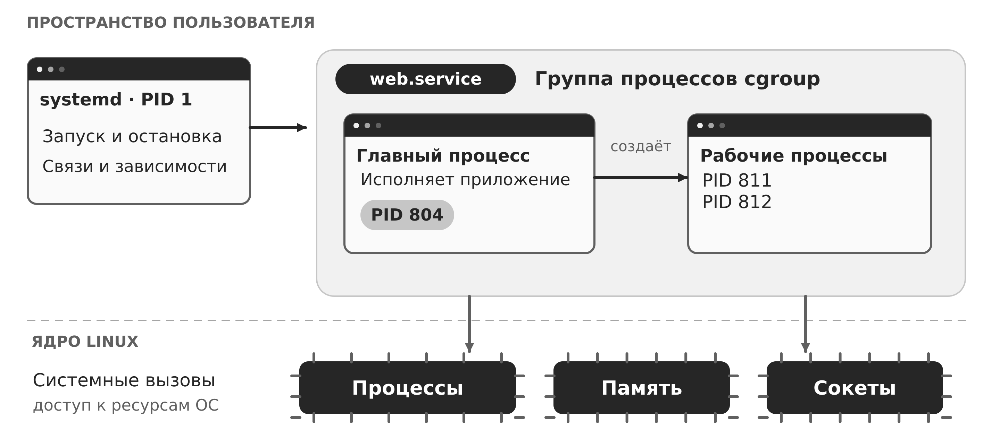
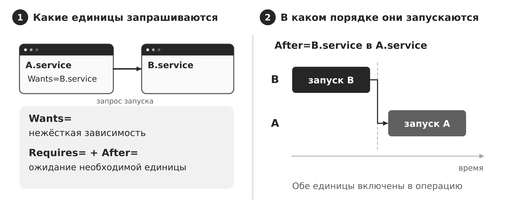
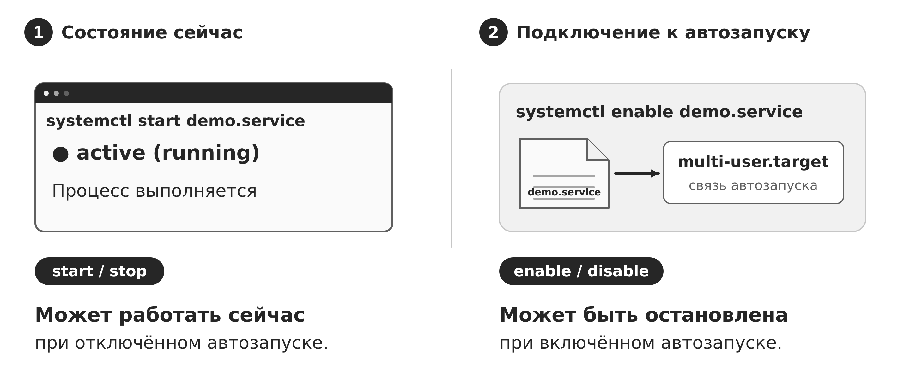
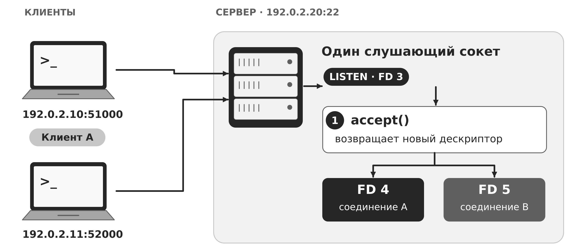
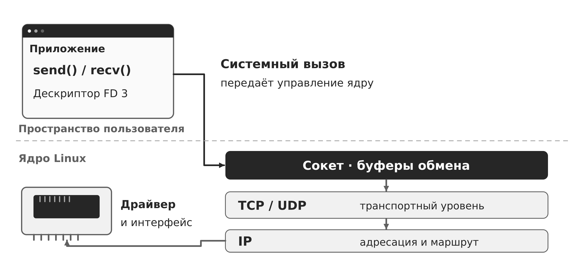
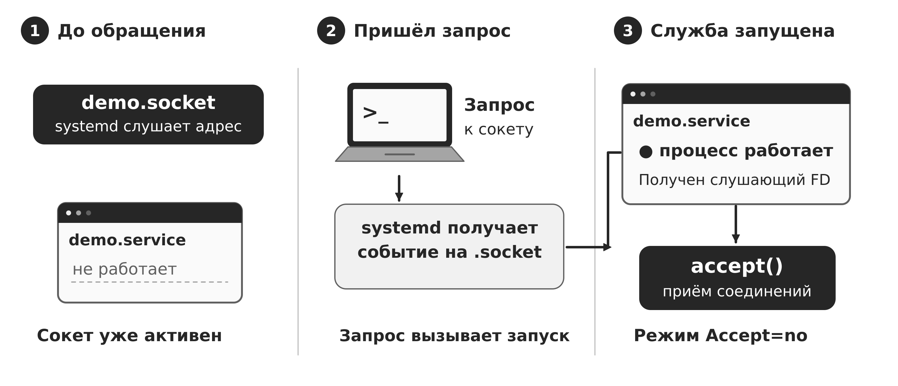
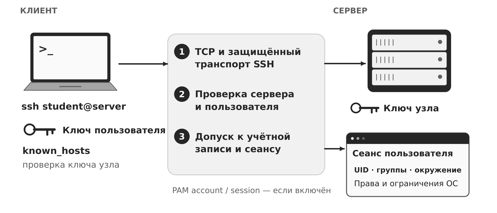
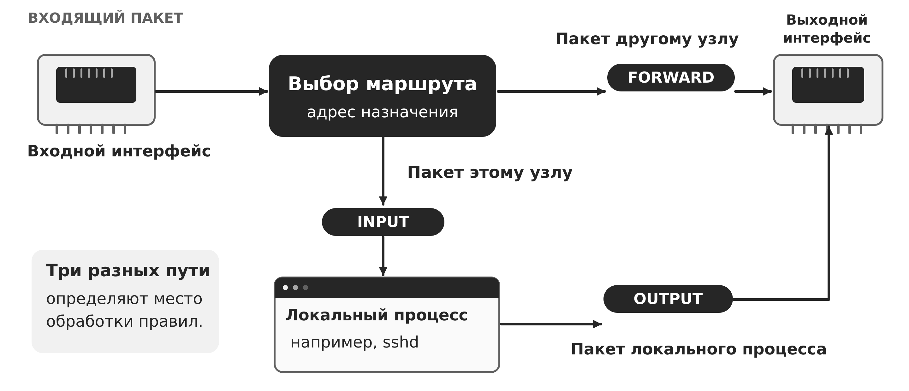
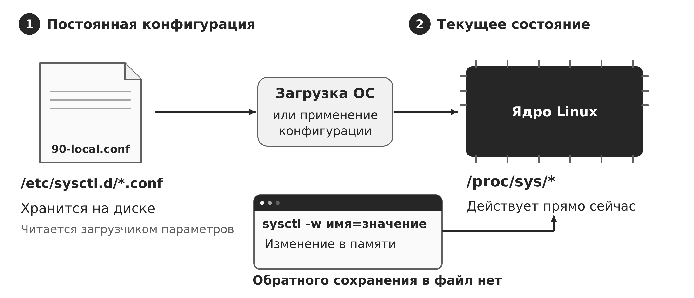

# Тема 11. Службы, сеть и безопасная конфигурация ОС

**Дисциплина:** Операционные системы. **Специальность:** 10.05.01 «Компьютерная безопасность». **Уровень:** университет, 3-й курс. **Продолжительность:** 90 минут.

Лекция посвящена механизмам организации служб и сетевого взаимодействия в Linux. После изучения материала студент сможет объяснить жизненный цикл службы, прочитать основные зависимости systemd, связать процесс с сокетом и сетевой доступностью, различить текущую и постоянную конфигурацию. Настройки безопасности рассматриваются как часть администрирования и корректной работы ОС.

Материал опирается на управление процессами, памятью, правами пользователей и архитектуру Astra Linux из предыдущих тем. Он создаёт основу для последующего изучения обновлений и журналирования. Примеры ориентированы на системы Astra Linux и Kali Linux с systemd. Их точное поведение определяется установленными версиями и конфигурацией.

## Оглавление

- [1. Служба как способ организации работы ОС](#1-служба-как-способ-организации-работы-ос)
- [2. systemd: единицы, зависимости и состояния](#2-systemd-единицы-зависимости-и-состояния)
- [3. Жизненный цикл и конфигурация службы](#3-жизненный-цикл-и-конфигурация-службы)
- [4. Сокеты и сетевой стек операционной системы](#4-сокеты-и-сетевой-стек-операционной-системы)
- [5. Сокетная активация и инвентаризация](#5-сокетная-активация-и-инвентаризация)
- [6. SSH как системная служба удалённого доступа](#6-ssh-как-системная-служба-удалённого-доступа)
- [7. Межсетевое экранирование в сетевом стеке](#7-межсетевое-экранирование-в-сетевом-стеке)
- [8. Параметры ядра и область действия настроек](#8-параметры-ядра-и-область-действия-настроек)
- [9. Минимальная конфигурация и локализация неисправностей](#9-минимальная-конфигурация-и-локализация-неисправностей)
- [10. Изменение конфигурации и проверка результата](#10-изменение-конфигурации-и-проверка-результата)
- [11. Основные понятия и вопросы для самоконтроля](#11-основные-понятия-и-вопросы-для-самоконтроля)
- [12. Источники](#12-источники)

## 1. Служба как способ организации работы ОС

Операционная система обеспечивает выполнение приложений и одновременно поддерживает собственную инфраструктуру: настройку сети, вход пользователей, печать, обмен сообщениями, синхронизацию времени. Многие такие функции должны работать независимо от открытого терминала. Для их организации ОС использует службы. Служба — управляемая функция системы, для которой определены условия запуска, среда выполнения, зависимости, правила остановки и наблюдения за состоянием.

Демон — процесс, обычно работающий без непосредственного взаимодействия с терминалом и обслуживающий события или запросы. Служба и демон относятся к разным уровням описания. Служба может включать несколько процессов, запускать кратковременную программу или вообще оставаться активной после завершения команды. Например, служба настройки параметров ядра выполняет работу и завершается, а SSH-сервер ожидает подключения постоянно. Один демон способен предоставлять несколько функций и слушать несколько сокетов.

Ранее демон нередко самостоятельно отделялся от терминала и создавал дочерний процесс. При управлении через systemd программе часто достаточно работать на переднем плане: менеджер служб уже организует её запуск и наблюдение. Запуск команды с `&` переводит её в фон оболочки, но сам по себе не создаёт полноценную системную службу с зависимостями, политикой перезапуска и учётом ресурсов.

При загрузке обычной Linux-системы ядро передаёт управление первому процессу пространства пользователя. В рассматриваемых установках эту роль выполняет systemd с идентификатором процесса PID 1. Он организует запуск компонентов пользовательского пространства и управляет их жизненным циклом. Точная загрузочная цепочка включает также загрузчик, ядро и, во многих конфигурациях, начальную файловую систему initramfs. systemd не выполняет функции ядра: планирование потоков, обработку сетевых пакетов и системные вызовы реализует ядро.

Процессы службы объединяются в контрольную группу — cgroup. Такая группа позволяет учитывать и ограничивать потребление ресурсов и управлять связанными процессами как целым. Поэтому завершение главного PID и остановка службы не всегда дают одинаковый результат. Поведение остановки определяется в том числе `KillMode=` и настройками приложения. На рисунке 1 показаны отношения между менеджером, службой и процессами.



Рисунок 1 — Служба в пространстве пользователя и её связь с ядром

В системах с systemd существует системный менеджер и могут работать пользовательские менеджеры. Команда `systemctl --user` обращается к менеджеру текущего пользователя. Его службы имеют другую область конфигурации и полномочий. Они не становятся системными только потому, что запускаются автоматически. Работа после выхода пользователя зависит от конфигурации сеанса и режима lingering.

Исходное состояние конкретной машины устанавливают до интерпретации примеров:

```bash
cat /etc/os-release
uname -r
ps -p 1 -o pid,comm,args
systemctl --version
ssh -V
```

Первые команды показывают выпуск ОС, ядро и процесс PID 1. Версия systemd определяет доступные директивы. `ssh -V` сообщает версию клиента OpenSSH; версию серверного пакета уточняют средствами пакетного менеджера. Для Astra Linux и Kali Linux полезно также проверить `dpkg-query -W systemd openssh-server iproute2 nftables`: отсутствие пакета является самостоятельным результатом проверки. Примеры далее объясняют механизмы, а имена интерфейсов и служб выбирают по фактической установке.

Источники раздела: [1], [3].

## 2. systemd: единицы, зависимости и состояния

Основной объект управления systemd называется unit, или единица. Имя состоит из основной части и суффикса типа. `.service` описывает выполнение программы, `.socket` — сокет, `.timer` — запуск по времени, `.path` — реакцию на изменения пути. `.mount` представляет точку монтирования, `.target` группирует единицы и задаёт точки синхронизации. Target не обязательно соответствует отдельному процессу. Таблица 1 сопоставляет объекты управления с их назначением.

Таблица 1 — Основные типы единиц systemd

| Тип | Объект управления | Пример применения |
|---|---|---|
| service | Выполнение программы | SSH-сервер, разовая настройка |
| socket | Сокет, которым управляет systemd | Запуск сервиса по обращению |
| timer | Событие по календарю или интервалу | Периодическая обработка |
| path | Наблюдение за путём | Реакция на появление файла |
| mount | Монтирование файловой системы | Подготовка каталога данных |
| target | Группа и точка синхронизации | Многопользовательское состояние |

Файл службы обычно содержит секции `[Unit]`, `[Service]`, `[Install]`. Первая задаёт описание и зависимости, вторая — выполнение, третья — правила подключения к автоматическому запуску. Директива `WantedBy=multi-user.target` используется командой `enable` для создания связей. Наличие этой строки в файле само по себе не означает, что служба уже включена.

Зависимости имеют два разных аспекта: включение единиц в операцию и порядок их выполнения. `Wants=B.service` задаёт нежёсткую зависимость: запуск A запрашивает B, но неудача B обычно не препятствует A. `Requires=B.service` задаёт более сильную связь. При сочетании с `After=B.service` неудачный запуск B препятствует запуску A. Для строгого согласования присутствия единиц существуют и другие директивы, например `BindsTo=`. Их выбирают по нужной семантике, а не по сходству названия.

`After=B.service` устанавливает порядок запуска, если обе единицы участвуют в операции. Оно не требует автоматически запустить B. Поэтому записи `Wants=` и `After=` часто встречаются вместе. При остановке учитывается обратный порядок относительно запуска. Параллельный запуск независимых единиц сокращает загрузку, однако заставляет явно описывать зависимости. Различие показано на рисунке 2.



Рисунок 2 — Включение единиц в запуск и порядок выполнения

Особенно важно различать `network.target` и `network-online.target`. Первый обозначает этап работы сетевой инфраструктуры и не гарантирует адреса или доступа к серверу. Второй может ожидать настройки сети через соответствующую службу wait-online. Условия «online» определяет используемый сетевой менеджер. Достижение target не является постоянным мониторингом доступности сети и не доказывает доступность удалённой базы данных. Сервер, слушающий wildcard-адрес, часто способен стартовать до настройки конкретного адреса, а клиент удалённого ресурса должен корректно обрабатывать временную недоступность.

У единицы нужно различать факт загрузки описания (`LoadState`), общее состояние (`ActiveState`), состояние реализации (`SubState`) и подключение к автозапуску (`UnitFileState`). `active (running)` обычно означает работающий процесс, а `active (exited)` может быть нормальным результатом разовой службы. `failed` указывает на зарегистрированную неудачу. `disabled` относится к автозапуску и совместимо с работающей службой.

```bash
systemctl status ssh.service --no-pager
systemctl show ssh.service -p LoadState -p ActiveState -p SubState -p UnitFileState
systemctl list-dependencies ssh.service
```

На Debian-подобных системах сервер часто называется `ssh.service`; в других установках встречается `sshd.service` или иной набор единиц. Имя сначала устанавливают по `systemctl list-unit-files '*ssh*'`. В системе с сокетной активацией необходимо исследовать также `.socket`.

Источники раздела: [2], [4], [6].

## 3. Жизненный цикл и конфигурация службы

Управление службой включает независимые операции. `start` запускает её сейчас, `stop` останавливает сейчас, `restart` выполняет остановку и новый запуск. `reload` просит само приложение перечитать конфигурацию, если такой механизм предусмотрен. `daemon-reload` заставляет менеджер systemd перечитать файлы единиц и перестроить зависимости. Эта команда не равнозначна `reload` приложения и не запускает новые параметры уже работающего процесса автоматически.

`enable` подключает единицу к предусмотренным правилам автоматического запуска, `disable` удаляет соответствующие связи. Ключ `--now` дополнительно запускает или останавливает единицу. `mask` запрещает активацию единицы через systemd, обычно связывая её имя с `/dev/null`. Маскирование не завершает уже работающий процесс без дополнительной остановки. Для локального файла единицы в `/etc/systemd/system` операция может завершиться конфликтом с существующим файлом. Рисунок 3 разделяет состояние запуска и подключение к автозапуску.



Рисунок 3 — Независимость текущей работы службы и её автозапуска

Файлы из пакета обычно находятся в `/usr/lib/systemd/system` или `/lib/systemd/system`, причём в системах с объединённым `/usr` пути могут указывать на одно место. Локальные изменения размещают в `/etc/systemd/system`. Предпочтительный способ изменить часть настроек — drop-in, например `/etc/systemd/system/demo.service.d/override.conf`. Он сохраняет пакетный файл и облегчает обновления. Итог складывается из основного файла и дополнений; порядок и правила объединения зависят от директив. Для списочных параметров иногда требуется предварительное обнуление пустым присваиванием.

```bash
systemctl cat demo.service
systemctl show demo.service -p FragmentPath -p DropInPaths -p ExecStart
```

Ниже разобран пример разовой службы. Файл `/etc/systemd/system/os-demo.service` содержит:

```ini
[Unit]
Description=OS lecture demonstration

[Service]
Type=oneshot
ExecStart=/usr/bin/true
RemainAfterExit=yes

[Install]
WantedBy=multi-user.target
```

`/usr/bin/true` завершается успешно без полезной нагрузки. `Type=oneshot` заставляет systemd дождаться завершения команды запуска. Благодаря `RemainAfterExit=yes` единица остаётся в состоянии `active (exited)`. Пример показывает, почему активность службы нельзя устанавливать только по наличию постоянно работающего PID.

```bash
sudo systemd-analyze verify /etc/systemd/system/os-demo.service
sudo systemctl daemon-reload
sudo systemctl start os-demo.service
systemctl show os-demo.service -p ActiveState -p SubState -p MainPID
journalctl -u os-demo.service -b --no-pager
```

Ожидаемая картина после успешного выполнения — `ActiveState=active`, `SubState=exited`, `MainPID=0`. Это разобранный результат модели службы, а не вывод, полученный на конкретном учебном стенде. Для такого файла `enable` не требуется, чтобы выполнить ручной `start`.

Для постоянно работающего приложения часто применяют `Type=simple`, где старт связан с созданием процесса, или `Type=exec`, где дополнительно учитывается успешное выполнение `execve()`. `Type=notify` позволяет приложению явно сообщить менеджеру о готовности через протокол уведомления. `Type=forking` предназначен для программ, которые сами уходят в фон. Доступность типов проверяют по локальной версии. Состояние systemd и прикладная готовность могут различаться: процесс уже существует, но ещё загружает данные.

`Restart=on-failure` задаёт автоматический перезапуск при определённых неудачах, а `RestartSec=` — задержку. Ограничители частоты запуска предотвращают бесконечный цикл быстрых попыток. Перезапуск помогает восстановить доступность, но не устраняет причину ошибки. Если процесс регулярно завершается из-за неверного пути, нужно исправить путь и проверить права, а не увеличивать число попыток.

Источники раздела: [3], [4].

## 4. Сокеты и сетевой стек операционной системы

Сокет — объект ядра, через который процесс обменивается данными. Процесс обращается к нему через файловый дескриптор. Сокет определяется семейством адресов, типом и протоколом. `AF_UNIX` используют для локального межпроцессного взаимодействия, `AF_INET` — для IPv4, `AF_INET6` — для IPv6. Потоковый сокет `SOCK_STREAM` в IP-сетях обычно работает через TCP, дейтаграммный `SOCK_DGRAM` — через UDP.

TCP (Transmission Control Protocol, протокол управления передачей) предоставляет надёжный упорядоченный поток байтов. UDP (User Datagram Protocol, протокол пользовательских датаграмм) передаёт отдельные сообщения без гарантии доставки на этом уровне. Оба используют IP (Internet Protocol, межсетевой протокол) для доставки между узлами.

Для TCP-сервера типичны вызовы `socket()`, `bind()`, `listen()`, `accept()`. Сначала создаётся объект, затем ему назначается локальный адрес. `listen()` переводит сокет в режим ожидания соединений. `accept()` возвращает новый дескриптор установленного соединения, а слушающий сокет остаётся доступным для следующих клиентов. Клиент создаёт сокет и вызывает `connect()`. Приём и передача данных выполняются через полученное соединение. На рисунке 4 отдельно показаны слушающий сокет и сокеты соединений.



Рисунок 4 — Работа TCP-сервера с несколькими клиентами

Обозначение FD (file descriptor) на схемах означает файловый дескриптор процесса.

Для UDP нет обязательной последовательности `listen()` и `accept()`: приложение получает отдельные датаграммы. Вызов `connect()` возможен и для UDP, но не устанавливает TCP-подобное соединение с рукопожатием. Он задаёт адрес партнёра и меняет способ работы с сокетом. Поэтому состояние `UNCONN` в выводе `ss` для UDP само по себе не означает неисправность.

Порт — числовая часть транспортного адреса, а не отдельный процесс или программа. TCP/53 и UDP/53 относятся к разным пространствам транспортных конечных точек. Одно приложение может использовать несколько портов. Одна служба может иметь несколько процессов. Установленное TCP-соединение различается адресами и портами обеих сторон в контексте протокола и сетевого пространства имён.

Привязка к `127.0.0.1` разрешает обращения через IPv4 loopback внутри данного сетевого пространства имён. `0.0.0.0` — wildcard для локальных IPv4-адресов. `::1` — IPv6 loopback, `::` — wildcard IPv6. Принятие IPv4 через IPv6-сокет зависит от `IPV6_V6ONLY`, настроек ОС и приложения. Строка `[::]:22` не позволяет без проверки утверждать доступность SSH по IPv4. Привязка к конкретному адресу ограничивает локальные адреса приёма, но не заменяет маршрутизацию и фильтрацию.

Сетевой обмен проходит несколько уровней. Драйвер принимает кадр с интерфейса, сетевой стек обрабатывает IP-пакет, транспортный протокол сопоставляет его сокету, после чего ядро делает данные доступными процессу. Исходящий путь включает выбор маршрута, выходного интерфейса и адреса источника. Пакет к самому узлу и транзитный пакет проходят разные пути. Упрощённое разделение пространства пользователя и ядра показано на рисунке 5.



Рисунок 5 — Приложение, сокет, сетевой стек и интерфейс

Сетевой интерфейс может быть физическим или виртуальным. Loopback обслуживает локальный обмен. Адрес и длина префикса описывают принадлежность к сети, таблица маршрутизации задаёт выбор пути. DNS — система доменных имён — помогает получить адрес по имени, но не создаёт сам маршрут. Неработающий DNS и отсутствие сетевого пути приводят к разным неисправностям и требуют разных проверок.

```bash
ip -br link
ip -br address
ip route
ip -6 route
getent ahosts localhost
```

`UP` в административных флагах интерфейса не доказывает наличие связи с нужным сервером. У виртуального интерфейса нет обязательного соответствия физическому кабелю. `ip route get 192.0.2.20` показывает предполагаемый маршрут к документационному адресу, если такой маршрут существует. Адреса `192.0.2.0/24` в лекции являются примерами из документационного диапазона, а не адресами реального стенда.

Источники раздела: [7], [8], [9].

## 5. Сокетная активация и инвентаризация

При обычном запуске сервер сам создаёт слушающий сокет. При сокетной активации этим занимается systemd на основании `.socket`. Менеджер может начать слушать адрес до запуска обслуживающего процесса. Когда появляется обращение, он запускает связанную `.service` и передаёт ей файловые дескрипторы. Программа должна поддерживать соответствующий способ получения сокетов. Произвольный сервер нельзя сделать совместимым добавлением одного файла `.socket`.

В режиме `Accept=no` приложение обычно получает слушающий сокет и само принимает соединения. В режиме `Accept=yes` systemd принимает отдельное соединение и запускает для него экземпляр шаблонной службы. Для некоторых программ применяют стандартный ввод как подключённый сокет. Выбор режима зависит от интерфейса приложения. Рисунок 6 показывает случай `Accept=no`.



Рисунок 6 — Слушающий сокет существует до запуска обслуживающей службы

Главное следствие для диагностики: остановка `.service` может оставить `.socket` активной. Следующий запрос снова запустит службу. Отключение автозапуска одной единицы также не исключает запуска по зависимости, таймеру или сокету. Поэтому инвентаризация включает пути активации, а не только список работающих процессов.

```bash
systemctl list-units --type=service --all
systemctl list-unit-files --type=service
systemctl list-sockets --all
systemctl list-timers --all
sudo ss -lntup
sudo ss -xlp
```

`list-units` показывает известные менеджеру загруженные единицы, а `list-unit-files` — файлы единиц и состояние их подключения. `ss -lntup` перечисляет слушающие TCP- и соответствующие UDP-сокеты с числовыми адресами и сведениями о процессах. Для полного просмотра чужих процессов обычно нужны повышенные права. `ss -xlp` позволяет исследовать локальные UNIX-сокеты, которые отсутствуют в сетевом сканировании. Эти команды не охватывают автоматически все контейнеры и сетевые пространства имён.

Для каждого сервиса полезно связать назначение, единицу, PID, пользователя, исполняемый файл, локальный адрес, транспорт, порт и способ запуска. Если в выводе `ss` указан PID 1, это может быть следствием сокетной активации, а не признаком работы прикладного протокола внутри systemd. Сопоставление выполняют через `systemctl status`, `systemctl show` и дерево процессов. Таблица 2 иллюстрирует учебную инвентарную запись.

Таблица 2 — Пример инвентаризации сетевой функции

| Поле | Учебное значение | Что объясняет |
|---|---|---|
| Функция | Удалённый терминал | Назначение сервиса |
| Единица | ssh.service, проверить ssh.socket | Управление и активация |
| Транспорт | TCP | Способ доставки |
| Привязка | 127.0.0.1:22 | Только локальный IPv4 |
| Владелец сокета | По фактическому `ss -p` | Процесс или менеджер |
| Внешний результат | Недоступен по адресу интерфейса | Совместимость с привязкой |

Локальный слушающий сокет ещё не означает доступность из другой машины. Нужны подходящий адрес, маршрут, пропуск пакетов и рабочий протокол приложения. Обратная ситуация также возможна: сервис доступен через прокси, перенаправление или контейнер, хотя поиск обычной `.service` на хосте не обнаруживает ожидаемого процесса. Внешняя проверка дополняет локальные данные, но не заменяет их.

В разрешённом учебном стенде сопоставляют результат подключения с конкретной записью `ss`. Проверка ограничивается адресом из паспорта стенда. В этой лекции не задаются реальные адреса машин и не предполагается доступ к чужим узлам. Важен метод сопоставления: наблюдение снаружи показывает доступность по выбранному пути, наблюдение внутри объясняет её механизм.

Источники раздела: [5].

## 6. SSH как системная служба удалённого доступа

Secure Shell (SSH) — протокол защищённого удалённого доступа. Клиент `ssh` работает на машине пользователя, сервер `sshd` — на целевой ОС. После установления транспортного соединения стороны согласуют параметры, выполняют обмен ключами и подтверждают подлинность сервера. Затем сервер аутентифицирует пользователя и создаёт канал сеанса. Системный смысл SSH состоит в том, что удалённое взаимодействие преобразуется в локальное выполнение с определёнными UID, группами, окружением и правами.

Нужно различать ключ узла и ключ пользователя. Закрытый ключ узла хранится на сервере и позволяет подтвердить его идентичность. Клиент сохраняет известные ключи узлов в `known_hosts`. Пользовательская пара ключей служит для подтверждения пользователя: закрытый ключ остаётся у клиента, открытый включают в разрешённые ключи учётной записи на сервере, обычно `~/.ssh/authorized_keys`. Предупреждение о смене ключа узла требует установить причину; простое удаление записи уничтожает накопленное подтверждение идентичности.

После успешной аутентификации SSH-сервер проверяет возможность входа в учётную запись и создаёт сеанс. В Linux конкретные сборки OpenSSH могут использовать Pluggable Authentication Modules (PAM) для проверок и организации сеанса. При `UsePAM yes` стадии account и session остаются существенными и при входе по ключу. Права файлов, ограничения пользователя и действующие механизмы Astra Linux также влияют на результат. Переход от TCP-соединения к процессу оболочки показан на рисунке 7.



Рисунок 7 — Установление SSH-сеанса и создание пользовательского процесса

Конфигурация сервера обычно начинается с `/etc/ssh/sshd_config`. Файлы дополнений участвуют только при соответствующей директиве `Include`. Для многих параметров применяется первое полученное значение, поэтому правило «последний файл всегда побеждает» для SSH неверно. Блоки `Match` изменяют условия для конкретных подключений. Эффективные параметры проверяют для нужного контекста.

```bash
sudo /usr/sbin/sshd -t
sudo /usr/sbin/sshd -T
sudo /usr/sbin/sshd -T -C user=student,addr=192.0.2.10,host=client.example
```

`-t` проверяет синтаксис и согласованность необходимых серверу данных, включая ключи. `-T` выводит эффективную конфигурацию, а `-C` позволяет учесть применимые условия `Match`. В примере имя пользователя и адрес обозначают учебный контекст. Отсутствие ошибки синтаксиса ещё не доказывает успешный вход реального пользователя.

В обычной модели именованного администрирования прямой вход root можно запретить `PermitRootLogin no`, а доступ ограничить `AllowUsers` или `AllowGroups`. Вход по ключам определяется `PubkeyAuthentication`. Отключение `PasswordAuthentication` само по себе не исключает парольный ввод через keyboard-interactive/PAM. Поэтому способ аутентификации рассматривают как комбинацию настроек. Если организация использует многофакторную проверку через PAM, механическое отключение `KbdInteractiveAuthentication` может разрушить нужный сценарий. Готового одинакового набора параметров для всех ОС нет.

Изменение SSH выполняют как изменение работающей системной службы: сохраняют исходные файлы и их права, обеспечивают консольный доступ, проверяют новый способ входа до отключения старого, проверяют синтаксис и эффективную конфигурацию, применяют поддерживаемое перечитывание. Для выбранной по факту единицы может использоваться `systemctl reload ssh.service`. Старый рабочий сеанс сохраняют до проверки нового соединения. Окончательная проверка включает успешный допустимый вход, ожидаемый отказ и сопоставление с журналом. Если результат неверен, через консоль возвращают исходную конфигурацию, снова выполняют `sshd -t` и перечитывают её.

```bash
journalctl -u ssh.service -b --no-pager
```

SSH также поддерживает передачу файлов и проброс портов. Поэтому работающий SSH-сервер представляет больше возможностей, чем один удалённый терминал. Разрешение таких функций должно соответствовать назначению узла. Смена порта влияет на адрес подключения и фильтрацию, но не меняет модель аутентификации и права созданного процесса.

Источники раздела: [10], [11].

## 7. Межсетевое экранирование в сетевом стеке

Межсетевой экран принимает решение о прохождении пакетов по правилам. В Linux пакетные точки обработки предоставляет подсистема Netfilter, а nftables служит одним из основных средств описания и загрузки правил. Здесь важно рассматривать фильтрацию как часть механизма сетевого ввода-вывода ОС: ядро сопоставляет характеристики пакета с условиями и выполняет действие.

Для упрощённого представления достаточно трёх направлений. Входящий пакет, адресованный самому узлу, проходит обработку `input`. Созданный локальным процессом исходящий пакет — `output`. Транзитный пакет, который узел маршрутизирует дальше, — `forward`. Пакет, адресованный локальному SSH-серверу, не попадает в `forward` только из-за того, что пришёл из другой машины. Наличие контейнеров, мостов, NAT и дополнительных пространств имён усложняет реальный путь. Базовое разветвление показано на рисунке 8.



Рисунок 8 — Локальная доставка, исходящий трафик и транзит

В nftables таблица содержит цепочки, а цепочки — правила. Базовая цепочка подключается к hook — точке обработки пакетов. Семейство `inet` позволяет работать с IPv4 и IPv6 в одной таблице, но условие `ip saddr` относится только к IPv4, а `ip6 saddr` — только к IPv6. Политика базовой цепочки применяется, когда обработка доходит до её конца без окончательного решения.

Правила проверяются в порядке, который имеет значение. Терминальное действие `drop` прекращает прохождение, а `accept` в одной базовой цепочке не гарантирует обхода других базовых цепочек того же hook. Поэтому перед добавлением правил необходимо понимать весь действующий набор и программы, которые им управляют. Одновременная ручная настройка nftables, iptables и отдельного менеджера может приводить к неожиданным результатам. В некоторых системах команда iptables использует совместимый интерфейс к nftables.

Состояния `new`, `established`, `related`, `invalid` относятся к отслеживанию соединений conntrack. Они описывают сетевой обмен, а не доверие пользователю. Разрешение established-пакетов позволяет продолжать ранее разрешённый обмен. Оно не выполняет SSH-аутентификацию и не подтверждает безопасность приложения.

Ниже дан фрагмент модели входящей политики для обычного конечного узла с одним административным IPv4-адресом. Это содержимое учебного файла, а не команда замены действующих правил. SSH в примере слушает TCP/22, а `192.0.2.10` обозначает документационный адрес администратора. Политика оставляет исходящий трафик без дополнительных ограничений в этой модели.

```nft
table inet lecture_filter {
    chain input {
        type filter hook input priority 0; policy drop;
        iifname "lo" accept
        ct state invalid drop
        ct state established,related accept
        meta l4proto { icmp, ipv6-icmp } accept
        ip saddr 192.0.2.10 tcp dport 22 ct state new accept
    }
}
```

Разрешение ICMP и ICMPv6 в учебном примере сохраняет диагностику и служебные сообщения, необходимые сетевому стеку, включая обнаружение соседей IPv6 и сведения о недопустимом размере пакета. В производственной политике допустимые типы и ограничения частоты уточняют по роли узла. Полный запрет ICMPv6 способен нарушить нормальную работу сети. Новое SSH-подключение по IPv6 данный фрагмент не разрешает: для него нужно отдельное явное правило или иной согласованный способ доступа.

```bash
sudo nft list ruleset
sudo nft -c -f lecture-filter.nft
```

Первая команда показывает действующие правила, вторая проверяет файл без применения. Даже успешно проверенный фрагмент может оказаться непригодным для текущего узла: например, он не учитывает DHCP-клиент, контейнерные сети или дополнительные базовые цепочки. Применение выполняют только после согласования с существующим менеджером правил и обеспечения консольного восстановления. `flush ruleset` не используют как универсальный предварительный шаг: он удаляет и чужие необходимые правила.

Правила в ядре и их загрузка после перезагрузки — разные аспекты состояния. Чтобы конфигурация сохранялась, используют предусмотренный дистрибутивом механизм загрузки, проверяют его единицу и фактический файл. Сохранённый файл не доказывает, что он загружен, а текущий вывод `nft list ruleset` не доказывает восстановление после перезагрузки.

Источники раздела: [12].

## 8. Параметры ядра и область действия настроек

Ядро Linux содержит изменяемые параметры времени выполнения. Многие из них доступны через `/proc/sys`, а утилита `sysctl` представляет удобный интерфейс чтения и записи. Имя `net.ipv4.ip_forward` соответствует пути `/proc/sys/net/ipv4/ip_forward`. Изменение параметра регулирует поведение подсистемы ядра и может немедленно повлиять на работающие службы.

```bash
sysctl net.ipv4.ip_forward
sysctl net.ipv4.conf.all.rp_filter
sysctl net.ipv4.conf.default.rp_filter
sysctl kernel.randomize_va_space
```

`sysctl -w имя=значение` изменяет текущее состояние. Для сохранения применяют файлы конфигурации и загрузчик параметров, предусмотренный системой. В системах с systemd существенен механизм `systemd-sysctl` и каталог `sysctl.d`. Утилита `sysctl --system` из procps читает свой набор файлов и может учитывать также `/etc/sysctl.conf`. Поэтому порядок и источники значений проверяют для фактически используемого механизма, а не предполагают по имени одного файла.

Настройка может иметь глобальную область, относиться к сетевому пространству имён или отдельному интерфейсу. В группе `net.ipv4.conf` значения `all`, `default` и конкретного интерфейса выполняют разные роли. `default` часто задаёт значения для вновь создаваемых интерфейсов, но не является командой перезаписи всех существующих. Для отдельных параметров действуют специальные правила сочетания `all` и интерфейсного значения. Рисунок 9 показывает различие текущего состояния и конфигурации, загружаемой при старте.



Рисунок 9 — Изменение параметров ядра и восстановление значений при загрузке

`net.ipv4.ip_forward=0` соответствует узлу без маршрутизации IPv4-пакетов между интерфейсами. Для маршрутизатора или некоторых контейнерных схем требуется другое значение. Переключение `ip_forward` может сбрасывать связанные параметры к значениям роли host/router, поэтому порядок применения имеет значение. Для IPv6 действуют отдельные параметры и особенности маршрутизации, включая взаимодействие с Router Advertisement. Одна IPv4-настройка не управляет всеми IPv6-пакетами.

`rp_filter` проверяет правдоподобность обратного пути для IPv4. Значение 1 задаёт строгую проверку обратного маршрута, 2 — более мягкую, 0 отключает её. Строгий режим может мешать асимметричной маршрутизации и сложным VPN. Для проверки используется максимальное значение между `all` и конкретным интерфейсом. Из этого следует, что просмотр только одного имени не всегда объясняет наблюдаемое поведение.

`kernel.randomize_va_space=2` включает расширенную рандомизацию адресного пространства в поддерживаемой конфигурации. Она связана с механизмами памяти из темы 5, но не делает любую программу неуязвимой. `kernel.kptr_restrict` ограничивает раскрытие указателей ядра через определённые интерфейсы, `kernel.dmesg_restrict` регулирует доступ к сообщениям ядра. Их влияние на диагностику и права рассматривают совместно с версией ядра и установленными механизмами защиты.

Безопасное значение определяется функцией машины и требованиями программ. Отключение маршрутизации на маршрутизаторе нарушает его основную задачу. Запрет необходимых пространств имён способен изменить работу контейнеров. Необратимые или труднообратимые переключатели, например запрет загрузки модулей до перезагрузки, нельзя включать без отдельного анализа зависимостей. Набор sysctl не заменяет обновление ядра и корректную настройку служб.

Источники раздела: [13], [14], [15].

## 9. Минимальная конфигурация и локализация неисправностей

Уменьшение поверхности атаки в контексте ОС начинается с упрощения состава работающих компонентов. Если служба не нужна для роли узла, её постоянная работа расходует ресурсы, усложняет зависимости и создаёт дополнительный интерфейс взаимодействия. Решение принимают по назначению и связям: обнаруженная служба времени или разрешения имён может быть необходима другим компонентам. Удаление пакета, остановка процесса, отключение автозапуска и запрет сетевого доступа решают разные задачи.

Для нужной службы можно уменьшить полномочия её процесса. `User=` задаёт пользователя, `NoNewPrivileges=yes` запрещает получение новых привилегий через последующий `execve()`, но не отнимает уже выданные полномочия. `ProtectSystem=` ограничивает запись в определённые части файловой иерархии для процессов службы. `PrivateTmp=yes` выделяет отдельное представление временных каталогов. Это настройка среды выполнения, а не полная виртуальная машина. Каталоги состояния, устройства и каналы IPC должны оставаться доступными в требуемом объёме.

`systemd-analyze security demo.service` может помочь исследовать применённые ограничения, если команда доступна в установленной версии. Полученная оценка отражает набор известных инструменту настроек, а не результат испытания приложения или сертификат защищённости. Механическое включение всех ограничителей может сломать службу. В Astra Linux дополнительно сохраняют штатные мандатные механизмы и учитывают метки и полномочия, не подменяя их универсальным примером systemd.

Устойчивый метод диагностики состоит в проверке переходов между уровнями. Если клиент сообщает тайм-аут, первым предположением не должен автоматически становиться неверный пароль. До аутентификации требуется сетевой путь и транспортное соединение. Если сервер отвечает отказом аутентификации, TCP-обмен уже состоялся и исследование переносится к учётной записи, ключам и политикам входа.

Основные наблюдения и соответствующие направления проверки приведены в таблице 3.

Таблица 3 — Интерпретация типичных наблюдений

| Наблюдение | Возможное объяснение | Следующая проверка |
|---|---|---|
| Служба failed | Ошибка команды, прав или зависимости | status, журнал, ExecStart |
| active, но порта нет | Разовая служба, другой адрес или namespace | Тип службы, ss, конфигурация |
| Есть LISTEN, удалённый тайм-аут | Маршрут, фильтр, адрес, обратный путь | ip route, правила, локальное подключение |
| Connection refused | Часто нет слушателя или есть явный reject | ss и фильтрация на нужном адресе |
| Permission denied в SSH | Отказ на этапе входа | ssh -v, журнал, sshd -T |
| По IP работает, по имени нет | Ошибка разрешения имени | getent и настройки resolver |
| После перезагрузки иначе | Не сохранено или иной порядок загрузки | enable, конфигурационные файлы и журнал загрузки |

Тайм-аут и refused являются наблюдениями, а не однозначными диагнозами. Пакеты могут теряться на промежуточном участке, ответы способен формировать экран, а клиент может обращаться по IPv6 вместо ожидаемого IPv4. В каждом случае следует проверить фактический адрес, протокол и контекст выполнения.

Разберём пример: `systemctl status ssh.service` показывает работающую службу, но подключение по IPv4-адресу интерфейса завершается отказом. Вывод `ss -lntp` обнаруживает только `127.0.0.1:22`. Причина согласуется с областью привязки: сервер принимает локальный IPv4, но не адрес интерфейса. Изменение пароля проблему не решит. Если роль узла предусматривает удалённый SSH, корректируют адрес прослушивания с учётом сокетной активации, проверяют конфигурацию и повторяют локальное и удалённое подключение.

В другом примере `.service` остановлена, но порт остаётся слушающим, а после подключения процесс появляется снова. `systemctl list-sockets` показывает активную связанную `.socket`. Система работает согласно механизму активации. Для полного прекращения этой функции анализируют и отключают требуемые пути запуска, после чего повторно проверяют сокеты. Массовое отключение служб по одному только имени не требуется.

Источники раздела: [16].

## 10. Изменение конфигурации и проверка результата

Рабочая конфигурация ОС складывается из файлов, состояния менеджеров и текущих объектов ядра. Между ними возможны расхождения: файл изменён, но приложение его не перечитало; служба включена, но ещё не запущена; sysctl изменён в памяти, но не сохранён; правила записаны на диске, но загружен другой набор. Поэтому результат изменения подтверждают на том уровне, где оно должно действовать.

Общий порядок включает фиксацию исходного состояния и версии, сохранение изменяемых файлов с правами и владельцами, внесение одного объяснимого изменения, синтаксическую проверку и применение нужным механизмом. Затем проверяют работоспособность функции, ожидаемое ограничение и восстановление после предусмотренного перезапуска. Для сетевых и входных настроек до применения необходим доступ через консоль или другой проверенный канал восстановления.

Восстановление тоже имеет разные уровни. Для drop-in возвращают прежние дополнения, выполняют `daemon-reload` и при необходимости перезапускают приложение. Для SSH возвращают серверные файлы, проверяют их и перечитывают. Для sysctl восстанавливают исходные текущие значения и корректируют постоянный файл. Для экрана возвращают согласованный предыдущий набор через используемый менеджер. Нельзя считать удаление конфигурационного файла достаточным откатом параметра, который уже изменён в ядре.

Проверка после перезагрузки относится к отдельному свойству — воспроизводимости состояния. Её выполняют, когда она предусмотрена условиями эксплуатации и обеспечено восстановление. Журнал текущей загрузки помогает установить порядок запуска и отличить новую ошибку от исторических записей. Дата, часовой пояс и выбранная загрузка важны при сопоставлении событий, но подробная организация аудита относится к следующей теме курса.

Таким образом, ОС предоставляет несколько согласованных механизмов: systemd управляет выполнением и зависимостями, ядро поддерживает процессы и сокеты, сетевой стек доставляет данные, экран регулирует пакеты, SSH превращает удалённое подключение в пользовательский сеанс, sysctl настраивает поведение подсистем. Обоснованная конфигурация сохраняет нужные функции узла и исключает ненужные интерфейсы и полномочия.

Источники раздела: [4], [10], [15].

## 11. Основные понятия и вопросы для самоконтроля

**Служба** — управляемая функция ОС с заданным жизненным циклом. **Демон** — процесс, обычно обслуживающий события без терминального взаимодействия. **Unit** — объект управления systemd. **Target** — единица группировки и синхронизации. **cgroup** — механизм объединения процессов для учёта ресурсов и управления. **Сокет** — объект ядра для обмена данными. **Привязка** — назначение сокету локального адреса. **Маршрут** — правило выбора пути к адресу назначения. **Netfilter** — подсистема обработки сетевых пакетов Linux. **nftables** — инфраструктура описания и управления правилами обработки. **SSH** — протокол удалённого доступа с защищённым транспортом и аутентификацией. **sysctl** — интерфейс работы с изменяемыми параметрами ядра. **UID/GID** — идентификаторы пользователя и группы. **IPC** (interprocess communication) — межпроцессное взаимодействие. **NAT** (network address translation) — преобразование сетевых адресов. **VPN** (virtual private network) — виртуальная частная сеть. **ICMP/ICMPv6** (Internet Control Message Protocol) — служебные протоколы IP/IPv6. **Поверхность атаки** — совокупность доступных интерфейсов, через которые возможно воздействие на систему.

1. Чем различаются служба, демон, процесс и единица systemd?
2. Почему `active (exited)` может быть нормальным состоянием?
3. Как связаны `Wants=`, `Requires=` и `After=`?
4. В чём различие `start`, `enable`, `reload` и `daemon-reload`?
5. Почему отключённая от автозапуска служба может запуститься?
6. Чем различаются слушающий сокет и сокет TCP-соединения?
7. Что меняется при привязке к loopback и wildcard-адресу?
8. Чем отличается UDP от TCP с точки зрения сокетного интерфейса?
9. Как systemd передаёт сокет активируемой программе?
10. Почему вывод `ss` и результат удалённого подключения могут различаться?
11. Как ОС создаёт пользовательский сеанс после SSH-аутентификации?
12. Чем различаются ключ узла и пользовательский ключ SSH?
13. Что проверяют `sshd -t` и `sshd -T -C`?
14. Как определить, проходит пакет через input или forward?
15. Почему ICMPv6 участвует в нормальной работе сети?
16. Чем текущее значение sysctl отличается от постоянной конфигурации?
17. Почему `rp_filter=1` подходит не для любой топологии?
18. Как проверить, что изменение действует и сохраняется после запуска системы?

## 12. Источники

1. [systemd: устройство менеджера](https://www.freedesktop.org/software/systemd/man/latest/systemd.html).
2. [systemd.unit: единицы и зависимости](https://www.freedesktop.org/software/systemd/man/latest/systemd.unit.html).
3. [systemd.service: типы и выполнение](https://www.freedesktop.org/software/systemd/man/latest/systemd.service.html).
4. [systemctl: операции и состояния](https://www.freedesktop.org/software/systemd/man/latest/systemctl.html).
5. [systemd.socket: активация](https://www.freedesktop.org/software/systemd/man/latest/systemd.socket.html).
6. [systemd: готовность сети](https://github.com/systemd/systemd/blob/main/docs/NETWORK_ONLINE.md).
7. [Linux man-pages: socket(7)](https://man7.org/linux/man-pages/man7/socket.7.html).
8. [Linux man-pages: accept(2)](https://man7.org/linux/man-pages/man2/accept.2.html).
9. [iproute2: ip-route(8)](https://man7.org/linux/man-pages/man8/ip-route.8.html).
10. [OpenSSH: sshd(8)](https://man.openbsd.org/sshd).
11. [OpenSSH: sshd_config(5)](https://man.openbsd.org/sshd_config).
12. [nftables: пример серверной политики](https://wiki.nftables.org/wiki-nftables/index.php/Simple_ruleset_for_a_server).
13. [Ядро Linux: сетевые sysctl](https://docs.kernel.org/networking/ip-sysctl.html).
14. [Ядро Linux: kernel sysctl](https://docs.kernel.org/admin-guide/sysctl/kernel.html).
15. [systemd: sysctl.d](https://www.freedesktop.org/software/systemd/man/latest/sysctl.d.html).
16. [systemd.exec: среда и ограничения](https://www.freedesktop.org/software/systemd/man/latest/systemd.exec.html).

Дата обращения: 5 ноября 2026 г. Документация latest описывает актуальный upstream и не подменяет локальные руководства установленной версии. Для целевой ОС сопоставляют `man systemd.service`, `man systemd.socket`, `man sshd_config`, `man nft`, `man sysctl` и документацию её выпуска. Вопросы мандатной защиты Astra Linux рассматриваются с сохранением штатных механизмов, изученных в теме 10.
