# Тема 12. Обновления, пакеты и доверие к программному обеспечению

**Дисциплина:** Операционные системы. **Специальность:** 10.05.01 «Компьютерная безопасность». **Уровень:** университет, 3-й курс. **Продолжительность:** 90 минут.

Лекция посвящена тому, как операционная система получает, устанавливает и обновляет программное обеспечение и на чём основано доверие к нему. После изучения материала студент сможет описать состав и жизненный цикл пакета, прочитать версию и зависимости, проследить цепочку доверия от ключа архива до файла на диске, объяснить выбор версии менеджером пакетов, спланировать обновление с проверкой и откатом и назвать основные риски цепочки поставок.

Материал опирается на темы о процессах, файловых системах, правах доступа, архитектуре безопасности Astra Linux и службах. Он связан с практической работой 11, где обновление выполняется из подписанного учебного репозитория, и подготавливает тему 13 о журналировании и контроле целостности. Примеры ориентированы на Debian-подобные системы: Astra Linux и Kali Linux используют формат пакетов .deb, dpkg и APT. Версии, имена пакетов и вывод команд в примерах условны; для конкретной установки их проверяют командами и документацией её выпуска.

**Сквозной пример.** На сервере отдела srv-01 работает служба reportd из пакета reportd 3.2-1. Служба использует библиотеку из пакета libparse1 версии 1.4-2. Поставщик дистрибутива публикует бюллетень: в libparse1 найдена уязвимость, исправление перенесено в версию 1.4-2+sec1. В стороннем источнике, найденном администратором в интернете, уже есть libparse1 2.0-1. Задача — устранить уязвимость, не нарушив работу службы и не расширив круг тех, кому система доверяет.

## Оглавление

- [1. Программное обеспечение как объект доверия](#1-программное-обеспечение-как-объект-доверия)
- [2. Пакет: формат, установка и состояние](#2-пакет-формат-установка-и-состояние)
- [3. Версии пакетов и их сравнение](#3-версии-пакетов-и-их-сравнение)
- [4. Зависимости и решатель APT](#4-зависимости-и-решатель-apt)
- [5. Репозитории и источники пакетов](#5-репозитории-и-источники-пакетов)
- [6. Подписи и цепочка доверия APT](#6-подписи-и-цепочка-доверия-apt)
- [7. Выбор версии: приоритеты и смешение источников](#7-выбор-версии-приоритеты-и-смешение-источников)
- [8. Жизненный цикл обновления](#8-жизненный-цикл-обновления)
- [9. Риски цепочки поставок](#9-риски-цепочки-поставок)
- [10. Контроль источников в организации](#10-контроль-источников-в-организации)
- [11. Откат изменений](#11-откат-изменений)
- [12. Основные понятия и вопросы для самоконтроля](#12-основные-понятия-и-вопросы-для-самоконтроля)
- [13. Источники](#13-источники)

## 1. Программное обеспечение как объект доверия

Установка программы означает, что код, полученный извне, будет выполняться в системе, часто с правами root во время установки и с правами службы во время работы. Механизмы разграничения доступа из предыдущих тем ограничивают уже работающий процесс, но не отвечают на вопрос, тот ли это код, который мы собирались запустить. Поэтому доверие к программному обеспечению — отдельная задача защиты.

Путь программы до процесса состоит из нескольких звеньев. Автор пишет исходный код и выпускает версию. Сопровождающий дистрибутива собирает её в пакет в сборочной среде. Пакет публикуется в репозитории и распространяется через зеркала. Менеджер пакетов загружает метаданные и файлы по сети или с носителя, проверяет их и передаёт dpkg. dpkg раскладывает файлы, выполняет сценарии сопровождающего и регистрирует пакет. Наконец, менеджер служб запускает процесс, который загружает исполняемый файл и библиотеки.

На рисунке 1 показан этот путь. Каждое звено — это место, где можно подменить код или где ошибка нарушит работу системы.

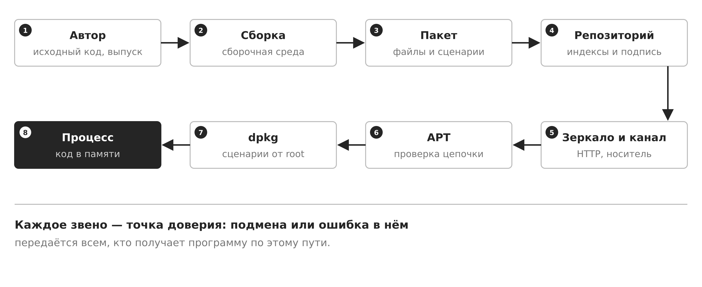

Рисунок 1 — Путь программы от автора к процессу и точки доверия

Цепочкой поставок программного обеспечения называют совокупность участников, процессов и инфраструктуры, через которые программа попадает к потребителю. В неё входят разработчики и сопровождающие, системы контроля версий, сборочные серверы, ключи подписи, репозитории, зеркала, сетевые каналы и инструменты установки. Компрометация любого звена передаётся всем, кто ему доверяет, поэтому одна атака может затронуть множество организаций.

Доверие в пакетной системе строится не на имени файла и не на адресе сайта, а на проверяемых свойствах: подпись известным ключом, совпадение хешей, происхождение из разрешённого источника, ожидаемая версия. Обновление сочетает две противоположные потребности. Оно устраняет известные уязвимости, а значит, задерживать его опасно. Но обновление — это новый код с правами root, а значит, принимать его без проверки тоже опасно. Цель лекции — показать, как ОС и администратор управляют этим противоречием.

На рисунке 2 сквозной пример представлен как исходные данные задачи: установленные версии, бюллетень поставщика и два возможных источника обновления.

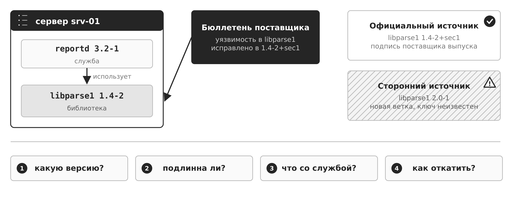

Рисунок 2 — Сквозной пример: служба reportd, библиотека libparse1 и источники обновления

Уже здесь видны вопросы, на которые лекция даст ответ: какую версию выбрать, как убедиться в её подлинности, что произойдёт с работающей службой и как вернуться назад при сбое.

Источники раздела: [10], [23].

## 2. Пакет: формат, установка и состояние

Двоичный пакет Debian (.deb) — архив формата ar с тремя членами. Файл debian-binary содержит версию формата. Архив control.tar содержит метаданные: файл control с именем, версией, архитектурой, зависимостями и описанием; список контрольных сумм файлов md5sums; список конфигурационных файлов conffiles; сценарии сопровождающего preinst, postinst, prerm, postrm. Архив data.tar содержит дерево файлов, которое будет развёрнуто от корня файловой системы.

На рисунке 3 показано устройство пакета. Важное следствие: пакет переносит не только файлы, но и программы-сценарии, которые dpkg выполняет с правами root.

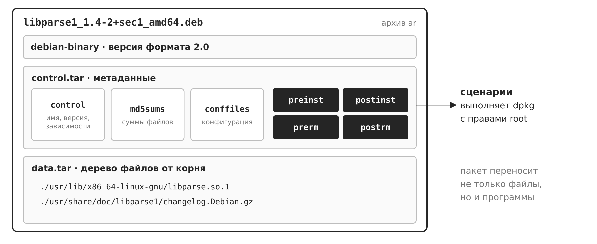

Рисунок 3 — Устройство пакета .deb

Пакеты обрабатываются двумя уровнями инструментов. dpkg работает с отдельными файлами .deb и базой установленных пакетов `/var/lib/dpkg`. Он не загружает файлы из сети и не подбирает зависимости, но отказывается настраивать пакет, если зависимости не удовлетворены. APT работает с репозиториями: загружает индексы, выбирает версии, вычисляет набор действий с учётом зависимостей, загружает пакеты и вызывает dpkg.

Установка выполняется в два этапа. На этапе распаковки dpkg вызывает preinst, разворачивает файлы и заменяет старые версии. На этапе настройки вызывается postinst с аргументом configure: создаются пользователи, обновляются кэши, запускаются службы. Удаление (remove) вызывает prerm и postrm и оставляет конфигурационные файлы. Полное удаление (purge) удаляет и их. Состояние каждого пакета хранится в `/var/lib/dpkg/status`. Основные состояния: not-installed, config-files (остались только конфигурационные файлы), half-installed, unpacked, half-configured, triggers-awaited, triggers-pending и installed.

На рисунке 4 показаны переходы между состояниями и вызываемые сценарии.

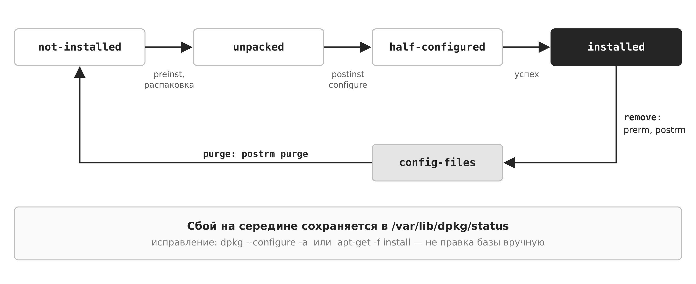

Рисунок 4 — Состояния пакета в dpkg и сценарии сопровождающего

Промежуточное состояние после сбоя — например, отключения питания во время настройки — фиксируется в базе. Его исправляют командой `dpkg --configure -a` или `apt-get -f install`. Это не повод удалять файлы базы вручную.

Сведения о пакете получают без установки и после неё:

```bash
dpkg-deb -I libparse1_1.4-2+sec1_amd64.deb      # поля control, размер, сценарии
dpkg-deb -c libparse1_1.4-2+sec1_amd64.deb      # список файлов в data.tar
dpkg -s libparse1                                # состояние и версия установленного пакета
dpkg -L libparse1                                # файлы, установленные пакетом
dpkg -S /usr/lib/x86_64-linux-gnu/libparse.so.1  # какому пакету принадлежит файл
dpkg -V libparse1                                # сверка файлов с контрольными суммами
```

`dpkg -V` сравнивает установленные файлы с сохранёнными контрольными суммами. Пустой вывод означает совпадение. Символ 5 в третьей позиции означает изменённое содержимое, буква c — что это конфигурационный файл. Это быстрый контроль целостности, но не защита от злоумышленника с правами root, который может изменить и базу.

Конфигурационные файлы (conffiles) обрабатываются особо, потому что администратор их правит. Если файл не менялся локально, при обновлении dpkg молча заменяет его новой версией. Если файл изменён администратором, а в пакете не менялся, сохраняется локальная версия. Если изменились обе стороны, dpkg спрашивает, что делать. Отвергнутая версия сохраняется рядом с суффиксом .dpkg-dist (новая версия поставщика) или .dpkg-old (прежняя локальная). При неинтерактивной установке поведение задают параметрами `--force-confold`, `--force-confnew`, `--force-confdef`.

На рисунке 5 показаны эти три случая.

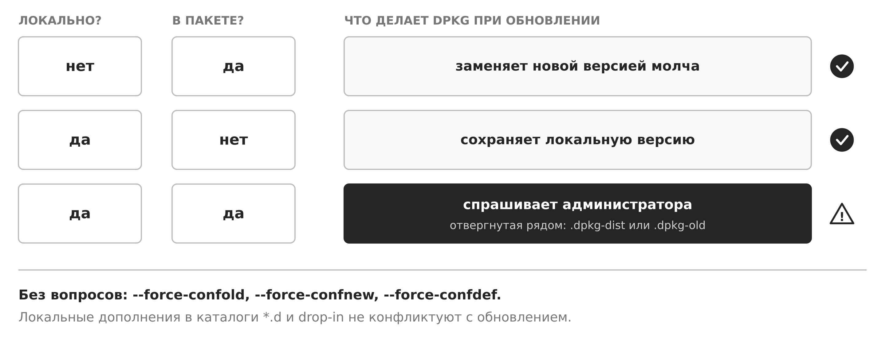

Рисунок 5 — Обработка conffile при обновлении пакета

Отсюда практическое правило: изменения конфигурации лучше вносить через предусмотренные механизмы дополнения (каталоги `*.d`, drop-in systemd), чтобы обновление пакета не вступало в конфликт с локальной правкой.

Источники раздела: [1], [3], [4], [5].

## 3. Версии пакетов и их сравнение

Версия пакета Debian имеет вид `[эпоха:]версия_автора[-ревизия_дистрибутива]`. Версия автора (upstream_version) — номер выпуска программы. Ревизия дистрибутива (debian_revision) — номер сборки пакета сопровождающим; при новой сборке той же версии автора увеличивается только она. Эпоха — небольшое целое число перед двоеточием, по умолчанию 0. Её вводят, когда схема нумерации автора изменилась и новые номера иначе оказались бы «меньше» старых.

Версии сравниваются не как числа и не как строки, а по правилам dpkg. Сначала сравниваются эпохи, затем версии автора, затем ревизии. Внутри частей чередуются нечисловые и числовые фрагменты; числа сравниваются численно, буквы — лексикографически. Знак тильды `~` сортируется раньше всего, даже раньше конца строки. Поэтому `1.0~rc1` меньше `1.0`, а предварительный выпуск не обгоняет окончательный.

На рисунке 6 разобрана структура версии и показан порядок нескольких версий.

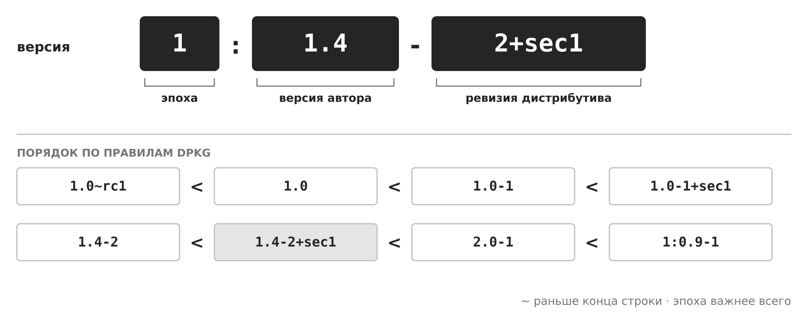

Рисунок 6 — Структура версии пакета и порядок сравнения

Сравнение проверяют командой dpkg, а не на глаз:

```bash
dpkg --compare-versions 1.4-2+sec1 gt 1.4-2 && echo newer
dpkg --compare-versions 1.0~rc1 lt 1.0 && echo prerelease-is-older
dpkg --compare-versions 1:0.9-1 gt 2.0-1 && echo epoch-wins
```

Для безопасности важнее другое следствие. Поставщики стабильных выпусков обычно не переходят на новую версию автора ради исправления, а переносят исправление в ту версию, которая уже есть в выпуске. Это называют бэкпортом исправления. Версия автора остаётся 1.4, меняется только ревизия: 1.4-2 становится 1.4-2+sec1. Так выпуск сохраняет совместимость и не получает вместе с исправлением новые функции и новые ошибки.

Поэтому номер версии автора не говорит, устранена ли уязвимость. Сканер, сравнивающий баннер программы с базой уязвимостей, видит 1.4 и сообщает о проблеме, хотя исправление уже установлено. Обратная ошибка тоже возможна: версия «новая», но исправление в неё не вошло. На рисунке 7 показано, почему решение принимают по бюллетеню поставщика своего дистрибутива и версии пакета, а не по версии автора.

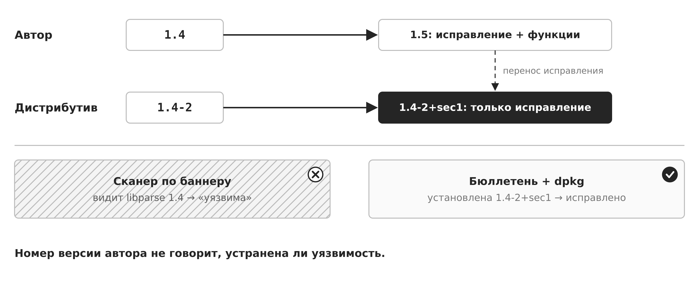

Рисунок 7 — Бэкпорт исправления: версия автора не меняется

Ключевая информация для сравнения — бюллетень поставщика, где указана исправленная версия пакета для каждого выпуска, и журнал изменений пакета (changelog.Debian), где перечислены устранённые уязвимости. Практическая работа 11 воспроизводит эту ситуацию на учебном пакете.

Источники раздела: [1], [14].

## 4. Зависимости и решатель APT

Пакеты редко самодостаточны. Отношения между ними описываются полями control. **Depends** — пакет не будет настроен, пока зависимость не установлена и не настроена. **Pre-Depends** — зависимость должна быть настроена ещё до распаковки; используется редко. **Recommends** — пакеты, которые обычно нужны вместе с данным; APT по умолчанию устанавливает их. **Suggests** — полезные дополнения, не устанавливаются автоматически. **Conflicts** — пакеты не могут быть установлены одновременно. **Breaks** — указанные версии другого пакета перестают работать и должны быть обновлены. **Replaces** — пакет может перезаписать файлы другого. **Provides** — пакет предоставляет виртуальный пакет, например агент почты mail-transport-agent.

Зависимости могут ограничивать версию: `libparse1 (>= 1.4-2)`. Альтернативы записываются через вертикальную черту: `default-mta | mail-transport-agent`. На рисунке 8 отношения показаны на сквозном примере.

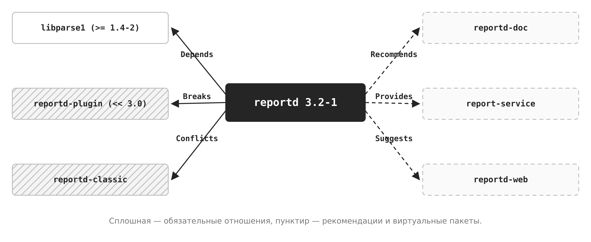

Рисунок 8 — Отношения между пакетами сквозного примера

Когда администратор просит установить или обновить пакет, APT решает задачу удовлетворения ограничений: найти набор версий, в котором выполнены все зависимости и нет конфликтов. Решений может быть несколько, и решатель выбирает по своим правилам. Если новая версия требует библиотеку другой ветки или конфликтует с установленным пакетом, решение может включать установку новых пакетов и удаление старых.

Команды APT различаются допустимыми действиями. `apt-get upgrade` обновляет установленные пакеты, но не устанавливает новых и не удаляет существующих; пакеты, обновление которых этого требует, остаются «отложенными». `apt-get dist-upgrade` (в новых версиях также `full-upgrade`) может устанавливать и удалять пакеты ради разрешения зависимостей. Поэтому перед любым изменением выполняют моделирование ключом `-s`: APT печатает строки Inst, Remv и Conf, ничего не меняя.

На рисунке 9 показано, как запрос на одно обновление превращается в план из нескольких действий.

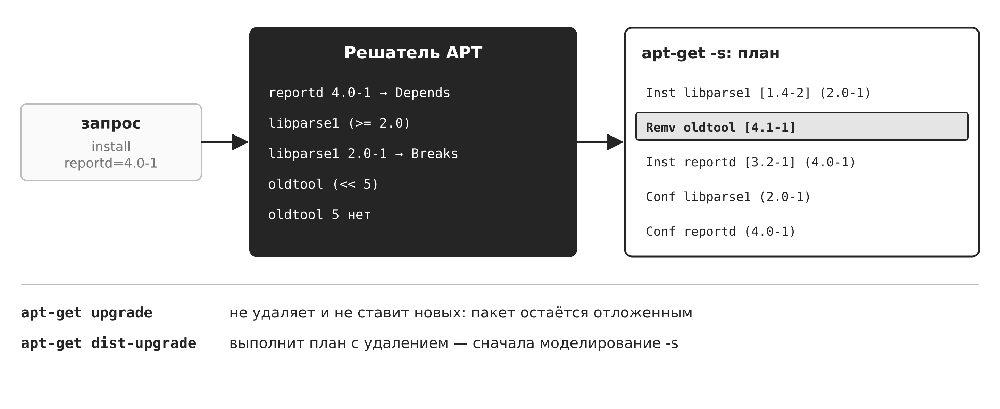

Рисунок 9 — Решатель APT: от запроса к плану действий

Таблица 1 — Команды APT и их назначение

| Команда | Что делает | Меняет систему |
|---|---|---|
| `apt-get update` | Загружает и проверяет индексы источников | Только списки в `/var/lib/apt/lists` |
| `apt-cache policy ПАКЕТ` | Показывает установленную версию, кандидата и источники с приоритетами | Нет |
| `apt-get -s install ПАКЕТ=ВЕРСИЯ` | Моделирует установку конкретной версии | Нет |
| `apt-get install ПАКЕТ=ВЕРСИЯ` | Устанавливает указанную версию с зависимостями | Да |
| `apt-get upgrade` | Обновляет пакеты без установки новых и без удаления | Да |
| `apt-get dist-upgrade` | Обновляет с возможной установкой и удалением пакетов | Да |
| `apt-get download ПАКЕТ=ВЕРСИЯ` | Загружает файл .deb в текущий каталог без установки | Нет |
| `apt-mark hold ПАКЕТ` | Запрещает автоматическое обновление пакета | Отметка в базе |

Строка моделирования вида `Inst libparse1 [1.4-2] (1.4-2+sec1 …)` означает обновление с версии в квадратных скобках до версии в круглых. Строка `Remv` означает удаление. Неожиданное удаление пакета — сигнал остановиться: скорее всего, выбран не тот источник или не та версия.

Источники раздела: [2], [6].

## 5. Репозитории и источники пакетов

Репозиторий APT — это каталог с определённой структурой, доступный по HTTP, HTTPS, с локального диска или с оптического носителя. Каталог `dists/<выпуск>/` содержит описание выпуска (suite или codename). В нём лежат файлы Release, InRelease и Release.gpg и подкаталоги компонентов, например `main/binary-amd64/` с индексом Packages в сжатом виде. Каталог `pool/` содержит сами файлы .deb, разложенные по компонентам и первым буквам имени исходного пакета.

Индекс Packages — список пакетов в формате «поле: значение». Для каждой версии в нём указаны имя, версия, архитектура, зависимости, путь Filename, размер и контрольные суммы SHA256. На рисунке 10 показана структура репозитория.

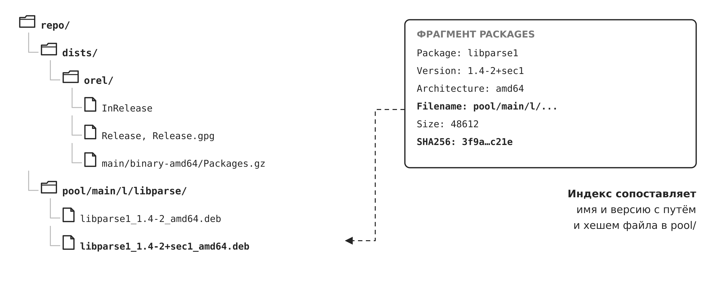

Рисунок 10 — Структура репозитория APT

Источники перечисляются в файле `/etc/apt/sources.list` и в файлах каталога `/etc/apt/sources.list.d/`. Однострочный формат: тип (deb для двоичных пакетов, deb-src для исходных), необязательные параметры в квадратных скобках, адрес, выпуск и компоненты. Начиная с APT 1.1 поддерживается многострочный формат deb822 в файлах `.sources`. Оптический носитель подключают командой `apt-cdrom add`, которая сама добавляет строку источника.

На рисунке 11 разобрана строка источника.

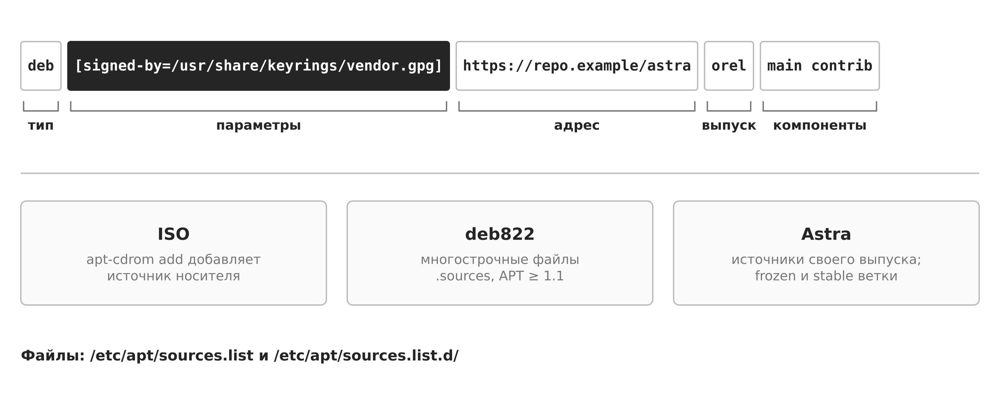

Рисунок 11 — Строка источника: тип, параметры, адрес, выпуск, компоненты

У Astra Linux собственные репозитории. Поставщик собирает пакеты из исходных текстов и сопровождает выпуск отдельно от Debian. Для выпусков Special Edition различают зафиксированные (frozen) ветки, соответствующие конкретному обновлению, и текущие (stable) ветки. В выпусках 1.7 репозиторий разделён на base, main, update и extended, в выпуске 1.8 — на Main и Extended. Main содержит компоненты, прошедшие полный цикл сертификации. Учебный «Орёл» 2.12 основан на Debian 9 и использует ISO и репозиторий своего выпуска. Конкретные адреса и порядок оперативного обновления берут из документации и бюллетеней установленного выпуска.

Важное свойство файла Release — поле Date и необязательное поле Valid-Until. APT отказывается использовать метаданные с истёкшим сроком. Это защищает от атаки «заморозки», при которой злоумышленник продолжает раздавать старые, но правильно подписанные индексы, чтобы клиент не узнал об обновлениях безопасности.

Источники раздела: [7], [11], [17].

## 6. Подписи и цепочка доверия APT

APT не проверяет подпись каждого файла .deb. Вместо этого он проверяет цепочку от одного подписанного файла к каждому пакету. Ключ архива подписывает файл InRelease — это Release с встроенной подписью; старый вариант — отдельная подпись Release.gpg. В Release перечислены размеры и хеши SHA256 всех индексов. В индексе Packages перечислены размеры и хеши SHA256 каждого файла .deb. При загрузке APT сверяет каждое звено. Если хотя бы одно не совпадает, файл отвергается.

На рисунке 12 показана эта цепочка для сквозного примера.

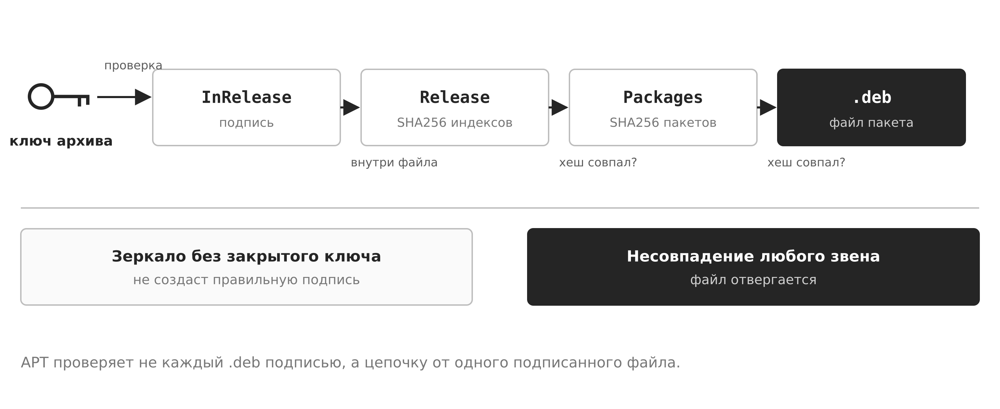

Рисунок 12 — Цепочка доверия: ключ → InRelease → Packages → .deb

Отсюда видно, что подпись защищает от подмены метаданных и пакетов при передаче и на зеркале. Зеркало может быть чужим и даже враждебным: без закрытого ключа архива оно не создаст правильную подпись. Поэтому доставка по HTTP допустима, хотя HTTPS дополнительно скрывает состав запрашиваемых пакетов. Современные версии APT по умолчанию отказываются загружать данные из неподписанного источника. В APT 1.4 учебного «Орла» команда apt уже отказывает, а apt-get в переходный период лишь предупреждает и требует явного подтверждения при установке пакета из такого источника; строгий режим для apt-get включают ключом `--no-allow-insecure-repositories`.

Подпись не защищает от всего. Если украден закрытый ключ архива, злоумышленник подпишет что угодно. Если вредоносный код внесён до сборки — автором, сопровождающим или через сборочную среду, — пакет будет честно подписан. Подпись подтверждает происхождение, а не безвредность. Подпись не защищает и от ошибок совместимости. От атаки «заморозки» защищает поле Valid-Until, если поставщик его задаёт. На рисунке 13 сведено, от чего защищает подпись и от чего нет.

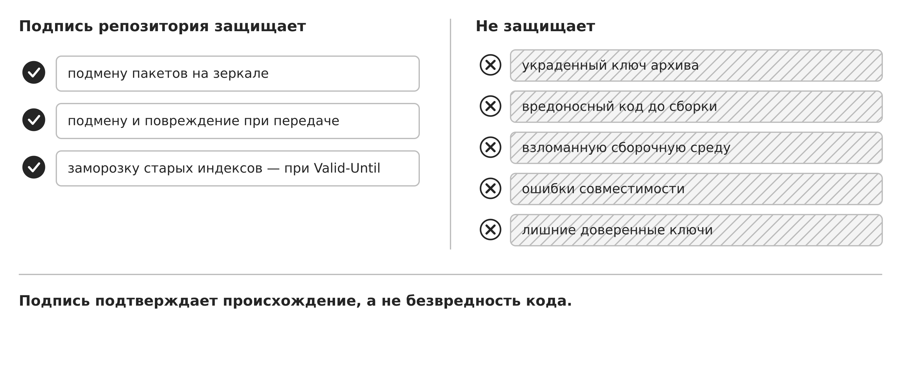

Рисунок 13 — Границы защиты, которую даёт подпись репозитория

Отдельный вопрос — каким ключам доверяет APT. Исторически ключи добавляли в общее хранилище: файл `/etc/apt/trusted.gpg` или каталог `/etc/apt/trusted.gpg.d/`, раньше — командой `apt-key add`. Любой ключ из этого хранилища может подписать **любой** источник. Если сторонний поставщик добавил свой ключ, его репозиторий может опубликовать пакет с именем системной библиотеки и большей версией, и APT примет его как обновление.

Параметр `signed-by` в строке источника, поддерживаемый с APT 1.1, связывает источник с конкретным файлом ключа: `deb [signed-by=/usr/share/keyrings/vendor.gpg] …`. Ключ хранят вне общего каталога, и он не действует для других источников. Команда `apt-key` в новых версиях APT объявлена устаревшей. На рисунке 14 показано различие двух подходов.

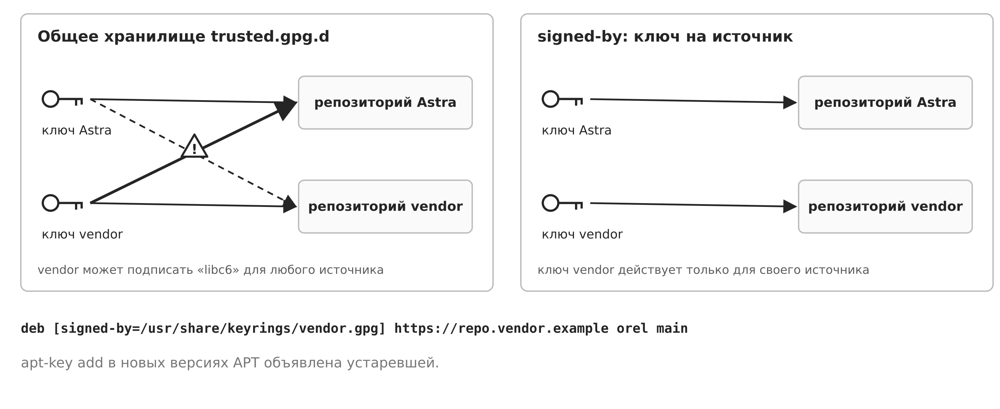

Рисунок 14 — Общее хранилище ключей и параметр signed-by

Отпечаток ключа сверяют по независимому каналу: в документации поставщика, в паспорте системы, в официальном пакете ключей дистрибутива. Ключ, загруженный с того же сайта, что и пакеты, без сверки отпечатка подтверждает только то, что сайт согласован сам с собой.

Типовые наблюдения при проверке:

```bash
sudo apt-get update
# W: GPG error: ... NO_PUBKEY 1234ABCD...        ключ для источника не найден
# E: The repository '...' is not signed.          источник отвергнут
gpgv --keyring /usr/share/keyrings/vendor.gpg InRelease   # ручная проверка подписи
ls -l /etc/apt/trusted.gpg /etc/apt/trusted.gpg.d/        # общее хранилище ключей
grep -rh '^deb' /etc/apt/sources.list /etc/apt/sources.list.d/
```

Сообщение NO_PUBKEY не устраняют поиском «какого-нибудь» ключа в интернете. Сначала выясняют, откуда взялся источник и должен ли он быть в системе. Параметры `trusted=yes`, `--allow-unauthenticated` и `Acquire::AllowInsecureRepositories` отключают проверку и превращают APT в загрузчик произвольного кода.

Источники раздела: [8], [10], [11].

## 7. Выбор версии: приоритеты и смешение источников

Когда одна и та же версия или разные версии пакета доступны из нескольких источников, APT выбирает кандидата на установку по приоритетам. Команда `apt-cache policy ПАКЕТ` показывает установленную версию (Installed), кандидата (Candidate) и таблицу версий с приоритетом каждого источника. Установленная версия имеет приоритет 100, обычный источник — 500. Источник выбранного выпуска (`-t` или APT::Default-Release) получает 990. Источники с пометкой NotAutomatic получают 1.

Правило выбора: кандидат — версия с наибольшим приоритетом. При равных приоритетах выбирается бо́льшая версия. Понижение версии происходит только при приоритете 1000 и выше. На рисунке 15 показан вывод policy для сквозного примера.

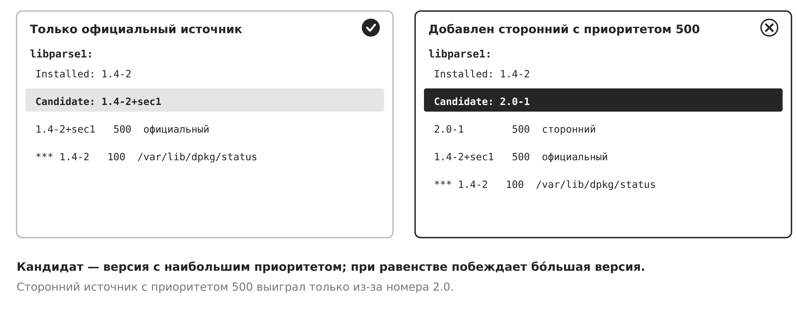

Рисунок 15 — apt-cache policy: установленная версия, кандидат, приоритеты

Приоритеты можно задать в файлах `/etc/apt/preferences.d/` — это называют закреплением (pinning). Закрепление позволяет, например, разрешить из стороннего источника только один пакет, а остальные пакеты этого источника запретить.

Таблица 2 — Значения приоритета и их действие

| Приоритет P | Действие |
|---|---|
| P < 0 | Версия никогда не устанавливается |
| 0 < P < 100 | Устанавливается, только если пакет ещё не установлен |
| 100 ≤ P < 500 | Устанавливается, если нет версии из других источников и установленная не новее; это уровень установленной версии |
| 500 ≤ P < 990 | Обычный источник: устанавливается, если нет версии из выбранного выпуска и установленная не новее |
| 990 ≤ P < 1000 | Выбранный выпуск: устанавливается, если установленная версия не новее |
| P ≥ 1000 | Устанавливается даже ценой понижения версии |

Пример закрепления, разрешающего из стороннего источника только один пакет:

```text
# /etc/apt/preferences.d/vendor-tool
Package: *
Pin: origin repo.vendor.example
Pin-Priority: -1

Package: vendor-tool
Pin: origin repo.vendor.example
Pin-Priority: 500
```

На рисунке 16 шкала приоритетов показана как набор зон.

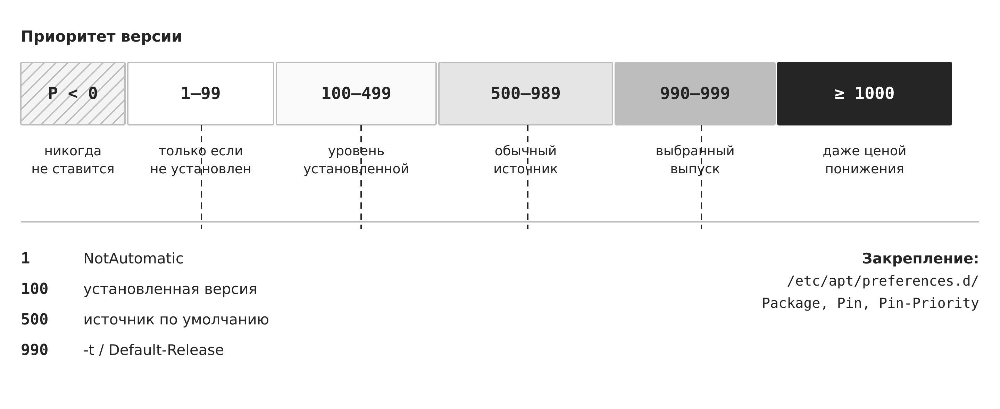

Рисунок 16 — Шкала приоритетов APT

Главная угроза здесь — смешение источников разных дистрибутивов и выпусков. Если к Astra Linux подключить репозиторий Debian или к «Орлу» — репозиторий другого выпуска, решатель начнёт выбирать «новые» версии системных библиотек из чужого источника. Это может нарушить совместимость и заменить компоненты, прошедшие проверку, пакетами без такой проверки. В сообществе Debian такую систему называют FrankenDebian. Для систем с сертифицированными средствами защиты это ещё и выход из проверенной конфигурации. На рисунке 17 показан механизм такой замены.

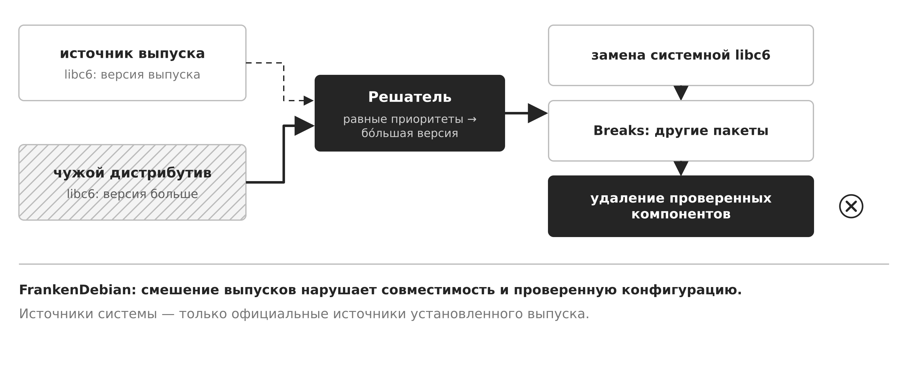

Рисунок 17 — Смешение источников: чужая библиотека побеждает по версии

Правило простое: источники системы — только официальные источники установленного выпуска. Сторонние пакеты подключают ограниченно — по одному пакету с закреплением и `signed-by` — и учитывают в описи системы.

Источники раздела: [9], [12], [17].

## 8. Жизненный цикл обновления

Обновление — управляемое изменение с понятными этапами, а не однократная команда. Первый этап — информирование. Сведения об уязвимостях публикуют поставщик дистрибутива в бюллетенях безопасности, Банк данных угроз ФСТЭК России (БДУ) и международная система идентификаторов CVE. Второй этап — оценка применимости. Третий — тестирование. Затем планирование, установка, перезапуск зависимых процессов, проверка и учёт. На рисунке 18 этапы показаны как цикл.

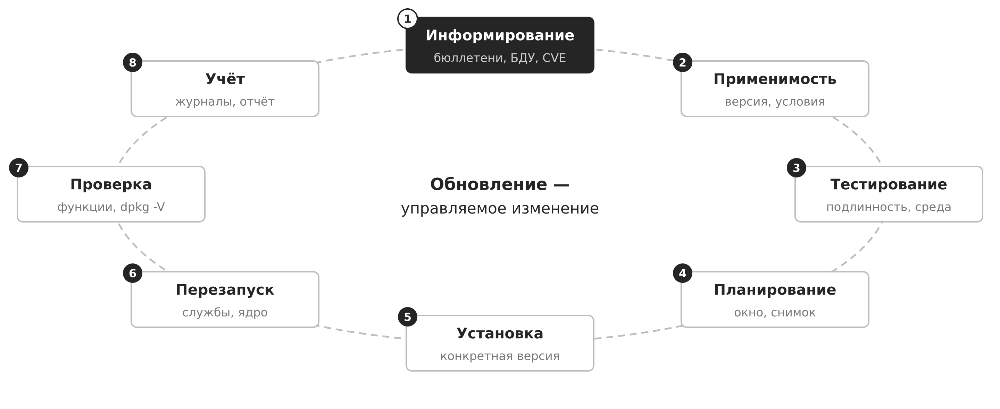

Рисунок 18 — Жизненный цикл обновления

Оценка применимости отвечает на вопросы. Установлен ли пакет? Относится ли установленная версия к затронутым — по бюллетеню своего поставщика, а не по версии автора? Используется ли уязвимый компонент и выполнены ли условия эксплуатации — например, доступна ли служба из сети? Ответы определяют срочность: уязвимость в библиотеке, которой пользуется сетевая служба, срочнее той же уязвимости на изолированной рабочей станции. На рисунке 19 эта логика показана как дерево решений.

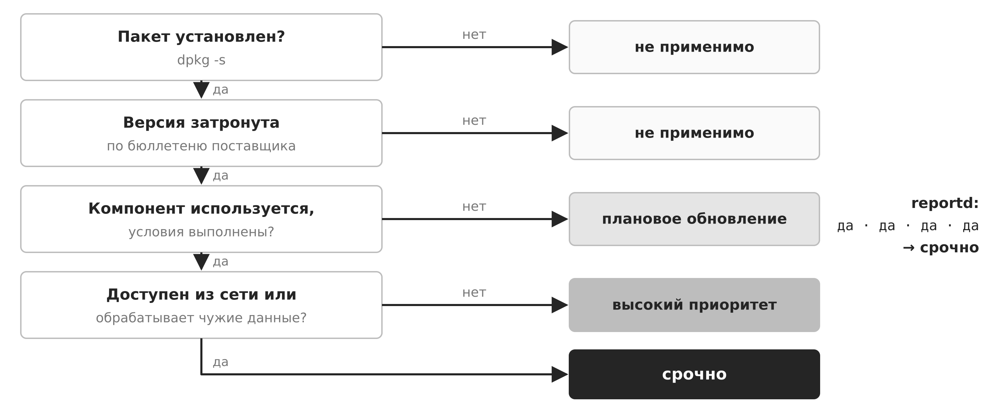

Рисунок 19 — Оценка применимости: от бюллетеня к приоритету

Тестирование проверяет, что обновление подлинное и не нарушает работу. ФСТЭК России утвердила 28 октября 2022 года «Методику тестирования обновлений безопасности программных, программно-аппаратных средств». Она применяется операторами государственных информационных систем и значимых объектов КИИ. Методика описывает проверку подлинности обновления, поиск признаков недекларированных возможностей и проверку в тестовой среде до установки в рабочую систему. Для пакетов Debian/Astra проверку подлинности обеспечивает цепочка подписей. Содержимое оценивают по журналу изменений, списку файлов, сценариям сопровождающего и моделированию.

Перед установкой создают точку отката, выполняют моделирование и устанавливают конкретную версию. После установки важно помнить: dpkg заменяет файлы на диске, но уже работающий процесс продолжает выполнять загруженный в память старый код. Для библиотек это особенно заметно: служба reportd после обновления libparse1 продолжает использовать старую копию до перезапуска. В `/proc/PID/maps` такая библиотека помечена как `(deleted)`. Утилиты needrestart и checkrestart (из пакета debian-goodies) находят такие процессы. Обновление ядра вступает в силу только после перезагрузки. На рисунке 20 показан этот разрыв.

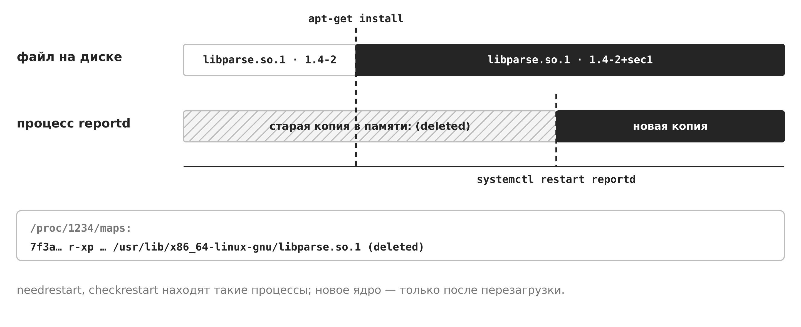

Рисунок 20 — Файл обновлён, процесс работает со старой копией

```bash
sudo grep -l 'libparse.*(deleted)' /proc/[0-9]*/maps 2>/dev/null   # процессы со старой библиотекой
sudo systemctl restart reportd
sudo grep -c 'libparse' /proc/"$(systemctl show -p MainPID --value reportd)"/maps
```

Обновления можно устанавливать вручную или автоматически, например пакетом unattended-upgrades. Автоматика сокращает время между публикацией исправления и его установкой, но отнимает у администратора момент проверки. Компромисс — поэтапное внедрение: сначала тестовая группа машин, затем пилотная, затем все. Автоматически можно ставить только обновления безопасности из официального источника, оставив остальное ручному плану. На рисунке 21 сравнены подходы.

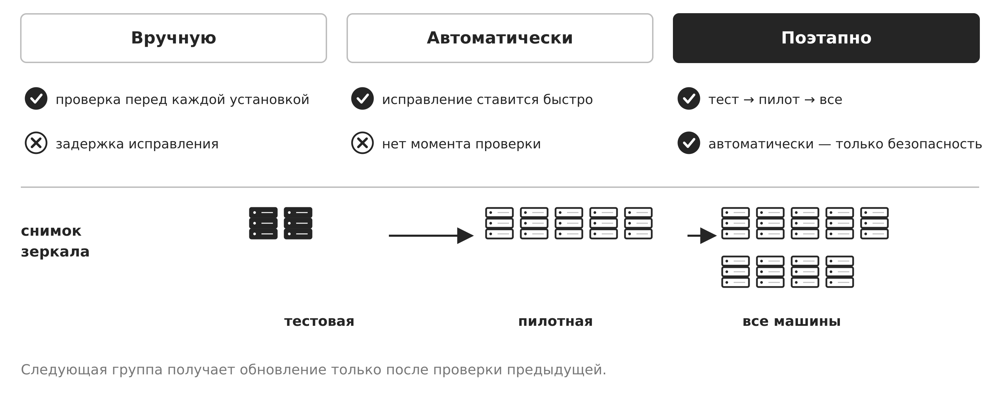

Рисунок 21 — Способы внедрения обновлений

Последний этап — учёт. APT записывает действия в `/var/log/apt/history.log`, dpkg — в `/var/log/dpkg.log`. В отчёте фиксируют, что и почему обновлено, какой бюллетень закрыт, что проверено и как выполнить откат.

Источники раздела: [13], [14], [15], [16].

## 9. Риски цепочки поставок

Атака на цепочку поставок поражает не конечную систему напрямую, а звено, которому эта система доверяет. На рисунке 22 точки атаки нанесены на путь программы из раздела 1.

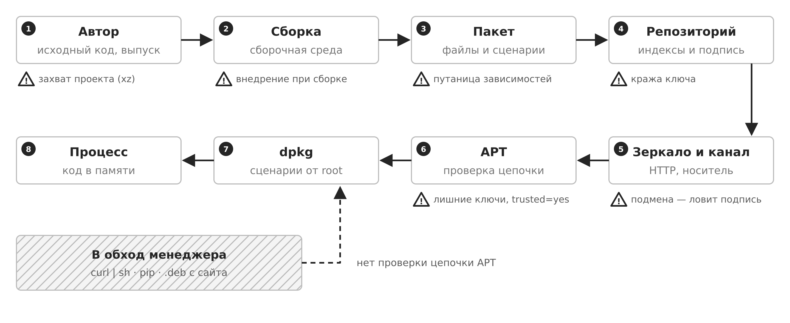

Рисунок 22 — Точки атаки на цепочку поставок

**Компрометация автора или сопровождающего.** Злоумышленник получает право выпускать версии проекта: годами вносит полезный вклад, перехватывает учётную запись или убеждает уставшего сопровождающего передать проект. Код выходит под настоящим именем и с настоящей подписью.

**Компрометация сборочной среды.** Исходный код чист, но в процессе сборки в результат внедряется вредоносный фрагмент. В 2020 году так были скомпрометированы обновления платформы SolarWinds Orion. Злоумышленники внедрили бэкдор в процесс сборки, и подписанное обновление разошлось клиентам.

**Компрометация репозитория, зеркала или ключа.** Без ключа подмена на зеркале обнаруживается проверкой подписи. С украденным ключом — нет.

**Подмена зависимости.** Решатель выбирает пакет по имени и версии. Если внутренний пакет организации называется так же, как пакет в публичном каталоге, а публичная версия больше, менеджер может выбрать публичную. Это атака «путаница зависимостей» (dependency confusion), продемонстрированная в 2021 году на менеджерах npm, PyPI и RubyGems. Похожий приём — тайпсквоттинг: пакет с именем, отличающимся одной буквой.

**Установка в обход менеджера пакетов.** Команда вида `curl … | sudo sh`, пакеты языковых менеджеров pip и npm, файлы .deb с сайтов и контейнерные образы не проходят цепочку проверки системного APT. Такие компоненты не видны в его базе и не обновляются вместе с системой.

Показательный случай — бэкдор в xz-utils (CVE-2024-3094), обнаруженный 29 марта 2024 года. Участник проекта, годами завоёвывавший доверие, стал одним из сопровождающих. Вредоносная логика находилась не в истории репозитория исходного кода, а в архивах выпусков 5.6.0 и 5.6.1. Изменённый сценарий сборки build-to-host.m4 извлекал объектный код из файлов, замаскированных под тестовые данные, и встраивал его в библиотеку liblzma. В ряде дистрибутивов sshd через libsystemd загружал liblzma, поэтому под угрозой оказался удалённый вход. Бэкдор обнаружили по аномальной задержке входа по SSH до попадания в большинство стабильных выпусков. Затронуты в основном тестовые и непрерывно обновляемые ветки. На рисунке 23 показан механизм.

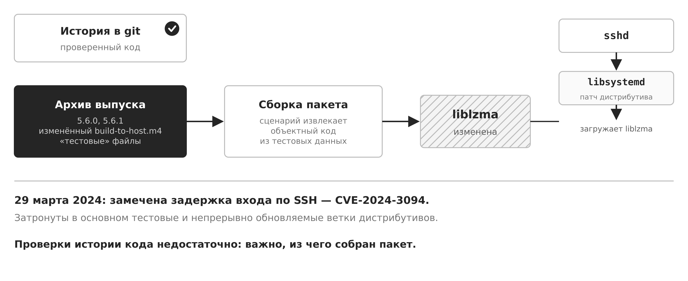

Рисунок 23 — Случай xz-utils: вредоносная логика в архиве выпуска

Выводы из случая: проверка истории исходного кода необходима, но недостаточна; важно, из чего собран пакет. Стабильный выпуск с консервативной политикой обновлений сократил ущерб. Свежая версия не всегда безопаснее проверенной. На рисунке 24 показан механизм путаницы зависимостей.

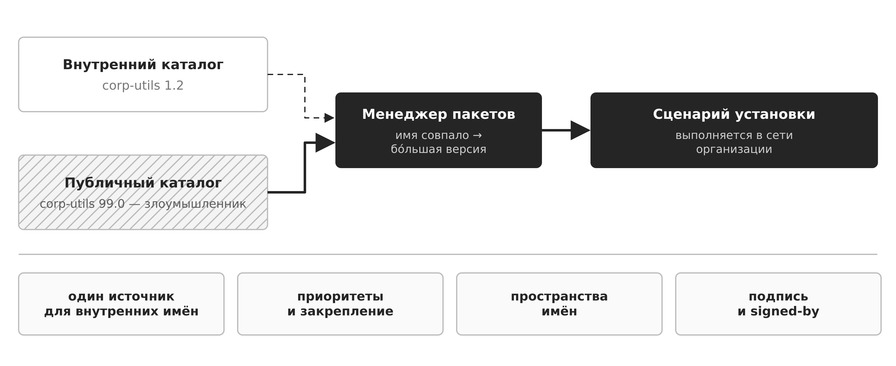

Рисунок 24 — Путаница зависимостей: публичный пакет с большей версией

Защитные подходы действуют на разных звеньях. **Воспроизводимая сборка** позволяет любому независимо собрать пакет из тех же исходников в той же среде и получить побитно тот же результат; расхождение указывает на вмешательство. **Сведения о происхождении (provenance)** — подписанное описание того, из чего, где и как собран артефакт. Уровни требований к ним задаёт система SLSA. **SBOM** (Software Bill of Materials) — перечень компонентов программы и их версий; он позволяет быстро ответить, затронута ли система новой уязвимостью. **Практики безопасной разработки** — например, NIST SP 800-218 (SSDF) — описывают защиту самого процесса создания ПО. На рисунке 25 эти подходы сопоставлены со звеньями цепочки.

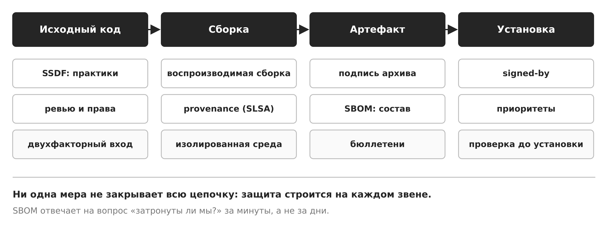

Рисунок 25 — Защитные подходы на звеньях цепочки поставок

Источники раздела: [18], [19], [20], [21], [22], [23], [24], [25].

## 10. Контроль источников в организации

В организации обычно не разрешают каждой машине обращаться к интернет-репозиториям. Устанавливается промежуточное звено: локальное зеркало или собственный репозиторий. Пакеты поставщика попадают в него после проверки подписи и тестирования. Машины подключаются только к нему, исходящий доступ к внешним репозиториям закрыт межсетевым экраном. Зеркало удобно фиксировать снимками: тестовая группа получает снимок раньше, рабочие машины — после проверки. Если организация переподписывает пакеты своим ключом, этот ключ становится критическим активом. На рисунке 26 показана такая схема.

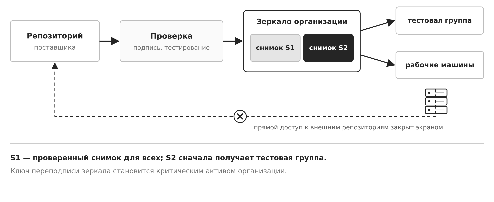

Рисунок 26 — Локальное зеркало организации и поэтапное распространение

Контроль источников начинается с описи. Её проводят при приёмке системы, после изменений и при расследовании.

Таблица 3 — Что входит в опись источников и пакетов

| Объект | Где смотреть | Что проверить |
|---|---|---|
| Источники | `/etc/apt/sources.list`, `/etc/apt/sources.list.d/` | Только разрешённые адреса и выпуск; нет `trusted=yes` |
| Ключи | `/etc/apt/trusted.gpg*`, файлы `signed-by` | Отпечатки известны и обоснованы; нет лишних |
| Приоритеты | `/etc/apt/preferences*`, `apt-cache policy` | Нет закреплений, понижающих системные пакеты |
| Удержания | `apt-mark showhold` | Каждое удержание обосновано и имеет срок |
| Пакеты вне источников | `apt list --installed`, вывод `apt-cache policy` для пакетов без источника | Происхождение пакетов, установленных из файлов |
| ПО вне dpkg | `/usr/local`, `/opt`, `pip list`, контейнеры | Учтено, имеет владельца и процесс обновления |
| История изменений | `/var/log/apt/history.log`, `/var/log/dpkg.log` | Изменения соответствуют заявкам |

Команды для описи можно выполнять без изменения системы:

```bash
grep -rhE '^(deb|Types|URIs)' /etc/apt/sources.list /etc/apt/sources.list.d/ 2>/dev/null
ls -l /etc/apt/trusted.gpg /etc/apt/trusted.gpg.d/ /usr/share/keyrings/ 2>/dev/null
apt-cache policy | grep -E '^ *[0-9]+ ' | sort -u
apt-mark showhold
zgrep -h ' install \| upgrade ' /var/log/dpkg.log* | tail -n 20
```

Признак тревоги — пакет, у которого в выводе `apt-cache policy` установленная версия есть только в `/var/lib/dpkg/status`. Значит, он поставлен из файла или из источника, который уже удалён. Его происхождение нужно выяснить.

Источники раздела: [7], [9], [12].

## 11. Откат изменений

План отката составляют до обновления, а не после сбоя. Уровни отката различаются полнотой и стоимостью. Снимок виртуальной машины или файловой системы (LVM, Btrfs) возвращает всё состояние, включая данные, накопленные после снимка, поэтому для рабочих систем его применяют осторожно. Понижение версии пакета возвращает только код. Восстановление конфигурации из резервной копии возвращает настройки. Удержание пакета (`apt-mark hold`) не откатывает, а только предотвращает повторное автоматическое обновление до исправления проблемы. На рисунке 27 уровни показаны по охвату.

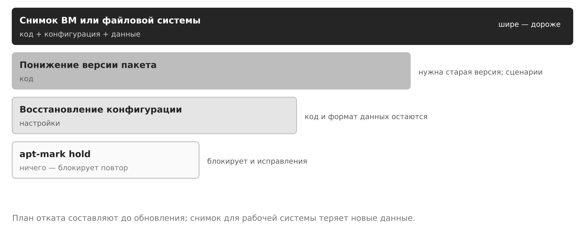

Рисунок 27 — Уровни отката: от снимка до удержания пакета

Таблица 4 — Способы отката и их ограничения

| Способ | Что возвращает | Ограничения |
|---|---|---|
| Снимок ВМ или файловой системы | Всё состояние на момент снимка | Теряются данные после снимка; нужен заранее созданный снимок |
| Понижение версии пакета | Код пакета | Нужна старая версия в источнике или в кэше; сценарии могут не поддерживать понижение |
| Восстановление конфигурации | Настройки | Не возвращает код и формат данных |
| Удержание пакета | Ничего; блокирует повтор | Блокирует и будущие исправления безопасности |

Понижение версии выполняется установкой конкретной версии: `apt-get install libparse1=1.4-2`. APT предупредит о понижении. Старая версия должна быть доступна: в источнике или в кэше `/var/cache/apt/archives`. Понижение может не сработать. Сценарии сопровождающего обычно рассчитаны на обновление, а не на возврат. Новая версия могла преобразовать данные в формат, который старая не читает. Обновление могло потянуть за собой новые версии других пакетов. Понижение до уязвимой версии возвращает и уязвимость. На рисунке 28 показаны эти ограничения.

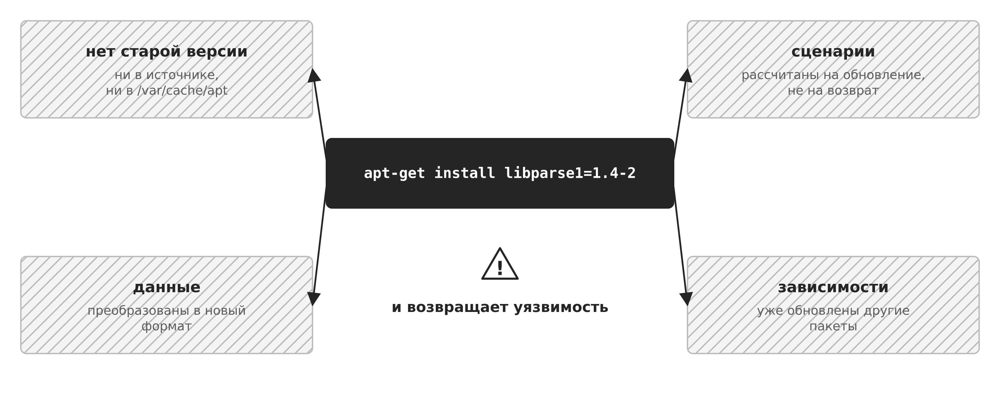

Рисунок 28 — Ограничения понижения версии

Вернёмся к сквозному примеру. Бюллетень относится к установленной версии 1.4-2, служба reportd использует библиотеку и доступна из сети, значит, обновление срочное. Выбирается 1.4-2+sec1 из официального источника, а не 2.0-1 из стороннего: исправление без смены ветки, проверяемая подпись. Перед установкой создаётся снимок, загружается и проверяется пакет, выполняется моделирование. После установки перезапускается reportd, проверяются `dpkg -V`, отсутствие старой библиотеки в памяти и работа службы. Результат записывается. Откат — снимок или версия 1.4-2 из кэша, с пониманием, что она уязвима. На рисунке 29 план показан целиком.

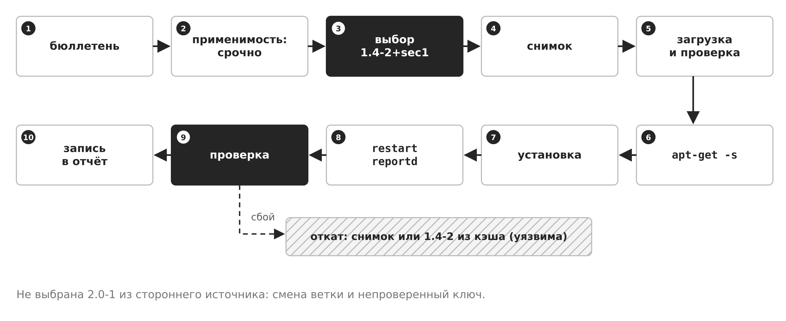

Рисунок 29 — План обновления libparse1 на srv-01

Итог лекции показан на рисунке 30.

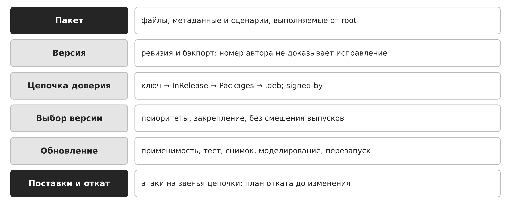

Рисунок 30 — Основные положения лекции

Источники раздела: [6], [9], [15].

## 12. Основные понятия и вопросы для самоконтроля

**Пакет** — архив с файлами программы, метаданными и сценариями установки. **dpkg** — низкоуровневый менеджер пакетов, работающий с файлами .deb и базой установленных пакетов. **APT** — менеджер, работающий с репозиториями, версиями и зависимостями. **Сценарии сопровождающего** — программы preinst, postinst, prerm, postrm, выполняемые при установке и удалении. **Conffile** — конфигурационный файл пакета, локальные изменения которого dpkg не перезаписывает молча. **Ревизия дистрибутива** — часть версии после последнего дефиса, номер сборки пакета. **Бэкпорт исправления** — перенос исправления в версию, уже входящую в выпуск. **Репозиторий** — каталог с индексами и пакетами. **InRelease** — подписанный файл с хешами индексов репозитория. **signed-by** — параметр источника, связывающий его с конкретным ключом. **Кандидат** — версия, которую APT установит по команде install. **Закрепление (pinning)** — назначение приоритетов источникам и версиям. **Цепочка поставок ПО** — участники, процессы и инфраструктура от автора до установленной программы. **Воспроизводимая сборка** — сборка, дающая побитно одинаковый результат у разных участников. **SBOM** — перечень компонентов программы. **Откат** — возврат системы к состоянию до изменения.

1. Из каких звеньев состоит путь программы от автора к процессу?
2. Что содержат control.tar и data.tar пакета .deb?
3. Какие сценарии сопровождающего выполняются при установке, обновлении и удалении?
4. Как dpkg поступает с изменённым администратором конфигурационным файлом?
5. Почему 1.0~rc1 меньше 1.0 и зачем нужна эпоха?
6. Почему версия автора не говорит, устранена ли уязвимость?
7. Чем различаются Depends, Recommends, Breaks и Conflicts?
8. Чем `apt-get upgrade` отличается от `dist-upgrade`?
9. Что проверяет APT при загрузке пакета из репозитория?
10. От каких угроз защищает подпись репозитория и от каких нет?
11. Почему общее хранилище ключей опаснее параметра signed-by?
12. Как APT выбирает кандидата при нескольких источниках?
13. Чем опасно смешение репозиториев разных выпусков?
14. Как оценить применимость уязвимости из бюллетеня к конкретной системе?
15. Почему после обновления библиотеки нужно перезапускать службы?
16. Какие звенья цепочки поставок были атакованы в случаях xz-utils и SolarWinds?
17. Что дают воспроизводимые сборки, SBOM и сведения о происхождении?
18. Почему понижение версии пакета не всегда возвращает систему в исходное состояние?

## 13. Источники

1. [Debian Policy Manual: поля control и версия пакета](https://www.debian.org/doc/debian-policy/ch-controlfields.html).
2. [Debian Policy Manual: отношения между пакетами](https://www.debian.org/doc/debian-policy/ch-relationships.html).
3. [Debian Policy Manual: сценарии сопровождающего](https://www.debian.org/doc/debian-policy/ch-maintainerscripts.html).
4. [Debian Policy Manual: файлы и conffiles](https://www.debian.org/doc/debian-policy/ch-files.html).
5. [dpkg(1), Debian 9](https://manpages.debian.org/stretch/dpkg/dpkg.1.en.html).
6. [apt-get(8), Debian 9](https://manpages.debian.org/stretch/apt/apt-get.8.en.html).
7. [sources.list(5), Debian 9](https://manpages.debian.org/stretch/apt/sources.list.5.en.html).
8. [apt-secure(8), Debian 9](https://manpages.debian.org/stretch/apt/apt-secure.8.en.html).
9. [apt_preferences(5), Debian 9](https://manpages.debian.org/stretch/apt/apt_preferences.5.en.html).
10. [Debian Wiki: SecureApt](https://wiki.debian.org/SecureApt).
11. [Debian Wiki: формат репозитория](https://wiki.debian.org/DebianRepository/Format).
12. [Debian Wiki: DontBreakDebian](https://wiki.debian.org/DontBreakDebian).
13. [Debian Wiki: UnattendedUpgrades](https://wiki.debian.org/UnattendedUpgrades).
14. [Debian Security FAQ](https://www.debian.org/security/faq).
15. [ФСТЭК России. Методика тестирования обновлений безопасности программных, программно-аппаратных средств, 28.10.2022](https://legalacts.ru/doc/metodicheskii-dokument-metodika-testirovanija-obnovlenii-bezopasnosti-programmnykh-programmno-apparatnykh-sredstv/).
16. [Банк данных угроз безопасности информации ФСТЭК России](https://bdu.fstec.ru/).
17. [Группа Астра: Astra Linux 1.8, репозитории Main и Extended](https://habr.com/en/companies/astralinux/news/833048).
18. [NVD: CVE-2024-3094](https://nvd.nist.gov/vuln/detail/CVE-2024-3094).
19. [Tukaani Project: XZ Utils backdoor](https://tukaani.org/xz-backdoor/).
20. [A. Birsan. Dependency Confusion, 2021](https://medium.com/@alex.birsan/dependency-confusion-4a5d60fec610).
21. [Reproducible Builds: определение](https://reproducible-builds.org/docs/definition/).
22. [SLSA v1.0: требования к происхождению сборки](https://slsa.dev/spec/v1.0/).
23. [NIST SP 800-218: Secure Software Development Framework](https://csrc.nist.gov/pubs/sp/800/218/final).
24. [CISA: Software Bill of Materials](https://www.cisa.gov/sbom).
25. [CISA: AA20-352A, компрометация цепочки поставок SolarWinds](https://www.cisa.gov/news-events/cybersecurity-advisories/aa20-352a).

Дата обращения: 7 ноября 2026 г. Справочные страницы Debian 9 соответствуют APT 1.4 и dpkg 1.18 учебного «Орла» 2.12; для другой установки сопоставляют `man apt-get`, `man apt_preferences`, `man sources.list`, `man apt-secure`, `man dpkg` её выпуска. Порядок обновления Astra Linux определяется документацией и бюллетенями разработчика для установленного выпуска; примеры лекции не подменяют эти документы.
