# Тема 13. Журналирование, аудит и контроль целостности

**Дисциплина:** Операционные системы. **Специальность:** 10.05.01 «Компьютерная безопасность». **Уровень:** университет, 3-й курс. **Продолжительность:** 90 минут.

Лекция посвящена тому, как операционная система фиксирует события и как по этим записям восстановить, что произошло. После изучения материала студент сможет перечислить источники событий в Linux и пути их доставки, прочитать запись syslog, journald и auditd, составить правила аудита для критичных объектов, объяснить роль синхронизации времени, спроектировать централизованный сбор событий, защитить сами журналы и организовать контроль целостности файлов по эталону.

Материал опирается на темы о процессах, файловых системах, пользователях и аутентификации, архитектуре безопасности Astra Linux и службах. Он связан с практическими работами 10 (журналирование действий и корреляция событий) и 13 (обнаружение изменения критичных файлов) и подготавливает тему 16 о реагировании на инциденты. Примеры ориентированы на Linux с systemd, rsyslog и подсистемой аудита ядра. Учебный «Орёл» 2.12 основан на Debian 9 (systemd 232). Состав установленных средств, например наличие auditd, проверяют на конкретной системе. Имена узлов, пользователей, адреса и вывод команд в примерах условны.

**Сквозной пример.** Ночью на сервере srv-01 происходит цепочка событий. С адреса 10.50.7.20 идёт серия неудачных входов по SSH. Затем пользователь operator успешно входит по паролю, через sudo открывает редактором /etc/ssh/sshd_config, сохраняет изменения и перезагружает службу ssh. Через несколько минут локальный журнал на сервере оказывается очищен. Утром проверка целостности сообщает об изменении sshd_config. Часы srv-01 спешат на три минуты. Задача — восстановить, кто, что, когда и откуда сделал, и понять, какие механизмы позволяют это доказать.

## Оглавление

- [1. Зачем журналировать: подотчётность и расследование](#1-зачем-журналировать-подотчётность-и-расследование)
- [2. Источники событий и пути их доставки](#2-источники-событий-и-пути-их-доставки)
- [3. syslog и rsyslog](#3-syslog-и-rsyslog)
- [4. journald: структурированный журнал](#4-journald-структурированный-журнал)
- [5. Подсистема аудита Linux и auditd](#5-подсистема-аудита-linux-и-auditd)
- [6. Правила аудита](#6-правила-аудита)
- [7. Синхронизация времени](#7-синхронизация-времени)
- [8. Централизованный сбор событий](#8-централизованный-сбор-событий)
- [9. Защита журналов](#9-защита-журналов)
- [10. Контроль целостности файлов](#10-контроль-целостности-файлов)
- [11. Корреляция и временная шкала: разбор примера](#11-корреляция-и-временная-шкала-разбор-примера)
- [12. Основные понятия и вопросы для самоконтроля](#12-основные-понятия-и-вопросы-для-самоконтроля)
- [13. Источники](#13-источники)

## 1. Зачем журналировать: подотчётность и расследование

Событие — это факт, произошедший в системе: вход пользователя, запуск программы, изменение файла, отказ в доступе. Запись журнала — сохранённое описание события. Между ними есть разрыв: не всякое событие записывается, а запись может быть неполной, искажённой или удалённой. Задача журналирования — сделать так, чтобы значимые для безопасности события записывались полно, надёжно и были доступны тому, кто будет их анализировать.

Хорошая запись отвечает на шесть вопросов: кто совершил действие (учётная запись, а лучше — исходная учётная запись до смены прав), что было сделано и над каким объектом, когда (точное и согласованное время), где (узел, служба, процесс), откуда (адрес, терминал) и с каким результатом (успех или отказ). Отказы так же важны, как успехи: серия отказов часто предшествует успешной атаке.

Журналы решают несколько задач. Обнаружение — заметить атаку или сбой, пока он происходит. Расследование — восстановить последовательность событий после инцидента. Подотчётность — связать действие с конкретным человеком, чтобы он не мог правдоподобно его отрицать. Соответствие требованиям — в российских нормативных документах регистрации событий посвящена группа мер РСБ («регистрация событий безопасности»), а контролю целостности — группа ОЦЛ («обеспечение целостности»). Так они названы в методическом документе ФСТЭК России «Меры защиты информации в государственных информационных системах» 2014 года. С 2025 года требования к государственным системам устанавливает приказ ФСТЭК России № 117, но сами группы мер сохраняют смысл. Руководство NIST SP 800-92 описывает управление журналами как процесс: генерация, передача, хранение, анализ и утилизация.

На рисунке 1 показано, как вопросы к записи связаны с задачами журналирования.

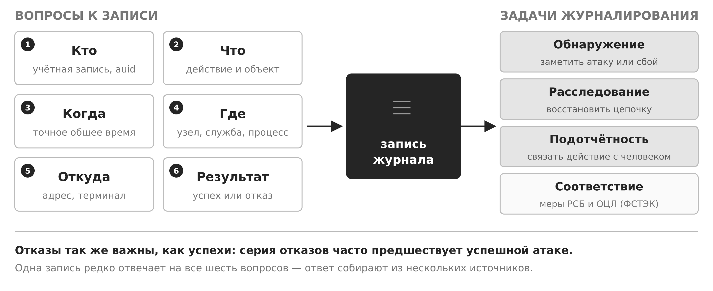

Рисунок 1 — Шесть вопросов к записи журнала и задачи журналирования

На рисунке 2 сквозной пример представлен как исходные данные: события ночи, их источники и вопросы расследования.

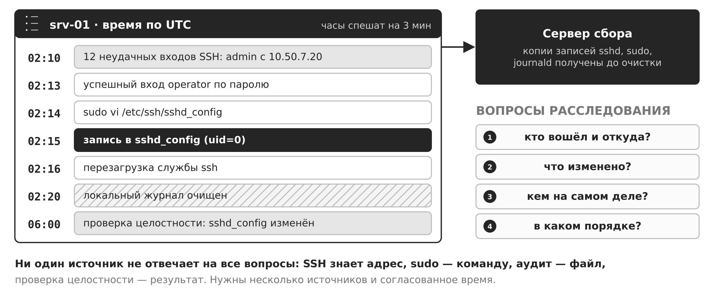

Рисунок 2 — Сквозной пример: события на srv-01 и вопросы расследования

Уже видно, что ни один источник не отвечает на все вопросы. Журнал SSH знает адрес и учётную запись, но не знает, что было изменено. Журнал sudo знает команду, но не знает, что именно записано в файл. Проверка целостности знает, что файл изменился, но не знает кем. Ответ складывается только из нескольких источников с согласованным временем.

Источники раздела: [1], [21].

## 2. Источники событий и пути их доставки

События в Linux порождают несколько независимых источников. Ядро пишет сообщения в кольцевой буфер; его читают `dmesg` и служба журнала через `/dev/kmsg`. Службы пишут в стандартные потоки вывода и ошибок. Многие программы вызывают библиотечную функцию syslog(), которая отправляет сообщение в сокет `/dev/log`. Модули PAM сообщают о входах и сменах паролей через тот же механизм. Отдельно стоит подсистема аудита ядра: она формирует записи о системных вызовах по правилам и передаёт их через сокет netlink демону auditd.

В системах с systemd центральным сборщиком служит systemd-journald. Он принимает сообщения ядра, сокета `/dev/log`, стандартных потоков служб и собственного программного интерфейса. Затем сохраняет их в двоичном журнале и может передавать дальше в rsyslog. rsyslog записывает текстовые файлы в `/var/log` и пересылает сообщения на удалённые серверы. auditd пишет свой журнал отдельно, в `/var/log/audit/audit.log`. Его сообщения обычно не проходят через journald, хотя часть из них ядро дублирует в kmsg.

На рисунке 3 показаны источники и пути доставки.

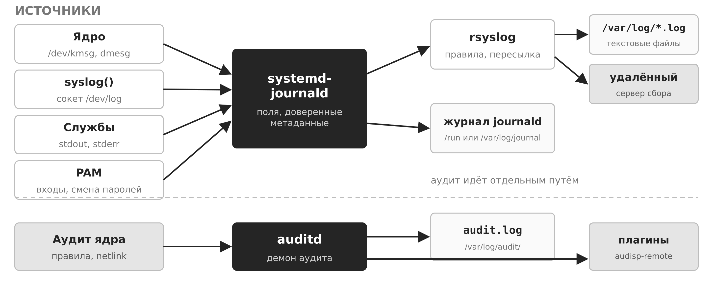

Рисунок 3 — Источники событий в Linux и пути их доставки

Из схемы следуют два практических вывода. Во-первых, одно и то же событие может оказаться в нескольких местах: в журнале journald, в `/var/log/auth.log` и в центральном хранилище. Это полезно для перекрёстной проверки. Во-вторых, каждый путь может прерваться: служба не запущена, буфер переполнен, сеть недоступна. Поэтому нужно знать, где искать запись и почему её может не быть.

Источники раздела: [4], [5].

## 3. syslog и rsyslog

Протокол syslog — старейший и самый распространённый формат системных сообщений. Каждое сообщение имеет приоритет, составленный из двух частей. Категория (facility) указывает источник: kern (0), user (1), mail (2), daemon (3), auth (4), syslog (5), cron (9), authpriv (10), local0–local7 (16–23). Уровень важности (severity) указывает серьёзность: emerg (0), alert (1), crit (2), err (3), warning (4), notice (5), info (6), debug (7). Числовой приоритет вычисляется как категория × 8 + уровень и передаётся в начале сообщения в угловых скобках. Например, auth.notice даёт 4 × 8 + 5 = 37, то есть `<37>`.

На рисунке 4 показана эта сетка и вычисление приоритета.

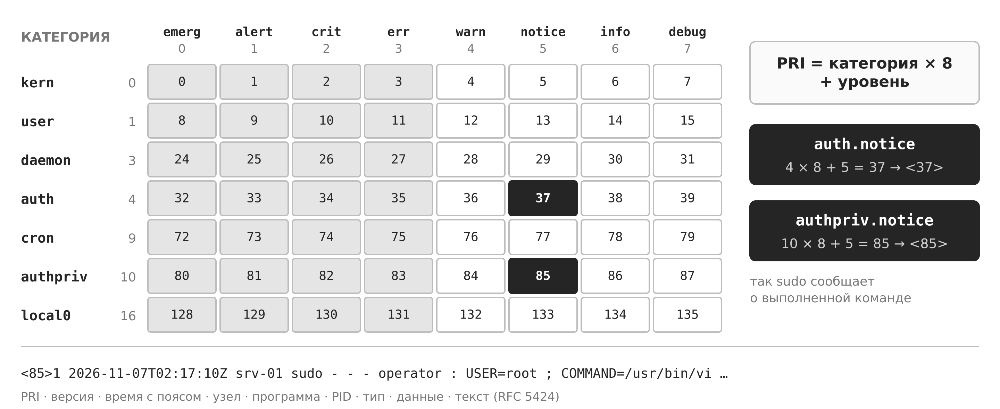

Рисунок 4 — Категории и уровни syslog; вычисление приоритета

Современный формат сообщения описан в RFC 5424: приоритет, версия, время с часовым поясом, узел, приложение, идентификатор процесса, тип сообщения, структурированные данные и текст. Старый формат RFC 3164 не содержит года и часового пояса, что затрудняет сопоставление записей с разных узлов.

rsyslog обрабатывает сообщения по правилам «селектор — действие». Селектор указывает категории и уровни, действие — куда записать. В Debian-подобных системах по умолчанию сообщения auth и authpriv идут в `/var/log/auth.log`, общий поток — в `/var/log/syslog`, сообщения ядра — в `/var/log/kern.log`. Знак `@` перед адресом означает пересылку по UDP, `@@` — по TCP. Порядок обработки определяется модулями ввода, наборами правил и модулями вывода. На рисунке 5 разобраны правила и путь сообщения внутри rsyslog.

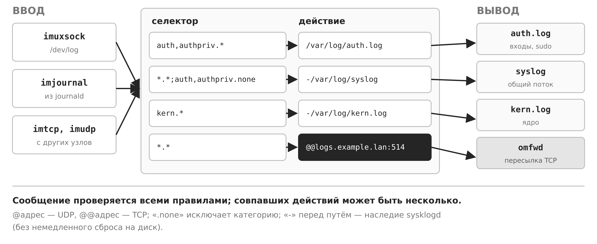

Рисунок 5 — Правила rsyslog: селектор, действие, пересылка

```text
# /etc/rsyslog.conf, фрагмент в стиле Debian
auth,authpriv.*                 /var/log/auth.log
*.*;auth,authpriv.none          -/var/log/syslog
kern.*                          -/var/log/kern.log
*.*                             @@logs.example.lan:514   # пересылка по TCP
```

Текстовые журналы растут, поэтому их периодически ротирует утилита logrotate. Текущий файл переименовывается, старые копии сжимаются, самые старые удаляются по счётчику rotate. После ротации службе нужно сообщить о новом файле: сигналом в postrotate или режимом copytruncate, при котором между копированием и усечением часть строк может потеряться. Срок хранения определяется произведением периода на число копий. Для auth.log с еженедельной ротацией и четырьмя копиями это около месяца — на расследование старого инцидента может не хватить. На рисунке 6 показан цикл ротации.

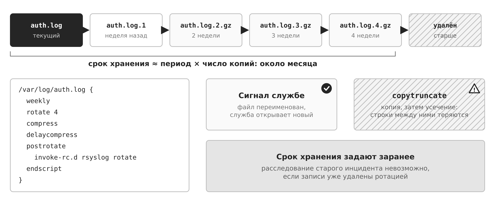

Рисунок 6 — Ротация журналов: срок хранения равен периоду, умноженному на число копий

Источники раздела: [2], [4], [20].

## 4. journald: структурированный журнал

systemd-journald хранит не строки, а записи из полей «имя=значение». Поле MESSAGE содержит текст, PRIORITY — уровень, SYSLOG_IDENTIFIER — имя программы. Важное различие проходит по первому символу имени. Поля без подчёркивания задаёт сам клиент, и им нельзя доверять безоговорочно: программа может назвать себя как угодно. Поля, начинающиеся с подчёркивания, добавляет journald по данным ядра, и клиент не может их подделать. Это _PID, _UID, _GID, _COMM, _EXE, _CMDLINE, _SYSTEMD_UNIT, _BOOT_ID, _HOSTNAME. Поля с двумя подчёркиваниями — служебные адреса записи: __REALTIME_TIMESTAMP (время по часам реального времени) и __MONOTONIC_TIMESTAMP (время с момента загрузки).

На рисунке 7 показана запись журнала с разделением полей по степени доверия.

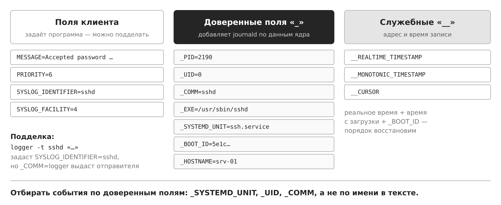

Рисунок 7 — Запись journald: поля клиента и доверенные поля

Место хранения задаёт параметр Storage в `/etc/systemd/journald.conf`. При volatile журнал хранится в `/run/log/journal` и теряется при перезагрузке. При persistent он хранится в `/var/log/journal`. Значение по умолчанию auto означает: хранить постоянно, если каталог `/var/log/journal` существует. В системах на базе Debian 9 этого каталога по умолчанию обычно нет, поэтому journald хранит журнал в памяти, а долговременные текстовые записи ведёт rsyslog. Размер ограничивают параметры SystemMaxUse и RuntimeMaxUse. Ограничение частоты (RateLimitIntervalSec, RateLimitBurst) защищает от затопления сообщениями, но при шквале событий часть записей будет подавлена — journald сообщит, сколько сообщений пропущено. На рисунке 8 сведены режимы хранения.

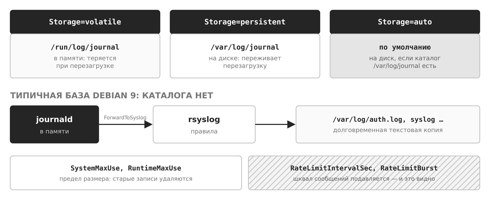

Рисунок 8 — Режимы хранения journald и связь с rsyslog

Запросы к журналу выполняются по полям, а не поиском по тексту:

```bash
journalctl -b -u ssh --since "02:00" --until "02:30"   # служба ssh в текущей загрузке
journalctl -p warning -b                                # уровень warning и выше
journalctl _UID=1003 --since today                      # всё от процессов с UID 1003
journalctl _COMM=sudo -o short-iso                       # записи sudo с временем ISO 8601
journalctl -u ssh -o json-pretty -n 1                    # одна запись со всеми полями
journalctl --list-boots                                  # загрузки и их идентификаторы
```

Ключ `-o short-iso` выводит время в формате ISO 8601 с часовым поясом, `-o json` — все поля для машинной обработки. Чтение системного журнала обычным пользователем ограничено: нужна группа systemd-journal или adm либо sudo.

Источники раздела: [5], [6], [7], [8].

## 5. Подсистема аудита Linux и auditd

Журналы служб описывают то, что службы сами решили сообщить. Подсистема аудита ядра Linux работает иначе: она наблюдает за системными вызовами и формирует записи по правилам независимо от желания программы. Правила загружаются в ядро командой auditctl. Ядро проверяет их на входе и выходе системных вызовов и при обращении к отслеживаемым файлам. Подходящие события передаются через netlink демону auditd. Он пишет их в `/var/log/audit/audit.log` и может передавать диспетчеру плагинов (в audit 2.x — audispd) для пересылки. При загрузке правила собираются из файлов `/etc/audit/rules.d/*.rules` утилитой augenrules. Для поиска и сводок служат ausearch и aureport.

На рисунке 9 показана архитектура подсистемы аудита.

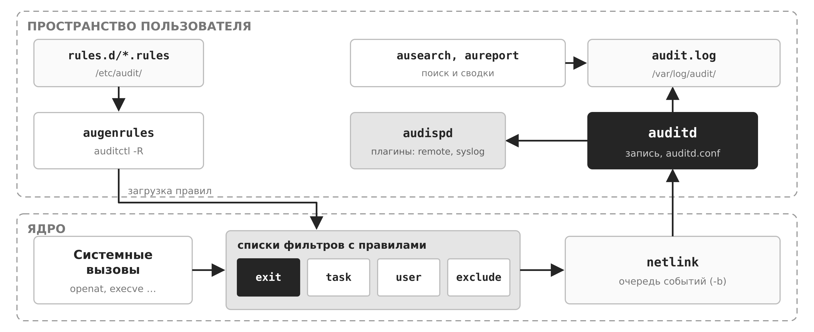

Рисунок 9 — Подсистема аудита: правила в ядре, auditd, журнал и инструменты

Одно событие аудита состоит из нескольких записей с общей отметкой `msg=audit(секунды.миллисекунды:порядковый_номер)`. Запись SYSCALL содержит номер вызова, результат, идентификаторы процесса, имя команды, путь к исполняемому файлу и ключ правила. Запись CWD — текущий каталог. Записи PATH — затронутые файлы с номером индексного дескриптора и правами. Запись PROCTITLE — командную строку в шестнадцатеричном виде. Ключ (key) задаётся в правиле и позволяет быстро найти связанные события. На рисунке 10 разобрано событие изменения sshd_config.

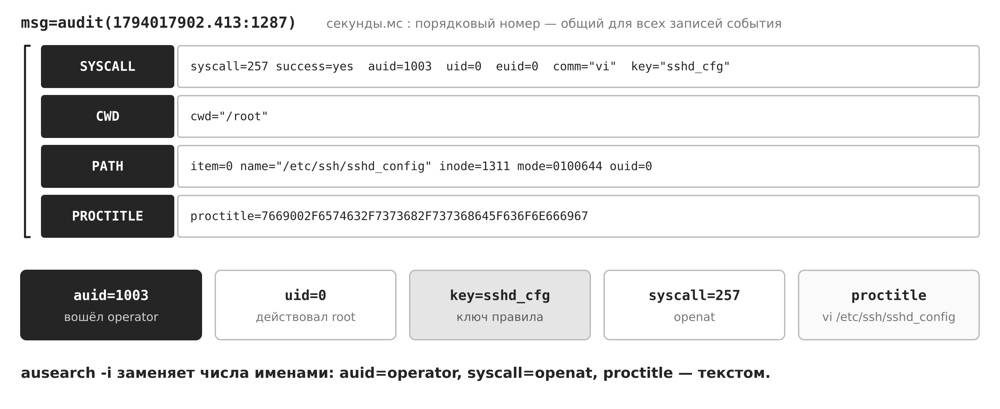

Рисунок 10 — Событие аудита: записи SYSCALL, CWD, PATH, PROCTITLE с общим номером

```text
type=SYSCALL msg=audit(1794017902.413:1287): arch=c000003e syscall=257 success=yes exit=3
  ppid=2210 pid=2214 auid=1003 uid=0 gid=0 euid=0 tty=pts1 ses=4 comm="vi"
  exe="/usr/bin/vim.basic" key="sshd_cfg"
type=CWD  msg=audit(1794017902.413:1287): cwd="/root"
type=PATH msg=audit(1794017902.413:1287): item=0 name="/etc/ssh/sshd_config" inode=1311 mode=0100644 ouid=0
type=PROCTITLE msg=audit(1794017902.413:1287): proctitle=7669002F6574632F7373682F737368645F636F6E666967
```

Самое ценное поле для подотчётности — auid, идентификатор учётной записи, под которой пользователь вошёл в систему (loginuid). Его устанавливает модуль pam_loginuid при входе. Он наследуется всеми потомками и не меняется при su и sudo. Поэтому в примере uid=0 говорит, что файл менял root, а auid=1003 — что этим root был пользователь operator. Если вход не проходил через PAM, auid не установлен и отображается как unset (4294967295). На рисунке 11 показано, как auid переживает повышение прав.

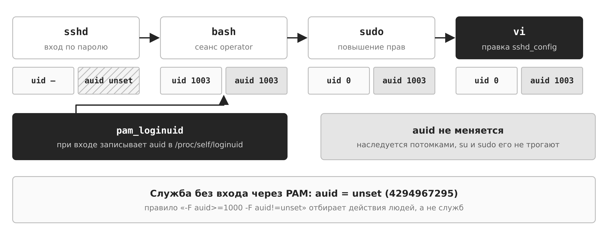

Рисунок 11 — auid сохраняется при sudo: действие root связано с исходной учётной записью

Три механизма журналирования дополняют друг друга. В таблице 1 сведены их различия.

Таблица 1 — Сравнение источников событий

| Свойство | rsyslog | journald | auditd |
|---|---|---|---|
| Что записывает | Сообщения, которые программы отправили сами | То же плюс потоки служб и сообщения ядра | События системных вызовов по правилам |
| Можно ли подделать отправителя | Да, имя программы задаёт клиент | Нет для полей с «_» | Нет, данные формирует ядро |
| Формат | Текст RFC 3164/5424 | Двоичный, поля «имя=значение» | Текст, записи с общим номером события |
| Кто действовал | Как сообщила программа | _UID, _PID процесса-отправителя | uid, euid и auid исходного входа |
| Пересылка | Встроенная (UDP, TCP, RELP, TLS) | Через rsyslog или journal-upload | Плагин диспетчера (audisp-remote) |

Источники раздела: [9], [12], [13], [14].

## 6. Правила аудита

Правила бывают двух видов. Наблюдение за файлом (watch) записывается как `-w путь -p права -k ключ`. Права r, w, x, a означают чтение, запись, выполнение и изменение атрибутов; для каталога наблюдение рекурсивно. Правило системного вызова записывается как `-a always,exit -F arch=b64 -S вызовы -F поле=значение -k ключ`. Оно срабатывает на выходе из вызова, если выполнены все условия. Архитектуру указывают явно: на 64-битной системе 32-битные программы используют другие номера вызовов, и для полного охвата нужно парное правило с arch=b32. На рисунке 12 сравниваются оба вида.

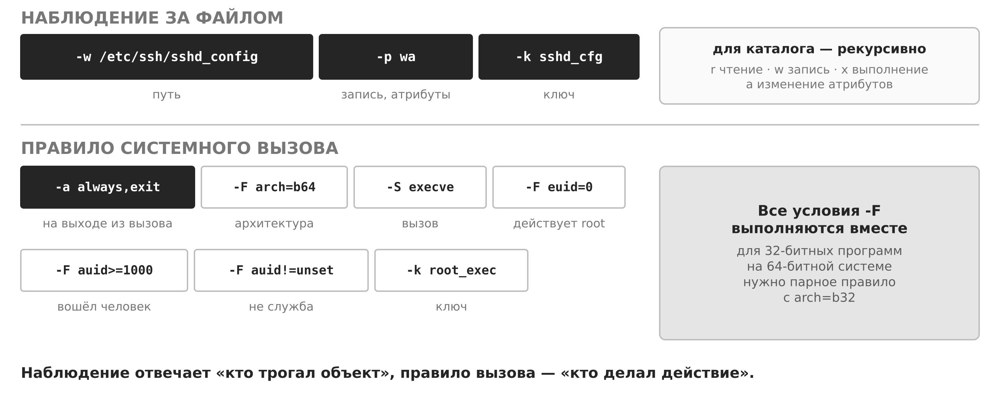

Рисунок 12 — Наблюдение за файлом и правило системного вызова

Выбор правил определяется тем, какие события важны для безопасности. Таблица 2 содержит типовой минимальный набор.

Таблица 2 — Что журналировать подсистемой аудита

| Объект | Правило (фрагмент) | Зачем |
|---|---|---|
| Учётные записи | `-w /etc/passwd -p wa -k identity` (также shadow, group, gshadow) | Создание записей и смена паролей |
| Права sudo | `-w /etc/sudoers -p wa -k sudoers`, `-w /etc/sudoers.d/ -p wa -k sudoers` | Расширение привилегий |
| SSH | `-w /etc/ssh/sshd_config -p wa -k sshd_cfg` | Изменение способов входа |
| Время | `-a always,exit -F arch=b64 -S adjtimex,settimeofday,clock_settime -k time` | Подмена времени маскирует порядок событий |
| Модули ядра | `-a always,exit -F arch=b64 -S init_module,finit_module,delete_module -k modules` | Загрузка кода в ядро |
| Запуск от root | `-a always,exit -F arch=b64 -S execve -F euid=0 -F auid>=1000 -F auid!=unset -k root_exec` | Действия пользователей после повышения прав |
| Сам аудит | `-w /etc/audit/ -p wa -k audit_cfg` | Попытка отключить наблюдение |

Слишком широкие правила (например, все execve всех пользователей) порождают огромный поток записей. Он замедляет систему, переполняет очередь ядра и занимает диск. Слишком узкие оставляют слепые зоны. Поэтому для каждого правила задают ключ и проверяют его полезность ausearch. Важны и режимы отказа. Параметр `-f` определяет реакцию ядра на потерю событий: 0 — молча, 1 — сообщение в kmsg (по умолчанию), 2 — аварийная остановка системы. Параметр `-b` задаёт размер очереди. В `/etc/audit/auditd.conf` параметры space_left_action, admin_space_left_action и disk_full_action определяют поведение при заполнении диска: предупредить, приостановить запись или остановить систему. Для систем, где пропуск записи недопустим, выбирают остановку, а не потерю. Последним правилом можно указать `-e 2`: конфигурация становится неизменяемой до перезагрузки, и злоумышленник с правами root не отключит аудит без следа перезагрузки. На рисунке 13 показан этот баланс.

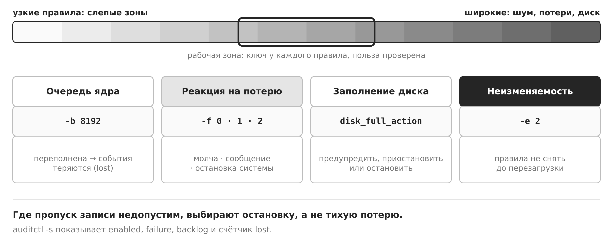

Рисунок 13 — Охват правил, объём записей и поведение при отказе

Работа с правилами и журналом:

```bash
sudo auditctl -s                                   # состояние: enabled, failure, backlog, lost
sudo auditctl -l                                   # загруженные правила
sudo auditctl -w /etc/ssh/sshd_config -p wa -k sshd_cfg   # временное правило до перезагрузки
sudo ausearch -k sshd_cfg -i --start today         # события по ключу, поля расшифрованы
sudo aureport --login --summary -i                 # сводка входов
sudo aureport -f -i --start today                  # обращения к файлам
```

Ключ `-i` заменяет числовые значения именами: auid=1003 превращается в auid=operator, номер вызова — в openat. Постоянные правила помещают в файл каталога `/etc/audit/rules.d/` и загружают augenrules. В учебном образе «Орла» демон auditd может быть не установлен: в практической работе 10 файловые события наблюдались через inotify. Его устанавливают из источника выпуска.

В Astra Linux Special Edition регистрация событий входит в комплекс средств защиты вместе с мандатным управлением доступом и контролем целостности. Её настройка описана в руководстве по КСЗ выпуска; механизмы лекции 10 дополняют общие средства Linux, разобранные здесь.

Источники раздела: [9], [10], [11], [12], [22].

## 7. Синхронизация времени

Расследование опирается на порядок событий. Если часы узлов расходятся, порядок искажается. В сквозном примере часы srv-01 спешат на три минуты. Изменение sshd_config по журналу сервера произошло в 02:18, а по центральному сборщику с точными часами сообщение о входе пришло в 02:13. Без поправки кажется, что между входом и изменением прошло пять минут, а при обратном расхождении изменение оказалось бы раньше входа. Время важно не только для журналов: протокол Kerberos по умолчанию отвергает расхождение больше пяти минут, а сертификаты TLS проверяются по сроку действия. На рисунке 14 показано, как расхождение часов меняет картину.

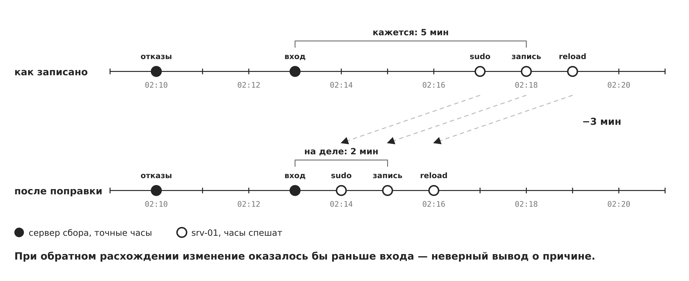

Рисунок 14 — Расхождение часов искажает порядок событий на временной шкале

Синхронизацию обеспечивает протокол NTP (RFC 5905). Источники точного времени образуют иерархию уровней (stratum): эталонные часы (уровень 0), серверы, подключённые к ним напрямую (уровень 1), и далее. В организации обычно есть свой сервер времени, к которому обращаются все узлы; в изолированном сегменте он сам становится источником. Клиент оценивает смещение и задержку и корректирует часы. Небольшое расхождение устраняется плавным замедлением или ускорением хода (slew). Большое — скачком (step), который сам по себе нарушает порядок записей. В Linux используют chrony (chronyd и chronyc), классический ntpd или простой клиент systemd-timesyncd, который реализует SNTP и не служит сервером для других. На рисунке 15 показана иерархия.

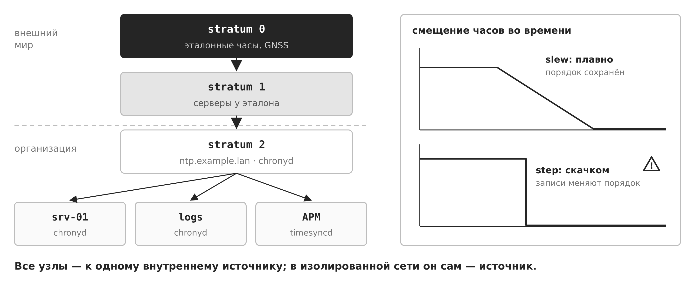

Рисунок 15 — Иерархия источников времени и клиенты NTP

В системе есть несколько часов. Аппаратные часы RTC работают при выключенном питании. Системные часы реального времени (CLOCK_REALTIME) можно перевести. Монотонные часы (CLOCK_MONOTONIC) только идут вперёд с момента загрузки. journald сохраняет для каждой записи и реальное, и монотонное время, и идентификатор загрузки. Поэтому даже при переводе часов порядок записей внутри одной загрузки восстанавливается. Журналы удобно хранить в UTC, а местное время показывать только при выводе. Изменение времени — само по себе событие безопасности: его фиксирует правило аудита на вызовы adjtimex, settimeofday и clock_settime. На рисунке 16 сопоставлены часы и отметки времени.

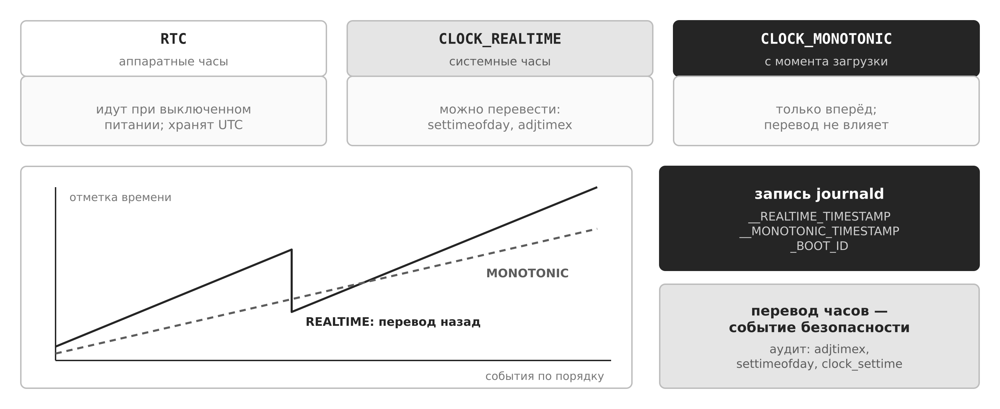

Рисунок 16 — RTC, часы реального времени и монотонные часы; что сохраняет journald

```bash
timedatectl                       # часовой пояс, синхронизация, источник
chronyc tracking                  # смещение и источник для chrony
chronyc sources -v                # список источников и их состояние
journalctl -u systemd-timesyncd   # сообщения клиента timesyncd
```

Источники раздела: [15], [16], [17].

## 8. Централизованный сбор событий

Локальный журнал уязвим: злоумышленник, получивший root, может его удалить или отредактировать. Именно это произошло в сквозном примере. Кроме того, расследование почти всегда затрагивает несколько узлов. Поэтому события пересылают на отдельный сервер сбора, сразу по мере появления. Он находится в другом административном домене: администраторы рабочих серверов не имеют на нём прав на удаление. На рисунке 17 показана архитектура.

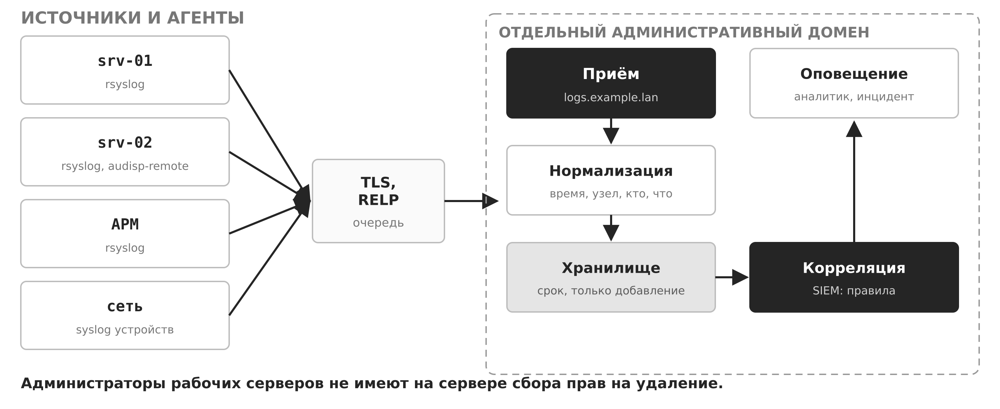

Рисунок 17 — Централизованный сбор: агенты, транспорт, хранилище, корреляция

Надёжность пересылки определяется транспортом. UDP (порт 514) прост, но теряет сообщения при перегрузке, не подтверждает доставку и позволяет подделать отправителя. TCP гарантирует порядок внутри соединения, но сообщения в буфере теряются при обрыве. Протокол RELP, используемый rsyslog, подтверждает доставку на уровне приложения. TLS (RFC 5425) шифрует канал и аутентифицирует стороны. На стороне отправителя настраивают очередь с выгрузкой на диск: при недоступности сервера сообщения накапливаются и отправляются после восстановления связи. На рисунке 18 сравниваются транспорты.

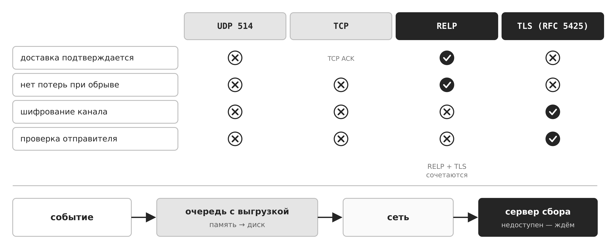

Рисунок 18 — Транспорты пересылки и очередь на стороне отправителя

```text
# rsyslog: пересылка по TCP с очередью на диске (фрагмент)
action(type="omfwd" target="logs.example.lan" port="514" protocol="tcp"
       queue.type="LinkedList" queue.filename="fwd_queue"
       queue.saveOnShutdown="on" action.resumeRetryCount="-1")
```

На сервере сбора события нормализуются — приводятся к общим полям: время, узел, пользователь, адрес, действие, результат. Затем они хранятся с заданным сроком и анализируются. Системы управления событиями безопасности (SIEM) применяют правила корреляции, связывающие события разных источников. Например, правило «несколько неудачных входов и успешный вход с того же адреса в течение десяти минут, затем изменение конфигурации тем же auid» срабатывает на цепочку из сквозного примера, хотя каждое событие по отдельности обычное. На рисунке 19 показано такое правило.

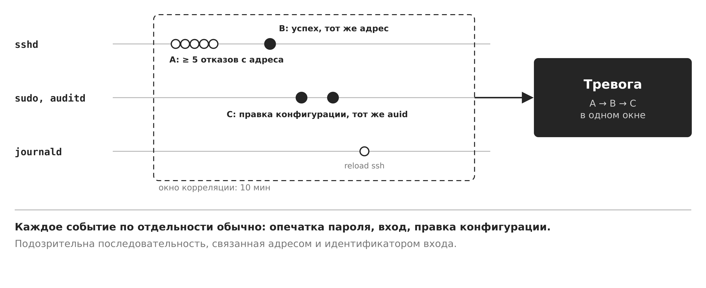

Рисунок 19 — Правило корреляции событий из трёх источников

Источники раздела: [1], [3], [4].

## 9. Защита журналов

Журнал полезен, только если ему можно доверять. Угрозы самим журналам: удаление и усечение, правка отдельных записей, затопление шумом, переполнение диска, остановка службы журналирования и как следствие — пропуск событий. Защита строится в несколько слоёв. Права доступа: файлы в `/var/log` принадлежат root, читать их может группа adm. Атрибут только-добавление (`chattr +a`): файл нельзя усечь или перезаписать, только дописать, — но root может снять атрибут. Немедленная пересылка на удалённый сервер — самая сильная мера против злоумышленника с root на источнике. Наблюдение за пропусками: внезапная тишина от узла — такой же сигнал, как поток ошибок. Аудит обращений к файлам журналов и к конфигурации журналирования. На рисунке 20 угрозы сопоставлены с мерами.

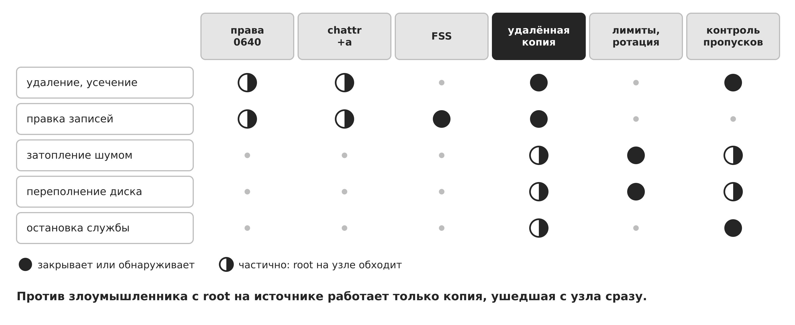

Рисунок 20 — Угрозы журналам и слои защиты

journald предлагает криптографическую защиту целостности — запечатывание с прямой стойкостью (Forward Secure Sealing, FSS). Команда `journalctl --setup-keys` создаёт ключ запечатывания, который хранится на узле, и ключ проверки, который показывается один раз и хранится отдельно. Через заданный интервал journald запечатывает накопленные записи и необратимо изменяет ключ запечатывания. Злоумышленник, получивший текущий ключ, не может переподписать уже запечатанные записи. Команда `journalctl --verify --verify-key=…` обнаружит их изменение. FSS не мешает удалить журнал целиком и не защищает записи последнего, ещё не запечатанного интервала, поэтому дополняет удалённую копию, а не заменяет её. На рисунке 21 показан принцип.

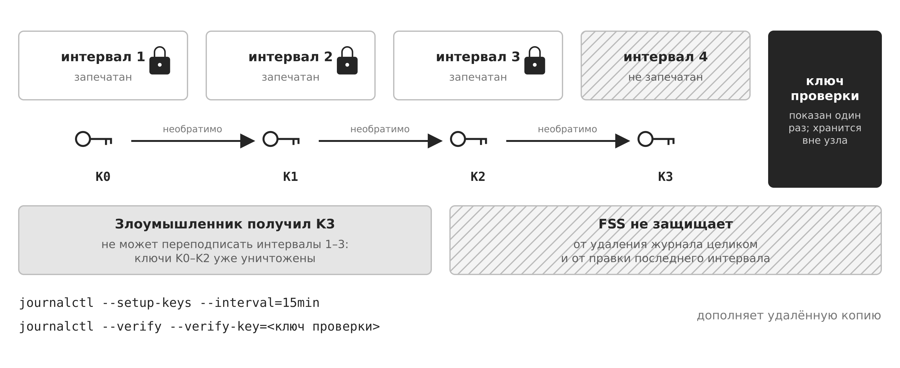

Рисунок 21 — Forward Secure Sealing: ключ меняется необратимо, проверка — отдельным ключом

Источники раздела: [1], [5], [8].

## 10. Контроль целостности файлов

Журналы фиксируют действия, контроль целостности — их результат: изменилось ли содержимое или атрибуты файла по сравнению с доверенным состоянием. Метод основан на эталоне. В момент, когда система заведомо в порядке, для выбранных файлов вычисляются и сохраняются атрибуты: права, владелец, группа, размер, номер индексного дескриптора, время изменения, криптографические хеши содержимого. Позже атрибуты вычисляются заново и сравниваются с эталоном. Классическое средство — AIDE (Advanced Intrusion Detection Environment); аналогично работают Tripwire и другие программы. Цикл работы: `aide --init` создаёт новую базу, администратор переносит её на место рабочей, `aide --check` сравнивает, `aide --update` после разрешённого изменения создаёт новую базу.

Эталон бесполезен, если злоумышленник может обновить его вместе с файлом. Поэтому базу хранят на носителе только для чтения или вне проверяемой системы, а её хеш записывают отдельно. Проверку лучше выполнять с доверенного носителя. Обнаруженное изменение сопоставляют с заявками на изменения. Разрешённое — повод обновить эталон, неразрешённое — инцидент, который требует расследования и восстановления доверенной версии файла из пакета или резервной копии. На рисунке 22 показан жизненный цикл эталона.

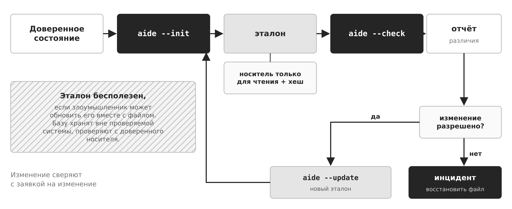

Рисунок 22 — Эталон целостности: создание, хранение, проверка, обновление

Не все файлы контролируются одинаково. Для исполняемых файлов и библиотек проверяют всё, включая хеш. Для конфигурации — хеш, права и владельца. Журналы растут постоянно, поэтому у них проверяют только права и владельца, иначе каждая проверка даст ложное срабатывание. Временные каталоги и кэши исключают. В AIDE это задаётся группами атрибутов в правилах конфигурации. На рисунке 23 показана политика по категориям файлов.

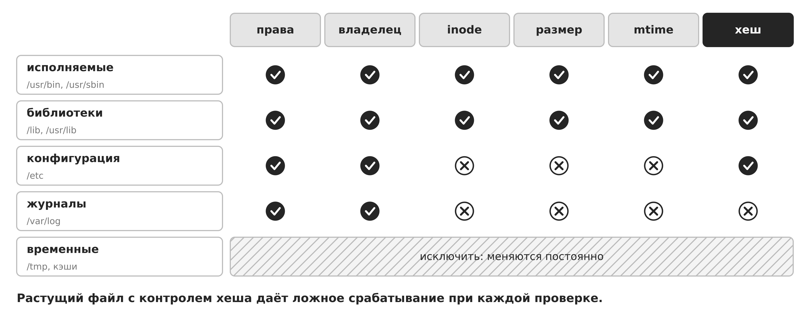

Рисунок 23 — Какие атрибуты контролировать для разных категорий файлов

```text
# /etc/aide/aide.conf, фрагмент
BIN  = p+i+n+u+g+s+m+c+sha256     # права, inode, ссылки, владелец, группа, размер, время, хеш
CONF = p+u+g+sha256
LOG  = p+u+g                       # растущие файлы: без хеша и размера
/usr/bin      BIN
/etc          CONF
/var/log      LOG
!/var/log/journal
```

Средства контроля различаются тем, где хранится эталон и что проверяется. `dpkg -V` и debsums сравнивают установленные файлы пакетов с контрольными суммами MD5 из базы dpkg. Это удобно и не требует настройки, но база лежит на той же машине, охватывает только файлы пакетов, а MD5 устарел как криптографическая функция. AIDE хранит собственный эталон с сильными хешами для любых файлов, и эталон можно унести с машины. Подсистема ядра IMA измеряет файлы при запуске и отображении в память и может заверять измерения доверенным модулем TPM. Дополнение EVM защищает атрибуты от подмены в выключенной системе. На рисунке 24 сведены эти подходы.

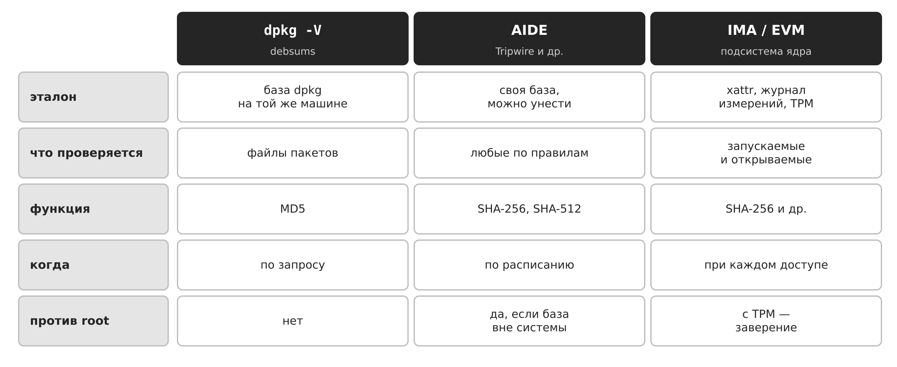

Рисунок 24 — dpkg -V, AIDE и IMA: где эталон и что проверяется

Практическая работа 13 проходит этот цикл: создание эталона, разрешённое изменение тестового файла, обнаружение и восстановление доверенной версии.

```bash
sudo aide --init                                   # новая база aide.db.new
sudo cp /var/lib/aide/aide.db.new /var/lib/aide/aide.db
sha256sum /var/lib/aide/aide.db > aide.db.sha256   # хеш эталона хранится отдельно
sudo aide --check                                  # сравнение с эталоном
sudo dpkg -V openssh-server                        # сверка файлов пакета с базой dpkg
```

Пути к базе и имя конфигурационного файла зависят от сборки AIDE; в Debian-подобных системах используется обёртка aideinit. Для своей системы сверяйтесь с `man aide`.

Источники раздела: [18], [19], [21].

## 11. Корреляция и временная шкала: разбор примера

Вернёмся к сквозному примеру и соберём временную шкалу. Первый шаг — привести всё к UTC и внести поправку на расхождение часов srv-01. Её определяют по журналу NTP-клиента или сравнением одного и того же события в локальном журнале и на центральном сервере. Второй шаг — расположить записи всех источников в одном порядке и пометить источник каждой. Третий — связать записи общими признаками: адрес, номер сеанса SSH, auid, процесс. На рисунке 25 показана получившаяся шкала.

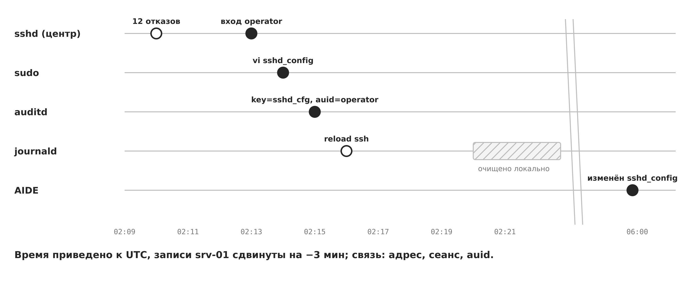

Рисунок 25 — Временная шкала инцидента на srv-01 после поправки времени

Каждый источник доказывает свою часть. Журнал sshd на центральном сервере показывает серию отказов и успешный вход operator по паролю с 10.50.7.20. Журнал sudo — запуск редактора для sshd_config от имени operator. Событие аудита с ключом sshd_cfg — запись в файл процессом vi (/usr/bin/vim.basic) с uid=0 и auid=1003, то есть operator. Запись journald о перезагрузке ssh — момент, когда изменение вступило в силу. Отчёт AIDE — что именно изменилось: хеш и время модификации файла. Пропуск в локальном журнале после 02:20 и наличие тех же записей на центральном сервере — свидетельство попытки скрыть следы. Ни один источник по отдельности не доказывает всю цепочку. На рисунке 26 сведено, что доказывает каждый источник и чего он не доказывает.

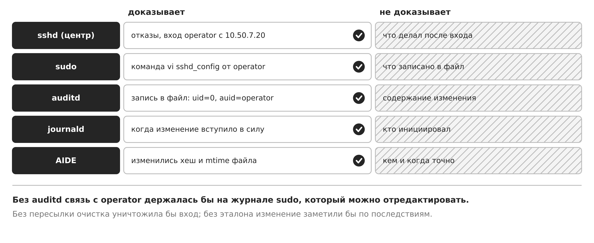

Рисунок 26 — Вклад источников в доказательство и оставшиеся пробелы

Остаются и пробелы. Если бы auditd не был настроен, связь изменения с operator держалась бы только на sudo, а его журнал можно отредактировать. Если бы события не пересылались, очистка локального журнала уничтожила бы доказательства входа. Если бы не было эталона, изменение sshd_config заметили бы только по последствиям. Вывод для проектирования: журналирование, аудит, синхронизация времени, централизованный сбор и контроль целостности — части одной системы, и каждая закрывает пробел других.

Итог лекции показан на рисунке 27.

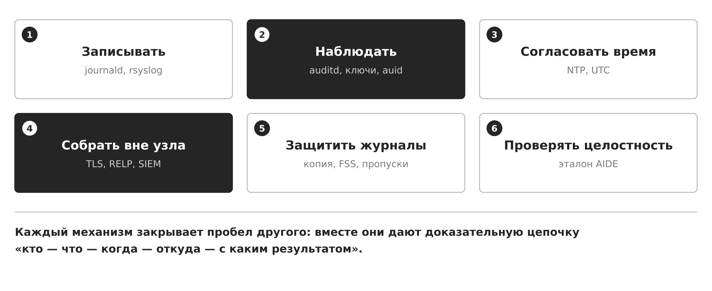

Рисунок 27 — Основные положения лекции

Источники раздела: [1], [3], [12], [18].

## 12. Основные понятия и вопросы для самоконтроля

**Событие** — факт, произошедший в системе. **Запись журнала** — сохранённое описание события. **syslog** — протокол и формат системных сообщений с категорией и уровнем важности. **rsyslog** — служба обработки, записи и пересылки сообщений syslog. **journald** — служба systemd, хранящая структурированные записи с доверенными полями. **Доверенное поле** — поле записи journald, начинающееся с подчёркивания и заполняемое по данным ядра. **Подсистема аудита** — механизм ядра, формирующий записи о системных вызовах по правилам. **auid (loginuid)** — идентификатор учётной записи входа, сохраняющийся при смене прав. **Ключ правила** — метка, по которой находят события аудита. **NTP** — протокол синхронизации времени. **Монотонные часы** — часы, идущие только вперёд с момента загрузки. **Централизованный сбор** — пересылка событий на отдельный сервер для хранения и анализа. **SIEM** — система управления событиями безопасности с правилами корреляции. **FSS** — запечатывание журнала journald с прямой стойкостью. **Эталон целостности** — сохранённые атрибуты и хеши файлов в доверенном состоянии. **AIDE** — программа контроля целостности файлов по эталону.

1. На какие шесть вопросов должна отвечать запись журнала?
2. Какие источники событий есть в Linux и какими путями они доставляются?
3. Как вычисляется приоритет сообщения syslog и что означает `<37>`?
4. Чем срок хранения журналов связан с параметрами logrotate?
5. Почему полям journald с подчёркиванием можно доверять больше, чем SYSLOG_IDENTIFIER?
6. От чего зависит, сохранится ли журнал journald после перезагрузки?
7. Из каких записей состоит событие аудита и что их связывает?
8. Чем auid отличается от uid и euid и почему это важно после sudo?
9. Чем наблюдение за файлом отличается от правила системного вызова?
10. Почему в правилах системных вызовов указывают архитектуру?
11. Что означают режимы отказа `-f` и параметр `-e 2`?
12. Как расхождение часов искажает расследование и чем slew отличается от step?
13. Что journald сохраняет для восстановления порядка записей при переводе часов?
14. Почему централизованный сбор защищает от злоумышленника с правами root на источнике?
15. Чем различаются UDP, TCP, RELP и TLS для пересылки журналов?
16. Что защищает и чего не защищает Forward Secure Sealing?
17. Почему эталон целостности нельзя хранить на проверяемой системе без защиты?
18. Чем dpkg -V отличается от AIDE и IMA?

## 13. Источники

1. [NIST SP 800-92: Guide to Computer Security Log Management](https://csrc.nist.gov/pubs/sp/800/92/final).
2. [RFC 5424: The Syslog Protocol](https://www.rfc-editor.org/rfc/rfc5424).
3. [RFC 5425: TLS Transport Mapping for Syslog](https://www.rfc-editor.org/rfc/rfc5425).
4. [rsyslog: документация](https://www.rsyslog.com/doc/).
5. [systemd-journald.service(8)](https://www.freedesktop.org/software/systemd/man/latest/systemd-journald.service.html).
6. [journald.conf(5)](https://www.freedesktop.org/software/systemd/man/latest/journald.conf.html).
7. [systemd.journal-fields(7)](https://www.freedesktop.org/software/systemd/man/latest/systemd.journal-fields.html).
8. [journalctl(1)](https://www.freedesktop.org/software/systemd/man/latest/journalctl.html).
9. [auditctl(8)](https://man7.org/linux/man-pages/man8/auditctl.8.html).
10. [audit.rules(7)](https://man7.org/linux/man-pages/man7/audit.rules.7.html).
11. [auditd.conf(5)](https://man7.org/linux/man-pages/man5/auditd.conf.5.html).
12. [ausearch(8)](https://man7.org/linux/man-pages/man8/ausearch.8.html).
13. [Red Hat Enterprise Linux 8: Auditing the system](https://docs.redhat.com/en/documentation/red_hat_enterprise_linux/8/html/security_hardening/auditing-the-system_security-hardening).
14. [pam_loginuid(8)](https://man7.org/linux/man-pages/man8/pam_loginuid.8.html).
15. [RFC 5905: Network Time Protocol Version 4](https://www.rfc-editor.org/rfc/rfc5905).
16. [chrony: документация](https://chrony-project.org/documentation.html).
17. [systemd-timesyncd.service(8)](https://www.freedesktop.org/software/systemd/man/latest/systemd-timesyncd.service.html).
18. [AIDE: документация](https://aide.github.io/doc/).
19. [Linux IMA/EVM: проектная вики](https://sourceforge.net/p/linux-ima/wiki/Home/).
20. [logrotate(8)](https://man7.org/linux/man-pages/man8/logrotate.8.html).
21. [ФСТЭК России. Меры защиты информации в государственных информационных системах, 11.02.2014](https://legalacts.ru/doc/metodicheskii-dokument-mery-zashchity-informatsii-v-gosudarstvennykh/).
22. [Anti-Malware.ru: обзор средств защиты Astra Linux, раздел «Регистрация и аудит событий»](https://www.anti-malware.ru/reviews/Astra-Linux-built-in-security).

Дата обращения: 8 ноября 2026 г. Современные справочные страницы systemd описывают новые версии; для учебного «Орла» 2.12 (systemd 232) сопоставляйте их с `man journald.conf`, `man journalctl`, `man systemd.journal-fields` установленной системы. Для auditd, AIDE и chrony используйте справку установленных версий.
