# Лекция 14. Kali Linux в задачах защитника

**Дисциплина:** Операционные системы

**Специальность:** 10.05.01 «Компьютерная безопасность»

**Уровень:** университет, специалитет, 3-й курс

**Продолжительность:** 2 академических часа, 90 минут

## Цель и логика лекции

Цель лекции — освоить безопасную методику разрешённой оценки защищённости операционной системы, в которой Kali Linux выступает контролируемым инструментом проверки, а не целью обучения атаке. Тема рассматривается с позиции защитника: проверяющая платформа нужна, чтобы подтвердить, что защищаемая система ведёт себя так, как заявлено в её паспорте, и чтобы найти расхождения между ожидаемым и фактическим состоянием до того, как их найдёт нарушитель.

После изучения темы студент должен объяснять, почему техническая возможность инструмента не является полномочием на действие; выделять субъект, объект, границу доверия и точку принуждения политики; формулировать правила взаимодействия и область проверки; разворачивать изолированный учебный полигон и проверять, что он не выпускает трафик за свои пределы; проходить этапы разрешённой проверки — подготовку, обнаружение поверхности, контролируемую валидацию и завершение; отличать наблюдение от подтверждённой уязвимости; оформлять находку нейтрально и доказательно; выполнять повторную проверку после исправления.

Лекция опирается на предыдущий материал курса. Инвентаризация сетевой поверхности и правила безопасного полигона рассматривались в практике по оценке с Kali; межсетевое экранирование и повторная проверка — в теме о защите сети; журналирование и корреляция событий — в теме об аудите; контроль целостности и доверенный эталон — в теме об обнаружении изменений. Следующая лекция посвящена виртуализации, контейнерам и изоляции: границы изоляции, которые здесь проверяются снаружи, там рассматриваются изнутри.

Центральный вопрос лекции: как доказать, что механизмы защиты реально формируют требуемое поведение системы, а не только присутствуют в конфигурации? Ответ строится по схеме «ожидание → наблюдение → исправление → повторная проверка», и именно эта схема задаёт логику всей темы.

## Оглавление

- [1. Место проверяющей платформы в работе защитника](#1-место-проверяющей-платформы-в-работе-защитника)
- [2. Разрешение, область и правила взаимодействия](#2-разрешение-область-и-правила-взаимодействия)
- [3. Минимизация риска, этика и доказательность](#3-минимизация-риска-этика-и-доказательность)
- [4. Безопасный лабораторный полигон](#4-безопасный-лабораторный-полигон)
- [5. Снимки, тестовые данные и барьер от выхода](#5-снимки-тестовые-данные-и-барьер-от-выхода)
- [6. Этапы разрешённой проверки: подготовка и обнаружение](#6-этапы-разрешённой-проверки-подготовка-и-обнаружение)
- [7. Сопоставление, валидация и ложные срабатывания](#7-сопоставление-валидация-и-ложные-срабатывания)
- [8. Завершение, отчёт и структура находки](#8-завершение-отчёт-и-структура-находки)
- [9. Рекомендация, повторная проверка и разбор сценария](#9-рекомендация-повторная-проверка-и-разбор-сценария)
- [Основные выводы](#основные-выводы)
- [Вопросы для самоконтроля](#вопросы-для-самоконтроля)
- [Основные понятия и сокращения](#основные-понятия-и-сокращения)
- [Источники](#источники)

На рисунке 1 показано: замкнутый цикл защитника, в котором проверка подтверждает поведение системы.

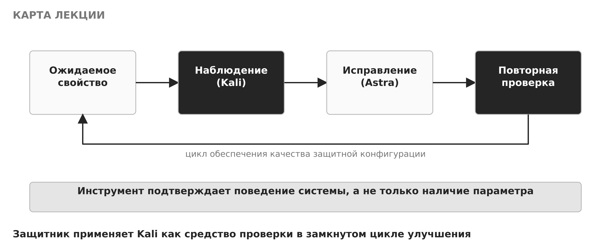

<em>Рисунок 1 — Цикл защитника: ожидание, наблюдение, исправление, повторная проверка</em>

## 1. Место проверяющей платформы в работе защитника

Kali Linux — это дистрибутив, в котором заранее собраны средства диагностики, инвентаризации и тестирования защищённости. Для защитника удобство такого набора очевидно: не нужно вручную собирать инструменты, их версии согласованы, а типовые задачи поддержаны из коробки. Однако наличие инструмента ничего не говорит о праве его применить. Сканер портов, анализатор трафика или средство проверки конфигурации сами по себе нейтральны; законность и допустимость действия определяются не техническими возможностями, а разрешением владельца системы и согласованной областью работ.

В защитном курсе Kali используется как внешний наблюдатель защищаемой Astra Linux. Задача наблюдателя — подтвердить ожидаемые свойства системы: какие сетевые сервисы видимы снаружи, какие протоколы и сертификаты они предъявляют, блокируются ли недопустимые соединения, появляются ли при этом события аудита. Это работа по обеспечению качества защитной конфигурации, а не по её преодолению. Эксплуатация уязвимостей, подбор учётных данных, вызов отказа в обслуживании, закрепление в системе, сокрытие следов и выход за пределы полигона не требуются для учебной цели и не допускаются.

Полезно с самого начала разделять три роли, которые часто смешивают: инструмент, разрешение и доказательство. Инструмент даёт техническую возможность получить данные. Разрешение определяет, какие из этих данных вообще можно получать и в каких пределах. Доказательство — это то, что остаётся после проверки и позволяет владельцу системы воспроизвести результат и принять решение. Сильная сторона защитника не в количестве инструментов, а в дисциплине: он работает в области, фиксирует наблюдения и доводит их до исправления и повторной проверки.

На рисунке 2 показано: техническая возможность инструмента проходит через «ворота» разрешения и области, и только затем действие становится допустимым.

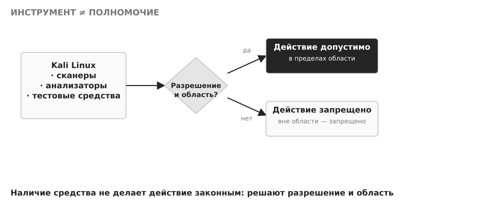

<em>Рисунок 2 — Инструмент не даёт полномочий</em>

Такое разделение объясняет, почему одна и та же команда может быть и рутинной проверкой, и недопустимым действием. Запрос к сетевому порту собственной учебной машины по согласованной области — это инвентаризация. Тот же запрос к чужому узлу вне области — нарушение, даже если технически он неотличим. Поэтому защитник описывает не только то, что он делает, но и на каком основании и в каких границах.

## 2. Разрешение, область и правила взаимодействия

Любая разрешённая проверка начинается не с запуска инструмента, а с фиксации правил взаимодействия и области. Правила взаимодействия — это письменно согласованный набор условий: кто владелец системы, какое разрешение получено, какие адреса и версии являются целями, в какое время допустима работа, какими методами, с какими ограничениями нагрузки, по какому контакту проверку немедленно останавливают и как обращаться с полученными данными. Всё, что не включено в область, по умолчанию считается запрещённым.

На рисунке 3 показано: Kali как внешний наблюдатель подтверждает видимые свойства Astra, не вмешиваясь в её работу.

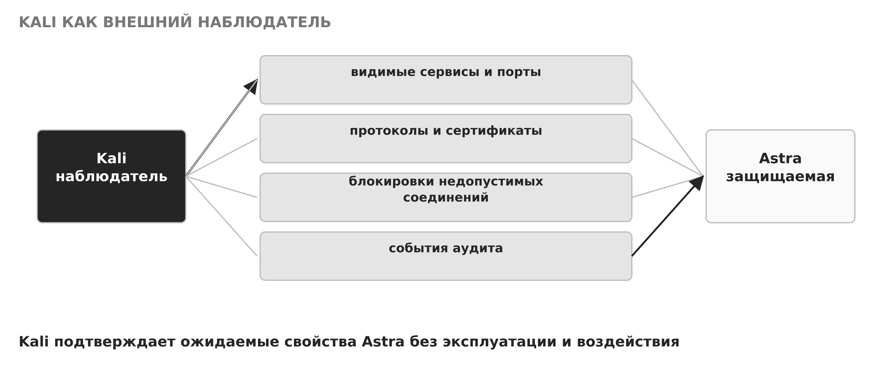

<em>Рисунок 3 — Kali как внешний наблюдатель Astra</em>

Отдельно и явно фиксируется то, что не входит в учебную проверку. Перечень запрещённого так же важен, как и перечень разрешённого: он снимает соблазн «проверить ещё и это» и защищает и систему, и студента.

На рисунке 4 показано: действия, которые не требуются для учебной цели и не допускаются.

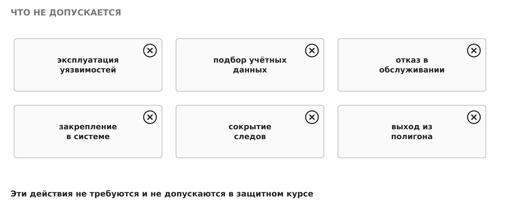

<em>Рисунок 4 — Действия, которые не допускаются</em>

Правила взаимодействия удобно свести в таблицу: каждый элемент отвечает на один вопрос и не оставляет места для домысливания. Пустое поле в такой таблице — это не мелочь, а источник будущего спора о том, было ли действие разрешено.

Таблица 1 — Элементы правил взаимодействия

| Элемент | Какой вопрос закрывает |
|---|---|
| Владелец системы | кто отвечает за актив и даёт разрешение |
| Письменное разрешение | на основании чего ведётся работа |
| Адреса и версии целей | что именно проверяется |
| Допустимое время | когда работа разрешена |
| Разрешённые методы | какими способами |
| Ограничения нагрузки | какой темп и объём безопасны |
| Контакт для остановки | кому и как сообщить о немедленной остановке |
| Правила обращения с данными | как хранить и передавать результаты |

Область проверки задаёт границу между разрешённым и запрещённым пространством действий. Внутри области — согласованные адреса, указанные порты и разрешённые методы. Вне области — всё остальное, и даже заманчивое наблюдение за её пределами не проверяется. Любая неожиданная находка за границей области означает немедленную остановку и уведомление ответственного, а не продолжение «из любопытства».

На рисунке 5 показано: правила взаимодействия как набор согласованных полей.

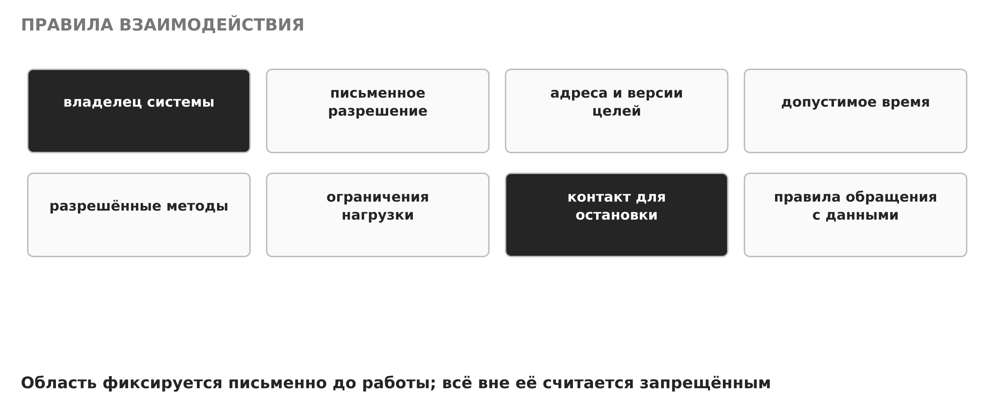

<em>Рисунок 5 — Правила взаимодействия</em>

На рисунке 6 показано: область проверки и её границы; вне области действие запрещено.

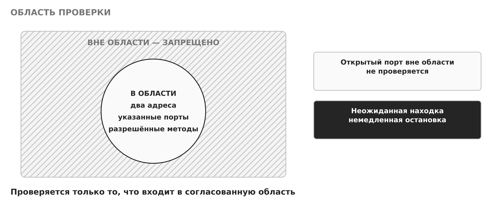

<em>Рисунок 6 — Область проверки и её границы</em>

Наконец, назначение проверки анализируют не как изолированную настройку, а как часть единого механизма операционной системы. Для любого результата важно установить четыре элемента: субъект решения (кто и по чьему разрешению проверяет), защищаемый объект (какой актив), границу доверия (где кончается доверенная зона) и точку принуждения политики (где решение реально применяется — при обращении, а не только в файле конфигурации). Если хотя бы один из этих элементов не определён, внешне одинаковая конфигурация может давать разные эффекты для интерактивной сессии, системной службы и автоматизированного задания.

На рисунке 7 показано: субъект, объект, граница доверия и точка принуждения как четыре опоры любой проверки.

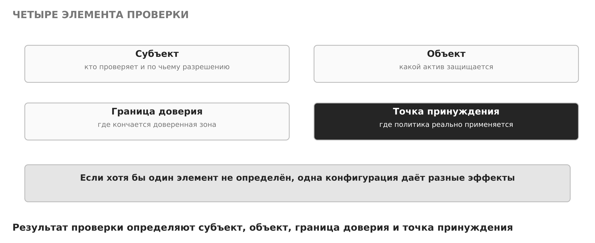

<em>Рисунок 7 — Субъект, объект, граница доверия и точка принуждения</em>

## 3. Минимизация риска, этика и доказательность

Даже полностью разрешённая проверка несёт риск непреднамеренного вреда: избыточная нагрузка может вызвать отказ службы, неосторожная команда — изменить состояние, а утечка учебных данных — создать проблему, которой изначально не было. Поэтому защитник выбирает неразрушающие методы (наблюдение и чтение вместо изменения), ограничивает скорость и объём воздействия, защищает учебные данные и заранее формулирует критерий немедленной остановки. Эти четыре меры снижают риск, не уменьшая ценности результата.

На рисунке 8 показано: минимизация риска через методы, темп, данные и критерий остановки.

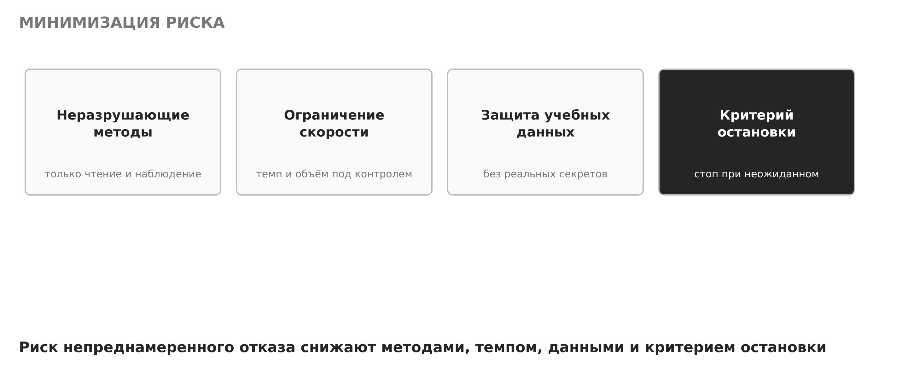

<em>Рисунок 8 — Минимизация риска</em>

Этическая сторона проверки неотделима от технической. Защитник описывает наблюдение точно, без преувеличения и без выхода за область. Распространённая ошибка — оценивать механизм только по удобному положительному сценарию: «порт закрыт, значит защита работает». Для защищённой эксплуатации нужны отрицательный тест (показать, что запрещённое действительно не проходит), проверка наследования (сохраняется ли свойство у дочерних процессов и служб) и анализ пути обхода через другой интерфейс. Изменение вносят обратимо, связывают с журналом и повторяют после обновления. Тогда механизм становится контролем, а не декларацией.

Ключ к доказательности — различать факт и гипотезу. Факт — это то, что наблюдалось: конкретная команда с параметрами, время, релевантный фрагмент вывода. Гипотеза — то, что это наблюдение может означать; она требует проверки и учёта контекста. В отчёте факт и гипотезу разделяют, а уровень уверенности указывают явно. Смешение этих категорий превращает честное наблюдение в необоснованное утверждение и подрывает доверие к результату.

На рисунке 9 показано: наблюдение разделяется на подтверждённый факт и требующую проверки гипотезу.

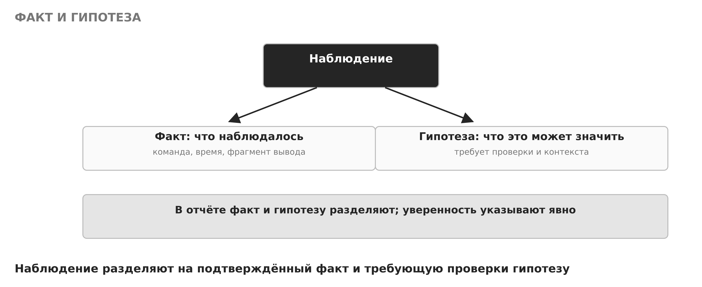

<em>Рисунок 9 — Факт и гипотеза</em>

## 4. Безопасный лабораторный полигон

Проверка проводится только в изолированном полигоне. Минимальная схема включает две виртуальные машины в сети типа Internal Network или Host-only: защищаемую Astra Linux и проверяющую Kali Linux. Мост к сети организации отключён, маршрутизация в Интернет для сканирования не используется, адреса назначаются статически. Такая топология гарантирует, что ни наблюдение, ни возможная ошибка не выйдут за пределы полигона.

На рисунке 10 показано: топология учебного полигона из двух машин в изолированной сети.

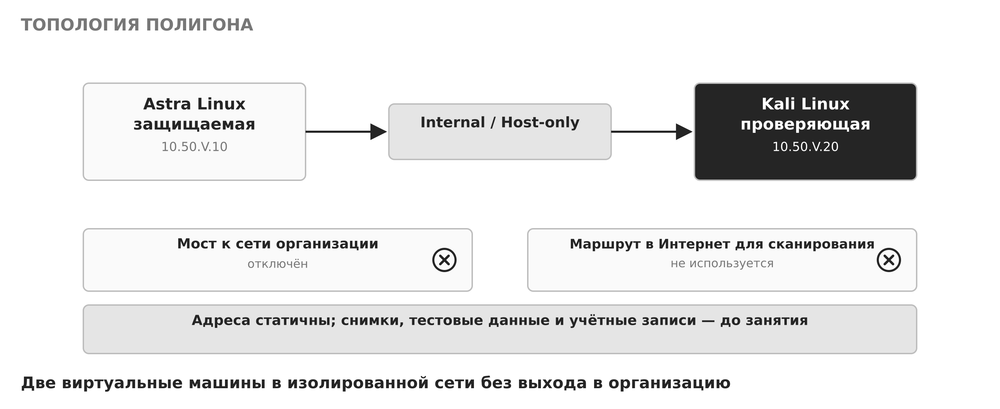

<em>Рисунок 10 — Топология учебного полигона</em>

Выбор режима сети виртуальных машин — это решение о границе доверия. В мостовом режиме виртуальная машина получает адрес в сети организации и способна обмениваться трафиком с реальными узлами; учебное сканирование в таком режиме выходит за полигон и недопустимо. В режиме Host-only или Internal Network обе машины видят только друг друга (и, при Host-only, хост), и трафик замкнут на полигон. Поэтому для разрешённой проверки предпочитают изолированные режимы, а мост сознательно отключают.

На рисунке 11 показано: мостовой режим выпускает трафик в сеть организации, а Host-only замыкает его на полигон.

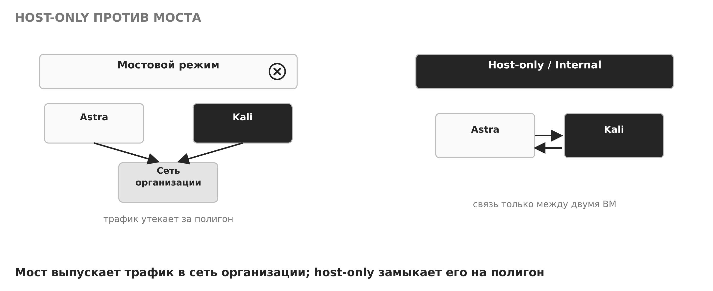

<em>Рисунок 11 — Host-only против мостового режима</em>

Ограничения ресурсов и скорости дополнительно снижают риск непреднамеренного отказа. Студент записывает выполненные команды, время, адрес цели и ожидаемый результат. Любое обнаружение за пределами двух согласованных адресов — повод немедленно остановиться. Секреты полигона не должны повторять реальные пароли, а неизвестные эксплойты и вредоносные образцы загружать запрещено: полигон остаётся управляемой учебной средой, а не площадкой для произвольных экспериментов.

## 5. Снимки, тестовые данные и барьер от выхода

Перед занятием полигон приводят в известное состояние и фиксируют его снимком (snapshot). Снимок позволяет воспроизводимо вернуть виртуальную машину к исходной точке после проверки: внесённые изменения откатываются, и следующее занятие начинается с того же базового состояния. Важно понимать ограничение: снимок фиксирует состояние в цепочке виртуального диска и зависит от его базовых файлов; он удобен для быстрого отката, но не заменяет резервную копию. Повреждение базового диска может сделать снимок бесполезным.

На рисунке 12 показано: снимок даёт воспроизводимый откат, но не является резервной копией.

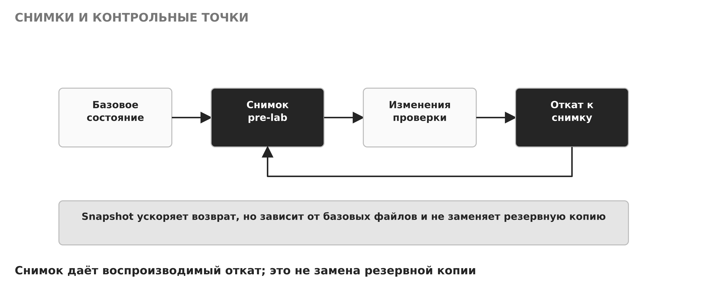

<em>Рисунок 12 — Снимки и контрольные точки</em>

Данные полигона должны быть учебными. В систему не помещают реальные пароли, персональные данные и продуктивные ключи; вместо них используют учебные логины, искусственные данные и одноразовые секреты. Это правило защищает и участников, и организацию: даже если учебный артефакт случайно окажется за пределами полигона, он не раскроет ничего ценного.

На рисунке 13 показано: тестовые идентичности вместо реальных секретов и персональных данных.

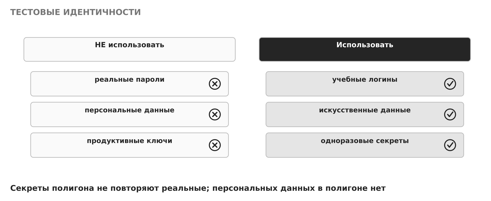

<em>Рисунок 13 — Тестовые идентичности</em>

Отдельный шаг — барьер от ошибочного выхода. Прежде чем запускать проверку, убеждаются, что ни один канал не выпускает трафик и файлы за полигон. Проверяют сетевые адаптеры (включён только Host-only или Internal), настройки DNS (без обращения к внешним серверам), таблицу маршрутов (нет маршрута по умолчанию в организацию или Интернет), общие папки гипервизора (shared folders) и проброс USB-устройств. Каждый из этих каналов при неосторожной настройке способен превратить изолированный полигон в мост наружу.

На рисунке 14 показано: барьер от ошибочного выхода как проверка каналов перед стартом.

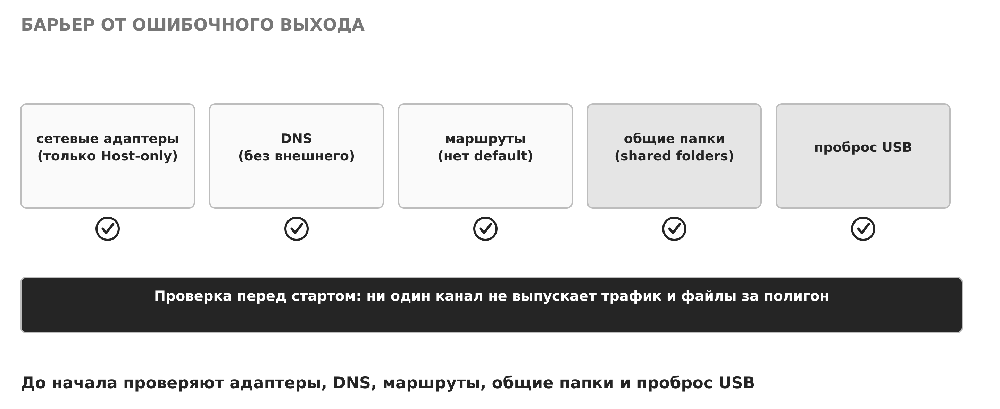

<em>Рисунок 14 — Барьер от ошибочного выхода</em>

После занятия артефакты (журналы, вывод команд, отчёт) передают преподавателю, а состояние полигона восстанавливают из снимка. Полигон между занятиями не хранит ни результатов проверки, ни наведённых изменений.

## 6. Этапы разрешённой проверки: подготовка и обнаружение

Разрешённая проверка идёт по этапам: подготовка, обнаружение поверхности, контролируемая валидация и завершение. Разделение на этапы не формальность — оно удерживает проверку в области, делает результат воспроизводимым и отделяет наблюдение от воздействия.

На рисунке 15 показано: четыре этапа разрешённой проверки.

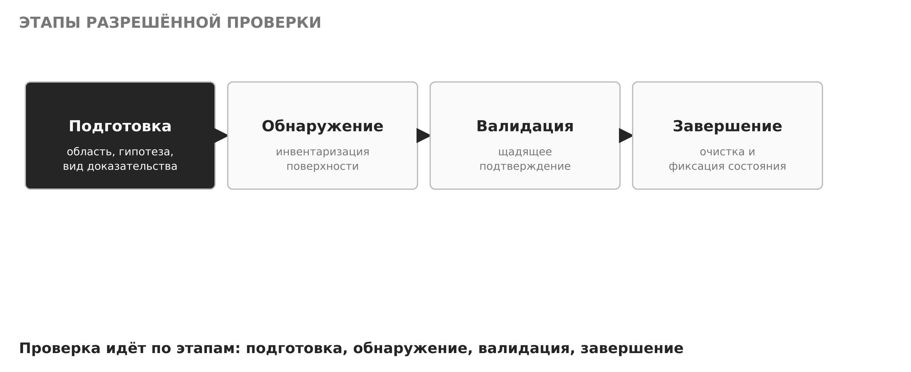

<em>Рисунок 15 — Этапы разрешённой проверки</em>

На этапе подготовки формулируют гипотезу и фиксируют три вещи: ожидаемый результат (каким должно быть состояние согласно паспорту), допустимый инструмент (чем проверяем в пределах области) и вид доказательства (что именно сохраняем как результат). Подготовка превращает расплывчатое «посмотрим, что там» в проверяемое утверждение: «ожидается, что порт X доступен только с адреса Y, подтверждением служит такой-то вывод и запись аудита».

На рисунке 16 показано: подготовка фиксирует ожидаемый результат, инструмент и вид доказательства.

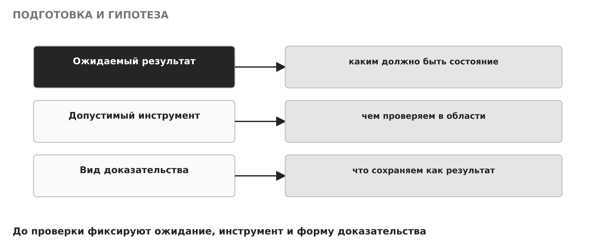

<em>Рисунок 16 — Подготовка и гипотеза</em>

На этапе обнаружения поверхности инвентаризируют собственную лабораторную цель: её адрес, доступные порты, предъявляемые сервисы и их версии, сертификаты. Инвентаризацию ведут с минимальной активностью — ровно столько запросов, сколько нужно для наблюдения, без агрессивных или нагрузочных режимов. Цель этапа — получить фактическую картину сетевой экспозиции узла, а не исчерпать все возможные проверки.

На рисунке 17 показано: обнаружение поверхности — инвентаризация адресов, портов, сервисов и сертификатов.

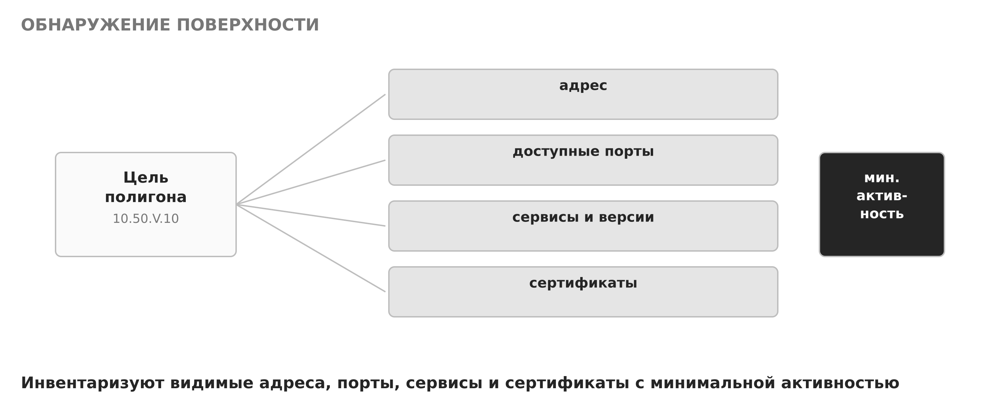

<em>Рисунок 17 — Обнаружение поверхности</em>

## 7. Сопоставление, валидация и ложные срабатывания

Полученную картину сопоставляют с паспортом защищаемого узла — с тем, какой должна быть его сетевая экспозиция. Здесь важна аккуратность: расхождение между наблюдением и паспортом не является автоматически уязвимостью. Открытый порт может быть требованием работающей службы; версия в баннере может быть неполной или намеренно скрытой; отличие может объясняться штатной активностью. Каждое расхождение объясняют, прежде чем отнести его к недостаткам.

На рисунке 18 показано: наблюдение сверяют с паспортом, и расхождение объясняют, а не сразу считают уязвимостью.

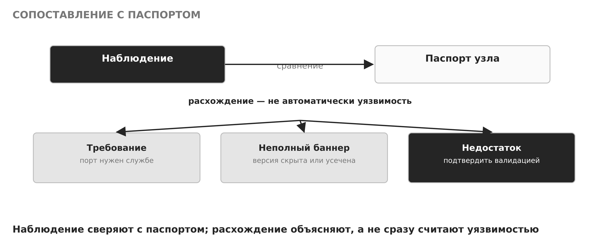

<em>Рисунок 18 — Сопоставление наблюдения с паспортом</em>

Если расхождение похоже на настоящий недостаток, выполняют контролируемую валидацию — щадящее подтверждение конфигурационного недостатка без эксплуатации, закрепления и разрушения. Задача валидации — получить доказательство того, что недостаток реален, минимально возможным воздействием. Если единственный способ подтвердить недостаток — опасное действие (эксплуатация, изменение, вызов отказа), его не выполняют: находку фиксируют как ограничение проверки и предлагают владельцу системы безопасный способ подтверждения.

На рисунке 19 показано: контролируемая валидация подтверждает недостаток щадяще, без опасных действий.

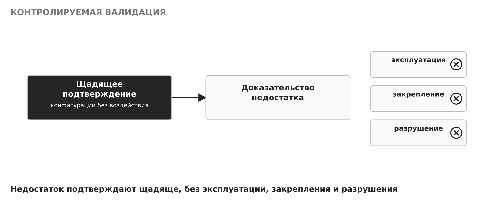

<em>Рисунок 19 — Контролируемая валидация</em>

Отдельного внимания требуют ложные срабатывания. Инструмент может сообщить о проблеме, которой нет: из-за особенностей баннера, нестандартного ответа службы или неверной интерпретации. Поэтому сигнал инструмента проверяют вручную с учётом контекста и только затем относят к подтверждённым недостаткам или к ложным срабатываниям. Повторяемость результата важнее числа задействованных инструментов: один воспроизводимый вывод ценнее десятка непроверенных сигналов.

На рисунке 20 показано: сигнал инструмента проходит ручную проверку и разделяется на подтверждённый недостаток и ложное срабатывание.

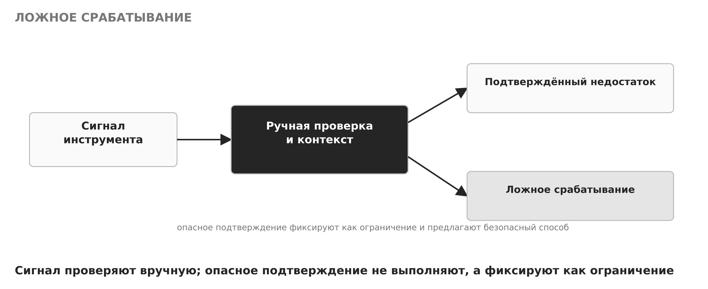

<em>Рисунок 20 — Обработка ложного срабатывания</em>

## 8. Завершение, отчёт и структура находки

Этап завершения закрывает проверку: инструменты останавливают, тестовые артефакты удаляют, состояние фиксируют, а результаты и артефакты передают преподавателю. После этого полигон можно вернуть к исходному состоянию из снимка. Завершение — не формальность: оставленный работающим инструмент или не удалённый артефакт сами становятся источником риска и искажают следующую проверку.

На рисунке 21 показано: завершение и очистка — остановка инструментов, удаление артефактов, фиксация и передача.

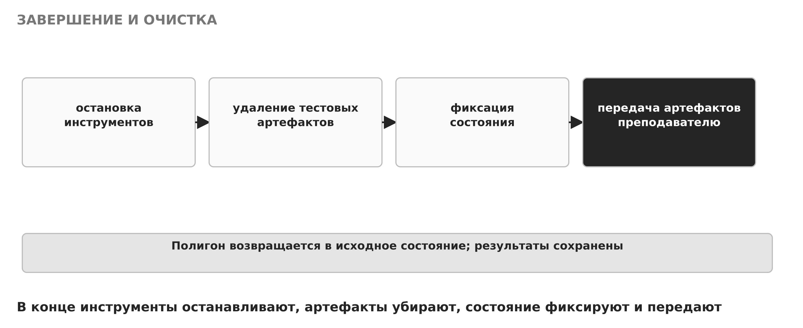

<em>Рисунок 21 — Завершение и очистка</em>

Результат проверки оформляют как находку с нейтральной формулировкой. Находка описывается по шести полям: условие (при каких обстоятельствах проявляется), актив (что затронуто), доказательство (чем подтверждается), возможное последствие (чем грозит), уровень уверенности (насколько надёжен вывод) и рекомендация (что предлагается сделать). Нейтральная формулировка отделяет факт от оценки и позволяет владельцу системы принять решение, а не поверить на слово.

На рисунке 22 показано: структура находки из шести полей.

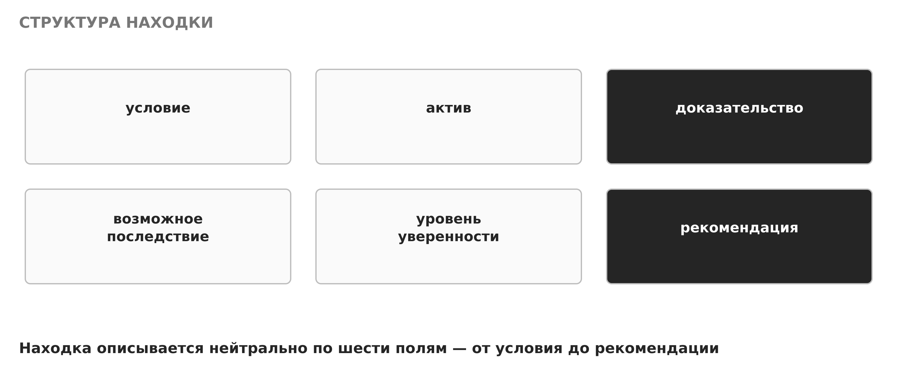

<em>Рисунок 22 — Структура находки</em>

Доказательство должно быть машинно-читаемым и воспроизводимым: команда с параметрами, время, релевантный фрагмент вывода и, по возможности, запись из журнала целевой системы. Скриншот без текста плохо ищется, не воспроизводится и не заменяет такой вывод. Снимок экрана уместен как иллюстрация, но доказательной базой служит текст, который можно повторить и проверить.

На рисунке 23 показано: доказательство — воспроизводимый вывод с контекстом, а не один скриншот.

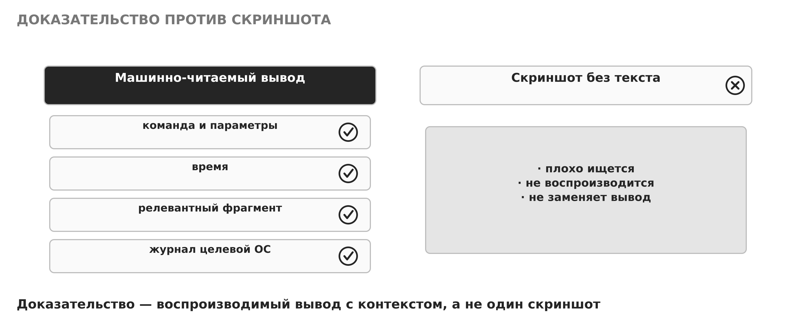

<em>Рисунок 23 — Доказательство против скриншота</em>

Таблица 2 — Этапы проверки, действие и доказательство

| Этап | Действие | Доказательство |
|---|---|---|
| Подготовка | область, гипотеза, вид доказательства | записанная гипотеза и критерии |
| Обнаружение | инвентаризация адресов, портов, сервисов | вывод команд с временем |
| Сопоставление | сверка с паспортом узла | таблица «ожидание — наблюдение» |
| Валидация | щадящее подтверждение недостатка | воспроизводимый вывод и запись аудита |
| Завершение | остановка, очистка, фиксация | протокол завершения и переданные артефакты |

Таблица 3 — Наблюдение и подтверждённая уязвимость

| Признак | Наблюдение | Подтверждённая уязвимость |
|---|---|---|
| Что это | расхождение с паспортом | доказанный недостаток |
| Нужна ли валидация | да, с объяснением | валидация уже выполнена щадяще |
| Как записывается | факт и гипотеза раздельно | находка с доказательством и уверенностью |
| Возможные причины | требование, неполный баннер, штатная активность | конкретная ошибка конфигурации |

## 9. Рекомендация, повторная проверка и разбор сценария

Рекомендация должна быть применимой. Недостаточно указать на проблему — нужно предложить конкретное изменение, его приоритет, возможные побочные эффекты и способ отката. Рекомендация без способа отката опасна: исправление может нарушить работу службы, и владельцу системы нужен путь назад. Хорошая рекомендация описывает ожидаемое состояние после изменения так же точно, как находка описывает текущее.

После исправления выполняют повторную проверку тем же методом и убеждаются, что причина устранена, а функция не нарушена. Например, ненужный порт должен исчезнуть, разрешённый сервис — остаться доступным из нужного сегмента, а запрещённая попытка — по-прежнему фиксироваться аудитом. Цикл «ожидание → наблюдение → исправление → повторная проверка» превращает инструменты Kali в средство обеспечения качества защитной конфигурации, а не в самоцель. Повторная проверка подтверждает устранение причины и отсутствие регрессии — нового недостатка, появившегося из-за исправления.

**Прикладной разбор.** В паспорте Astra Linux разрешён SSH только с адреса проверяющей виртуальной машины и HTTPS из учебной подсети. Студент выполняет ограниченную инвентаризацию двух указанных портов, проверяет предъявляемый сертификат и пробует соединение с заведомо запрещённым тестовым портом. На стороне Astra сопоставляются правила фильтрации и журналы отказа: разрешённые соединения проходят, запрещённое — отклоняется и фиксируется аудитом. В отчёте отсутствуют попытки обхода аутентификации; цель разбора — доказать, что сетевая экспозиция узла соответствует утверждённой модели, а наблюдаемость отказа работает.

На рисунке 24 показано: сквозной пример разрешённой проверки — разрешённые соединения проходят, запрещённое фиксируется аудитом.

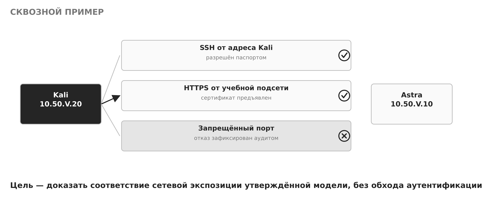

<em>Рисунок 24 — Сквозной пример разрешённой проверки</em>

Такой разбор показывает роль Kali в защитном курсе в чистом виде: проверяющая платформа подтверждает соответствие конфигурации модели и наблюдаемость событий, не прибегая к эксплуатации и разрушительному воздействию. Качественным результатом считается не найденная «дыра», а воспроизводимое доказательство соответствия и успешная повторная проверка после любого исправления.

## Основные выводы

- Любая проверка начинается с разрешения и точной области; техническая возможность инструмента не является полномочием на действие.
- Kali в защитном курсе — внешний наблюдатель, подтверждающий ожидаемые свойства Astra без эксплуатации, подбора, отказа в обслуживании, закрепления и сокрытия следов.
- Изолированный полигон (Host-only или Internal), снимки, тестовые данные и барьер от ошибочного выхода обязательны; критерий немедленной остановки задаётся заранее.
- Проверка идёт по этапам: подготовка и гипотеза, обнаружение поверхности, сопоставление с паспортом, контролируемая валидация, завершение и очистка.
- Расхождение с паспортом не является автоматически уязвимостью; ложные срабатывания устраняют ручной проверкой и контекстом, опасное подтверждение не выполняют, а фиксируют как ограничение.
- Находку оформляют нейтрально по шести полям; доказательство — воспроизводимый машинно-читаемый вывод с контекстом, а не один скриншот.
- Качественный результат — применимая рекомендация со способом отката и успешная повторная проверка, подтверждающая устранение причины и отсутствие регрессии.

## Вопросы для самоконтроля

1. Какие элементы должны входить в правила взаимодействия и почему пустое поле в них опасно?
2. Почему наличие инструмента в Kali не является полномочием на его применение?
3. Чем режим Host-only предпочтительнее мостового для учебного полигона?
4. Что проверяют в барьере от ошибочного выхода и какие каналы способны выпустить трафик за полигон?
5. Чем снимок (snapshot) отличается от резервной копии и в чём его ограничение?
6. Из каких этапов состоит разрешённая проверка и что фиксируют на этапе подготовки?
7. Почему расхождение наблюдения с паспортом не следует сразу считать уязвимостью? Приведите примеры объяснимых расхождений.
8. Как отличают подтверждённый недостаток от ложного срабатывания и что делают, если подтверждение требует опасного действия?
9. Из каких шести полей состоит находка и почему факт и гипотезу разделяют?
10. Почему машинно-читаемый вывод предпочтительнее скриншота как доказательство?
11. Что должна содержать применимая рекомендация и почему способ отката обязателен?
12. Что подтверждает повторная проверка после исправления и что такое регрессия?

## Основные понятия и сокращения

- **Правила взаимодействия (rules of engagement)** — письменно согласованный набор условий проверки: владелец, разрешение, цели, время, методы, ограничения, контакт для остановки, обращение с данными.
- **Область проверки** — согласованное пространство разрешённых действий; всё вне области запрещено.
- **Инвентаризация** — наблюдение и учёт видимых адресов, портов, сервисов, версий и сертификатов с минимальной активностью.
- **Контролируемая валидация** — щадящее подтверждение недостатка без эксплуатации, закрепления и разрушения.
- **Ложное срабатывание** — сигнал инструмента о проблеме, которой нет; устраняется ручной проверкой и контекстом.
- **Доказательство** — воспроизводимый машинно-читаемый результат: команда, параметры, время, фрагмент вывода, запись аудита целевой системы.
- **Находка** — нейтрально сформулированный результат проверки: условие, актив, доказательство, последствие, уверенность, рекомендация.
- **Повторная проверка** — проверка после исправления, подтверждающая устранение причины и отсутствие регрессии.
- **Изолированный полигон** — учебная среда из двух виртуальных машин в сети Host-only или Internal без выхода в организацию.
- **Снимок (snapshot)** — зафиксированное состояние виртуальной машины для воспроизводимого отката; не заменяет резервную копию.
- **Host-only / Internal Network** — режимы сети гипервизора, замыкающие трафик на полигон.
- **Регрессия** — новый недостаток или нарушение функции, возникшие в результате исправления.
- **Astra Linux** — защищаемая операционная система полигона; **Kali Linux** — проверяющая платформа.

## Источники

1. [NIST SP 800-115. Technical Guide to Information Security Testing and Assessment](https://csrc.nist.gov/pubs/sp/800/115/final) — методика оценки, правила и фазы.
2. [NIST SP 800-61 Rev. 3. Incident Response Recommendations and Considerations](https://csrc.nist.gov/pubs/sp/800/61/r3/final) — документирование, доказательства и цикл улучшения.
3. [NIST Cybersecurity Framework (CSF) 2.0](https://www.nist.gov/cyberframework) — функции Identify, Protect, Detect, Respond, Recover.
4. [OWASP Web Security Testing Guide](https://owasp.org/www-project-web-security-testing-guide/) — методология разрешённой проверки и оформление результатов.
5. [Kali Linux Documentation](https://www.kali.org/docs/) — назначение и состав платформы.
6. [nmap(1)](https://man7.org/linux/man-pages/man1/nmap.1.html), [ss(8)](https://man7.org/linux/man-pages/man8/ss.8.html), [openssl-s_client(1)](https://www.openssl.org/docs/manmaster/man1/openssl-s_client.html) — инструменты инвентаризации и проверки сервисов.
7. [ФСТЭК России. Меры защиты информации в ГИС, 11.02.2014](https://legalacts.ru/doc/metodicheskii-dokument-mery-zashchity-informatsii-v-gosudarstvennykh/) — группа мер АНЗ «Анализ защищённости».

Дата обращения к источникам: 8 ноября 2026 года.
