# Лекция 15. Виртуализация, контейнеры и изоляция


**Дисциплина:** Операционные системы. **Аудитория:** университет, 3-й курс, 10.05.01 «Компьютерная безопасность». **Занятие:** 90 минут.


## Содержание

- [1. Виртуализация как продолжение механизмов ОС](#sec-1)

- [2. Модель машины, гипервизор и эмуляция](#sec-2)

- [3. Виртуальный процессор и два планировщика](#sec-3)

- [4. Память виртуальной машины](#sec-4)

- [5. Виртуальные устройства и путь ввода-вывода](#sec-5)

- [6. Виртуальные сети](#sec-6)

- [7. Виртуальные диски, снимки и согласованность](#sec-7)

- [8. Контейнер как окружение процессов](#sec-8)

- [9. Пространства имён: видимость объектов](#sec-9)

- [10. User namespace и область полномочий](#sec-10)

- [11. Контрольные группы и распределение ресурсов](#sec-11)

- [12. Файловые слои и постоянные данные контейнера](#sec-12)

- [13. Сеть контейнера и публикация порта](#sec-13)

- [14. Границы изоляции и наблюдение](#sec-14)

- [15. Итоги и вопросы для самоконтроля](#sec-15)

- [Основные понятия](#glossary)

- [Источники](#sources)


<a id="sec-1"></a>

## 1. Виртуализация как продолжение механизмов ОС

Операционная система уже создаёт для процесса абстракции: виртуальный процессор, адресное пространство и дерево файлов. Виртуализация вычислительной системы переносит эту идею на более крупный объект. Гостевая ОС получает модель машины, а контейнер получает ограниченное окружение для процессов. В обоих случаях физические ресурсы остаются конечными, поэтому абстракция требует отображения, планирования и учёта.

Рассмотрим учебный сервер: на нём требуется одновременно запускать Astra Linux, Kali Linux и несколько одинаковых прикладных служб. Для разных ядер подходят виртуальные машины. Для нескольких экземпляров приложения, совместимых с одним ядром Linux, подходят контейнеры. Выбор определяется требуемым интерфейсом и жизненным циклом состояния, а не только размером дистрибутива. Вложенный вариант также возможен: контейнеры работают внутри гостевой Linux, а её ядро выполняется в виртуальной машине.

К концу лекции нужно уметь проследить путь инструкции, адреса, пакета и изменения файла в каждой модели. Это связывает тему с ранее изученными процессами, памятью, вводом-выводом, файловыми системами и службами. Термин «изоляция» далее означает конкретное разделение объектов и полномочий. Он не означает автоматического отсутствия всех каналов взаимодействия.

На рисунке 1 показан механизм «Один сервер, разные окружения». Выбор начинается с нужного ядра и интерфейса приложения.

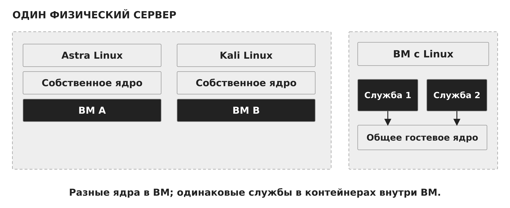

*Рисунок 1 — Один сервер, разные окружения*


<a id="sec-2"></a>

## 2. Модель машины, гипервизор и эмуляция

Виртуальная машина, или ВМ, включает виртуальные процессоры, оперативную память, контроллеры устройств и диски. Гостевая ОС загружается в эту модель и управляет своими процессами. Гипервизор контролирует доступ гостя к физическим ресурсам и поддерживает состояние виртуального оборудования. Отдельно существует плоскость управления: она создаёт ВМ, задаёт параметры и управляет её жизненным циклом.

Классическая классификация различает гипервизор типа 1, работающий непосредственно над оборудованием, и типа 2, использующий сервисы хостовой ОС. Реальные реализации сложнее рисунка из двух этажей. Например, KVM встраивает средства виртуализации в ядро Linux, QEMU предоставляет пользовательскую модель машины, а libvirt организует управление. Поэтому полезнее назвать роли компонентов, чем пытаться объяснить всё одним номером типа.

При аппаратной виртуализации совместимые инструкции гостя преимущественно выполняет физический процессор. Аппаратные расширения позволяют контролировать привилегированные операции и переходы между гостем и монитором. При эмуляции процессора программа воспроизводит семантику другой архитектуры, например переводит блоки гостевых инструкций. QEMU поддерживает как аппаратные ускорители, так и программный транслятор TCG. Наличие виртуальной машины само по себе не доказывает использование аппаратного ускорения. [1,2]

На рисунке 2 показан механизм «Два уровня абстракции». ВМ предоставляет машину, контейнер организует процессы.

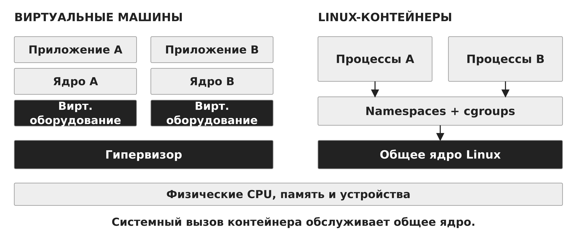

*Рисунок 2 — Два уровня абстракции*

На рисунке 3 показан механизм «Гипервизоры типов 1 и 2». Номер типа описывает размещение, но не все свойства реализации.

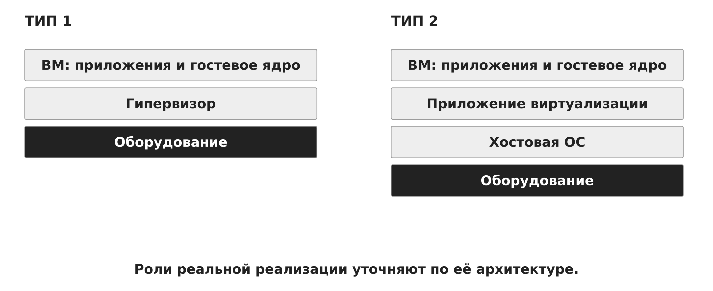

*Рисунок 3 — Гипервизоры типов 1 и 2*

На рисунке 4 показан механизм «KVM, QEMU и libvirt». Ядро, модель устройств и управление выполняют разные роли.

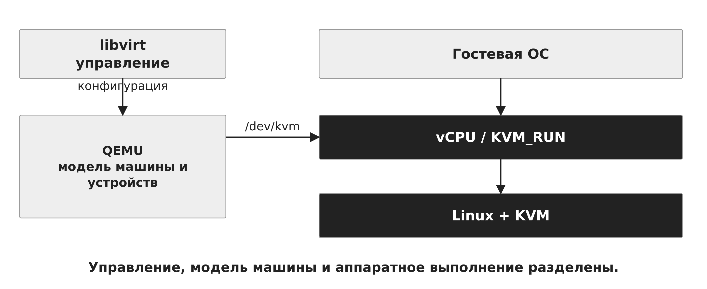

*Рисунок 4 — KVM, QEMU и libvirt*


<a id="sec-3"></a>

## 3. Виртуальный процессор и два планировщика

Виртуальный процессор, vCPU, представляет состояние процессора с точки зрения гостя: регистры, режим выполнения и связанные управляющие структуры. В типичной ВМ QEMU/KVM выполнение каждого vCPU обслуживает поток хостового процесса. Планировщик гостя выбирает гостевой поток, а планировщик хоста выбирает поток vCPU для физического CPU. Поэтому готовность программы внутри гостя ещё не означает немедленное получение физического процессора.

При VM exit процессор передаёт управление из гостевого режима в среду виртуализации по причине, заданной архитектурой и настройкой. Причиной может быть определённая операция ввода-вывода, событие или необходимость обслуживания. Далее гипервизор либо пользовательская модель устройства выполняют работу, после чего гость продолжает исполнение. Системный вызов приложения сначала обрабатывает гостевое ядро: каждый такой вызов не требует обязательного выхода к гипервизору.

Перераспределение, или overcommit, позволяет назначить ВМ суммарно больше vCPU, чем существует физических логических CPU. Это полезно, когда нагрузки не достигают пика одновременно. Если все vCPU требуют CPU, растёт ожидание. В иллюстрации с двумя физическими CPU и четырьмя постоянно готовыми vCPU каждому при равном распределении достаётся примерно половина времени одного CPU. Это упрощённая модель без привязки, приоритетов и служебных затрат. Увеличение числа vCPU без анализа очередей может ухудшить задержки.

На рисунке 5 показан механизм «Два планировщика для одного приложения». Гость выбирает поток, хост выбирает vCPU.

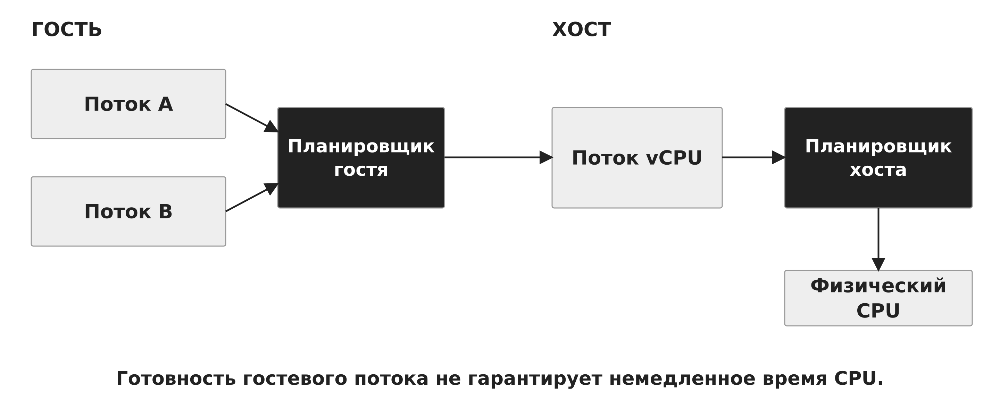

*Рисунок 5 — Два планировщика для одного приложения*

На рисунке 6 показан механизм «Вход в гостя и VM exit». Системный вызов приложения сначала обслуживает гостевое ядро.

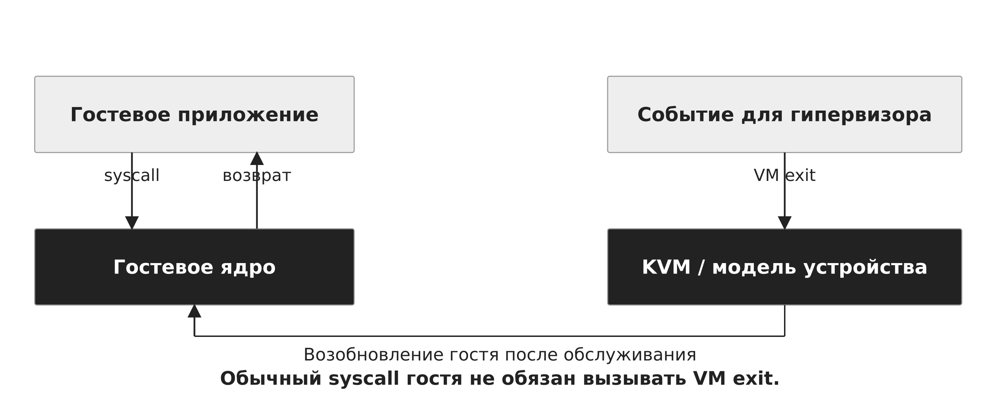

*Рисунок 6 — Вход в гостя и VM exit*

На рисунке 7 показан механизм «Четыре vCPU на двух физических CPU». Overcommit увеличивает конкуренцию при одновременном пике.

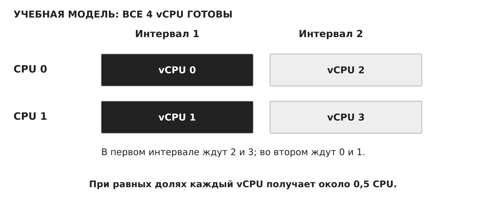

*Рисунок 7 — Четыре vCPU на двух физических CPU*


<a id="sec-4"></a>

## 4. Память виртуальной машины

Приложение внутри ВМ использует гостевой виртуальный адрес. Гостевые таблицы страниц переводят его в гостевой физический адрес. Среда виртуализации связывает этот адрес с памятью хоста. На процессорах с поддержкой вложенной трансляции аппаратный механизм объединяет эти отображения. На x86 используются, в частности, EPT или NPT в зависимости от производителя. Термин «физический» для гостя поэтому обозначает ресурс его модели машины. [3]

Учебный числовой пример не зависит от конкретного формата таблиц. Пусть страница имеет размер 4 КиБ, гостевой виртуальный адрес равен 0x1234, гостевая таблица отображает страницу 1 в гостевой кадр 5, а внешняя таблица отображает гостевой кадр 5 в кадр хоста 42. Смещение равно 0x234. Гостевой физический адрес получается 0x5234, а итоговый адрес памяти хоста — 0x2A234. Смещение сохраняется на каждом уровне.

Назначенный объём памяти ВМ отличается от фактического потребления физической памяти хоста и от свободной памяти внутри гостя. На расход влияют реально затронутые страницы, служебные структуры и настройки резервирования. Balloon-драйвер позволяет гостю и хосту согласованно менять доступный гостю объём: занятые «баллоном» страницы гость исключает из обычного использования. Давление памяти на хосте может вызвать подкачку страниц ВМ. Если одновременно активно подкачивает гость, задержки становятся особенно сложными для диагностики.

На рисунке 8 показан механизм «Три адреса одного обращения». Гостевой физический адрес ещё требует отображения в память хоста.

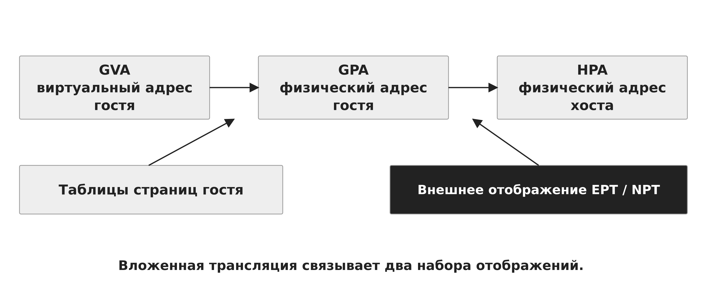

*Рисунок 8 — Три адреса одного обращения*

На рисунке 9 показан механизм «Перевод адреса 0x1234». При размере страницы 4 КиБ смещение 0x234 сохраняется.

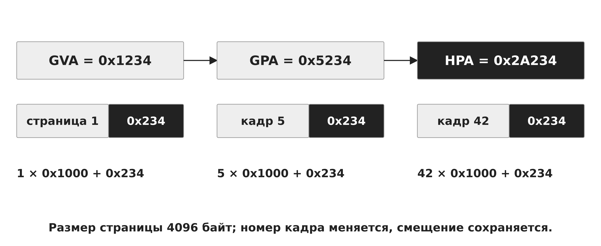

*Рисунок 9 — Перевод адреса 0x1234*


<a id="sec-5"></a>

## 5. Виртуальные устройства и путь ввода-вывода

Модель устройства должна реализовать интерфейс, который понимает гостевой драйвер. Эмулируемое устройство воспроизводит знакомый аппаратный контроллер и удобно для совместимости. Паравиртуальное устройство, например семейства virtio, использует специальный интерфейс взаимодействия гостевого драйвера и обслуживающей стороны. Очереди запросов уменьшают необходимость воспроизводить детали старого оборудования. Передача устройства напрямую гостю сокращает часть посредников, но требует поддержки аппаратуры и организации DMA через IOMMU.

При записи файла приложение сначала выполняет системный вызов гостевому ядру. Гостевая файловая система формирует блочные запросы, драйвер помещает их в виртуальную очередь, а обслуживающая сторона передаёт операции файловому или блочному хранилищу хоста. На физический носитель данные могут попасть позже из-за буферизации. Успешный write сообщает о принятии данных соответствующим программным слоем, а гарантия устойчивости требует согласования кэшей и протоколов записи.

Дополнительные функции интеграции меняют набор общих ресурсов. Общий каталог предоставляет гостю доступ к конкретному дереву хоста. Общий буфер обмена и проброс устройств создают самостоятельные каналы. Поэтому описание границы ВМ должно перечислять не только виртуальный диск, но и явно подключённые общие объекты. [2,4]

Сопоставление приведено в таблице 1.

**Таблица 1 — Три способа предоставить устройство**

| Способ | Интерфейс гостя | Особенность |

| --- | --- | --- |

| Эмуляция | Модель известного устройства | Совместимость с драйвером |

| Паравиртуализация | Специальный драйвер virtio | Очереди и меньше эмуляции |

| Прямое назначение | Физическое устройство | DMA и требования к IOMMU |

На рисунке 10 показан механизм «Путь записи из гостя на накопитель». Между write и носителем есть файловые системы, очереди и кэши.

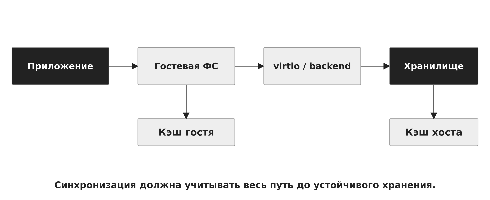

*Рисунок 10 — Путь записи из гостя на накопитель*


<a id="sec-6"></a>

## 6. Виртуальные сети

Виртуальный сетевой адаптер предоставляет гостю интерфейс Ethernet. На стороне хоста его трафик можно передать виртуальному коммутатору, маршрутизировать или транслировать адреса. NAT, Network Address Translation, изменяет адресные параметры при прохождении через узел. Он обычно позволяет гостю инициировать внешние соединения, но входящее соединение требует доступного пути, правил и, при необходимости, перенаправления порта. NAT сам по себе не делает стенд изолированным от внешнего мира.

Подключение через мост, bridge, связывает интерфейс ВМ с выбранным канальным сегментом. Гость участвует в нём как отдельный сетевой узел с собственным адресом. Host-only обычно создаёт связь между хостом и гостями без штатного выхода наружу, тогда как внутренняя сеть конкретного гипервизора может связывать только гостей. Названия режимов зависят от продукта, а реальную связность определяют адаптеры, мосты, маршруты и правила хоста. [6]

В учебной схеме Astra и Kali соединены отдельным виртуальным коммутатором без внешнего uplink. Адреса 192.0.2.10 и 192.0.2.20 используются здесь только как документальный пример, а не как назначение стенду. Дополнительный адаптер NAT, маршрутизация хоста или общий сервис могут создать путь за пределы ожидаемого сегмента. Проверка топологии должна рассматривать все интерфейсы ВМ и хоста.

На рисунке 11 показан механизм «NAT, мост и внутренняя сеть». Режим сети определяет путь пакета и доступность узлов.

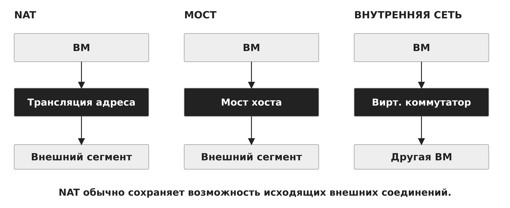

*Рисунок 11 — NAT, мост и внутренняя сеть*

На рисунке 12 показан механизм «Изолированный учебный сегмент». Любой второй адаптер способен изменить ожидаемую связность.

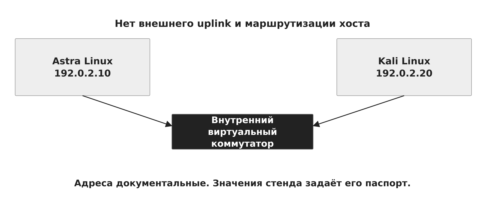

*Рисунок 12 — Изолированный учебный сегмент*


<a id="sec-7"></a>

## 7. Виртуальные диски, снимки и согласованность

Виртуальный диск является блочным устройством гостя, хотя на хосте он может храниться в файле или отдельном блочном томе. Формат raw близок к прямому представлению секторов. Формат qcow2 поддерживает дополнительные метаданные, разреженное размещение и работу с базовым образом. В цепочке copy-on-write чтение сначала ищет актуальный блок в верхнем слое, а при его отсутствии обращается к базе. Новая запись создаёт изменённый блок в верхнем слое. Удаление необходимой базы разрушает цепочку. [7]

Снимок фиксирует выбранные части состояния ВМ в определённой точке. Дисковый снимок сохраняет состояние дисков, но не обязательно оперативную память. Полный снимок может включать память и состояние устройств в соответствии с возможностями платформы. Внешний снимок обычно создаёт новый активный слой записи, связанный с прежним состоянием. Длинные цепочки усложняют эксплуатацию и могут увеличивать накладные расходы. [8]

Согласованность файловой системы после внезапного отключения не равна согласованности приложения. База данных может держать часть изменений в памяти. При восстановлении после дискового снимка она выполняет журналирование и восстановление по своим правилам. Для прикладной согласованности используют согласованную приостановку записи, гостевой агент и штатные средства приложения. Снимок памяти должен согласовываться с дисками, иначе возвращаемое состояние может противоречить данным на хранении.

Снимок и резервная копия имеют разные цели. Быстрый откат удобен перед изменением, но цепочка на том же накопителе разделяет с оригиналом его отказ. Резервная копия должна позволять восстановление при потере исходного хранилища и зависимостей. Для неё отдельно проверяют полноту, сохранность и восстановимость. Снимок не возвращает состояние внешней базы, удалённой службы или другой ВМ, если они не включены в согласованный набор.

На рисунке 13 показан механизм «Базовый образ и слой изменений». Чтение ищет новый блок сверху, запись меняет верхний слой.

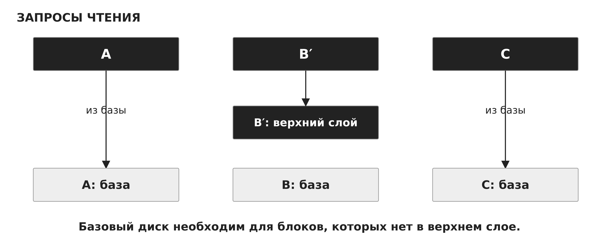

*Рисунок 13 — Базовый образ и слой изменений*

Сопоставление приведено в таблице 2.

**Таблица 2 — Снимок диска и снимок состояния ВМ**

| Что сохраняем | Что возвращаем | Что требует внимания |

| --- | --- | --- |

| Диски | Содержимое блоков | Согласованность приложения |

| Память и устройства | Состояние выполнения | Соответствие состоянию дисков |

| Полный набор | Согласованные компоненты | Поддержка платформы |

На рисунке 14 показан механизм «Согласованность при снимке». Согласованность ФС и согласованность приложения проверяют отдельно.

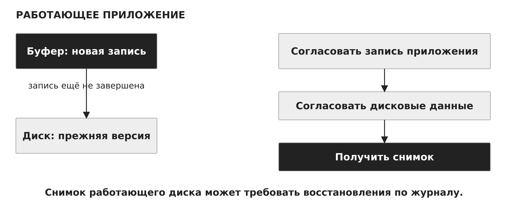

*Рисунок 14 — Согласованность при снимке*


<a id="sec-8"></a>

## 8. Контейнер как окружение процессов

Linux-контейнер обычно объединяет процессы с настроенными пространствами имён, корневой файловой системой, ограничениями ресурсов и политикой полномочий. Его исполняемый код обращается к тому же ядру, которое обслуживает хостовые процессы. Образ другого дистрибутива меняет пользовательские программы и библиотеки, но не загружает собственное Linux-ядро. Для запуска нужен совместимый интерфейс ядра и подходящая архитектура или отдельный механизм эмуляции. [5]

Образ — это подготовленные файловые слои и метаданные запуска. Контейнер — конкретный экземпляр с процессами и изменяемым состоянием. Один образ позволяет создать несколько независимых экземпляров. Остановка процесса сохраняет контейнерные метаданные и слой записи до удаления контейнера. Удаление контейнера обычно уничтожает его собственный слой записи, тогда как явно созданный постоянный том живёт отдельно.

Средство высокого уровня получает образ, формирует конфигурацию и передаёт запуск среде выполнения. OCI, Open Container Initiative, определяет совместимые форматы и контракт выполнения. В OCI runtime-spec задаются состояния creating, created, running и stopped. Запуск контейнера связывает операции над файлами, создание процессов и настройку механизмов ядра. Состояние процесса приложения остаётся центральным: интерфейс управления не превращает контейнер в самостоятельную машину. [9]

На рисунке 15 показан механизм «Общее ядро контейнеров». Образ дистрибутива содержит пользовательскую среду.

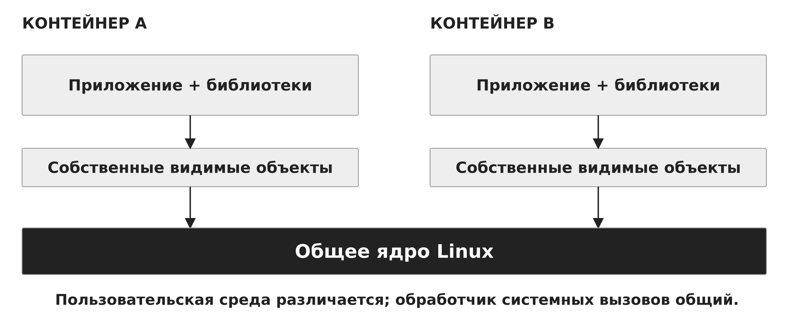

*Рисунок 15 — Общее ядро контейнеров*

На рисунке 16 показан механизм «Образ, контейнер и процесс». Из одного образа запускаются независимые экземпляры.

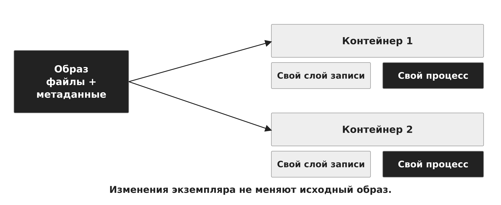

*Рисунок 16 — Образ, контейнер и процесс*

На рисунке 17 показан механизм «Жизненный цикл контейнера». Завершение основного процесса переводит экземпляр в stopped.

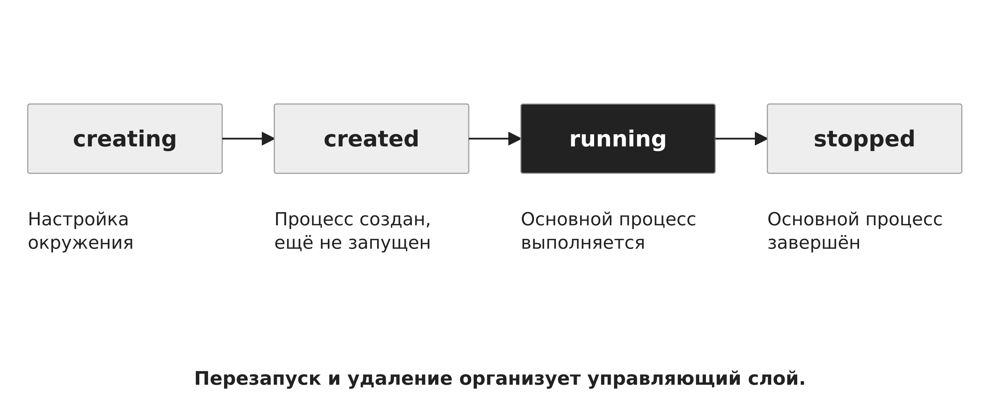

*Рисунок 17 — Жизненный цикл контейнера*


<a id="sec-9"></a>

## 9. Пространства имён: видимость объектов

Пространство имён, namespace, задаёт отдельное представление определённого класса ресурсов ядра. PID namespace разделяет номера процессов, mount namespace — набор точек монтирования, network namespace — сетевые интерфейсы, маршруты и сокеты. UTS namespace разделяет имя узла, IPC namespace — соответствующие объекты System V IPC и POSIX message queues. User namespace отображает идентификаторы пользователей и групп. Также существуют пространства имён cgroup и времени. Набор доступных механизмов зависит от конфигурации ядра. [10]

Процесс может иметь разные PID на разных уровнях вложенности. Например, приложение является PID 1 внутри контейнера и PID 4312 с точки зрения внешнего хоста. Это один объект процесса, а не два исполняемых экземпляра. Родительское пространство видит процессы потомков, но внутреннее пространство не получает симметричной видимости внешних процессов. Корректно смонтированный procfs нужен для соответствующего представления /proc. [11]

Первый процесс PID namespace выполняет особую роль: он принимает осиротевших потомков и должен обеспечивать обработку завершений. Обработка сигналов у PID 1 имеет особенности. Если оболочка запускает приложение как дочерний процесс и неправильно передаёт сигналы, штатная остановка может задерживаться. Исполнение приложения через exec либо небольшой init-процесс помогает организовать корректную передачу сигналов и сбор завершившихся потомков.

Разделение имён не устанавливает квоту CPU и не ограничивает объём памяти. Также новый mount namespace сам по себе не делает существующие файлы приватными: два дерева монтирований могут ссылаться на один и тот же объект файловой системы. Следует различать отдельное представление ресурса и отдельное владение данными.

Сопоставление приведено в таблице 3.

**Таблица 3 — Какие ресурсы разделяют namespaces**

| Пространство | Разделяемое представление |

| --- | --- |

| PID | Номера и видимость процессов |

| Mount | Дерево точек монтирования |

| Network | Интерфейсы, маршруты и сокеты |

| User | UID, GID и область полномочий |

| UTS / IPC | Имя узла / объекты IPC |

На рисунке 18 показан механизм «Один процесс, два PID». PID 1 внутри и PID 4312 снаружи обозначают один процесс.


*Рисунок 18 — Один процесс, два PID*

На рисунке 19 показан механизм «Разные деревья, один файл». Отдельный mount namespace не копирует данные автоматически.

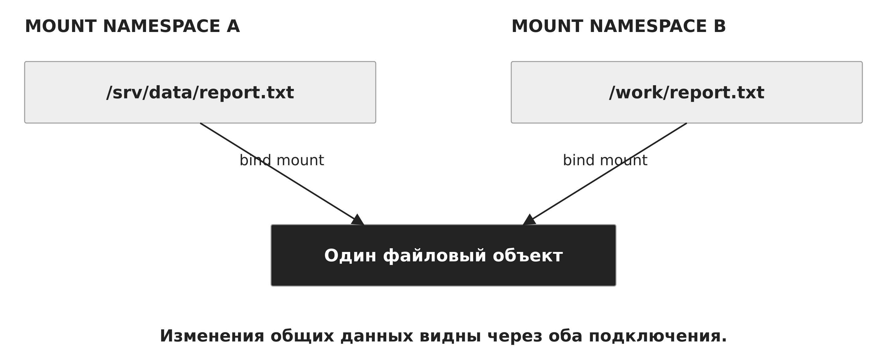

*Рисунок 19 — Разные деревья, один файл*


<a id="sec-10"></a>

## 10. User namespace и область полномочий

User namespace позволяет процессу иметь UID 0 внутри окружения и непривилегированный UID во внешнем пространстве. Диапазоны соответствия задают, как внутренние идентификаторы переводятся во внешние. Учебный пример отображает внутренний UID 0 во внешний 100000, а внутренний 1000 — во внешний 101000 при линейном отображении диапазона. Конкретное отображение проверяют по /proc/PID/uid_map и gid_map. [12]

Число 0 не даёт универсальных полномочий над всеми объектами хоста. Проверка учитывает пространство имён, capabilities и область владения ресурсом. Rootless-запуск дополнительно означает, что управляющая среда и контейнеры работают без root-полномочий хоста. Он использует пространства имён пользователей и другие механизмы, а доступные сетевые и ресурсные функции зависят от конфигурации. [13]

Права на подключённый каталог остаются правами реального файлового объекта. Необходимо согласовать внешние идентификаторы владельца, режим монтирования и требуемые операции приложения. Контейнер с непривилегированным UID может получить доступ к слишком широкому набору данных, если эти данные явно предоставлены ему через монтирование. Поэтому проверка пользователя дополняется проверкой подключённых ресурсов.

На рисунке 20 показан механизм «UID внутри и снаружи». Полномочия UID 0 имеют область действия.

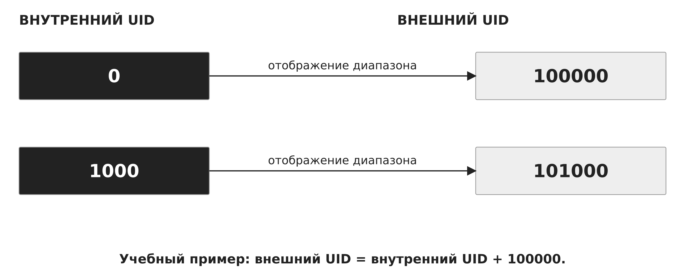

*Рисунок 20 — UID внутри и снаружи*


<a id="sec-11"></a>

## 11. Контрольные группы и распределение ресурсов

Контрольные группы, cgroups, объединяют процессы для учёта и управления ресурсами. В cgroup v2 группы образуют единую иерархию, а контроллеры задают правила распределения CPU, памяти и других ресурсов. При анализе важны не только параметры самой группы, но и ограничения предков, делегирование контроллеров и разрешённое перемещение процессов. Пространство имён cgroup меняет видимое представление иерархии, но само по себе не выдаёт дополнительный ресурс. [15]

Файл cpu.max задаёт квоту и период. Значение 50000 100000 означает до 50000 микросекунд суммарного CPU-времени за период 100000 микросекунд для соответствующего класса планирования. В среднем это 0,5 CPU. Два параллельных потока могут исчерпать квоту за 25 миллисекунд реального времени, если оба непрерывно исполняются на разных CPU. Затем группа будет ждать пополнения бюджета. Квота не закрепляет конкретное ядро, а cpu.weight определяет относительную долю при конкуренции в соответствующей иерархии.

memory.high задаёт порог давления и возврата памяти, memory.max — предельный объём учтённой памяти группы. При невозможности снизить расход до жёсткого предела возможен OOM внутри группы. Ограничение памяти включает не только heap приложения: учитываются и другие категории, включая соответствующий файловый кэш. Отдельные настройки определяют использование swap. Лимит pids.max ограничивает число задач, включая потоки, и помогает сдерживать чрезмерное размножение процессов.

Параметр ограничивает потребление, но сам по себе не гарантирует требуемую задержку. Для объяснения поведения нужны наблюдения: cpu.stat, memory.current, memory.events и pids.current. При диагностике сначала устанавливают, какая группа содержит процесс, затем читают её параметры и эффективные ограничения предков. Прямое изменение дерева, которым управляет systemd, может конфликтовать с его моделью. Для управляемых служб используют штатный интерфейс менеджера.

На рисунке 21 показан механизм «Иерархия cgroup v2». Ограничения предка действуют на поддерево.

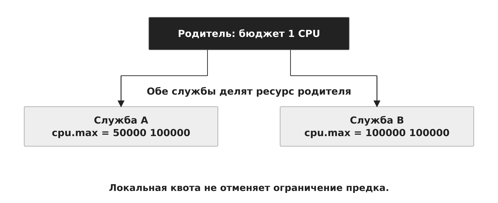

*Рисунок 21 — Иерархия cgroup v2*

На рисунке 22 показан механизм «Квота 50 мс на период 100 мс». Два потока могут израсходовать 50 мс CPU за 25 мс времени.

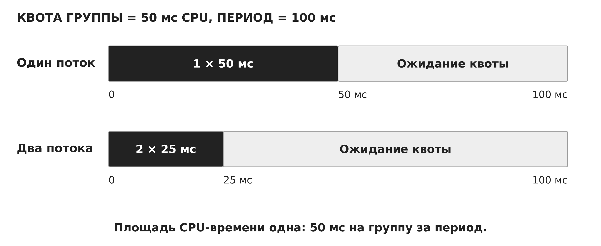

*Рисунок 22 — Квота 50 мс на период 100 мс*

Сопоставление приведено в таблице 4.

**Таблица 4 — Память и число задач в cgroup**

| Параметр | Назначение | Наблюдение |

| --- | --- | --- |

| memory.high | Порог давления памяти | Возврат памяти, задержки |

| memory.max | Жёсткий предел | Возможен OOM в группе |

| pids.max | Число задач, включая потоки | Отказ создания новой задачи |

| cpu.stat | Статистика CPU | События ограничения квотой |


<a id="sec-12"></a>

## 12. Файловые слои и постоянные данные контейнера

В многослойной файловой системе нижние слои содержат подготовленные файлы образа, а верхний слой хранит изменения конкретного контейнера. OverlayFS формирует объединённое представление каталогов. При первой модификации файла из нижнего слоя возможен copy-up в верхний слой. Это копирование относится к файловому представлению и отличается от копирования страниц памяти после fork. Точный путь хранения зависит от backend среды выполнения: нельзя считать overlay2 универсальным вариантом для всех установок. [16]

Записываемый слой контейнера существует между его остановкой и повторным запуском, пока контейнер не удалён. Постоянные данные целесообразно размещать в отдельно управляемом томе. Именованный том отделяет жизненный цикл данных от пересоздания контейнера, но сам по себе не создаёт резервную копию. Bind mount подключает конкретный путь хоста. tmpfs использует память и не обеспечивает сохранность после завершения соответствующего жизненного цикла. [14]

Для обновления службы создают новый экземпляр из нового образа и подключают нужные данные. Совместимость формата данных проверяют отдельно: старое приложение может не понимать изменения схемы, внесённые новой версией. Поэтому возврат старого образа не всегда означает рабочий откат всей системы. Версию исполняемой среды, конфигурацию и состояние данных рассматривают совместно.

На рисунке 23 показан механизм «Файловые слои и copy-up». Изменяемый слой принадлежит экземпляру контейнера.

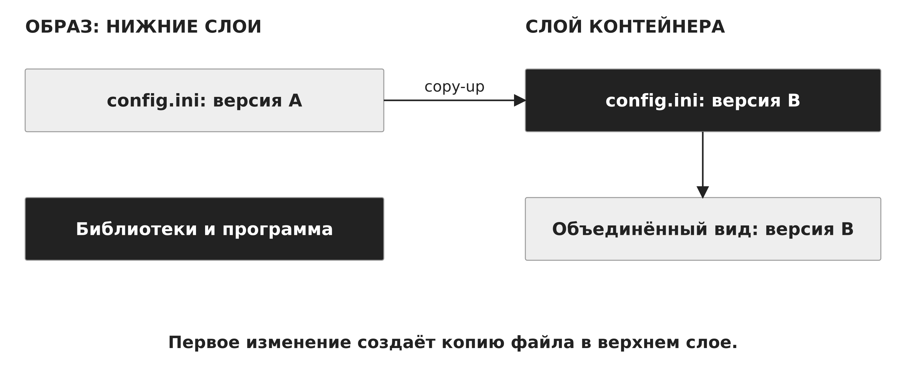

*Рисунок 23 — Файловые слои и copy-up*

Сопоставление приведено в таблице 5.

**Таблица 5 — Где живут данные после удаления**

| Ресурс | После stop | После удаления контейнера |

| --- | --- | --- |

| Слой записи | Сохраняется | Обычно удаляется |

| Именованный том | Сохраняется | Живёт отдельно до удаления |

| Bind mount | Данные на хосте | Данные остаются на хосте |

| tmpfs | Данные исчезают при остановке | Постоянного хранения нет |


<a id="sec-13"></a>

## 13. Сеть контейнера и публикация порта

Network namespace предоставляет отдельный сетевой стек. Для связи используют, например, пару veth: один конец находится в контейнерном пространстве, другой подключён к мосту хоста. Пакет проходит интерфейс контейнера, виртуальный линк, мост и затем маршрут хоста. Дальнейший выход зависит от маршрутизации, трансляции и политики фильтрации. [17,18]

Два контейнера могут слушать порт 8080 в разных network namespaces без конфликта. Привязка сокета имеет смысл внутри конкретного сетевого пространства. Публикация порта создаёт путь от адреса и порта хоста к сервису контейнера. В примере 127.0.0.1:18080 на хосте сопоставлен с портом 8080 контейнера. Для процесса хоста loopback и loopback контейнера относятся к разным сетевым стекам. [18]

Название сети не подтверждает её изоляцию. Режим host network разделяет сетевое пространство хоста и меняет исходные предположения. Служба может быть недоступна из-за прослушивания только loopback контейнера, отсутствия публикации, неверного маршрута или правил фильтрации. Эти причины относятся к разным этапам пути пакета и проверяются последовательно.

На рисунке 24 показан механизм «Пакет через veth и мост». Loopback контейнера принадлежит его сетевому пространству.

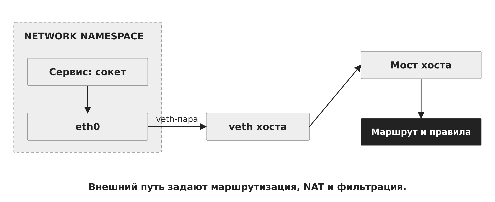

*Рисунок 24 — Пакет через veth и мост*

На рисунке 25 показан механизм «Одинаковый порт в двух контейнерах». Публикация связывает порт хоста с конкретным контейнером.

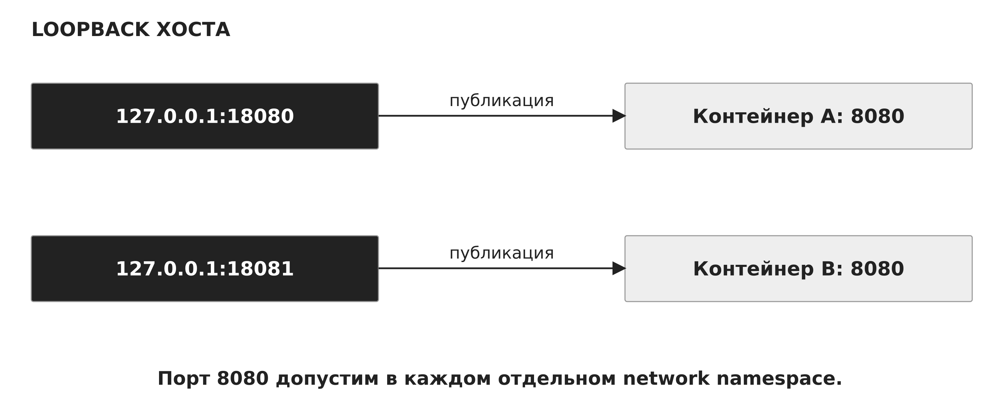

*Рисунок 25 — Одинаковый порт в двух контейнерах*


<a id="sec-14"></a>

## 14. Границы изоляции и наблюдение

Граница контейнера складывается из нескольких механизмов. Namespaces разделяют представления, cgroups регулируют ресурсы, capabilities ограничивают административные операции, а seccomp фильтрует системные вызовы. Политики разграничения доступа и режим файловой системы дополняют эту конфигурацию. Все обычные Linux-контейнеры одного ядра продолжают зависеть от его корректности. [10,15,19]

Привилегированный режим, подключение управляющего сокета контейнерного движка и широкие bind mounts изменяют полномочия приложения. Доступ к управляющему сокету может позволить создавать новые контейнеры и подключать дополнительные ресурсы с полномочиями сервиса управления. Поэтому описание изоляции должно включать реальные пользовательские идентификаторы, предоставленные устройства и файловые подключения.

Виртуальная машина имеет собственное гостевое ядро, но её граница тоже содержит конкретные интерфейсы: виртуальные устройства, общий каталог, сеть, средства управления. Нет оснований объявлять одну модель безусловно безопасной при любой конфигурации. Для дисциплины ОС существенна связь между объектом, точкой проверки и предоставленным интерфейсом.

Наблюдение начинают с установления уровня: физический хост, ВМ или контейнер. Внутри ВМ uname сообщает о гостевом ядре. В Linux-контейнере тот же вызов обращается к общему ядру, хотя политика среды может менять отдельные видимые сведения. Ссылки /proc/PID/ns/* помогают сопоставить пространства имён, а /proc/PID/cgroup — положение процесса в дереве ресурсов. Чтение этих объектов может ограничиваться правами. Числа и пути на слайдах являются иллюстративными и не выдаются за результат запуска на учебном стенде.

На рисунке 26 показан механизм «Механизмы границы контейнера». Каждый механизм отвечает за определённый класс проверок.

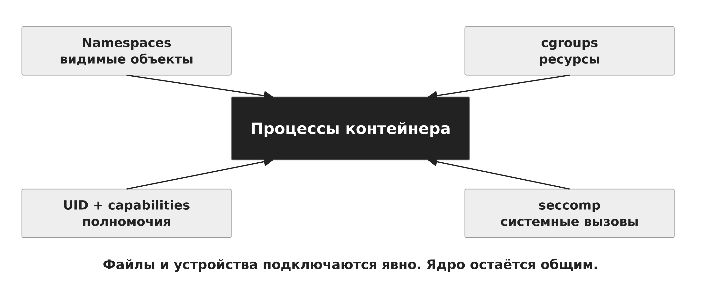

*Рисунок 26 — Механизмы границы контейнера*

Иллюстративные команды чтения состояния процесса на хосте:

```bash

readlink /proc/4312/ns/pid
readlink /proc/4312/ns/net
cat /proc/4312/cgroup
cat /proc/4312/uid_map

```

Сопоставление приведено в таблице 6.

**Таблица 6 — Виртуальная машина и контейнер**

| Свойство | Виртуальная машина | Linux-контейнер |

| --- | --- | --- |

| Ядро | Собственное гостевое | Общее с окружением |

| Выполнение | vCPU и гостевой планировщик | Обычные задачи ядра |

| Файлы | Виртуальный диск | Образ, слой записи, тома |

| Ресурсы | Конфигурация ВМ и хоста | cgroups и предки |

| Граница | Модель машины | Механизмы общего ядра |


<a id="sec-15"></a>

## 15. Итоги и вопросы для самоконтроля

Виртуализация машины повторно использует механизмы исполнения, памяти и ввода-вывода, но добавляет уровень управления гостевой ОС. Контейнерная модель применяет механизмы общего ядра к группе процессов. В обоих случаях требуется отдельно объяснить ресурсы, видимость, права и сохранность состояния.

При выборе окружения последовательно определяют необходимость собственного ядра, совместимость приложения, потребность в устройствах, жизненный цикл данных и требования к восстановлению. Затем оценивают ограничения физических ресурсов и пути взаимодействия. Это позволяет обосновать архитектуру без универсальных обещаний о скорости и изоляции.

Вопросы для самоконтроля:
1. Как отличаются роли KVM, QEMU и libvirt?
2. Почему готовый гостевой поток может ждать на перегруженном хосте?
3. Чем отличаются гостевой виртуальный, гостевой физический и физический адрес хоста?
4. Как вычислен адрес 0x2A234 в разобранном примере?
5. Почему NAT не означает отсутствие выхода во внешнюю сеть?
6. Какие части состояния сохраняет дисковый снимок и что остаётся вне него?
7. Почему образ контейнера не определяет собственное ядро?
8. Как один процесс получает два PID?
9. Почему mount namespace не копирует данные?
10. Как два потока расходуют квоту 50000 100000?
11. Чем различаются memory.high и memory.max?
12. Какие данные сохраняются после удаления контейнера?
13. Как публикация порта меняет путь пакета?
14. Какие объекты нужно проверить для объяснения границы изоляции?


<a id="glossary"></a>

## Основные понятия

**Гипервизор.** Компонент, управляющий выполнением ВМ и её доступом к ресурсам.

**vCPU.** Состояние и выполнение виртуального процессора гостя.

**VM exit.** Передача управления из гостевого режима в среду виртуализации.

**GVA / GPA / HPA.** Виртуальный адрес гостя / физический адрес гостя / физический адрес хоста.

**virtio.** Интерфейсы паравиртуальных устройств.

**Snapshot.** Сохранение выбранных частей состояния в определённой точке.

**Copy-on-write.** Создание отдельной версии данных при изменении.

**Namespace.** Отдельное представление определённого класса ресурсов ядра.

**cgroup.** Группа задач для учёта и управления ресурсами.

**OCI.** Спецификации контейнерных образов и среды выполнения.

**veth.** Пара связанных виртуальных сетевых интерфейсов.

**Rootless.** Работа управляющей среды и контейнеров без root-полномочий хоста.


<a id="sources"></a>

## Источники

Технические интерфейсы сверены с первичными источниками 8 ноября 2026 года. Конкретную поддержку механизмов определяют выпуск ОС, конфигурация ядра и среда выполнения.

1. [Linux Kernel: KVM API](https://docs.kernel.org/virt/kvm/api.html).

2. [QEMU: Introduction](https://www.qemu.org/docs/master/system/introduction.html).

3. [Linux Kernel: KVM x86 MMU](https://docs.kernel.org/virt/kvm/x86/mmu.html).

4. [Linux Kernel: virtiofs](https://docs.kernel.org/filesystems/virtiofs.html).

5. [Docker: What is a container?](https://docs.docker.com/get-started/docker-concepts/the-basics/what-is-a-container/).

6. [libvirt: Network XML](https://libvirt.org/formatnetwork.html).

7. [QEMU: Disk Images](https://www.qemu.org/docs/master/system/images.html).

8. [libvirt: Snapshot XML](https://libvirt.org/formatsnapshot.html).

9. [OCI Runtime Specification](https://github.com/opencontainers/runtime-spec/blob/main/runtime.md).

10. [Linux man-pages: namespaces(7)](https://man7.org/linux/man-pages/man7/namespaces.7.html).

11. [Linux man-pages: pid_namespaces(7)](https://man7.org/linux/man-pages/man7/pid_namespaces.7.html).

12. [Linux man-pages: user_namespaces(7)](https://man7.org/linux/man-pages/man7/user_namespaces.7.html).

13. [Docker: Rootless mode](https://docs.docker.com/engine/security/rootless/).

14. [Docker: Volumes](https://docs.docker.com/engine/storage/volumes/).

15. [Linux Kernel: cgroup v2](https://docs.kernel.org/admin-guide/cgroup-v2.html).

16. [Docker: OverlayFS](https://docs.docker.com/engine/storage/drivers/overlayfs-driver/).

17. [Linux man-pages: network_namespaces(7)](https://man7.org/linux/man-pages/man7/network_namespaces.7.html).

18. [Docker: Bridge network driver](https://docs.docker.com/engine/network/drivers/bridge/).

19. [Docker: Seccomp profiles](https://docs.docker.com/engine/security/seccomp/).