# Лекция 16. Реагирование, восстановление и современные тенденции


**Дисциплина:** Операционные системы. **Аудитория:** университет, 3-й курс, 10.05.01 «Компьютерная безопасность». **Занятие:** 90 минут.


## Содержание

- [1. Работоспособность ОС и наблюдаемое состояние](#sec-1)

- [2. Цикл реагирования и выбор действия](#sec-2)

- [3. Артефакты и изменчивость данных](#sec-3)

- [4. Журналы, загрузки и временная шкала](#sec-4)

- [5. Диагностика по слоям ОС](#sec-5)

- [6. Загрузка и восстановительные окружения](#sec-6)

- [7. Сбой ядра и состояние после аварии](#sec-7)

- [8. Восстановление данных и устранение причины](#sec-8)

- [9. Резервное копирование, RPO и RTO](#sec-9)

- [10. Разобранный сценарий восстановления службы](#sec-10)

- [11. Реальное время и предсказуемость ОС](#sec-11)

- [12. Отечественные ОС и эксплуатационная совместимость](#sec-12)

- [13. Современная эксплуатация и zero trust](#sec-13)

- [14. Итоги курса и самоконтроль](#sec-14)

- [Основные понятия](#glossary)

- [Источники](#sources)


<a id="sec-1"></a>

## 1. Работоспособность ОС и наблюдаемое состояние

Работоспособность операционной системы определяется возможностью выполнять требуемые функции с допустимыми задержками и корректным состоянием данных. Сам факт загрузки ядра или существования процесса не гарантирует полезного результата. Служба может находиться в состоянии active и при этом не читать данные, не принимать соединения или возвращать ошибки. Поэтому восстановление завершают проверкой функции, которую получает пользователь.

Отказом будем называть утрату требуемой функции. Сбой может иметь временный характер, а неисправность — устойчивую причину. Инцидент в контексте эксплуатации означает событие или набор событий, которые требуют организованного реагирования. Не каждый отказ связан с атакой. Заполненный раздел, ошибочная конфигурация, нехватка памяти, отказ устройства и несовместимое обновление способны дать похожий внешний симптом.

Сквозной пример лекции — учебная служба обработки отчётов. После изменения конфигурации она перестала сохранять результат. Разбор начнётся с наблюдений и гипотез, затем перейдёт к сохранению состояния, локализации причины и проверке восстановления. Все временные отметки и имена в примере условные. Основное внимание уделяется состояниям процессов, загрузке, файловым системам, памяти и зависимостям служб.

На рисунке 1 показан механизм «Процесс существует, результата нет». Работоспособность подтверждает полезная операция приложения.

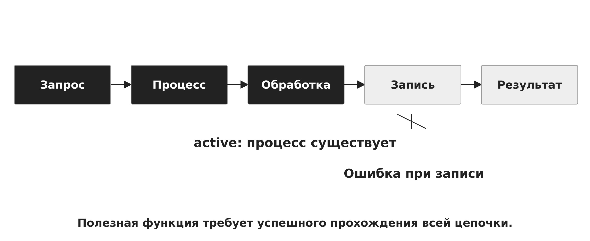

*Рисунок 1 — Процесс существует, результата нет*


<a id="sec-2"></a>

## 2. Цикл реагирования и выбор действия

Цикл реагирования в этой лекции описывает техническую работу с ОС: подготовка, обнаружение и первичная оценка, сохранение нужных сведений, локализация последствий, устранение причины, восстановление и анализ результата. Это учебная модель эксплуатации, а не дословное воспроизведение стандарта. Этапы могут повторяться: новая информация меняет гипотезу и требует дополнительной проверки.

Подготовка создаёт исходную линию: версии ОС и пакетов, конфигурацию, состав устройств, зависимости служб и проверенные копии. Обнаружение устанавливает фактическое нарушение и область влияния. Локализация ограничивает продолжение ущерба или отказа, например приостанавливает входные задания. Устранение причины исправляет конфигурацию или заменяет неисправный компонент. Восстановление возвращает функцию, а заключительный анализ уточняет исходную линию и средства наблюдения.

Действие выбирают по влиянию на данные и доступность. Перезапуск может быстро вернуть службу, но уничтожает оперативное состояние процесса. Отключение сети уменьшает внешнее взаимодействие, но также может прервать удалённое управление и зависимые операции. При физическом отказе носителя многократные чтения способны ухудшить ситуацию. Поэтому универсальная команда «сначала перезагрузить» не заменяет анализа конкретного состояния.

Каждое существенное действие связывают с гипотезой, ожидаемым результатом и способом проверки. Например: «служба не может создать временный файл из-за отсутствия свободных inode». Проверка должна различать нехватку блоков, нехватку inode, квоту и запрет доступа. Запись времени и результата позволяет восстановить последовательность решений и избежать повторения уже отвергнутых действий.

На рисунке 2 показан механизм «Цикл работы с отказом». После действия повторно проверяют состояние и рабочую гипотезу.

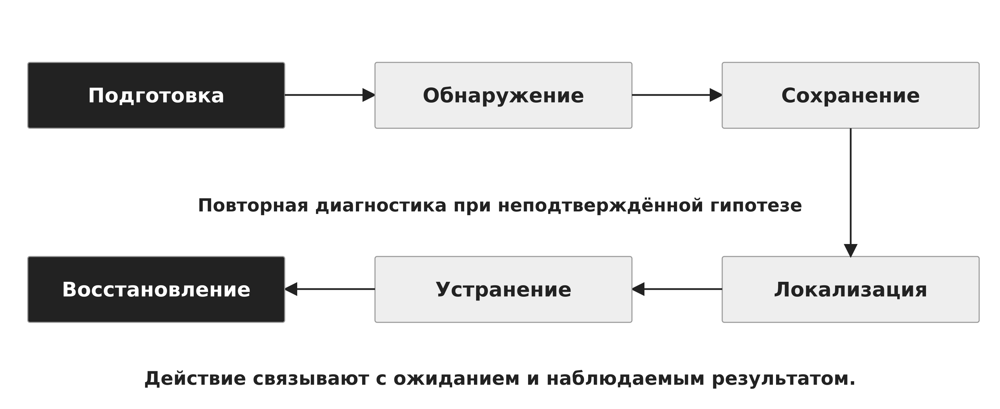

*Рисунок 2 — Цикл работы с отказом*

Сопоставление приведено в таблице 1.

**Таблица 1 — Действие и цена изменения состояния**

| Действие | Что меняется | Что можно потерять |

| --- | --- | --- |

| Перезапуск процесса | Новое выполнение | RAM и текущие соединения |

| Перезагрузка ОС | Новая загрузка ядра | Оперативное состояние узла |

| Отключение сети | Пути взаимодействия | Удалённое управление |

| Ремонт файловой системы | Метаданные ФС | Исходное состояние данных |


<a id="sec-3"></a>

## 3. Артефакты и изменчивость данных

Артефакт — сохранённое наблюдение или объект, помогающий объяснить состояние системы. К нему относятся журналы, конфигурационные файлы, сведения о процессах, сетевых соединениях, монтированиях и версиях пакетов. Артефакт должен сопровождаться контекстом: источник, момент получения, способ сбора, имя узла и границы полноты. Отдельная строка без происхождения часто допускает несколько трактовок.

Оперативные данные изменяются быстрее, чем сохранённая конфигурация. Завершение процесса уничтожает его текущую память и открытые дескрипторы. Перезагрузка удаляет многие текущие состояния ядра. Журнал предыдущей загрузки доступен только при фактическом сохранении соответствующих записей. Порядок сбора зависит от задачи, риска продолжения работы и возможностей среды. Он не является неизменной таблицей для всех случаев.

Команда чтения тоже влияет на систему: создаёт процесс, потребляет CPU, память и ввод-вывод. Сохранение вывода на тот же переполненный раздел может не сработать. Получение дампа памяти требует подготовленного средства и разрешённого места хранения. В учебной лекции достаточно понимать это влияние и различать наблюдение живой системы и анализ её сохранённой копии.

Контрольная сумма помогает обнаружить последующее изменение файла относительно зафиксированного значения. Она сама по себе не подтверждает достоверность первоначального содержимого и не доказывает источник. Для этого дополнительно нужен надёжный процесс получения и хранения. Исходный артефакт сохраняют отдельно, а преобразование формата, фильтрацию и поиск выполняют на рабочей копии.

На рисунке 3 показан механизм «Что исчезает при перезапуске». Оперативное состояние сохраняют до действия, которое его уничтожает.


*Рисунок 3 — Что исчезает при перезапуске*

На рисунке 4 показан механизм «Исходный артефакт и рабочая копия». Поиск и преобразования выполняют на копии с сохранённым происхождением.

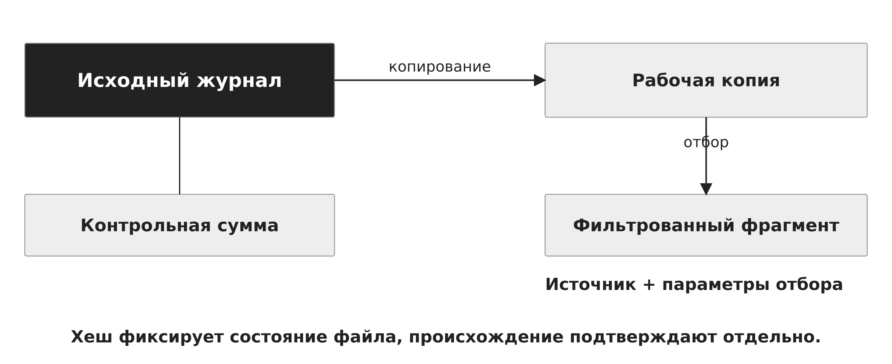

*Рисунок 4 — Исходный артефакт и рабочая копия*


<a id="sec-4"></a>

## 4. Журналы, загрузки и временная шкала

Системный журнал связывает сообщения с загрузкой, службой, процессом и временем. В systemd journal идентификатор загрузки позволяет отделить события до и после перезапуска ОС. journalctl --list-boots показывает доступные загрузки, а -b выбирает нужную. Параметр -b -1 означает предыдущую доступную загрузку, если её журнал сохранён. Ключ -u ограничивает выборку указанной службой, а -k выбирает сообщения ядра. [2]

Календарное время удобно для сопоставления разных узлов, но зависит от настройки часов и синхронизации. Монотонное время удобно для порядка событий внутри одной загрузки, однако его нельзя напрямую сравнивать между разными загрузками и машинами. При построении общей шкалы фиксируют часовой пояс и известные поправки, а близкие события не объявляют причинно связанными только из-за соседних временных меток.

В учебном примере в 10:02 изменяется конфигурация службы, в 10:03 происходит перезапуск, а в 10:04 появляется ошибка сохранения. Такая последовательность поддерживает гипотезу о связи с изменением, но ещё не устанавливает причину. Проверка обнаруживает новый путь временного каталога на файловой системе без свободных inode. Подтверждение требует сопоставить конфигурацию, монтирование, счётчики ФС и сообщение приложения.

Сообщение «отказано в доступе» также требует контекста: проверяются пользователь процесса, режим каталога, ACL, режим монтирования и политика доступа. Наличие ошибки в журнале является наблюдением, а не готовым объяснением всей неисправности. Переход от журнала к гипотезе должен завершаться проверкой соответствующего механизма.

На рисунке 5 показан механизм «Две системы времени». Монотонное время сопоставляют в пределах одной загрузки.

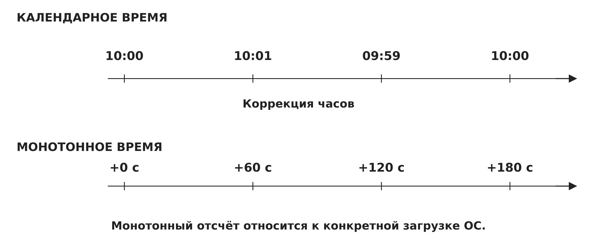

*Рисунок 5 — Две системы времени*

Иллюстративные команды чтения состояния процесса на хосте:

```bash

journalctl --list-boots
journalctl -b -1 -k
journalctl -b -u report.service
systemctl --failed

```

На рисунке 6 показан механизм «Наблюдение, гипотеза, подтверждение». Временная близость событий требует проверки механизма.

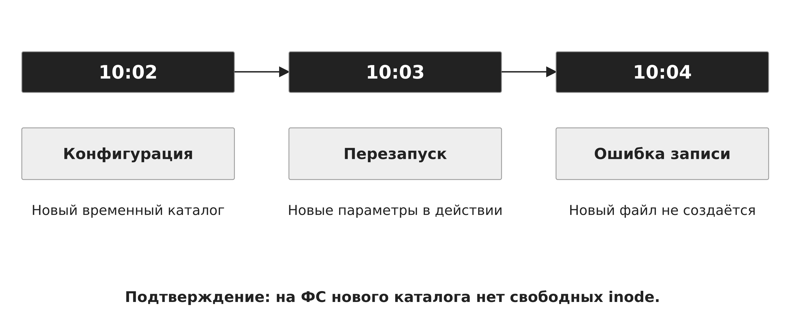

*Рисунок 6 — Наблюдение, гипотеза, подтверждение*


<a id="sec-5"></a>

## 5. Диагностика по слоям ОС

Поиск причины удобно вести от наблюдаемой функции к зависимостям. Для службы это процесс и его код завершения, параметры запуска, пользователь, файлы, доступность хранилища, сокеты и внешние зависимости. Если процесс не запущен, проверяют результат запуска. Если запущен, но не отвечает, рассматривают ожидание ресурсов, блокировки и доступность зависимых служб.

Состояние D в Linux обычно связано с непрерываемым ожиданием, часто ввода-вывода. Сигнал не обязан немедленно прекратить такой поток: выполнение реакции может ждать возврата из соответствующего ожидания ядра. Высокая загрузка системы также не равна высокой полезной работе CPU. Растущая очередь, ожидание диска и давление памяти требуют разных наблюдений. По одному числу нельзя выбрать корректное средство восстановления. [4]

Для файловой системы различают свободные блоки и свободные inode. Большое число маленьких файлов способно исчерпать inode при оставшемся пространстве. Другие причины ошибки записи — квота, режим read-only, запрет доступа, ошибка устройства или неверный путь. df -h оценивает использование пространства, df -i — inode, findmnt — фактическое монтирование, а lsblk — блочные устройства. [7,8,9]

В сквозном примере свободны 8 ГиБ, но доступных inode нет. Удалять произвольные системные файлы нельзя: сначала устанавливают владельца и назначение мелких временных объектов. После сохранения нужных сведений освобождают только согласованную категорию временных данных или переводят службу на подходящее хранилище. Затем проверяют создание файла от имени службы, выполнение задания и отсутствие повторной ошибки.

На рисунке 7 показан механизм «Уровни поиска причины». На каждом уровне проверяется конкретная зависимость.

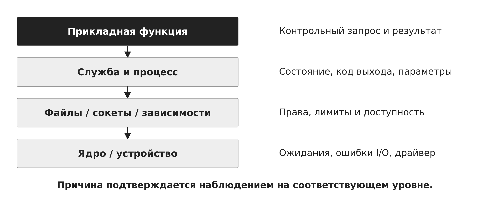

*Рисунок 7 — Уровни поиска причины*

На рисунке 8 показан механизм «Место есть, файл не создаётся». Свободные блоки и свободные inode — разные ресурсы ФС.

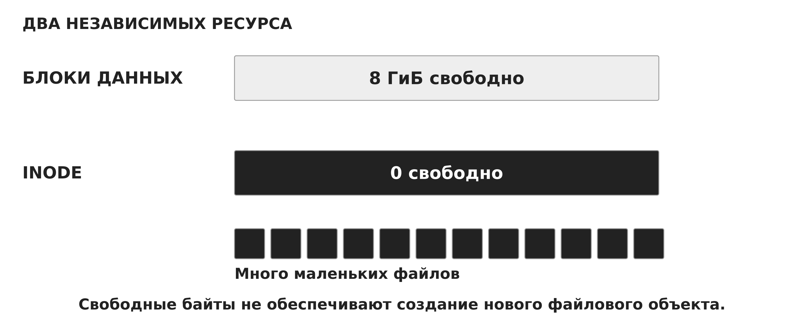

*Рисунок 8 — Место есть, файл не создаётся*

Сопоставление приведено в таблице 2.

**Таблица 2 — Симптом и проверяемая причина**

| Наблюдение | Возможное объяснение | Проверка |

| --- | --- | --- |

| Служба failed | Ошибка старта | Код завершения и журнал |

| Процесс в D | Ожидание в ядре | Стек, I/O и устройство |

| Нет записи | Блоки, inode или права | df, findmnt и контекст |

| Нет ответа | Сокет, маршрут, зависимость | Путь запроса по слоям |


<a id="sec-6"></a>

## 6. Загрузка и восстановительные окружения

Загрузка Linux проходит несколько крупных стадий: прошивка выбирает загрузчик, загрузчик загружает ядро и начальную файловую систему initramfs, ранняя пользовательская среда находит корневую файловую систему, затем основной менеджер запускает зависимости и службы. Сбой на каждой стадии оставляет разные возможности наблюдения. Ошибка поиска root по UUID отличается от ошибки запуска прикладной службы уже после монтирования корня.

Initramfs содержит ранние программы и драйверы, необходимые до подключения основного корня. При несовместимом модуле накопителя или неправильном UUID система может остановиться до обычного входа пользователя. Поэтому восстановление загрузки начинается с точного места остановки, сохранения диагностических сообщений и сопоставления устройств с конфигурацией. Замена всего набора компонентов без локализации причины усложняет последующее объяснение.

В systemd rescue.target запускает базовую систему и восстановительную оболочку, а emergency.target создаёт более минимальное окружение. Emergency не подключает автоматически весь набор файловых систем и основных служб. Режим корневой ФС может быть read-only или read-write в зависимости от пути входа. Поэтому название режима не заменяет проверки текущих монтирований. [3]

Независимый загрузочный носитель позволяет анализировать систему, которая не загружается со своего диска. До записи устанавливают, какой накопитель и раздел являются исходными. Подключение файловой системы в read-only не всегда исключает служебные записи: особенности воспроизведения журнала зависят от конкретной ФС и параметров монтирования. При необходимости сохранения точного состояния используют подготовленный режим доступа и рабочую копию. Разблокировка шифрованного тома также не отменяет требований к сохранности исходных данных.

На рисунке 9 показан механизм «Где прервалась загрузка». Место остановки определяет доступные средства наблюдения.

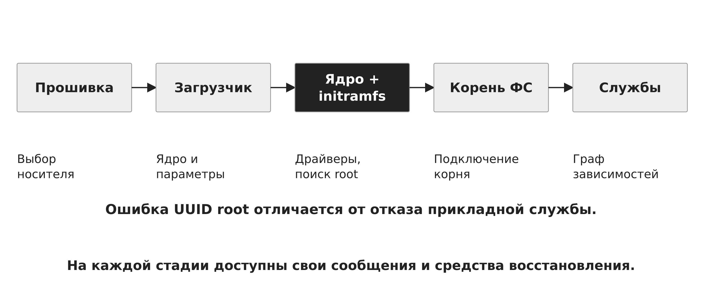

*Рисунок 9 — Где прервалась загрузка*

Сопоставление приведено в таблице 3.

**Таблица 3 — Rescue и emergency**

| Свойство | rescue.target | emergency.target |

| --- | --- | --- |

| Окружение | Базовая система и оболочка | Минимальная оболочка |

| Монтирования | Базовый набор зависимостей | Не подтягивает автоматически |

| Службы | Наиболее основные | Минимум процессов |

| Корневая ФС | Фактический режим проверяют | Возможны ro и rw |


<a id="sec-7"></a>

## 7. Сбой ядра и состояние после аварии

Необрабатываемая ошибка ядра может привести к panic и остановке нормального выполнения. Oops фиксирует ошибку, после которой система иногда продолжает работу, но её состояние требует оценки. Наличие taint-флагов указывает на события, значимые для диагностики, например загрузку определённого внешнего модуля. Флаг сохраняется и после удаления вызвавшего его компонента, поэтому его трактуют как диагностический контекст. [10]

Kdump использует заранее зарезервированную память и второе ядро для сохранения дампа после аварии основного ядра. Подготовка выполняется до сбоя. Во время аварии специальное ядро получает доступ к сохранённой памяти и переносит дамп в установленное место. Это позволяет анализировать стеки и структуры исходного ядра. Если механизм не был настроен или не сработал, наличие полного дампа нельзя предполагать. [6]

Дамп может содержать пользовательские данные, ключи и другую информацию из памяти. Его хранят с учётом содержания и предоставляют только необходимым участникам анализа. Символы отладки и сведения о точной сборке ядра помогают правильно интерпретировать адреса. По снимку памяти анализируют конкретный момент, а не всю предшествующую историю системы.

Перезагрузка устраняет текущее состояние, но не обязательно его причину. Возврат отказа после одинакового триггера, связь с версией драйвера и повторяемый стек помогают построить объяснение. Поэтому после восстановления доступа продолжают анализ диагностических данных и проверяют, исчез ли механизм отказа.

На рисунке 10 показан механизм «Panic, dump и повторная загрузка». Сохранение дампа требует подготовки до аварии.

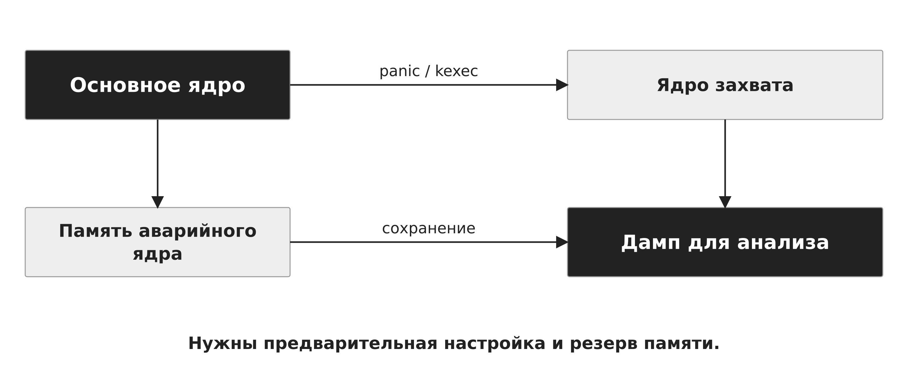

*Рисунок 10 — Panic, dump и повторная загрузка*


<a id="sec-8"></a>

## 8. Восстановление данных и устранение причины

При логическом повреждении файловой системы восстановительная утилита проверяет структуры размещения и связи метаданных. fsck обычно выбирает специализированное средство для конкретного типа ФС. Ремонт проводят в поддерживаемом для неё состоянии, как правило на размонтированном объекте. Команда с автоматическим согласием на все исправления не подходит как универсальная первая операция. Исправление структуры может удалить противоречивые ссылки и не восстановит гарантированно смысл пользовательского документа. [11]

При ошибках ввода-вывода приоритет смещается к сохранению читаемых данных. Ремонт на исходном неисправном носителе увеличивает риск потерь. GNU ddrescue предназначен для копирования доступных областей с учётом ошибок и использует mapfile для фиксации состояния чтения. Карта позволяет продолжать работу и различать прочитанные, непрочитанные и проблемные области. Конкретную стратегию выбирают с учётом характера отказа. [5]

Рабочая копия отделяет операции логического восстановления от исходного носителя. Контроль размеров, идентичности источника и назначения выполняют до записи. Имена устройств и стратегию копирования определяют по фактическому подключению накопителей и характеру ошибок. Смысл механизма состоит в сохранении доступных байтов и последующем анализе копии.

После исправления непосредственной причины проверяют связанные последствия. Ошибочная конфигурация могла породить неполные файлы. Переполненный раздел мог прервать обновление пакетов. Отказ накопителя мог затронуть несколько служб. Возврат одной операции записи является необходимым наблюдением, но полнота восстановления зависит от границы затронутого состояния.

На рисунке 11 показан механизм «Носитель с ошибками и рабочая копия». Логическое восстановление отделяют от чтения неисправного оригинала.

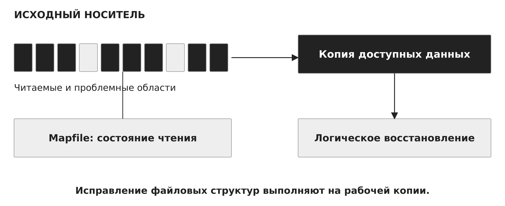

*Рисунок 11 — Носитель с ошибками и рабочая копия*


<a id="sec-9"></a>

## 9. Резервное копирование, RPO и RTO

План восстановления определяет допустимую потерю данных и время возвращения функции. Recovery Point Objective, RPO, задаёт целевую границу потери данных во времени. Recovery Time Objective, RTO, задаёт целевое время восстановления. Это требования к процессу, а не автоматически достигнутые свойства программы копирования. Фактический результат измеряют отдельно.

В учебном примере согласованная копия отражает состояние на 09:00, отказ произошёл в 09:40, а функция вернулась в 10:10. При восстановлении только этой копии фактический промежуток утраченных изменений может составить до 40 минут. Время недоступности составляет 30 минут. Если цели равны RPO 15 минут и RTO 45 минут, цель по времени выполнена, а по потере данных — нет. Дополнительное воспроизведение транзакционных журналов могло бы изменить результат, но в условиях примера его нет.

Полная копия служит базой. Инкрементальные копии обычно зависят от предыдущих звеньев выбранной цепочки. Потеря необходимого звена ограничивает восстановление соответствующей точки. Поэтому проверяют не только успешное завершение последнего задания копирования, но и доступность всех зависимостей. Реплика также не является независимой историей: логическое удаление может распространиться на неё.

Пробное восстановление выполняют в изолированное окружение, чтобы избежать конфликта имён, адресов и одновременной работы двух владельцев одного состояния. Проверяют файлы, права, метки при их использовании, конфигурацию и прикладную операцию. Только после этого принимают решение о возвращении узла в работу. Измеренные сроки и полнота данных сравниваются с исходными требованиями.

На рисунке 12 показан механизм «RPO и RTO на одной шкале». В примере потеря изменений до 40 минут, недоступность 30 минут.

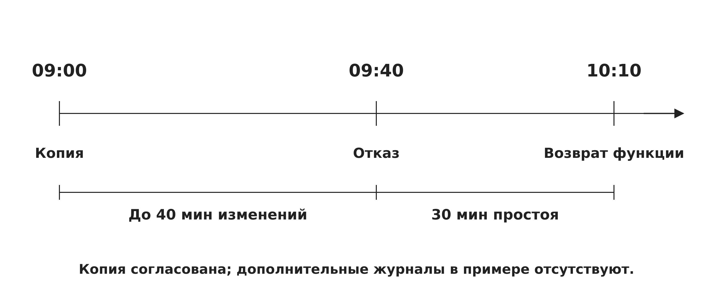

*Рисунок 12 — RPO и RTO на одной шкале*

Сопоставление приведено в таблице 4.

**Таблица 4 — Цели и фактический результат**

| Показатель | Цель | Результат примера |

| --- | --- | --- |

| Потеря данных | RPO ≤ 15 минут | До 40 минут: не выполнено |

| Восстановление | RTO ≤ 45 минут | 30 минут: выполнено |

| Условия | Одна копия на 09:00 | Журналы не воспроизводятся |

На рисунке 13 показан механизм «Цепочка резервных копий». Для нужной точки восстановления должны быть доступны все её зависимости.

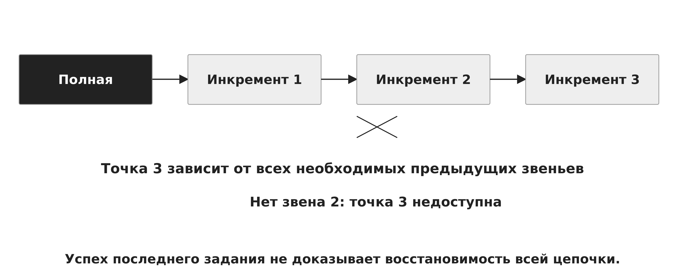

*Рисунок 13 — Цепочка резервных копий*

На рисунке 14 показан механизм «Проверка восстановленной службы». Сначала проверка в изоляции, затем контролируемый возврат в работу.

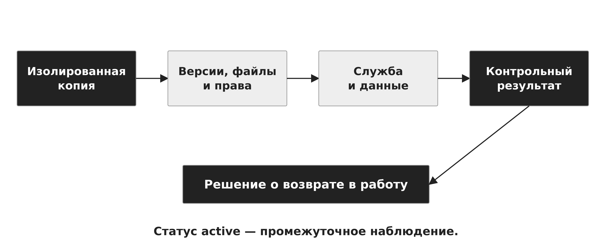

*Рисунок 14 — Проверка восстановленной службы*


<a id="sec-10"></a>

## 10. Разобранный сценарий восстановления службы

Вернёмся к службе отчётов. Наблюдение: запрос приходит, обработка начинается, результат не сохраняется. Сохранены журнал текущей загрузки, конфигурация до и после изменения, сведения о монтированиях и использовании inode. Гипотеза о нехватке места в байтах не подтверждается. Новый каталог временных данных расположен на разделе, где исчерпан ресурс inode.

Причина локализована на уровне файловой системы и выбранного пути. Входящие задания приостанавливаются согласованным способом, чтобы не увеличивать число неполных результатов. После сохранения необходимых сведений устраняется источник накопления мелких файлов и восстанавливается проверенная конфигурация каталога. Удаляются только известные временные объекты по принятой политике, а не произвольные данные приложения.

Контроль включает создание файла в нужном каталоге с контекстом пользователя службы, обработку контрольного запроса, чтение итогового отчёта и наблюдение за расходом inode. Проверяется, что очередь заданий не содержит потерянных или повторно выполненных операций. Такой разбор показывает полный переход от симптома к механизму и далее к подтверждённому восстановлению. Если бы источник роста числа файлов остался, освобождение ресурса дало бы только временный эффект.

На рисунке 15 показан механизм «Служба отчётов: полный разбор». Исправление причины дополняется проверкой очереди и результата.

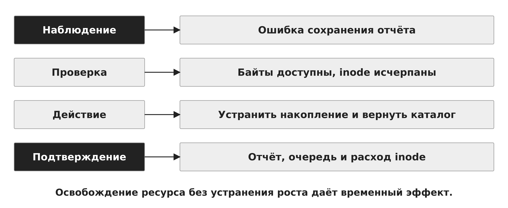

*Рисунок 15 — Служба отчётов: полный разбор*


<a id="sec-11"></a>

## 11. Реальное время и предсказуемость ОС

Для системы реального времени корректность результата зависит и от значения, и от момента его получения. Дедлайн задаёт предельный срок завершения. В жёстком реальном времени нарушение срока является недопустимым исходом по требованиям системы. В мягком реальном времени отдельные опоздания снижают качество. Это различие определяется прикладной задачей, а не названием дистрибутива.

Пусть управляющее воздействие должно завершиться за 10 мс после события. В учебной модели доставка события занимает 2 мс, ожидание CPU — 3 мс, вычисление — 4 мс. Ответ появляется через 9 мс и укладывается в срок. Если ожидание увеличится ещё на 2 мс, время ответа составит 11 мс, а тот же вычислительный результат окажется просроченным. Среднее время выполнения функции не описывает худшую задержку.

Время ответа включает блокировки, вытеснение, обработку прерываний и зависимость от устройств. Worst-Case Execution Time, WCET, обозначает оценку наихудшего времени выполнения кода при заданных условиях. Его нужно отличать от полной задержки ответа, которая включает ожидания. Для строгих гарантий требуются модель нагрузки, анализ допустимости и контролируемые ограничения среды.

PREEMPT_RT повышает вытесняемость ядра, применяет примитивы с наследованием приоритета и переносит значительную часть обработки прерываний в потоки. Это снижает задержку запуска высокоприоритетной задачи, но не превращает любое приложение и оборудование в систему с доказанными дедлайнами. Драйверы, невытесняемые участки и сама конфигурация остаются существенными. [13]

В SCHED_DEADLINE задают runtime, deadline и period. Планировщик использует алгоритм ближайшего срока EDF и механизм CBS для управления бюджетом. Наличие параметров не отменяет проверки допустимости нагрузки. В упрощённой однопроцессорной модели независимых вытесняемых периодических задач с дедлайнами, равными периодам, сумма C/T не должна превышать единицу. Для реальной системы добавляются служебные расходы, блокировки и ограничения реализации. [14]

На рисунке 16 показан механизм «Результат и срок завершения». Для реального времени важен худший допустимый отклик.

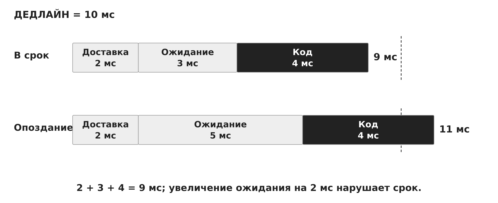

*Рисунок 16 — Результат и срок завершения*

На рисунке 17 показан механизм «Инверсия приоритетов». Наследование приоритета помогает владельцу быстрее освободить ресурс.

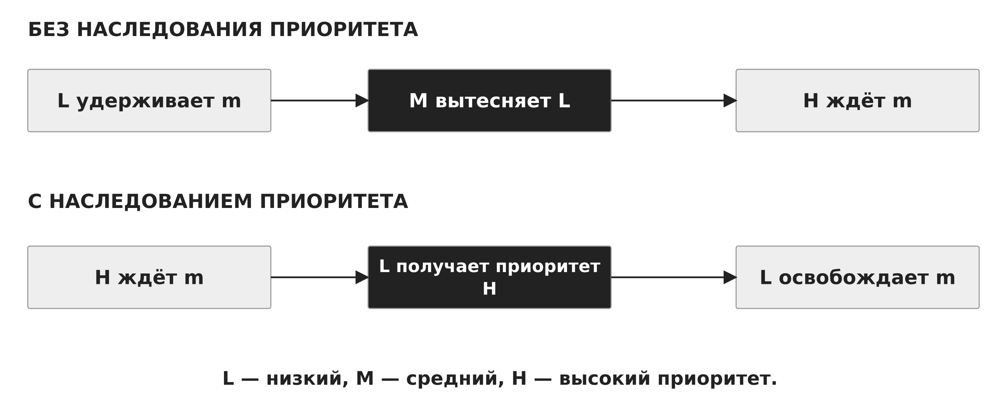

*Рисунок 17 — Инверсия приоритетов*

На рисунке 18 показан механизм «Бюджет и период задачи». В идеализированной модели 2/10 + 3/10 = 0,5 CPU.


*Рисунок 18 — Бюджет и период задачи*


<a id="sec-12"></a>

## 12. Отечественные ОС и эксплуатационная совместимость

Astra Linux, семейство «Альт» и РЕД ОС предоставляют отечественные платформы для разных сценариев эксплуатации. При сравнении важно рассматривать конкретный продукт, редакцию и поддерживаемую конфигурацию. Нельзя переносить свойства одной редакции, набор пакетов или срок поддержки на всё семейство. Точные версии и ограничения проверяют по документации поставщика. [15–17]

С точки зрения механизмов ОС миграция требует совместимости архитектуры CPU, драйверов, библиотек и интерфейсов системных вызовов. Совпадение названия прикладного пакета не гарантирует бинарную совместимость. На работу влияют версии библиотек, формат пакетов, порядок обновлений и политика доступа. Восстановительная процедура также зависит от загрузчика, файловой системы и средств поставки.

Проверка перехода охватывает реальные функции: запуск службы, доступ к устройству, обработку данных, журналирование и восстановление из копии. Отдельно оценивают возможность отката и поддержку оборудования. Поддержка производителя и доступность документации являются эксплуатационными свойствами, которые нельзя вывести из происхождения ядра или маркетингового описания.

В учебном курсе Astra Linux и Kali Linux выполняют разные роли стенда, но знания о процессах, памяти, файловых системах и сети позволяют анализировать обе среды. Именно эти механизмы образуют переносимую основу подготовки. Специфические средства администрирования изучаются поверх неё по фактической версии системы.

Сопоставление приведено в таблице 5.

**Таблица 5 — Отечественные ОС: предмет сравнения**

| Платформа | Первичный источник | Что уточнять |

| --- | --- | --- |

| Astra Linux | Документация Astra Linux | Продукт, редакция, конфигурация |

| Альт | Документация BaseALT | Дистрибутив и ветка пакетов |

| РЕД ОС | Документация РЕД СОФТ | Версия и поддержка |

| Любая миграция | Проверка целевых функций | Драйверы, библиотеки, откат |

На рисунке 19 показан механизм «Совместимость приложения по слоям». Совпадение имени пакета не доказывает совместимость всей системы.

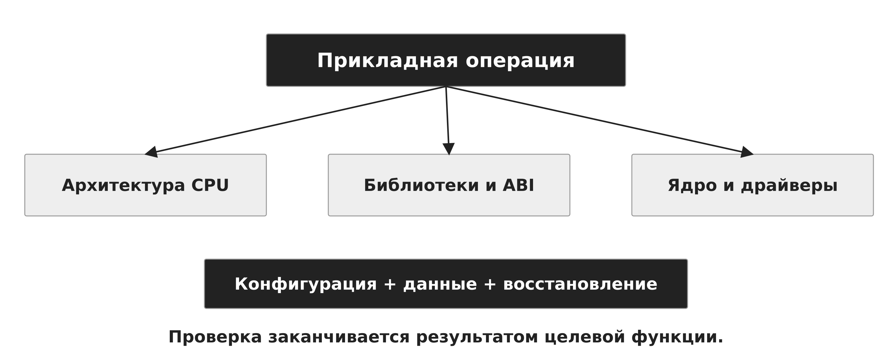

*Рисунок 19 — Совместимость приложения по слоям*


<a id="sec-13"></a>

## 13. Современная эксплуатация и zero trust

Современные подходы стремятся сделать состояние системы воспроизводимым. Декларативная конфигурация задаёт желаемое состояние, а средство управления сравнивает его с фактическим. Неизменяемый базовый образ позволяет заменять системный слой целиком и хранить изменяемые данные отдельно. Атомарное обновление стремится переключить согласованный набор компонентов как единое изменение. Возможность отката при этом ограничивается совместимостью данных и внешним состоянием.

Такая организация не устраняет диагностику: необходимо понимать, какая версия образа запущена, какие данные подключены и почему система отклонилась от целевого состояния. Мониторинг должен отражать полезные функции и давление ресурсов, а не только наличие процессов. Автоматическое восстановление применяют там, где повторный запуск или замена экземпляра не нарушают корректность операций.

Zero trust — архитектурный подход к доступу, в котором положение в сети само по себе не создаёт доверие. Решение учитывает субъект, ресурс и актуальный контекст. В модели NIST различаются принятие решения политики и точка его исполнения. Для ОС это связывается с идентичностью процесса, минимальными полномочиями, локальными проверками и наблюдаемым состоянием узла. Zero trust не является отдельным ядром или универсальным переключателем настройки. [18]

Доверенная эксплуатация в рамках лекции означает управляемое происхождение системных компонентов, контролируемые изменения и проверяемое восстановление. Обновление, разграничение доступа, журналирование и резервирование образуют согласованный жизненный цикл. Они не заменяют друг друга: журнал помогает объяснить событие, копия возвращает состояние, а управление конфигурацией уменьшает непредусмотренные различия.

Итоговый критерий профессионального анализа: назвать объект ОС, его состояние, точку наблюдения и проверку гипотезы. Такое объяснение переносится между дистрибутивами и остаётся полезным при появлении новых инструментов. Именно поэтому завершающая тема объединяет восстановление и развитие систем, сохраняя опору на базовые механизмы курса.

На рисунке 20 показан механизм «Воспроизводимое состояние системы». Версия образа, конфигурация и данные имеют отдельные жизненные циклы.

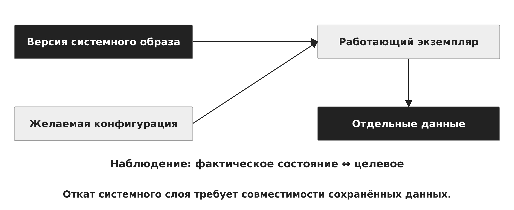

*Рисунок 20 — Воспроизводимое состояние системы*

На рисунке 21 показан механизм «Zero trust и механизмы ОС». Сетевое расположение само по себе не предоставляет полномочия.

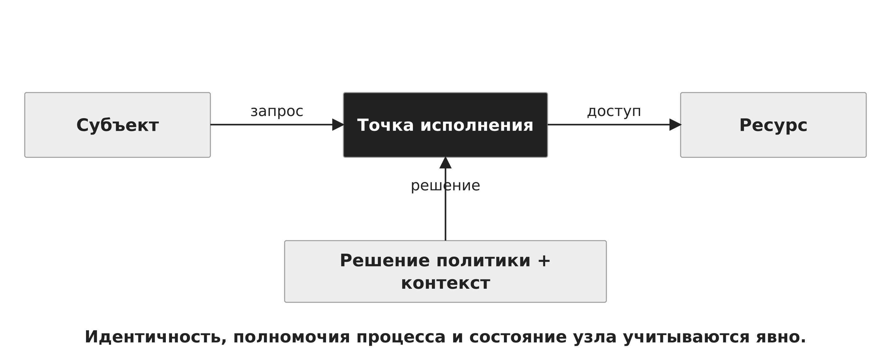

*Рисунок 21 — Zero trust и механизмы ОС*


<a id="sec-14"></a>

## 14. Итоги курса и самоконтроль

Операционная система управляет ресурсами и поддерживает абстракции, от которых зависит выполнение приложений. Отказ функции можно объяснить через состояние процесса, нехватку ресурса, ошибку отображения, проблему устройства, нарушение зависимости или несогласованное изменение данных. Реагирование использует эти же механизмы для наблюдения, локализации и восстановления.

Рабочая последовательность анализа: установить нарушенную функцию, сохранить необходимые сведения, сформулировать проверяемую гипотезу, выполнить обоснованное действие и измерить результат. При восстановлении различают доступность и полноту данных. При анализе реального времени различают вычислительный результат и допустимую задержку. При сравнении платформ различают общее устройство ОС и свойства конкретной версии.

Вопросы для самоконтроля:
1. Почему active-процесс не гарантирует работоспособность службы?
2. Как действие администратора меняет наблюдаемое состояние?
3. Что теряется при завершении процесса и перезагрузке ОС?
4. Чем контрольная сумма отличается от доказательства происхождения?
5. Как соотносятся календарное и монотонное время?
6. Почему наличие свободных байтов не гарантирует создание файла?
7. Как отличаются rescue.target и emergency.target?
8. Почему ремонт ФС на неисправном носителе опасен для сохранности данных?
9. Какая подготовка требуется для kdump?
10. Как рассчитаны фактические 40 минут потери изменений и 30 минут простоя?
11. Почему реплика и цепочка копий имеют разные зависимости?
12. Как проверить прикладную согласованность после восстановления?
13. Как инверсия приоритетов увеличивает время ответа?
14. Что меняет PREEMPT_RT и чего не гарантирует само его наличие?
15. Какие условия нужны для оценки загрузки C/T?
16. Что проверяют при переносе приложения между дистрибутивами?
17. Как zero trust связан с идентичностью и полномочиями процесса?


<a id="glossary"></a>

## Основные понятия

**Артефакт.** Сохранённый объект или наблюдение с контекстом получения.

**Исходная линия.** Зафиксированное состояние для последующего сравнения.

**Локализация.** Ограничение области продолжающегося отказа или его последствий.

**Initramfs.** Начальная пользовательская среда до подключения основного корня.

**Kernel panic.** Состояние аварийной остановки нормального выполнения ядра.

**Kdump.** Механизм сохранения памяти аварийного ядра с помощью ядра захвата.

**RPO.** Целевая граница допустимой потери данных во времени.

**RTO.** Целевое время восстановления функции.

**WCET.** Оценка наихудшего времени выполнения при заданных условиях.

**Дедлайн.** Предельный срок завершения операции.

**Инверсия приоритетов.** Задержка высокоприоритетной задачи из-за ресурса у низкоприоритетной.

**PREEMPT_RT.** Механизмы повышения вытесняемости и предсказуемости Linux.

**Zero trust.** Подход к доступу с явной проверкой субъекта, ресурса и контекста.


<a id="sources"></a>

## Источники

Технические интерфейсы сверены с первичными источниками 8 ноября 2026 года. Конкретную поддержку механизмов определяют выпуск ОС, конфигурация ядра и среда выполнения.

1. [systemctl(1), systemd project](https://man7.org/linux/man-pages/man1/systemctl.1.html).

2. [journalctl(1), systemd project](https://man7.org/linux/man-pages/man1/journalctl.1.html).

3. [systemd.special](https://freedesktop.org/software/systemd/man/latest/systemd.special.html).

4. [Linux man-pages: proc_pid_stat(5)](https://man7.org/linux/man-pages/man5/proc_pid_stat.5.html).

5. [GNU ddrescue Manual](https://www.gnu.org/software/ddrescue/manual/ddrescue_manual.html).

6. [Linux Kernel: Kdump](https://docs.kernel.org/admin-guide/kdump/kdump.html).

7. [GNU Coreutils: df(1)](https://man7.org/linux/man-pages/man1/df.1.html).

8. [util-linux: findmnt(8)](https://man7.org/linux/man-pages/man8/findmnt.8.html).

9. [util-linux: lsblk(8)](https://man7.org/linux/man-pages/man8/lsblk.8.html).

10. [Linux Kernel: Tainted kernels](https://docs.kernel.org/admin-guide/tainted-kernels.html).

11. [util-linux: fsck(8)](https://man7.org/linux/man-pages/man8/fsck.8.html).

12. [NIST SP 800-34 Rev. 1: Contingency Planning](https://csrc.nist.gov/pubs/sp/800/34/r1/upd1/final).

13. [Linux Kernel: PREEMPT_RT theory](https://docs.kernel.org/core-api/real-time/theory.html).

14. [Linux Kernel: SCHED_DEADLINE](https://docs.kernel.org/scheduler/sched-deadline.html).

15. [Astra Linux: эксплуатационная документация](https://docs.astralinux.ru/latest/doc/).

16. [BaseALT: документация](https://www.basealt.ru/documentation).

17. [РЕД ОС: документация](https://redos.red-soft.ru/product/docs/).

18. [NIST SP 800-207: Zero Trust Architecture](https://csrc.nist.gov/pubs/sp/800/207/final).