# Архитектуры ОС и системные вызовы

**Курс:** Операционные системы  
**Специальность:** 10.05.01 «Компьютерная безопасность»  
**Лекция:** 2  
**Продолжительность:** 90 минут

## Оглавление

- [Цель и результаты](#sec-1)
- [Карта понятий лекции](#sec-2)
- [Последовательность системного вызова](#sec-3)
- [2.1. Ядро и граница привилегий](#sec-4)
- [2.2. Системные вызовы как контракт ОС](#sec-5)
- [2.3. Монолитное ядро, микроядро и гибридный подход](#sec-6)
- [2.4. Прерывания, драйверы и принцип минимизации привилегий](#sec-7)
- [Прикладной разбор путь запроса open() в Linux](#sec-8)
- [Сравнение архитектур ОС](#sec-9)
- [Итоги лекции](#sec-10)
- [Вопросы для самоконтроля](#sec-11)
- [Глоссарий](#sec-12)
- [Литература](#sec-13)

## Цель и результаты

Цель лекции — понять устройство ядра, механизм перехода между пользовательским и привилегированным режимами и влияние архитектурных решений на надёжность, производительность и защищённость операционной системы.

- объяснять назначение ядра и аппаратное разделение уровней привилегий;

- различать системный вызов, исключение и аппаратное прерывание;

- объяснять отношения API, ABI, библиотечной обёртки и обработчика ядра;

- описывать валидацию пользовательских параметров, авторизацию, атомарность и корректный отказ;

- распознавать гонки TOCTOU и объяснять роль дескрипторов и атомарных операций;

- сравнивать монолитную, модульную, микроядерную и гибридную архитектуры по проверяемым критериям;

- характеризовать драйвер как привилегированный компонент и часть поверхности атаки;

- применять принцип наименьших привилегий к ядру, модулям и системным службам.

## Карта понятий лекции

Таблица 1 — Карта понятий лекции

| Вопрос | Понятие | Что проверяем |
| --- | --- | --- |
| Где проходит граница? | Режим пользователя / режим ядра | Какие операции аппаратно запрещены приложению |
| Как запросить услугу? | API → ABI → системный вызов | Как представлены аргументы и результат |
| Что обязан сделать обработчик? | Валидация → авторизация → действие | Недоверенные данные, состояние, полномочия, атомарность |
| Где выполняются службы? | Монолит / микроядро / гибрид | Размер TCB, IPC, локализация отказа |
| Как приходит внешнее событие? | Прерывание и драйвер | Контекст, очередь, DMA, жизненный цикл |
| Как уменьшить последствия? | Наименьшие привилегии | Минимальный код, интерфейсы, модули и права |

## Последовательность системного вызова

Таблица 2 — Последовательность системного вызова

| Шаг | Действие | Контрольный смысл |
| --- | --- | --- |
| 1 | Приложение вызывает функцию API | Формируется намерение выполнить операцию |
| 2 | Библиотека размещает аргументы по ABI | Обеспечивается двоичная совместимость |
| 3 | Специальная инструкция переводит процессор в ядро | Используется разрешённый аппаратный шлюз |
| 4 | Ядро сохраняет контекст и определяет номер вызова | Запрос связывается с текущим субъектом |
| 5 | Проверяются параметры, объект, состояние и полномочия | Недоверенный ввод не используется до проверки |
| 6 | Операция выполняется или отклоняется | Требуемая атомарность и допустимые частичные эффекты определены контрактом |
| 7 | Результат копируется и управление возвращается | Восстанавливается контекст и непривилегированный режим |

## 2.1. Ядро и граница привилегий

Ядро получает исключительные полномочия не ради удобства реализации, а потому, что только аппаратно поддержанная граница позволяет сделать управление памятью, процессором и устройствами неизбежным для непривилегированного приложения.

### 2.1.1. Назначение ядра

Ядро — центральная часть операционной системы, выполняющаяся в привилегированном режиме и управляющая ресурсами, которые нельзя безопасно передать приложению напрямую. Оно создаёт и завершает процессы, планирует потоки, формирует адресные пространства, обрабатывает прерывания, управляет устройствами и реализует базовые правила доступа. Важно отличать ядро от всей операционной среды: оболочка, утилиты, библиотеки и многие службы работают в пользовательском режиме, хотя воспринимаются пользователем как части ОС.

Ключевая архитектурная задача ядра — контролируемое мультиплексирование аппаратуры. Один процессор поочерёдно выполняет множество потоков, физическая память отображается в разные виртуальные пространства, один накопитель обслуживает параллельные запросы, а сетевой интерфейс разделяется между сокетами. Ядро ведёт состояние каждого потребителя и не допускает, чтобы локальная ошибка одного процесса автоматически стала ошибкой всей системы.

Для специалиста по компьютерной безопасности ядро является одновременно механизмом защиты и особо критичным активом. Если приложение нарушено, воздействие в идеале ограничивается его адресным пространством и полномочиями. Если нарушено ядро, атакующий может изменить таблицы страниц, подменить результаты системных вызовов, скрыть процессы и отключить аудит. Поэтому код, выполняемый в режиме ядра, входит в доверенную вычислительную базу и требует особенно строгого контроля.

Основные связи показаны на рисунке 1.

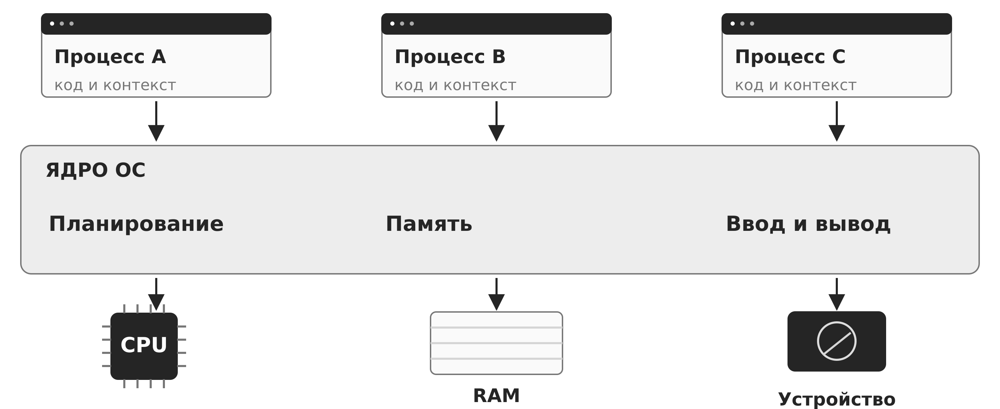

*Рисунок 1 — Роль ядра*

### 2.1.2. Уровни привилегий процессора

Современный процессор различает как минимум привилегированный и непривилегированный режимы. В архитектуре x86 исторически предусмотрены кольца защиты от 0 до 3, однако большинство универсальных ОС активно использует кольцо 0 для ядра и кольцо 3 для приложений. Другие архитектуры применяют собственные уровни исключений, но общий принцип одинаков: текущий уровень определяет, какие инструкции и области памяти доступны выполняемому коду.

К привилегированным относятся операции, способные изменить глобальное состояние машины: настройка таблиц страниц, управление прерываниями, доступ к регистрам устройств, изменение системных регистров и конфигурации таймера. Если разрешить их обычному процессу, он сможет читать чужую память, удерживать процессор или нарушать работу устройств. Попытка выполнить запрещённую инструкцию создаёт синхронное исключение; процессор передаёт управление заранее зарегистрированному обработчику ядра.

Уровень привилегий сам по себе не является полной политикой безопасности. Он отделяет ядро от приложений, но не различает пользователей, роли и файлы. Разграничение доступа строится выше: ядро сопоставляет контекст процесса с объектом и операцией. Аппаратная граница обеспечивает неизбежность проверки, а программная политика определяет её содержание.

Основные связи показаны на рисунке 2.

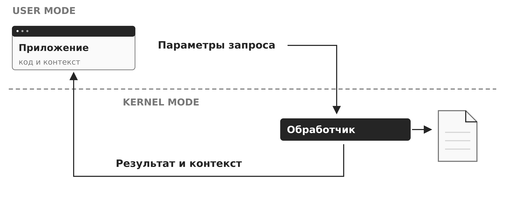

*Рисунок 2 — Граница привилегий*

### 2.1.3. Защита памяти как часть границы

Разделение режимов дополняется механизмом виртуальной памяти. Для каждого процесса ядро формирует отображение виртуальных адресов в физические страницы и права доступа к ним. Страница может разрешать чтение, запись и исполнение в различных сочетаниях; часть отображений доступна только ядру. Процессор проверяет права при каждом обращении, поэтому защита не зависит от добросовестности программы.

При нарушении прав возникает исключение страницы. Оно может означать штатную ситуацию — например, необходимость подгрузить страницу или создать копию при записи, — либо реальную ошибку: запись в область только для чтения, исполнение неисполняемой страницы, доступ по неверному адресу. Ядро анализирует причину и либо исправляет отображение, либо доставляет процессу сигнал; дальнейшее поведение зависит от его обработки и характера ошибки.

Защита памяти ограничивает последствия ошибок, но не отменяет необходимости проверять переходы между пространствами. Когда системный вызов передаёт ядру указатель на пользовательский буфер, этот адрес остаётся недоверенным. Ядро должно безопасно скопировать данные, проверить длину и обработать возможную ошибку страницы, не разрушив собственное состояние.

Основные связи показаны на рисунке 3.

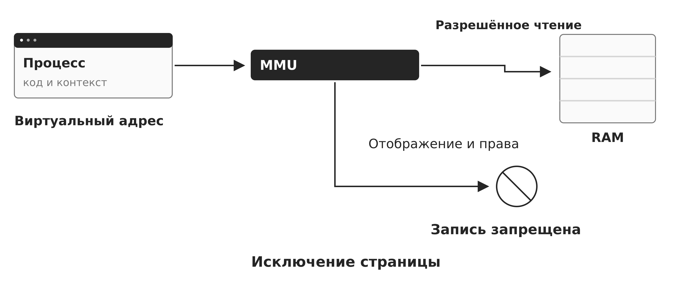

*Рисунок 3 — Проверка адреса MMU*

### 2.1.4. Контекст выполнения

Контекст процесса включает значения регистров, указатель инструкций, указатель стека, состояние процессора, сведения об адресном пространстве и атрибуты безопасности. При переходе в ядро часть контекста сохраняется аппаратно, остальное — входным кодом ОС. Это необходимо, чтобы после обслуживания события продолжить выполнение с той же инструкции или вернуть приложению результат системного вызова.

Следует различать режим процессора и субъект безопасности. Один и тот же поток временно выполняется в режиме ядра, когда обслуживает собственный системный вызов, но логически продолжает действовать от имени исходного процесса. Поэтому проверка полномочий использует эффективные идентификаторы, группы, capabilities, метки и другие атрибуты именно этого процесса. Переход в режим ядра не превращает пользователя в администратора — привилегии принадлежат обработчику, а не запросившему приложению.

Контекст также определяет возможность вытеснения, блокировки и обработки сигналов. Код ядра обязан понимать, можно ли в текущем месте ожидать ресурс, держит ли поток блокировку и допустимо ли обращение к пользовательской памяти. Ошибка контекста порождает взаимоблокировки, повреждение данных и трудно воспроизводимые гонки.

### 2.1.5. Контролируемые причины входа в ядро

Процессор передаёт управление ядру по трём основным причинам. Системный вызов инициируется программой намеренно и просит услугу ОС. Исключение возникает синхронно с текущей инструкцией: например, при делении на ноль, нарушении прав страницы или неверной операции. Аппаратное прерывание приходит асинхронно от таймера или устройства и сообщает о внешнем событии.

При передаче управления из пользовательского режима эти механизмы используют предусмотренные архитектурой точки входа. Если событие возникает уже в режиме ядра, смены уровня привилегий может не быть. Смысл трёх причин входа различен. Для системного вызова ожидается определённый контракт и код результата. Исключение требует классифицировать ошибку и решить, можно ли продолжить процесс. Прерывание необходимо быстро подтвердить, сохранить достаточное состояние и отложить длительную обработку. Смешение этих сценариев усложняет код и может нарушить как производительность, так и безопасность.

Любой вход должен приводить в известную точку ядра, а не по произвольному адресу. Процессор использует настроенные ОС таблицы векторов, защищённые дескрипторы и специальные инструкции перехода. Тем самым аппаратная архитектура создаёт шлюзы, через которые проходит смена уровня привилегий.

Основные связи показаны на рисунке 4.

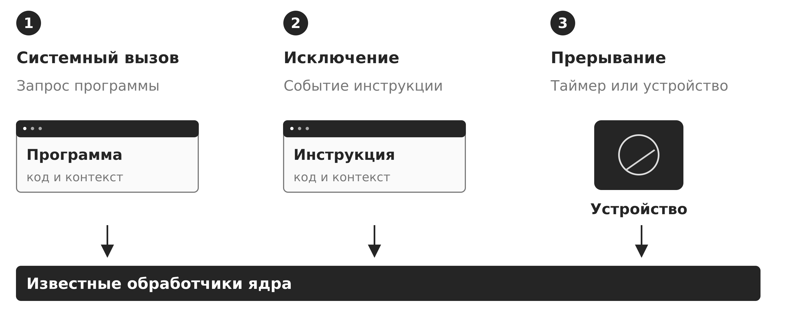

*Рисунок 4 — Причины передачи управления*

### 2.1.6. Последовательность входа и возврата

Упрощённая последовательность выглядит так: процессор завершает или приостанавливает текущую инструкцию; сохраняет критические части состояния; переключает стек и уровень привилегий; выбирает обработчик; передаёт управление входному коду ядра. ОС сохраняет дополнительные регистры, определяет причину события и связывает её с текущим процессом или источником прерывания.

После обработки ядро выбирает дальнейшее действие. Оно может вернуть результат тому же процессу, доставить сигнал, разблокировать другой поток или запустить планировщик. Перед возвратом восстанавливаются регистры и отображение адресного пространства, проверяется допустимость состояния, затем специальная инструкция возвращает непривилегированный режим. Ошибка в этой последовательности способна раскрыть данные ядра или вернуть управление по подменённому адресу.

Граница привилегий является не линией на схеме, а протоколом смены состояния. Её надёжность определяется аппаратной поддержкой, корректностью входного кода, безопасным стеком, проверкой параметров и предсказуемым возвратом. Поэтому небольшие низкоуровневые фрагменты входа в ядро относятся к наиболее критичным участкам ОС.

Ключевой вывод. Процессор делает границу привилегий технически неизбежной, а ядро превращает её в управляемый протокол: сохраняет контекст, классифицирует событие, проверяет запрос и безопасно возвращает управление.

## 2.2. Системные вызовы как контракт ОС

Системный вызов связывает приложение и ядро формальным контрактом: определяет операцию, представление параметров, правила проверки, возможные результаты и наблюдаемые побочные эффекты.

Основные связи показаны на рисунке 5.

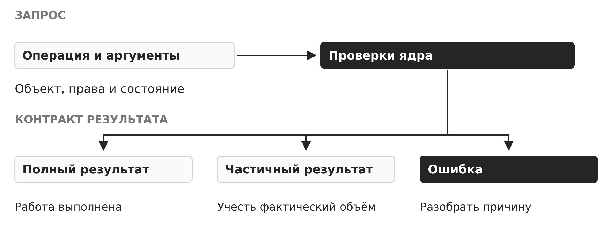

*Рисунок 5 — Контракт вызова*

### 2.2.1. API, ABI и системный вызов

API — программный интерфейс на уровне исходного кода: имена функций, типы параметров и правила использования. ABI — двоичное соглашение между уже скомпилированными компонентами: размещение аргументов в регистрах или стеке, формат структур, размеры типов, номера системных вызовов и способ возврата результата. Системный вызов является конкретным механизмом обращения к ядру, а не синонимом любой библиотечной функции.

Программа обычно вызывает функцию стандартной библиотеки, например open, read, write или socket. Обёртка подготавливает аргументы в соответствии с ABI и выполняет специальную инструкцию перехода. При возврате она интерпретирует машинный результат, устанавливает errno и предоставляет приложению привычную модель ошибок. Некоторые библиотечные функции полностью работают в пользовательском пространстве, другие используют один или несколько системных вызовов.

Различение API и ABI объясняет совместимость. Исходный код можно перекомпилировать под другую архитектуру при сходном API, но уже собранный файл зависит от ABI. Изменение структуры параметров или номера вызова нарушит старые программы, поэтому ядра поддерживают стабильные пользовательские интерфейсы, совместимые режимы и аккуратное расширение флагов.

Основные связи показаны на рисунке 6.

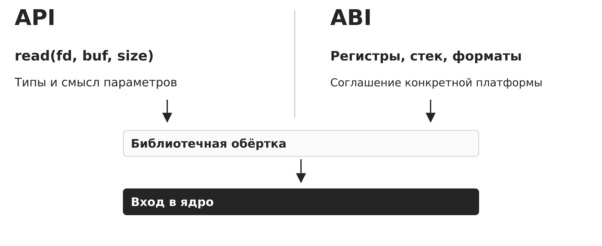

*Рисунок 6 — API ABI и переход к ядру*

### 2.2.2. Классы системных вызовов

Системные вызовы группируются по управляемым ресурсам. Управление процессами включает создание, замену образа, ожидание, завершение, сигналы и изменение параметров планирования. Операции с файлами создают дескрипторы, читают и записывают данные, изменяют метаданные и структуру пространства имён. Управление памятью отображает области, меняет права и организует совместное использование.

Сетевые вызовы создают сокеты, связывают адреса, устанавливают соединения и передают сообщения. Отдельные интерфейсы управляют устройствами, временем, идентичностью, правами и межпроцессным взаимодействием. Эта классификация полезна для анализа поверхности атаки: обработчики, принимающие сложные структуры или управляющие привилегированными объектами, требуют более строгой проверки.

Наличие системного вызова не означает, что операция всегда разрешена. Вызов — только вход в механизм принятия решения. Ядро проверяет состояние объекта, контекст процесса, ограничения ресурсов и правила безопасности. Один и тот же вызов для разных субъектов может завершиться успехом, отказом в доступе, отсутствием объекта или временной невозможностью выполнить действие.

Основные связи показаны на рисунке 7.

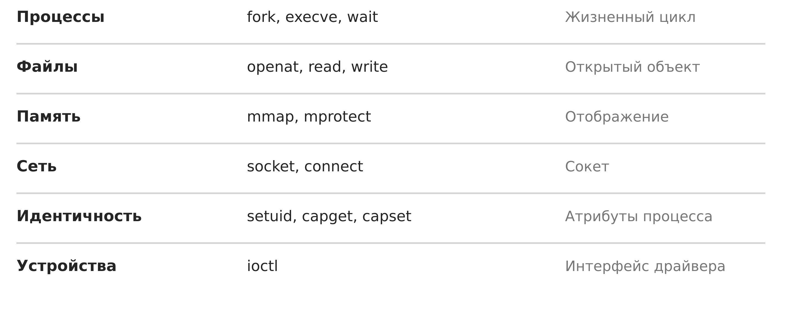

*Рисунок 7 — Классы системных вызовов*

### 2.2.3. Дескрипторы и объектная модель

Многие интерфейсы ОС используют непрямую ссылку — дескриптор. После успешного открытия файла или сокета процесс получает небольшое целое число, которое индексирует таблицу открытых объектов. Дескриптор скрывает внутренние адреса ядра, связывает объект с режимом доступа и позволяет унифицировать чтение, запись, ожидание и закрытие.

Проверка пути и прав обычно выполняется при открытии, после чего последующие операции используют уже созданную ссылку. Это повышает эффективность, но создаёт важное свойство: переименование или замена имени не обязательно изменяет ранее открытый объект. Политика должна учитывать жизненный цикл дескриптора, наследование при создании процесса и автоматическое закрытие при выполнении новой программы.

Дескрипторы являются возможностями: их наличие даёт определённый доступ. Поэтому утечка дескриптора в дочерний процесс, передача через IPC или ошибочное сохранение после повышения привилегий может обойти ожидаемую проверку имени. Флаги close-on-exec, минимальный набор наследуемых объектов и явное закрытие уменьшают этот риск.

В Linux запись таблицы дескрипторов ссылается на описание открытого файла. Позиция и файловые флаги находятся в описании открытия и могут разделяться после dup() или fork(). Флаг FD_CLOEXEC относится к отдельному дескриптору и закрывает его при успешном exec, но не препятствует наследованию при fork().

Основные связи показаны на рисунке 8.

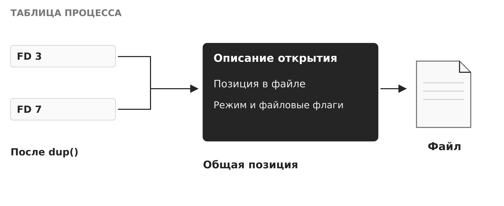

*Рисунок 8 — Дескриптор и описание открытия*

### 2.2.4. Передача параметров и данных

Простые аргументы передаются в регистрах или стеке: номера, флаги, размеры и дескрипторы. Сложные данные передаются через указатели на пользовательскую память. Ядро не должно напрямую доверять такому указателю, потому что он может быть неверным, указывать на недоступную страницу или изменяться параллельным потоком.

Безопасная реализация копирует входные данные в область ядра, проверяет размер, выравнивание, допустимые флаги и логические связи между полями. Для выходных данных сначала формируется согласованный результат, затем он копируется пользователю. Операции копирования должны корректно обрабатывать исключение страницы и возвращать ошибку, а не оставлять частично изменённое внутреннее состояние.

Особую сложность представляют массивы переменной длины, вложенные указатели, строки без гарантированного завершения и структуры с версиями. Контракт должен задавать максимальные размеры и правила расширения. Если неизвестные флаги молча игнорируются, приложение может ошибочно считать, что требуемое защитное свойство применено; безопаснее явно сообщать о неподдерживаемом параметре.

Основные связи показаны на рисунке 9.

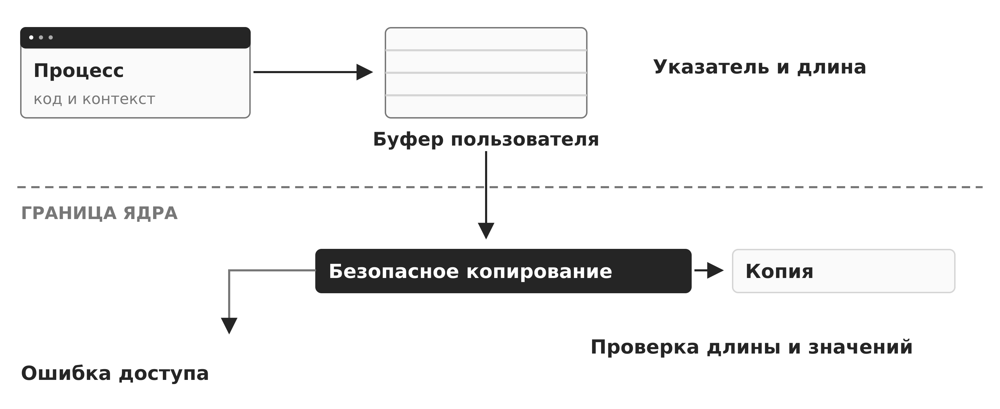

*Рисунок 9 — Пользовательские данные*

### 2.2.5. Валидация, авторизация и атомарность

Обработчик системного вызова выполняет несколько разных проверок. Структурная валидация отвечает на вопрос, корректно ли представлены параметры. Проверка состояния убеждается, что объект существует и допускает операцию сейчас. Авторизация сопоставляет контекст субъекта с политикой. Проверка ресурсов оценивает квоты, лимиты и возможность завершить действие.

Порядок проверок важен. Нельзя использовать указатель до проверки, создавать побочный эффект до решения доступа или раскрывать через разные коды ошибки лишнюю информацию о скрытом объекте. Внутренние блокировки и транзакционные механизмы обеспечивают атомарность там, где промежуточное состояние не должно наблюдаться другими потоками.

Корректный отказ так же важен, как успешное выполнение. Ядро возвращает результат согласно контракту и освобождает временные ресурсы. Допустимость частичных эффектов зависит от конкретного интерфейса. Приложение должно различать постоянные и временные ошибки, учитывать частичную запись и прерывание операции сигналом. Контракт включает не только результат, но и модель восстановления после отказа.

Для read() положительное значение меньше запрошенного размера может быть нормальным частичным результатом. Ноль при ненулевом чтении обычного файла означает конец файла, а −1 в библиотечном API обозначает ошибку с errno.

### 2.2.6. TOCTOU и состояние, изменяющееся между проверками

Ошибка TOCTOU возникает, когда между проверкой условия и использованием ресурса проходит время, в течение которого другой субъект может изменить объект. Классический пример — программа сначала проверяет путь, а затем отдельно открывает файл. Если каталог или символическая ссылка заменены между действиями, фактический объект окажется другим.

Защита строится не на попытке сделать промежуток очень коротким, а на исключении повторного разрешения изменяемого имени. Следует получить дескриптор проверенного каталога или объекта и выполнять последующие операции относительно него, использовать атомарные системные вызовы, безопасные флаги открытия и корректные блокировки. Проверка должна быть максимально близка к моменту использования.

TOCTOU шире файловой системы. Состояние процесса, набор полномочий, сетевое соединение и таблица устройств также меняются конкурентно. Любая схема «сначала спросили, затем отдельно сделали» требует анализа: кто способен изменить условие, что именно фиксирует ссылку на объект и какую атомарность гарантирует ядро.

Устойчивый дескриптор фиксирует определённый объект, но сам по себе не устраняет все гонки путей и состояний. Для конкретной модели нужны ограничения разрешения имени, проверка фактически открытого объекта и предусмотренная интерфейсом атомарность.

Основные связи показаны на рисунке 10.

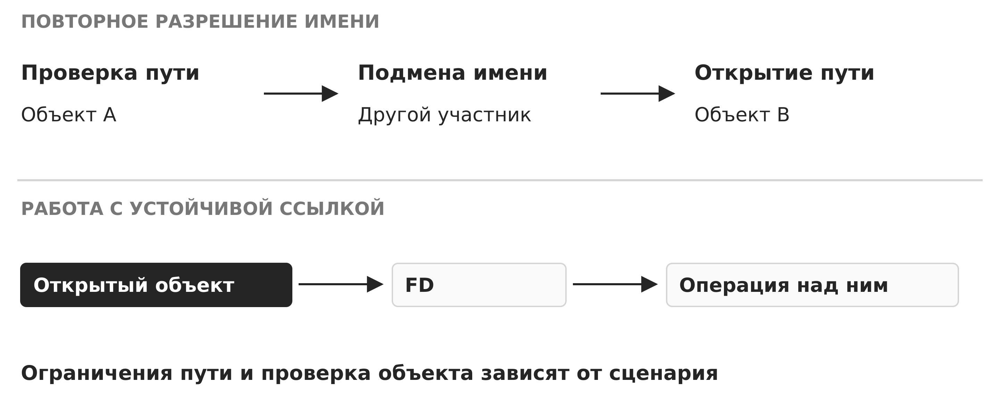

*Рисунок 10 — TOCTOU*

### 2.2.7. Наблюдение и ограничение системных вызовов

Системные вызовы образуют удобную границу наблюдения. Трассировщик может показать последовательность запросов процесса, аргументы и коды результата. Это помогает диагностировать отсутствие файла, отказ в доступе, зависание на ожидании или неожиданное сетевое взаимодействие. Однако трасса отражает интерфейс ядра, а не все действия приложения: вычисления в пользовательской памяти не видны.

Механизмы аудита выбирают значимые операции и связывают их с субъектом, временем и объектом. Фильтрация системных вызовов может ограничить набор операций процесса, особенно в изолированных службах и контейнерах. Такой фильтр не заменяет файловые права и сетевую политику, потому что системный вызов остаётся общим, а допустимость зависит от конкретного объекта.

При проектировании аудита важно соблюдать баланс. Запись каждого вызова создаёт огромный поток событий и снижает полезность анализа. Выбираются операции изменения идентичности, конфигурации, прав, модулей, времени и других критичных объектов. Полнота оценивается относительно сценариев угроз, а не по максимальному объёму журнала.

Ключевой вывод. Системный вызов — это двоичный и семантический контракт. Его надёжность зависит от стабильного ABI, проверки недоверенных параметров, авторизации, атомарности, корректного отказа и наблюдаемости.

## 2.3. Монолитное ядро, микроядро и гибридный подход

Архитектура определяет, какие функции выполняются с максимальными привилегиями, как взаимодействуют подсистемы и насколько легко локализовать ошибку. Ни один класс архитектуры сам по себе не гарантирует защищённость.

### 2.3.1. Критерии сравнения архитектур

Архитектуры следует сравнивать не по одному ярлыку, а по набору критериев: объём кода в привилегированном режиме, стоимость взаимодействия, изоляция отказов, расширяемость, совместимость драйверов, предсказуемость времени и удобство проверки. Один критерий может конфликтовать с другим: перенос службы в пользовательский режим уменьшает последствия её сбоя, но добавляет сообщения и переключения контекста.

Важен размер доверенной вычислительной базы, но также важны её структура и интерфейсы. Малое ядро с большим привилегированным сервером не обязательно лучше модульного монолитного ядра. Изолированный компонент полезен только при корректной границе, минимальных полномочиях и безопасном IPC.

Практическая архитектура формируется историей, требованиями к совместимости и доступной аппаратурой. Поэтому современные ОС часто сочетают подходы: монолитное адресное пространство ядра, загружаемые модули, изолированные пользовательские службы, виртуализацию и отдельные механизмы песочницы.

### 2.3.2. Монолитное ядро

В монолитной архитектуре основные подсистемы ОС выполняются в едином привилегированном адресном пространстве и могут вызывать друг друга напрямую. Планировщик, память, сеть, файловые системы и многие драйверы используют общие внутренние структуры. Это даёт высокую производительность и удобство тесной интеграции.

Главный риск — широкая область последствий дефекта. Ошибка записи в драйвере может повредить память другой подсистемы или всего ядра. Внутренний интерфейс не защищён процессорной границей так же строго, как пользовательский. Поэтому качество кода, ревью, защитные механизмы компилятора, тестирование и ограничение состава модулей особенно важны.

Монолитность не означает отсутствие структуры. Ядро может иметь ясные слои, подсистемы, таблицы операций и правила владения объектами. Модульность позволяет загружать функциональность по необходимости, но загруженный модуль всё равно получает привилегии ядра. Подпись подтверждает происхождение модуля, а не отсутствие логических ошибок.

Основные связи показаны на рисунке 11.

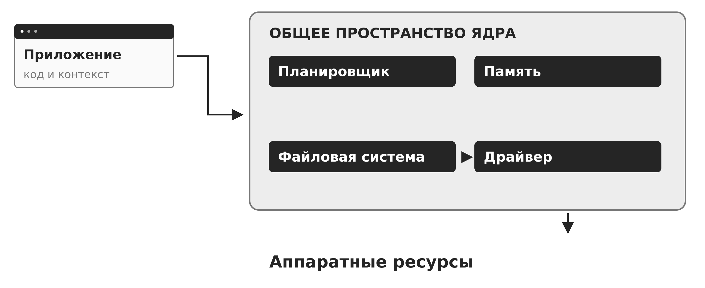

*Рисунок 11 — Монолитное ядро*

### 2.3.3. Многоуровневые и модульные системы

Многоуровневый подход организует ОС как последовательность абстракций, где каждый уровень использует услуги нижнего и предоставляет интерфейс верхнему. Такая структура упрощает рассуждение, тестирование и замену компонентов, если границы действительно соблюдаются. На практике строгое деление может мешать производительности и приводить к обходным связям.

Загружаемые модули позволяют расширять ядро без полной перекомпоновки и перезагрузки. Они применяются для драйверов, файловых систем, сетевых функций и средств наблюдения. Жизненный цикл модуля включает проверку источника, совместимость с версией ядра, инициализацию, регистрацию интерфейсов, обработку конкурентных обращений и безопасную выгрузку.

С точки зрения безопасности модуль является кодом высокой критичности. Следует запрещать загрузку из недоверенных источников, минимизировать набор установленных модулей, контролировать параметры и журналировать изменения. Если модуль больше не нужен, его отсутствие надёжнее, чем надежда на то, что уязвимый интерфейс никто не вызовет.

### 2.3.4. Микроядерная архитектура

Микроядро оставляет в привилегированном режиме минимальный набор механизмов: планирование, базовое управление адресными пространствами, обработку низкоуровневых событий и IPC. Файловые системы, сетевые стеки, драйверы и другие службы могут работать как отдельные пользовательские серверы.

Изоляция уменьшает область повреждения: сбой драйвера не обязан разрушать ядро, а сервер можно перезапустить. Компоненты получают разные адресные пространства и полномочия, что облегчает применение принципа наименьших привилегий. Небольшое микроядро потенциально проще формально анализировать и сертифицировать.

Цена подхода — более сложное взаимодействие. Запрос может пройти через несколько сообщений, переключений контекста и копирований или отображений памяти. Возникают вопросы маршрутизации, именования служб, обработки отказа сервера и сохранения состояния при перезапуске. Высокая надёжность требует не только малого ядра, но и правильно спроектированных протоколов между компонентами.

Основные связи показаны на рисунке 12.

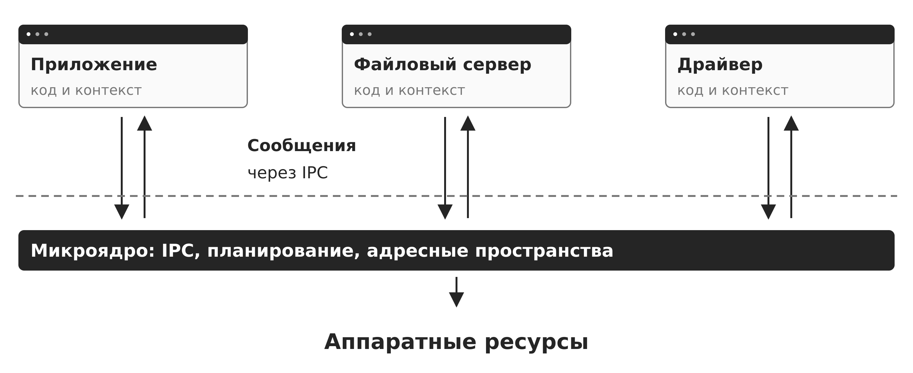

*Рисунок 12 — Микроядро и серверы*

### 2.3.5. Гибридные ядра

Гибридный подход использует идеи микроядерной структуры, но часть серверов и драйверов размещает в привилегированном пространстве ради производительности или совместимости. Термин описывает семейство решений, а не строгую единую схему. Реальное значение имеет карта компонентов: что исполняется в ядре, какие интерфейсы доступны и какие отказы локализуются.

Гибридная система может сохранить модульность и объектные интерфейсы, но большая привилегированная часть остаётся общей областью риска. Напротив, отдельные службы безопасности, аутентификации или интерфейса пользователя могут быть вынесены в процессы и ограничены политикой. Поэтому архитектуру анализируют по фактическим границам, а не рекламному названию.

Современные механизмы виртуализации и изоляции дополняют классическую классификацию. Гипервизор создаёт ещё один привилегированный слой, контейнер разделяет одно ядро между средами, а доверенные среды исполнения формируют отдельные области. Каждый новый слой может уменьшить одну область риска и одновременно расширить общую доверенную базу.

### 2.3.6. Экзоядра, unikernel и специализированные решения

Экзоядро стремится минимально управлять аппаратными ресурсами и передавать больше политики библиотечным ОС. Приложение получает более прямой и контролируемый доступ к ресурсам, что позволяет специализировать управление. Однако ответственность за корректность абстракций смещается, а интерфейс безопасного разделения аппаратуры становится особенно критичным.

Unikernel объединяет приложение и минимальный набор библиотек ОС в специализированный образ, часто предназначенный для одной виртуальной машины и одной функции. Малый состав уменьшает число ненужных служб, но единое адресное пространство сокращает внутреннюю изоляцию. Обновление обычно выполняется заменой образа, а наблюдаемость и отладка требуют специальных средств.

Специализированные ОС реального времени, мобильные платформы и защищённые системы выбирают архитектуру по своему приоритету: детерминированности, энергоэффективности, формальной проверяемости или совместимости. Для оценки необходимо сначала определить назначение и модель угроз, затем проверить, как архитектурное решение поддерживает требуемое свойство.

### 2.3.7. Как архитектура влияет на безопасность

Архитектура влияет на четыре аспекта: размер привилегированной части, число и сложность интерфейсов, возможность локализовать отказ и способ обновления. Перенос драйвера в пользовательский режим уменьшает его прямой доступ, но создаёт IPC-интерфейс. Загружаемый модуль повышает гибкость, но требует доверенной цепочки поставки и контроля совместимости.

Нельзя утверждать, что микроядро всегда безопаснее, а монолит всегда быстрее. Реальные результаты зависят от реализации, аппаратной поддержки, зрелости драйверов и эксплуатационной дисциплины. Уязвимый сервер с чрезмерными полномочиями нарушит микроядерную систему, а хорошо структурированное монолитное ядро может эффективно ограничивать приложения.

Корректная формулировка сравнения звучит так: какая часть системы входит в TCB, как проверяется каждый интерфейс, что произойдёт при отказе компонента и как будет восстановлена функция. Эти вопросы переводят архитектурную классификацию из теории в анализ конкретного узла.

Ключевой вывод. Архитектурный класс задаёт распределение полномочий и стоимость взаимодействия, но безопасность определяется фактической TCB, качеством границ, минимальностью интерфейсов и возможностью локализовать и восстановить отказ.

Основные связи показаны на рисунке 13.

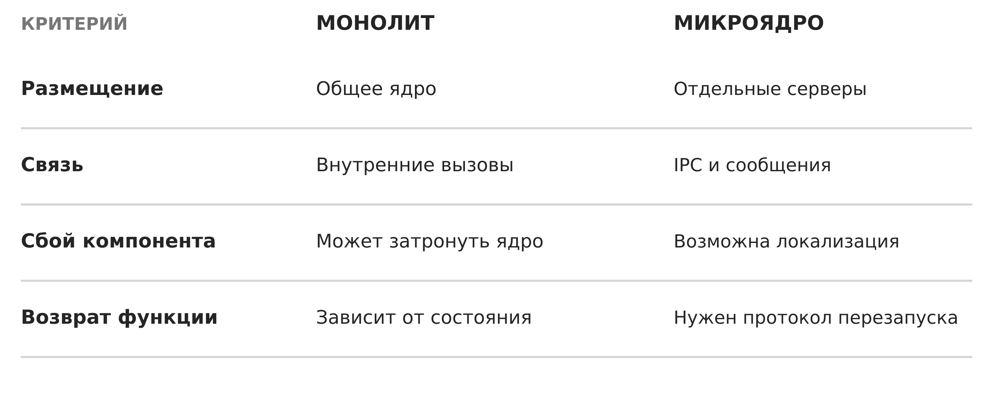

*Рисунок 13 — Сравнение размещения*

## 2.4. Прерывания, драйверы и принцип минимизации привилегий

Устройства взаимодействуют с ОС асинхронно и через привилегированный код. Поэтому обработка прерываний и архитектура драйверов определяют не только производительность ввода-вывода, но и значительную часть поверхности атаки ядра.

### 2.4.1. Исключения и аппаратные прерывания

Исключение связано с текущей инструкцией и воспроизводится при повторении условий. К исключениям относятся ошибка страницы, недопустимая инструкция, деление на ноль и программно инициированный переход. Аппаратное прерывание приходит от внешнего источника — таймера, сетевой карты, накопителя — и не обязано совпадать с логической границей выполняемой программы.

Ядро регистрирует обработчики и настраивает контроллер прерываний. При событии процессор сохраняет состояние, определяет вектор и передаёт управление. Обработчик должен подтвердить источник и не допустить бесконечного повторения события. Ошибочная конфигурация может привести к потере прерываний, шторму событий или зависанию устройства.

Таймерное прерывание особенно важно для многозадачности: оно возвращает управление ядру, даже если процесс не выполняет системных вызовов. Планировщик получает возможность учесть время, проверить квант и переключить поток. Без такого механизма непривилегированная программа могла бы удерживать процессор неограниченно.

Основные связи показаны на рисунке 14.

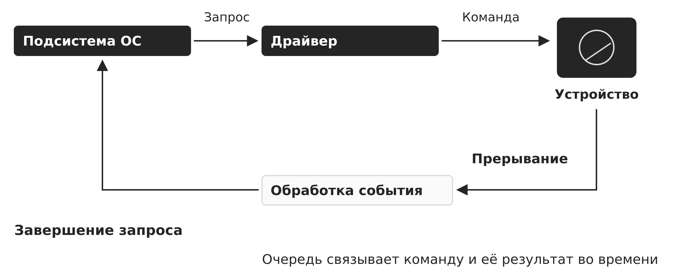

*Рисунок 14 — Асинхронный ввод и вывод*

### 2.4.2. Верхняя и отложенная части обработки

Непосредственный обработчик прерывания выполняется в ограниченном контексте и должен быть коротким. Он считывает минимально необходимое состояние, подтверждает событие и планирует последующую работу. Длительный разбор пакета или завершение сложной операции в этом месте увеличивает задержки для всей системы.

Отложенная часть выполняет более тяжёлую обработку позднее, когда разрешены дополнительные механизмы синхронизации и планирования. Конкретные ОС используют разные модели: очереди работ, программные прерывания, выделенные потоки. Общая цель — разделить срочное взаимодействие с аппаратурой и обычную обработку данных.

Безопасность зависит от корректной передачи состояния между частями. Данные устройства могут изменяться параллельно, буфер должен иметь определённого владельца, а длина — быть проверена до использования. Гонки между прерыванием, пользовательским запросом и выгрузкой драйвера являются типичным источником дефектов.

Не всякая отложенная обработка разрешает ожидание: допустимые операции зависят от конкретного механизма и контекста, например очереди работ или softirq.

Основные связи показаны на рисунке 15.

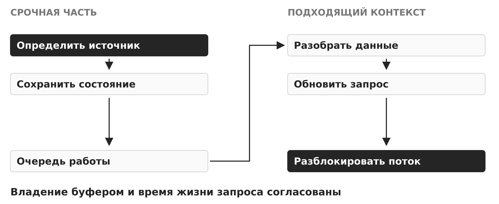

*Рисунок 15 — Обработка прерывания*

### 2.4.3. Драйвер как адаптер и привилегированный компонент

Драйвер преобразует универсальную модель ОС в команды конкретного устройства. Он инициализирует оборудование, управляет регистрами, настраивает DMA, обрабатывает прерывания, ведёт очереди запросов и сообщает подсистеме ОС о завершении. Верхняя часть драйвера следует контракту ядра, нижняя — спецификации устройства и прошивки.

Драйвер получает данные из нескольких недоверенных источников: параметры пользовательских запросов, содержимое устройства, ответы прошивки и состояния шины. Даже физическое устройство нельзя считать безусловно корректным. Проверяются размеры, границы буферов, допустимые команды и состояние жизненного цикла.

Ошибка драйвера часто опаснее ошибки обычного приложения, поскольку драйвер работает в режиме ядра и обращается к физической памяти. Он может нарушить изоляцию через некорректный DMA, утечку неинициализированных данных или запись по неверному адресу. IOMMU ограничивает доступ устройства к памяти, но требует правильной настройки отображений.

### 2.4.4. Жизненный цикл драйвера и модуля

Жизненный цикл начинается с обнаружения устройства и сопоставления драйвера. Затем выполняются выделение ресурсов, регистрация интерфейсов, настройка прерываний и перевод устройства в рабочее состояние. При отключении или выгрузке необходимо прекратить новые запросы, дождаться текущих операций, освободить DMA-буферы и удалить интерфейсы.

Горячее подключение усложняет модель: устройство может исчезнуть во время операции. Пользовательский процесс всё ещё держит дескриптор, очередь содержит запросы, а прерывание уже не должно обращаться к освобождённой структуре. Корректная реализация использует счётчики ссылок, состояния завершения и строгий порядок освобождения.

Модуль ядра должен соответствовать версии и внутренним интерфейсам. Подпись и доверенная загрузка позволяют ограничить внедрение неподтверждённого кода. Но обновление драйвера остаётся изменением TCB: оно требует теста совместимости, плана отката и проверки после перезагрузки.

### 2.4.5. DMA, IOMMU и граница аппаратного доверия

Прямой доступ к памяти позволяет устройству передавать данные без копирования процессором. Драйвер формирует дескрипторы буферов и получает DMA-адреса через соответствующий API. Эти адреса не обязаны совпадать с физическими адресами CPU. Ошибка или злонамеренное устройство потенциально может прочитать или изменить чужую память, обходя обычные проверки процессора.

IOMMU создаёт отображения для устройств аналогично виртуальной памяти процессов. Устройству предоставляется только набор буферов, необходимых для операции. Это локализует последствия дефекта и особенно важно для виртуализации и передачи устройства гостевой системе. Однако слишком широкое отображение фактически отменяет защиту.

Граница доверия проходит через прошивку, шину, контроллер и драйвер. Обновление прошивки, безопасная загрузка устройства и физический контроль портов дополняют программную изоляцию. Архитектура ОС не может гарантировать безопасность, если аппаратный компонент имеет неограниченный доступ к памяти и не входит в управляемую модель.

Основные связи показаны на рисунке 16.

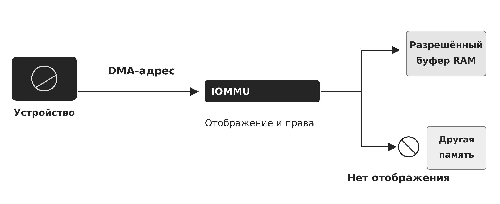

*Рисунок 16 — IOMMU и DMA*

### 2.4.6. Принцип наименьших привилегий

Принцип наименьших привилегий требует выдавать компоненту только необходимые полномочия, ресурсы и время действия. Для ядра это означает сокращение загруженных модулей, ограничение административных интерфейсов, разделение драйверов и перенос сложной обработки в менее привилегированную среду, когда это возможно.

Для системной службы принцип реализуется отдельной учётной записью, ограниченным набором capabilities, закрытой файловой системой, фильтром системных вызовов и сетевыми ограничениями. Важно не просто понизить пользователя, а проверить фактические возможности: открытые дескрипторы, наследуемые права, доступные сокеты и интерфейсы ядра.

Минимизация должна сохранять управляемость и восстановление. Отключение диагностического интерфейса может уменьшить поверхность атаки, но лишить систему способа расследования. Поэтому каждая привилегия связывается с функцией, владельцем, сценарием риска и контрольным тестом.

### 2.4.7. Защита ядра и драйверной подсистемы

Базовые меры включают доверенную загрузку, проверку подписей модулей, запрет неподтверждённой загрузки, обновление ядра и прошивок, минимальный состав драйверов и контроль параметров командной строки. Защитные механизмы памяти ядра усложняют эксплуатацию ошибок, но не заменяют исправление дефекта.

Наблюдаемость охватывает загрузку и выгрузку модулей, изменение параметров, ошибки устройств, аварии ядра и необычные административные действия. Журналы должны сохраняться так, чтобы сбой узла не уничтожил единственное доказательство. Дамп аварии может содержать чувствительную память и требует отдельной политики доступа и хранения.

Проверка конфигурации начинается с инвентаризации: какие модули загружены, какие устройства активны, кто может загрузить код ядра, включена ли проверка подписи, доступны ли отладочные интерфейсы. Результат сравнивается с утверждённой базовой линией, а исключения имеют обоснование и срок пересмотра.

Ключевой вывод. Драйверы и обработчики прерываний являются частью привилегированной границы. Их безопасность требует коротких обработчиков, строгого жизненного цикла, ограничения DMA, доверенной загрузки и минимального набора функций.

## Прикладной разбор путь запроса open() в Linux

Сквозной пример соединяет пользовательский API, системный вызов, файловую подсистему, проверку доступа и драйвер накопителя в одну последовательность и показывает, где проходят границы доверия.

### Постановка задачи

Пусть непривилегированная программа открывает файл /srv/course/materials/lecture2.pdf для чтения. На уровне исходного кода вызывается библиотечная функция open или openat. Программа передаёт строку пути и флаги. Эти данные находятся в пользовательской памяти и могут быть неверными или изменяемыми другим потоком.

Библиотечная обёртка формирует параметры ABI и выполняет инструкцию системного вызова. Процессор переходит на вход ядра, сохраняет состояние и переключает стек. Ядро определяет номер вызова, безопасно копирует путь, проверяет флаги и начинает разрешение имени относительно корня и текущего каталога процесса.

### Разрешение пути и проверка доступа

Подсистема VFS последовательно обрабатывает компоненты пути, точки монтирования и символические ссылки. Она использует кэш имён и структуры конкретной файловой системы. На каждом шаге учитываются права поиска каталога, ограничения пространства имён и состояние объектов. Итоговая ссылка должна указывать именно на тот объект, для которого принято решение.

Проверка доступа сопоставляет эффективный контекст процесса с владельцем, группой, режимом, ACL и дополнительными политиками безопасности. Если операция разрешена, ядро создаёт объект открытого файла, связывает его с режимом чтения и помещает ссылку в таблицу дескрипторов процесса. Программа получает номер дескриптора, но не внутренний адрес ядра.

### Чтение данных и путь к устройству

Последующий read использует дескриптор. Ядро проверяет режим открытого объекта, текущую позицию и размер пользовательского буфера. Если нужные страницы уже находятся в кэше, данные копируются пользователю без обращения к устройству. Иначе файловая система формирует запрос блочному слою и драйверу накопителя.

Драйвер настраивает очередь и DMA, устройство выполняет операцию и посылает прерывание. Обработчик подтверждает завершение, отложенная часть обновляет состояние запроса, ожидающий поток разблокируется, а данные передаются в пользовательский буфер. В одной операции участвуют несколько архитектурных границ, но каждая должна сохранять связь с исходным объектом и запросом.

Основные связи показаны на рисунке 17.

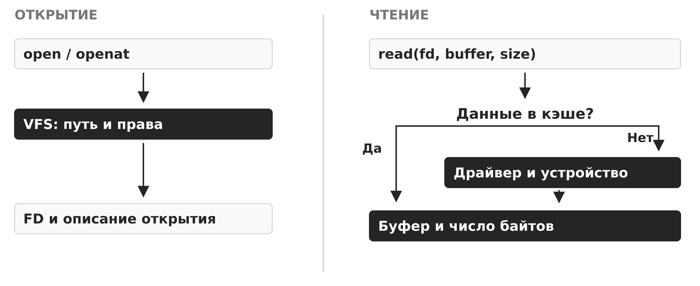

*Рисунок 17 — Путь открытия и чтения*

### Точки риска и контрольные вопросы

Риски включают неверную длину строки, гонку при разрешении пути, ошибку проверки ACL, утечку дескриптора, использование освобождённой структуры драйвером, некорректный DMA и подменённый модуль ядра. Защита распределена: безопасное копирование, атомарные операции с объектами, счётчики ссылок, IOMMU, подпись модулей, аудит и минимальные полномочия процесса.

Для анализа полезно задать пять вопросов: где данные переходят из пользовательского пространства; где принимается решение доступа; какой объект фиксирует результат проверки; какие части выполняются с привилегиями; какое событие подтвердит успех или отказ. Такой разбор показывает, что системный вызов — не единичная функция, а начало контролируемого пути через подсистемы ОС.

Ключевой вывод. Запрос open/read проходит через библиотеку, ABI, вход ядра, VFS, политику доступа, кэш, драйвер и прерывание. Надёжность обеспечивается не одной проверкой, а сохранением корректного объекта и контекста на всём пути.

## Сравнение архитектур ОС

Таблица 3 — Сравнение архитектур ОС

| Критерий | Монолитное ядро | Микроядро | Гибридный подход |
| --- | --- | --- | --- |
| Привилегированный состав | Большинство основных подсистем | Минимальные механизмы | Зависит от реализации; часть серверов в ядре |
| Взаимодействие | Прямые внутренние вызовы | IPC и сообщения | Сочетание вызовов и сообщений |
| Локализация сбоя | Ошибка драйвера может повредить ядро | Сервер или драйвер может быть изолирован | Часть отказов изолируется, часть остаётся общей |
| Производительность | Малые накладные расходы на связь | Дополнительные переходы и IPC | Компромисс зависит от размещения служб |
| Проверяемость | Большая TCB, но возможна строгая модульность | Малое ядро проще анализировать | Нужно оценивать фактическую TCB |
| Основной риск | Широкие последствия дефекта в ядре | Сложность протоколов и полномочий серверов | Неясные границы и большая привилегированная часть |

## Итоги лекции

- Аппаратные уровни привилегий и виртуальная память делают границу ядра неизбежной для обычного приложения.

- Вход в ядро происходит через системный вызов, исключение или аппаратное прерывание; каждый сценарий имеет собственную семантику.

- Системный вызов является контрактом, включающим ABI, проверку параметров, авторизацию, атомарность, результат и модель отказа.

- Пользовательский указатель и любые данные устройства считаются недоверенными до структурной и семантической проверки.

- Дескриптор фиксирует связь с открытым объектом, но его наследование и передача должны контролироваться.

- Защита от конкретной гонки TOCTOU требует устойчивых ссылок, нужной атомарности и ограничений разрешения пути; сокращение временного окна не устраняет гонку.

- Монолитная, микроядерная и гибридная архитектуры различаются размещением функций и стоимостью взаимодействия, но не гарантируют защищённость по названию.

- Драйверы, модули и обработчики прерываний входят в критичную часть TCB и требуют минимизации, доверенной загрузки и контроля жизненного цикла.

- IOMMU ограничивает доступ устройств к памяти и дополняет изоляцию, обеспечиваемую процессором для программ.

- Архитектуру следует оценивать по фактическим границам доверия, интерфейсам, области последствий отказа и способу восстановления.

## Вопросы для самоконтроля

- Какие функции ядра требуют привилегированного режима и почему их нельзя безопасно передать приложению напрямую?

- Чем уровень привилегий процессора отличается от полномочий пользователя в политике ОС?

- Как защита страниц дополняет разделение пользовательского режима и режима ядра?

- Какие данные входят в контекст потока при переходе в ядро?

- Какие три причины могут передать управление ядру и чем они различаются?

- Почему системный вызов нельзя считать обычным вызовом библиотечной функции?

- Чем API отличается от ABI и как это связано с двоичной совместимостью?

- Какие проверки должен выполнить обработчик системного вызова до изменения объекта?

- Почему указатель из пользовательского пространства всегда считается недоверенным?

- Как дескриптор фиксирует результат открытия объекта и какие риски создаёт его наследование?

- В чём состоит ошибка TOCTOU и почему простого повторения проверки недостаточно?

- Какие преимущества и риски имеет монолитное ядро?

- Почему загружаемый модуль остаётся частью монолитной доверенной базы?

- Какие функции обычно оставляют в микроядре?

- За счёт чего микроядерная архитектура локализует отказ и какую цену за это платит?

- Почему термин «гибридное ядро» недостаточен для оценки безопасности конкретной ОС?

- Чем аппаратное прерывание отличается от синхронного исключения?

- Почему непосредственная часть обработчика прерывания должна быть короткой?

- Какие недоверенные данные обрабатывает драйвер устройства?

- Как IOMMU ограничивает последствия ошибки DMA?

- Какие этапы должен учитывать безопасный жизненный цикл загружаемого драйвера?

- Как принцип наименьших привилегий применяется к ядру, модулям и системным службам?

- Какие границы доверия проходит запрос открытия и чтения файла?

- Какие события необходимо журналировать для контроля изменений привилегированной части ОС?

## Глоссарий

Таблица 4 — Термины и определения

| Термин | Определение |
| --- | --- |
| ABI | Двоичное соглашение о представлении типов, параметров, регистров, структур и способе взаимодействия с уже скомпилированным кодом. |
| API | Интерфейс прикладного программирования на уровне функций, типов и правил использования исходным кодом. |
| DMA | Прямой доступ устройства к памяти без передачи каждого байта процессором. |
| IOMMU | Аппаратный механизм преобразования и ограничения адресов памяти для устройств ввода-вывода. |
| TOCTOU | Класс гонок, при котором состояние объекта меняется между его проверкой и использованием. |
| Вектор прерывания | Идентификатор события, по которому процессор выбирает зарегистрированный обработчик. |
| Дескриптор | Непрямая ссылка процесса на открытый объект ядра и связанные с ним права и состояние. |
| Драйвер | Компонент ОС, преобразующий общий интерфейс подсистемы в операции конкретного устройства. |
| Исключение | Синхронная передача управления ядру из-за события, связанного с текущей инструкцией. |
| Контекст | Состояние выполнения потока: регистры, стек, адресное пространство и атрибуты безопасности. |
| Микроядро | Архитектура, оставляющая в привилегированном режиме минимальные механизмы и выносящая службы в отдельные процессы. |
| Монолитное ядро | Архитектура, в которой основные подсистемы ОС работают в общем привилегированном адресном пространстве. |
| Прерывание | Асинхронный сигнал процессору от таймера или устройства, требующий обслуживания ядром. |
| Привилегированная инструкция | Инструкция, выполнение которой разрешено только на установленном уровне привилегий. |
| Системный вызов | Контролируемый запрос процесса к ядру на выполнение операции с системным ресурсом. |
| TCB | Совокупность компонентов, корректность которых необходима для принуждения политики безопасности. |

## Литература

- Востокин С. В. Операционные системы: учебное пособие. — Самара: Самарский университет, 2018.

- Таненбаум Э., Бос Х. Современные операционные системы. — 4-е изд. — Санкт-Петербург: Питер, 2015.

- Староверова Н. А. Операционные системы: учебное пособие (электронное издание).

- Операционные системы: конспект лекций факультета ВМК МГУ имени М. В. Ломоносова. — 2024.

- Linux man-pages: разделы 2 и 7 — системные вызовы, сигналы, процессы, файлы, сокеты и модель ошибок.

- Документация ядра Linux: архитектура системных вызовов, драйверная модель, прерывания, DMA и IOMMU — для используемой версии ядра.

- Astra Linux Special Edition. Руководства по установке, администрированию и комплексу средств защиты — для используемой версии ОС.

### Справочные источники

- [read(2)](https://man7.org/linux/man-pages/man2/read.2.html)

- [open(2)](https://man7.org/linux/man-pages/man2/open.2.html)

- [dup(2)](https://man7.org/linux/man-pages/man2/dup.2.html)

- [execve(2)](https://man7.org/linux/man-pages/man2/execve.2.html)

- [Entry/exit handling](https://docs.kernel.org/core-api/entry.html)

- [Linux generic IRQ handling](https://docs.kernel.org/core-api/genericirq.html)

- [Dynamic DMA mapping Guide](https://docs.kernel.org/core-api/dma-api-howto.html)