# Лекция 3. Процессы, потоки и управление процессами

**Дисциплина:** Операционные системы  
**Специальность:** 10.05.01 «Компьютерная безопасность»  
**Уровень:** университет, 3-й курс  
**Продолжительность:** 90 минут

Операционная система превращает программу в управляемое выполнение: связывает поток с ресурсами, сохраняет контекст и выбирает, кому предоставить процессор. Лекция объясняет жизненный цикл процесса, совместную работу потоков и компромиссы планирования. Сквозной расчёт четырёх расписаний показывает, почему отклик, ожидание и оборот дают разные оценки.

## Содержание

- [Карта понятий лекции](#sec-1)
- [Базовая модель переходов состояний](#sec-2)
- [3.1. Процесс как контейнер ресурсов](#sec-3)
- [3.2. Потоки и совместное использование](#sec-14)
- [3.3. Планирование процессора](#sec-21)
- [3.4. Контекст безопасности процесса](#sec-31)
- [Прикладной разбор: безопасный жизненный цикл сетевой службы](#sec-38)
- [Сравнение процессов и потоков](#sec-43)
- [Сравнение алгоритмов планирования](#sec-44)
- [Итоги лекции](#sec-45)
- [Вопросы для самоконтроля](#sec-46)
- [Глоссарий](#sec-47)
- [Рекомендуемая литература](#sec-48)

## Цель и результаты

Цель лекции — разобрать модель выполнения программ, переключение контекста, алгоритмы планирования и механизмы изоляции процессов.

- различать программу, процесс и поток, а также состояние процесса и потоковый контекст;

- описывать адресное пространство, PCB, дескрипторы и жизненный цикл ресурсов;

- объяснять состояния и переходы, создание, exec, завершение, зомби и осиротевшие процессы;

- описывать этапы создания процесса, иерархию родительских и дочерних процессов, очереди дескрипторов и приостановленные состояния;

- обосновывать выбор между процессами, потоками и комбинированной архитектурой;

- характеризовать стоимость переключения контекста и критерии качества планирования;

- сравнивать FCFS, SJF/SRTF, Round Robin, приоритетные и многоуровневые схемы;

- объяснять многоядерную балансировку, аффинность и основы реального времени;

- анализировать идентичность, наследование, понижение прав и фактическую изоляцию процесса.

## Карта понятий лекции

В таблице 1 приведено сопоставление: карта понятий.

Таблица 1 — Карта понятий

| Вопрос | Понятие | Что проверяем |
| --- | --- | --- |
| Что выполняется? | Процесс и поток | Где находятся код, регистры, стек и общие ресурсы |
| Почему выполнение продолжается после паузы? | Контекст | Какие данные сохраняет ядро |
| Почему поток не работает сейчас? | Состояние | Готовность, ожидание, вытеснение и событие |
| Кто получает процессор? | Планировщик | Отклик, ожидание, справедливость и сроки |
| От чьего имени выполняется операция? | Контекст безопасности | UID, группы, capabilities, метки и дескрипторы |
| Где проходит граница ущерба? | Процессная изоляция | Память, IPC, лимиты и восстановление |

## Базовая модель переходов состояний

В таблице 2 приведено сопоставление: переходы базовой модели.

Таблица 2 — Переходы базовой модели

| Переход | Причина | Практический смысл |
| --- | --- | --- |
| создание → готов | Контекст сформирован | Поток может конкурировать за процессор |
| готов → выполнение | Решение планировщика | Диспетчер восстанавливает контекст |
| выполнение → ожидание | Блокирующая операция | Поток не потребляет CPU до события |
| ожидание → готов | Событие произошло | Поток возвращается в очередь |
| выполнение → готов | Вытеснение или квант | Процессор передаётся другой задаче |
| выполнение → завершён | exit, ошибка или сигнал | Ресурсы освобождаются, статус сохраняется |

## 3.1. Процесс как контейнер ресурсов

Процесс — не просто выполняемый код. Это управляемый операционной системой контейнер, который связывает поток исполнения, адресное пространство, ресурсы, идентификаторы и контекст безопасности.

### 3.1.1. Программа и процесс

Программа представляет собой пассивное описание вычисления: исполняемый файл, библиотеки, данные и метаданные. Процесс — активный экземпляр программы, которому операционная система назначила виртуальное адресное пространство, хотя бы один поток, набор открытых объектов и состояние выполнения. Один исполняемый файл может быть запущен многократно, и каждый запуск образует самостоятельный процесс со своими данными и идентификатором.

Различие хорошо видно на примере текстового редактора. Файл программы на диске один, но два запущенных экземпляра имеют разные окна, буферы, текущие каталоги, открытые документы и права. Изменение памяти одного экземпляра не должно изменять память другого. Эту независимость обеспечивает не сама программа, а механизмы ядра: таблицы страниц, таблицы дескрипторов, планировщик и контроль доступа.

Процесс удобно рассматривать сразу в трёх ролях. Во-первых, это единица владения ресурсами. Во-вторых, это субъект, от имени которого ядро проверяет доступ. В-третьих, это объект управления: его можно создать, приостановить, завершить, наблюдать и ограничить. В некоторых ОС непосредственно планируется поток, однако процесс остаётся контейнером, задающим границы ресурсов и доверия.

Связи и последовательность показаны на рисунке 1.

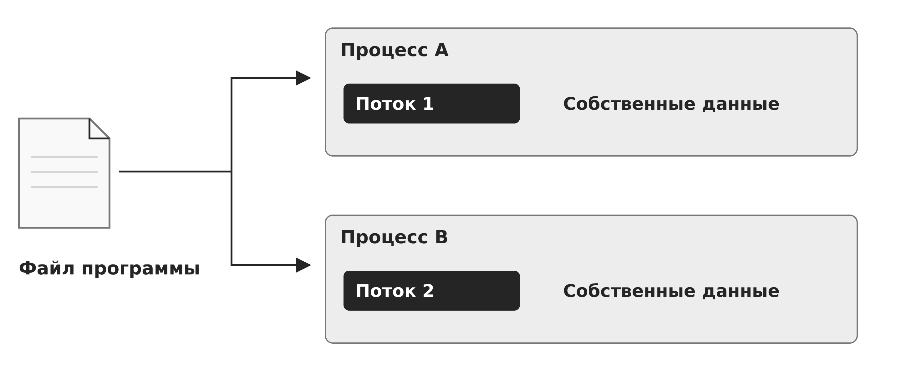

Рисунок 1 — Программа, процессы и потоки

### 3.1.2. Дескриптор процесса и сохраняемый контекст

Ядро хранит сведения о процессе в наборе внутренних структур, логически соответствующих PCB — блоку управления процессом. В них находятся PID и родственные идентификаторы, состояние, параметры планирования, ссылки на адресное пространство, открытые файлы, обработчики сигналов, учётные данные, статистика и ограничения. Реальная реализация может распределять эти сведения по нескольким структурам, но их назначение едино: однозначно описывать процесс и связывать его с ресурсами.

Контекст выполнения потока включает счётчик команд, регистры общего назначения, указатели стеков, флаги процессора, векторные регистры и служебное состояние архитектуры. Когда выполнение приостанавливается, ОС сохраняет достаточно данных, чтобы позднее продолжить его так, будто паузы не было. Адресное пространство и открытые объекты обычно не копируются при каждом переключении — ядро сохраняет ссылки и активирует нужный контекст.

Важно разделять состояние процесса и состояние его потоков. У каждого потока собственные регистры, стек и позиция выполнения. Общие для процесса данные — виртуальная память, большинство дескрипторов, текущий каталог и учётные атрибуты — доступны всем его потокам. Такое разделение объясняет и эффективность многопоточности, и масштаб последствий ошибки: повреждение общей памяти одним потоком затрагивает весь процесс.

Связи и последовательность показаны на рисунке 2.

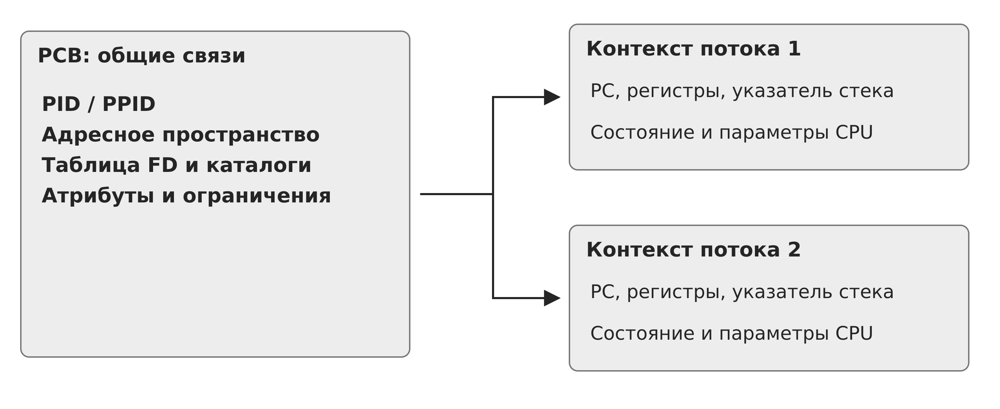

Рисунок 2 — Общий процессный и отдельный потоковый контекст

### 3.1.3. Виртуальное адресное пространство

Типичное адресное пространство содержит код, неизменяемые данные, глобальные переменные, динамическую область, стеки потоков, отображённые файлы и библиотеки. Ядро задаёт отображение виртуальных страниц на физическую память и права чтения, записи и исполнения. Одинаковые виртуальные адреса в разных процессах обычно соответствуют разным физическим страницам.

Изоляция памяти позволяет одному процессу аварийно завершиться, не разрушая данные соседнего. Однако отображения могут быть общими намеренно: разделяемые библиотеки экономят память, а совместная память ускоряет IPC. Следовательно, граница процесса — не абсолютная герметичность, а набор контролируемых отображений и интерфейсов. Каждое общее отображение должно иметь понятного владельца и режим доступа.

При fork в Linux для обычных частных отображений применяется копирование при записи: исходное совместное использование физических страниц не даёт процессам совместной записи в эти частные данные. Правила намеренно разделяемых отображений отличаются. При первой попытке записи возникает исключение, и ядро создаёт частную копию страницы. Это делает создание процесса быстрым, но требует помнить, что логическая независимость появляется сразу, даже если физическое копирование откладывается.

Связи и последовательность показаны на рисунке 3.

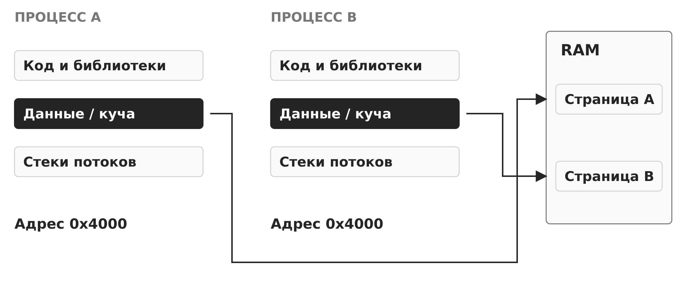

Рисунок 3 — Виртуальные адреса и физические страницы

### 3.1.4. Ресурсы процесса

Таблица файловых дескрипторов связывает небольшие целые числа с объектами ядра: файлами, каталогами, каналами, сокетами, таймерами и другими ресурсами. Дескриптор не является адресом объекта; он действует только в контексте конкретного процесса. Для обычного файла режим открытия, позиция и файловые флаги связаны с описанием открытия; запись дескриптора содержит собственные флаги, в частности FD_CLOEXEC. После fork или dup несколько дескрипторов могут ссылаться на одно описание и разделять позицию.

К ресурсам также относятся текущий и корневой каталоги, пространство имён, лимиты, маска создания файлов, обработчики сигналов и статистика времени. Многие атрибуты наследуются потомком, поэтому создание процесса переносит не только код, но и часть окружения. Непреднамеренное наследование дескриптора или привилегии способно нарушить изоляцию.

Жизненный цикл ресурса определяется ссылками. Закрытие дескриптора уменьшает счётчик; окончательное освобождение происходит, когда ссылок не осталось. Такая модель необходима при наследовании и передаче дескрипторов, но усложняет диагностику утечек. Процесс может удерживать удалённый файл, сокет или устройство дольше, чем ожидает администратор.

Связи и последовательность показаны на рисунке 4.

Рисунок 4 — Контейнер ресурсов и файловые ссылки

### 3.1.5. Состояния и переходы

Базовая модель включает состояния создания, готовности, выполнения, ожидания и завершения. Готовый поток допущен к выполнению, но ещё не получил процессор. Выполняющийся использует логический процессор. В однопоточной учебной модели это также называют состояниями процесса. Ожидающий не может продолжить работу до события: завершения ввода-вывода, появления данных, освобождения блокировки или истечения таймера.

Переход из готовности в выполнение выполняет диспетчер. Из выполнения в готовность поток переводится при вытеснении, окончании кванта или появлении более приоритетной задачи. В ожидание поток переходит, когда продолжение зависит от события, например блокирующей операции; ожидание страницы также может возникнуть при обращении к памяти. После события ожидающий поток становится готовым, но не обязательно запускается сразу.

Состояния важны для диагностики. Большая очередь готовых потоков указывает на конкуренцию за процессор. Много потоков в непрерываемом ожидании часто связано с вводом-выводом или драйвером. Спящий процесс не обязательно неисправен: событийная служба большую часть времени должна ждать. Оценивать состояние следует вместе с длительностью, причиной ожидания и нагрузкой системы.

Связи и последовательность показаны на рисунке 5.

Рисунок 5 — Конкурентность на одном процессоре

Связи и последовательность показаны на рисунке 6.

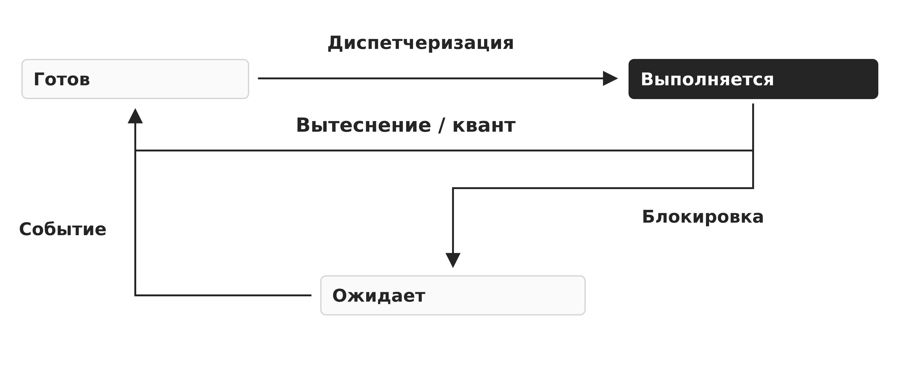

Рисунок 6 — Состояния и причины переходов

### 3.1.6. Создание процесса, замена образа и завершение

В Unix-подобной модели fork создаёт потомка с логической копией состояния родителя, а exec заменяет адресное пространство новым образом программы. PID сохраняется, но код, данные, стеки и большая часть пользовательского состояния заменяются. Некоторые дескрипторы переживают exec, если для них не установлен флаг close-on-exec. Поэтому безопасная программа явно управляет наследованием.

Создание процесса в других ОС может объединять выбор программы, формирование адресного пространства и запуск первого потока в одну операцию. Независимо от интерфейса ядро должно назначить идентификаторы, контекст безопасности, ресурсы и начальное состояние, затем поместить поток в очередь готовых. Ошибка на промежуточном этапе требует полного отката частично созданных объектов.

При завершении освобождаются адресное пространство и ресурсы, но краткая запись о результате может сохраняться до получения статуса родителем. В Unix такой завершённый, но не собранный процесс называют зомби. Осиротевший работающий процесс передаётся системному родителю. Эти состояния не являются вредоносными сами по себе, но массовое накопление зомби указывает на ошибку управления жизненным циклом.

Ключевой вывод. Процесс объединяет выполняемый код, память, ресурсы и полномочия. Его корректное понимание требует различать потоковый контекст, общие объекты процесса и переходы жизненного цикла.

Связи и последовательность показаны на рисунке 7.

Рисунок 7 — Создание потомка и замена его образа

Связи и последовательность показаны на рисунке 8.

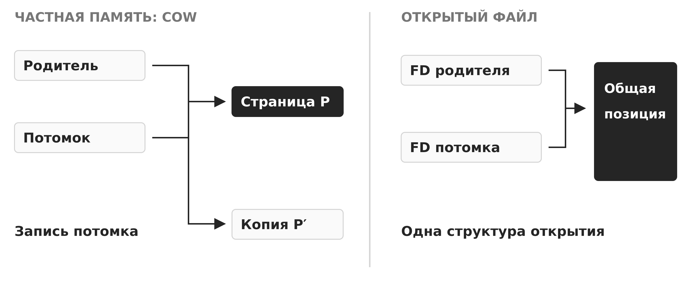

Рисунок 8 — Копирование при записи и общая позиция файла

Связи и последовательность показаны на рисунке 9.

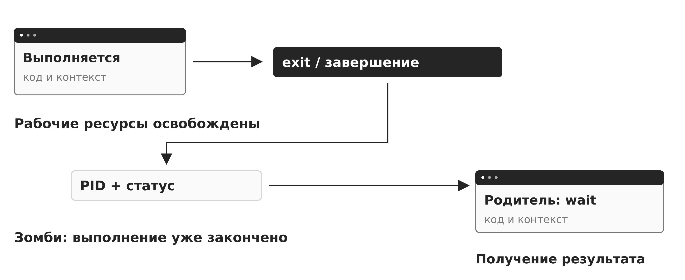

Рисунок 9 — Завершение, зомби и сбор результата

### 3.1.7. Этапы создания процесса и иерархия

Создание процесса начинается не с выполнения первой инструкции, а с подготовки управляемого объекта ядра. ОС назначает идентификатор, формирует PCB и потоковый контекст, создаёт или подключает адресное пространство, инициализирует таблицы ресурсов и атрибуты безопасности. Затем первый поток получает начальное состояние и попадает в очередь готовых. До этого момента процесс не может конкурировать за процессор.

Практически создание включает четыре группы действий: регистрацию процесса в системных структурах, выделение памяти и объектов ядра, наследование или явную настройку окружения, а также подготовку первого потока. Если любой шаг завершается ошибкой, ядро должно отменить уже выполненные действия и освободить частично выделенные ресурсы.

Процессы образуют отношения происхождения. Родитель может создать потомка, передать ему часть окружения и позднее получить код завершения. Однако иерархия происхождения не равна иерархии полномочий: потомок не обязан иметь больше прав, а безопасная архитектура обычно сокращает наследуемые возможности. Поведение потомка после завершения родителя зависит от модели ОС и механизмов надзора.

Связи и последовательность показаны на рисунке 10.

Рисунок 10 — Подготовка нового процесса

### 3.1.8. Очереди дескрипторов и операции управления

Планировщик работает не с абстрактными названиями программ, а с дескрипторами готовых потоков. Ядро объединяет их в очереди и другие структуры поиска. Отдельные очереди могут соответствовать процессорам, классам планирования, уровням приоритета и причинам ожидания. Для ввода-вывода и синхронизации обычно нужны разные списки ожидания, потому что каждую группу пробуждает своё событие.

Изменение состояния реализуется перемещением дескриптора между управляющими структурами. Диспетчер извлекает готовый поток из очереди, блокирующая операция связывает его с очередью ожидания, а обработчик события возвращает поток в готовое состояние. Такая организация позволяет быстро добавлять, удалять и переупорядочивать элементы без перемещения самого кода процесса.

В таблице 3 приведено сопоставление: операции над состоянием.

Таблица 3 — Операции над состоянием

| Операция ОС | Изменение состояния | Что происходит с дескриптором |
| --- | --- | --- |
| Допуск | создание → готовность | Первый поток включается в очередь готовых |
| Диспетчеризация | готовность → выполнение | Выбранный поток удаляется из очереди и получает CPU |
| Вытеснение | выполнение → готовность | Контекст сохраняется, поток возвращается в очередь |
| Блокирование | выполнение → ожидание | Поток связывается с очередью конкретного события |
| Пробуждение | ожидание → готовность | Обработчик события снова делает поток доступным планировщику |
| Завершение | выполнение → завершение | Ресурсы освобождаются, статус сохраняется для родителя |
| Изменение приоритета | состояние может не измениться | Меняется положение в очереди или класс обслуживания |

Связи и последовательность показаны на рисунке 11.

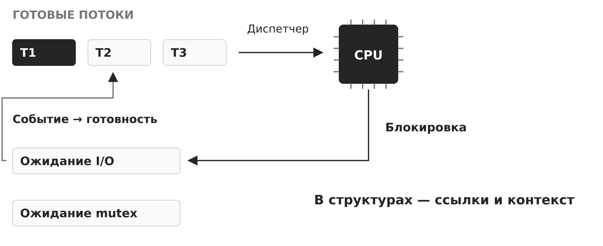

Рисунок 11 — Очереди и переход управляющих ссылок

### 3.1.9. Приостановленные состояния и регулирование нагрузки

Базовой модели состояний достаточно для объяснения конкуренции за CPU, но она не показывает процессы, временно исключённые из оперативного планирования. В расширенной модели используются состояния «приостановлен-готов» и «приостановлен-ожидает». Такой процесс сохраняется как объект ОС, но его выполнение невозможно до явного возобновления или возвращения необходимых страниц и ресурсов.

Приостановка применяется при управлении памятью, диагностике, административной остановке и регулировании перегрузки. Следует различать блокирование и приостановку: блокированный поток ожидает событие, а приостановленный исключён из набора допускаемых к выполнению решением ОС или администратора. Возможна их комбинация, когда событие уже произошло, но процесс остаётся приостановленным.

Количество активных процессов ограничивают не числом записей в таблице как таковым, а доступной памятью, лимитами объектов ядра, политиками контейнеров и допустимой нагрузкой. В системах реального времени размеры пулов структур часто задают заранее, чтобы исключить непредсказуемое выделение памяти. В универсальных ОС структуры обычно создаются динамически, но также подчиняются лимитам.

### 3.1.10. Аппаратная поддержка контекста

Архитектура процессора предоставляет регистры режима, указатели таблиц памяти, механизмы прерываний и защищённого перехода в ядро. На x86 структуры TSS появились в процессорах защищённого режима, начиная с 80286, и исторически поддерживали аппаратное переключение задач. Современные ОС обычно сохраняют большую часть контекста программно, поскольку это даёт ядру контроль над объёмом сохраняемых данных и политикой переключения.

Аппаратная поддержка не отменяет PCB. Процессор сохраняет или загружает только архитектурное состояние, тогда как ядро управляет очередями, адресными пространствами, дескрипторами, полномочиями и статистикой. Поэтому переключение контекста является совместной работой аппаратуры и программных структур ОС.

Связи и последовательность показаны на рисунке 12.

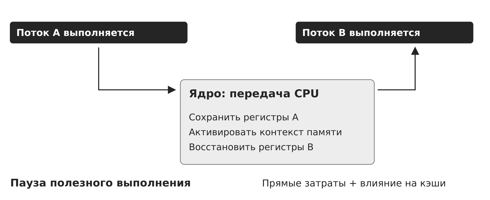

Рисунок 12 — Передача контекста между потоками

## 3.2. Потоки и совместное использование

Поток делает параллельное выполнение внутри одного процесса дешёвым, но превращает общую память в общий риск: производительность растёт только вместе с дисциплиной синхронизации и ясным владением данными.

### 3.2.1. Поток как единица выполнения

Поток — последовательность выполнения с собственным счётчиком команд, регистрами и стеком. Потоки одного процесса разделяют код, глобальные данные, кучу, большинство дескрипторов и учётный контекст. Они могут выполнять разные функции одной программы параллельно и обращаться к одним структурам данных без отдельного механизма передачи сообщений.

Минимальное состояние потока меньше состояния процесса, поэтому создание и переключение потоков обычно дешевле. Однако слово «дешевле» не означает «бесплатно»: нужны стек, структура ядра, участие планировщика и кэш процессора. Слишком большое число потоков увеличивает память, переключения и конкуренцию за блокировки.

В современных универсальных ОС именно поток обычно является планируемой сущностью. Процесс с десятью готовыми потоками может одновременно выполняться на десяти ядрах, если это допускают данные и синхронизация. Однопоточный процесс одновременно использует лишь одно ядро, даже если внутри него есть много асинхронных операций.

Связи и последовательность показаны на рисунке 13.

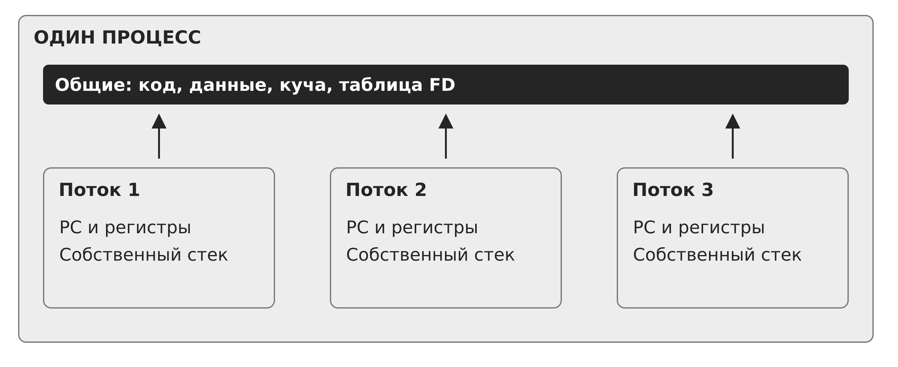

Рисунок 13 — Потоки в одном адресном пространстве

### 3.2.2. Зачем применяют многопоточность

Первая причина — отзывчивость. Интерфейсный поток продолжает обрабатывать события, пока рабочий поток выполняет вычисление или ожидает ресурс. Вторая — перекрытие ожидания: когда один поток заблокирован на вводе-выводе, другой может использовать процессор. Третья — параллелизм на многоядерной системе.

Многопоточность естественна для серверов, конвейеров обработки, мультимедиа и фоновых задач. Но архитектура должна учитывать характер нагрузки. Для коротких задач выгоден ограниченный пул потоков, а создание отдельного потока на каждый запрос может привести к истощению памяти и эффекту «толпы» при пробуждении.

Асинхронная модель и потоки решают разные задачи. Асинхронный ввод-вывод уменьшает число блокирующих потоков, но не устраняет необходимость параллельных вычислений. Практические системы часто сочетают цикл событий, пул рабочих потоков и отдельные процессы для компонентов с иной границей доверия.

### 3.2.3. Пользовательские и ядерные потоки

Потоки пользовательского уровня могут управляться библиотекой без обращения к ядру при каждом переключении. Это быстро и позволяет реализовать специальную политику, но ядро не видит отдельные сущности. Если один такой поток выполняет блокирующий системный вызов, может остановиться весь связанный с ним ядерный поток.

При модели один-к-одному каждый пользовательский поток соответствует планируемому потоку ядра. Блокировка одного не останавливает остальных, а ядро распределяет их по процессорам. Цена — системные ресурсы и более дорогие операции жизненного цикла. Именно эта модель типична для современных Linux и Windows.

Гибридные модели отображают множество пользовательских потоков на несколько ядерных. Они сочетают управляемость среды выполнения с настоящим параллелизмом, но усложняют обработку сигналов, блокировок, отладки и планирования. Важно всегда уточнять, что именно обозначает слово «поток» в конкретной среде.

Связи и последовательность показаны на рисунке 14.

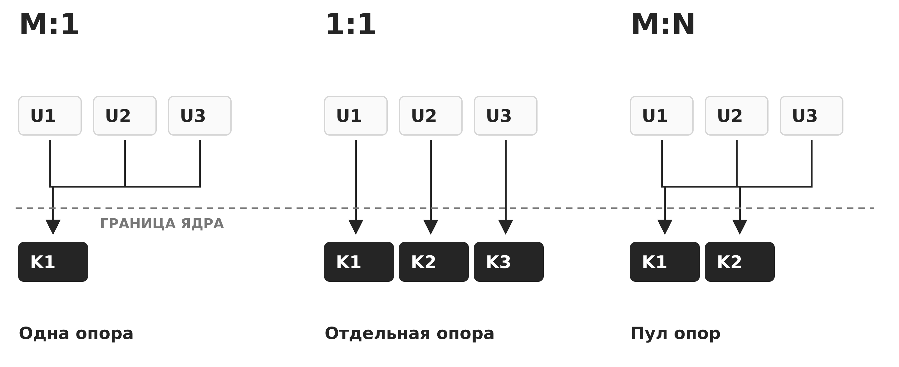

Рисунок 14 — Модели отображения пользовательских задач

### 3.2.4. Общая память и гонки

Обычная операция исходного языка может состоять из нескольких машинных действий. Если два потока одновременно читают и изменяют одну переменную без согласования, результат зависит от чередования инструкций. Такое состояние гонки проявляется редко, зависит от нагрузки и может исчезать при отладке.

Разделение памяти означает, что ошибка указателя, переполнение буфера или освобождение объекта одним потоком затрагивает соседние потоки. Аппаратная защита страниц не разделяет потоки одного процесса. Поэтому компоненты с разным уровнем доверия нельзя изолировать только потоками: им нужен отдельный процесс или более сильная среда изоляции.

Безопасное совместное использование требует явных правил владения: какие данные неизменяемы, кто их изменяет, какой примитив защищает инвариант, когда объект уничтожается. Синхронизация будет подробно рассмотрена в следующей лекции, но уже здесь важно понять: общая память ускоряет обмен ценой необходимости доказать корректность всех допустимых чередований.

Связи и последовательность показаны на рисунке 15.

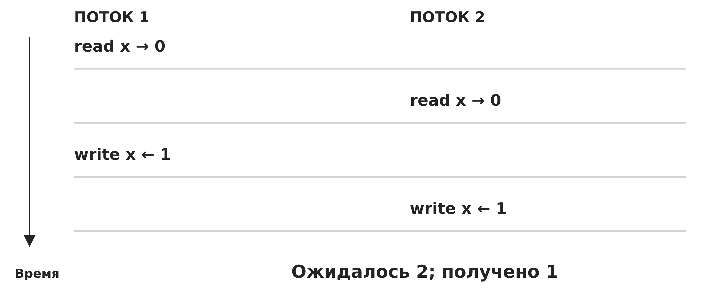

Рисунок 15 — Потерянное обновление

Связи и последовательность показаны на рисунке 16.

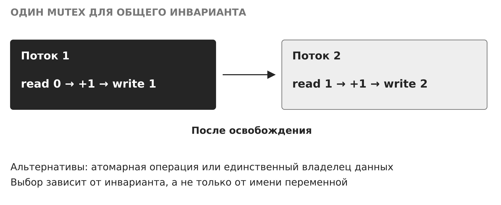

Рисунок 16 — Защищённая операция изменения

### 3.2.5. Потоки, процессы и границы доверия

Процессы обеспечивают отдельные адресные пространства и позволяют назначить разные учётные записи, политики и ограничения. Отказ рабочего процесса можно локализовать и обработать управляющим процессом. Недостаток — необходимость IPC, сериализации данных и управления распределённым состоянием.

Потоки упрощают доступ к общим данным и уменьшают накладные расходы, но разделяют область отказа. Если один поток испортил кучу или вызвал аварийное завершение, прекращается весь процесс. Разделение на процессы оправдано для парсеров недоверенных форматов, сетевых фронтендов, модулей расширения и других компонентов, где последствия дефекта важнее стоимости обмена.

Выбор не должен быть догмой. Полезен комбинированный подход: небольшое число процессов задаёт границы доверия и восстановления, а внутри каждого процесса ограниченный пул потоков обеспечивает параллелизм. Проектировщик документирует, какие данные пересекают IPC, какие полномочия имеет каждая сторона и как система восстанавливается после сбоя.

### 3.2.6. Наблюдение и диагностика потоков

Средства наблюдения должны показывать дерево процессов, число потоков, состояния, потребление процессора и памяти, причины ожидания и переключения контекста. В Linux применяются ps, top или htop, каталог /proc, а для углублённого анализа — perf, strace и средства трассировки. Интерпретация важнее отдельного числа.

Если процесс потребляет одно ядро на 100 %, это может быть нормой для вычислительного однопоточного кода. Если сотни потоков почти не выполняют полезной работы, возможны чрезмерная конкуренция, частые пробуждения или блокировка на общем ресурсе. Высокая скорость добровольных переключений обычно связана с ожиданиями, а недобровольных — с вытеснением.

Диагностика многопоточного сбоя должна фиксировать стеки всех потоков, а не только аварийного. Один поток может держать блокировку, второй — ожидать её, третий — завершать объект. Дамп, временная шкала и события планировщика помогают восстановить причинную последовательность.

Ключевой вывод. Потоки эффективны там, где действительно нужны общая память и параллелизм. Для разделения полномочий, локализации отказа и обработки недоверенного кода надёжнее процессная граница.

## 3.3. Планирование процессора

Планировщик не ускоряет процессор: он распределяет ограниченное время между готовыми потоками и выбирает компромисс между откликом, пропускной способностью, справедливостью и сроками.

Связи и последовательность показаны на рисунке 17.

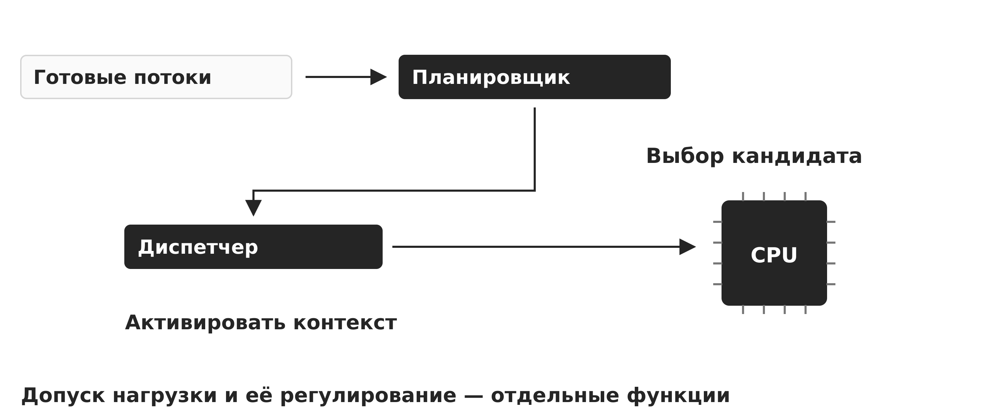

Рисунок 17 — Выбор кандидата и выполнение диспетчеризации

### 3.3.1. Планировщик и диспетчер

Планировщик выбирает следующий готовый поток, а диспетчер фактически передаёт ему процессор: сохраняет прежний контекст, активирует адресное пространство и восстанавливает регистры. Решение принимается при блокировке текущего потока, его завершении, истечении кванта, появлении более приоритетной задачи или изменении доступности процессора.

Вытесняющая ОС может приостановить поток без его согласия. Таймер гарантирует, что вычислительная задача не удержит процессор навсегда. Невытесняющая схема передаёт управление только при добровольной блокировке или завершении, проще по реализации, но непригодна для надёжной многозадачности общего назначения.

Само переключение не создаёт полезной работы. Оно включает сохранение регистров, смену таблиц страниц, воздействие на кэши и предсказатели. Слишком короткий квант улучшает видимую отзывчивость, но повышает накладные расходы; слишком длинный приближает Round Robin к FCFS и ухудшает интерактивность.

Связи и последовательность показаны на рисунке 18.

Рисунок 18 — CPU-работа, вытеснение и ожидание

### 3.3.2. Критерии качества

Загрузка процессора отражает долю занятости в принятом способе учёта, включая системную работу; она сама по себе не измеряет полезность результата. При этом пропускная способность — число завершённых работ, время оборота — интервал от поступления до завершения, время ожидания — пребывание в очереди готовых, время отклика — задержку до выбранного наблюдаемого ответа. В учебных расписаниях ниже отдельно измеряется задержка до первого запуска на CPU. Эти показатели не взаимозаменяемы.

Для пакетной обработки важны пропускная способность и среднее время оборота. Для интерактивной системы — быстрый и устойчивый отклик. Для многопользовательской среды — справедливость и защита от монополизации. Для реального времени — соблюдение сроков, даже если среднее значение выглядит хуже.

Оптимизация среднего может скрыть неприемлемые выбросы. Если большинство запросов обслуживается быстро, а некоторые ждут минуты, среднее может оставаться хорошим. Поэтому оценивают распределение задержек, квантили, максимальное ожидание и наличие голодания.

### 3.3.3. FCFS, SJF и SRTF

FCFS обслуживает работы в порядке поступления. Он прост и предсказуем, но длинная вычислительная задача заставляет короткие ждать — возникает эффект конвоя. В системе с чередованием CPU- и I/O-нагрузки это снижает использование устройств и ухудшает отклик.

SJF невытесняюще выбирает кратчайший ожидаемый CPU burst среди готовых задач. При одновременном поступлении всех работ и известных длительностях такой порядок минимизирует среднее ожидание. При разных моментах поступления это не является безусловным утверждением глобальной оптимальности. На практике будущий CPU burst неизвестен, поэтому его оценивают по истории. Длинные задачи могут голодать, если постоянно приходят короткие.

SRTF — вытесняющий вариант кратчайшей оставшейся работы. Новый короткий поток может вытеснить текущий. Алгоритм улучшает средние показатели, но требует оценок, создаёт переключения и не обеспечивает естественной справедливости. Эти алгоритмы важны прежде всего как модели для понимания компромиссов.

### 3.3.4. Round Robin и квант

Round Robin организует готовые потоки в циклическую очередь и выдаёт каждому ограниченный квант. Если поток блокируется раньше, процессор получает следующий. Если квант истекает, поток возвращается в хвост очереди. При равных условиях это создаёт понятную долю процессорного времени.

Размер кванта выбирается относительно длительности интерактивных всплесков и стоимости переключения. Большинство интерактивных задач быстро блокируется и получает хороший отклик. Вычислительные задачи используют квант полностью. Однако большое число готовых потоков увеличивает время до следующего обслуживания каждого.

Round Robin не учитывает важность и сроки. Он также не гарантирует равную полезную производительность: потоки различаются рабочим набором, кэш-поведением и числом процессоров. Поэтому практические планировщики используют веса, классы и динамическую оценку поведения.

### Разобранный пример сравнения расписаний

Рассмотрим один набор задач из исходной презентации: A поступает в момент 0 и требует 8 мс CPU; B поступает в 1 и требует 4 мс; C поступает в 2 и требует 2 мс. Используется одно ядро, у каждой задачи одна порция CPU-работы, нет ввода-вывода и затрат переключения. При равенстве учитывается порядок поступления. Для RR квант равен 2 мс; задачи, поступившие точно на границе кванта, включаются в очередь до возврата вытесненной задачи.

В таблице 4 приведено сопоставление: исходные данные расчёта.

Таблица 4 — Исходные данные расчёта

| Задача | Поступление, мс | CPU-работа, мс |
| --- | --- | --- |
| A | 0 | 8 |
| B | 1 | 4 |
| C | 2 | 2 |

Обозначим момент поступления a, первого запуска s, завершения f и суммарное CPU-время b. Время оборота T = f − a. Для модели без I/O ожидание в очереди W = T − b, а первый отклик R = s − a. В общем случае с ожиданием устройства формула W = T − b не выделяет только готовность: в неё попадут и другие ожидания.

FCFS: A: 0–8, B: 8–12, C: 12–14 мс. Для A/B/C времена завершения равны 8, 12, 14 мс; ожидания — 0, 7, 10 мс; первого отклика — 0, 7, 10 мс. Среднее ожидание 5,67 мс, оборот 10,33 мс, первый отклик 5,67 мс.

Связи и последовательность показаны на рисунке 19.

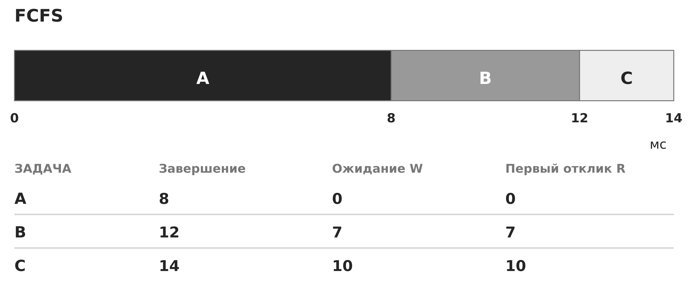

Рисунок 19 — FCFS: рассчитанное расписание

SJF: A: 0–8, C: 8–10, B: 10–14 мс. Для A/B/C времена завершения равны 8, 14, 10 мс; ожидания — 0, 9, 6 мс; первого отклика — 0, 9, 6 мс. Среднее ожидание 5,00 мс, оборот 9,67 мс, первый отклик 5,00 мс.

Связи и последовательность показаны на рисунке 20.

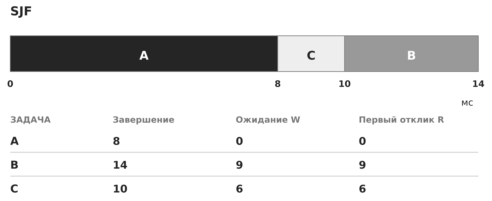

Рисунок 20 — SJF: рассчитанное расписание

SRTF: A: 0–1, B: 1–2, C: 2–4, B: 4–7, A: 7–14 мс. Для A/B/C времена завершения равны 14, 7, 4 мс; ожидания — 6, 2, 0 мс; первого отклика — 0, 0, 0 мс. Среднее ожидание 2,67 мс, оборот 7,33 мс, первый отклик 0,00 мс.

Связи и последовательность показаны на рисунке 21.

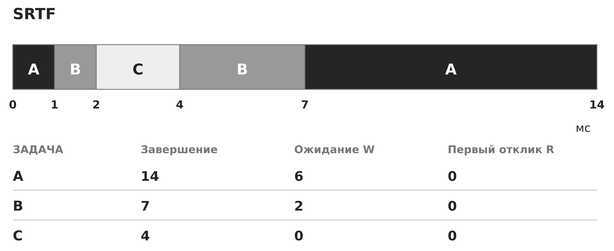

Рисунок 21 — SRTF: рассчитанное расписание

RR: A: 0–2, B: 2–4, C: 4–6, A: 6–8, B: 8–10, A: 10–12, A: 12–14 мс. Для A/B/C времена завершения равны 14, 10, 6 мс; ожидания — 6, 5, 2 мс; первого отклика — 0, 1, 2 мс. Среднее ожидание 4,33 мс, оборот 9,00 мс, первый отклик 1,00 мс.

Связи и последовательность показаны на рисунке 22.

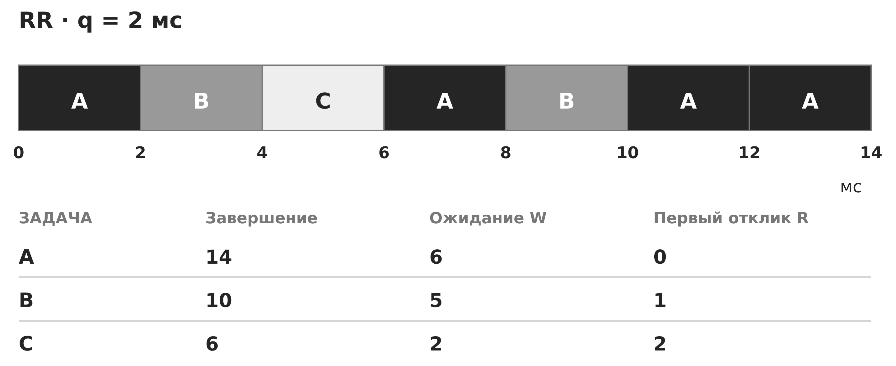

Рисунок 22 — RR: рассчитанное расписание

В таблице 5 приведено сопоставление: показатели рассчитанных расписаний.

Таблица 5 — Показатели рассчитанных расписаний

| Алгоритм | Среднее W, мс | Среднее T, мс | Среднее R, мс |
| --- | --- | --- | --- |
| FCFS | 5,67 | 10,33 | 5,67 |
| SJF | 5,00 | 9,67 | 5,00 |
| SRTF | 2,67 | 7,33 | 0,00 |
| RR | 4,33 | 9,00 | 1,00 |

В этом наборе SRTF даёт наименьшее среднее ожидание и мгновенный первый запуск каждой задачи, поскольку короткие работы поступают достаточно рано. Это результат данного примера, а не обещание отсутствия голодания при произвольном потоке задач. RR улучшает первый отклик по сравнению с FCFS, но его цена зависит от реальных переключений. На границе 12 мс снова выбирается A: новый квант не требует переключения на другой поток.

### 3.3.5. Приоритеты и многоуровневые очереди

Приоритетное планирование выбирает наиболее важный готовый поток. Приоритет может задаваться администратором, классом службы или вычисляться динамически. Низкоприоритетная задача способна голодать, поэтому применяют старение — постепенное повышение приоритета при длительном ожидании.

Многоуровневая очередь разделяет задачи на классы, например системные, интерактивные и пакетные. Между очередями действует отдельная политика, внутри каждой — собственный алгоритм. Многоуровневая очередь с обратной связью перемещает поток в зависимости от поведения: коротко работающие и часто блокирующиеся задачи получают быстрый отклик, длительно вычисляющие переходят ниже.

Приоритет может стать источником инверсии: высокоприоритетный поток ждёт блокировку, удерживаемую низкоприоритетным, а средние потоки не дают владельцу завершиться. Механизм наследования приоритета временно повышает владельца ресурса. Это связывает планирование с синхронизацией и показывает, почему отдельные подсистемы ОС нельзя анализировать изолированно.

Связи и последовательность показаны на рисунке 23.

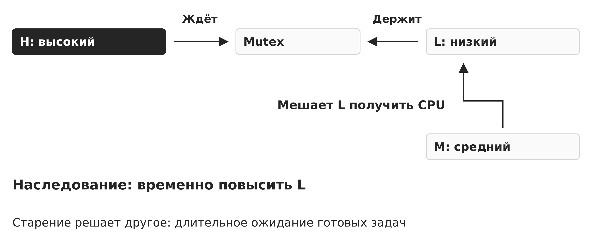

Рисунок 23 — Инверсия приоритетов на блокировке

Связи и последовательность показаны на рисунке 24.

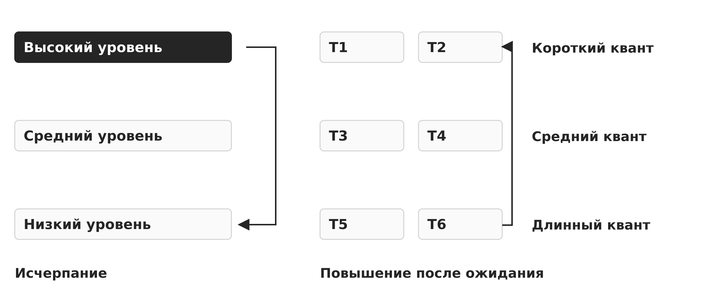

Рисунок 24 — Многоуровневые очереди с обратной связью

### 3.3.6. Современное справедливое планирование

Современный планировщик общего назначения стремится распределять время пропорционально весам и поддерживать хорошую интерактивность. Вместо буквального обхода очереди он может учитывать виртуальное время выполнения: поток, получивший меньшую долю, становится более предпочтительным. Структуры данных позволяют быстро находить кандидата.

Планировщик различает задачи, но не знает бизнес-смысла каждой инструкции. Вес и nice выражают относительную долю только среди конкурентов. Повышение приоритета одной службы уменьшает ресурсы остальных и не устраняет перегрузку. Для управляемости приоритеты сочетают с лимитами, квотами и контролем поступления задач.

Наблюдать следует не только общую загрузку, но и задержку запуска готового потока, число миграций, долю ожидания и распределение CPU по группам. Высокая загрузка может быть нормальной, если сроки соблюдаются; низкая — проблемной, если поток ждёт блокировку или устройство.

### 3.3.7. Многоядерность, аффинность и балансировка

На многоядерной системе планировщик решает две задачи: какой поток запустить и на каком процессоре. Миграция выравнивает нагрузку, но может потерять тёплый кэш и нарушить локальность памяти NUMA. Аффинность ограничивает допустимые процессоры или сохраняет предпочтение к прежнему ядру.

Балансировка должна учитывать не только число потоков, но и их веса, рабочие наборы, аппаратные потоки и домены памяти. Два готовых потока могут создавать разную нагрузку. Закрепление всех важных процессов за одним ядром создаёт искусственное узкое место, а чрезмерные миграции увеличивают задержки.

Для изолированных или временно критичных задач иногда выделяют ядра и ограничивают фоновые прерывания. Но это уменьшает общий пул ресурсов и требует целостной настройки. Локальная оптимизация одного сервиса может ухудшить обслуживание всей системы.

Связи и последовательность показаны на рисунке 25.

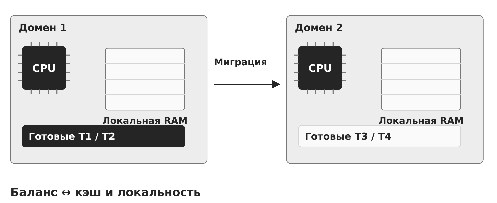

Рисунок 25 — Балансировка и локальность памяти

### 3.3.8. Планирование реального времени

В системе реального времени корректность включает время получения результата. Жёсткое реальное время не допускает пропуска срока, мягкое допускает редкие нарушения с ухудшением качества. Для анализа задачи описывают периодом, временем выполнения и дедлайном.

Rate Monotonic назначает более высокий фиксированный приоритет задаче с меньшим периодом. Earliest Deadline First динамически выбирает ближайший срок и способен эффективнее использовать процессор при идеальных предпосылках. Оба подхода требуют оценки наихудшего времени выполнения и анализа допустимости нагрузки.

Высокий приоритет не создаёт гарантии сам по себе. Страница может вызвать задержку, драйвер — удерживать процессор, а блокировка — создать инверсию. Система реального времени требует контролировать всю цепочку: прерывания, память, синхронизацию, устройства и перегрузку.

Ключевой вывод. Планирование — многокритериальная политика. Выбор алгоритма определяется видом нагрузки, допустимыми задержками, справедливостью и возможностью доказать соблюдение сроков.

## 3.4. Контекст безопасности процесса

Ядро принимает решение не только по имени программы, а по фактическому контексту процесса: идентификаторам, группам, возможностям, меткам, пространствам имён, открытым объектам и ограничениям.

### 3.4.1. Идентичность и полномочия

Процесс связан с идентификаторами пользователя и групп. Unix-подобные системы различают реальные, эффективные и сохранённые идентификаторы, чтобы описывать происхождение и текущие полномочия. Проверки доступа обычно используют эффективный контекст. Дополнительные группы расширяют набор разрешений.

Модель capabilities разделяет полномочия суперпользователя на отдельные возможности: например, изменение сетевой конфигурации или переключение учётных данных. Службе можно выдать только нужную способность, но каждая capability остаётся сильным правом и должна быть обоснована. Полный набор практически эквивалентен широким административным полномочиям.

Обязательное управление доступом добавляет метки и правила, которые действуют независимо от дискреционных прав владельца. Процесс с корректным UID может получить отказ из-за политики домена или уровня. Итоговое разрешение является пересечением применимых механизмов, а не выбором одного из них.

### 3.4.2. Наследование при создании и exec

Потомок обычно наследует учётный контекст, окружение, текущий каталог, маску, ограничения и открытые дескрипторы. Это удобно, но создаёт каналы непреднамеренной передачи полномочий. Безопасный родитель перед запуском менее доверенной программы формирует минимальное окружение и закрывает лишние дескрипторы.

Exec заменяет программу, но не обязательно очищает весь процессный контекст. PID, часть идентификаторов, лимиты и разрешённые дескрипторы сохраняются. Специальные атрибуты исполняемого файла могут изменить эффективные полномочия. Поэтому загрузка нового образа — критичная точка, где ядро пересчитывает контекст и применяет защитные правила.

Опасно полагаться на имя запускаемого файла или переменные окружения без фиксации объекта. Поиск через PATH, подмена рабочей директории и наследование настроек динамического загрузчика меняют фактический код. Привилегированная служба использует абсолютные пути, доверенное окружение и устойчивые ссылки.

Связи и последовательность показаны на рисунке 26.

Рисунок 26 — Наследуемые объекты при fork и exec

### 3.4.3. Изоляция процессов

Основой служит виртуальная память: процесс не может произвольно читать и записывать чужие страницы. Ядро проверяет доступ к файлам, сокетам и IPC по контексту. Дополнительные пространства имён предоставляют разным группам процессов разные представления PID, сети, точек монтирования и других глобальных ресурсов.

Группы управления ресурсами ограничивают и учитывают CPU, память и ввод-вывод. Они защищают доступность: даже непривилегированная или ошибочная задача не должна истощить систему. Фильтрация системных вызовов уменьшает доступный интерфейс ядра, а обязательная политика ограничивает допустимые объекты и переходы.

Ни один механизм не равен полной виртуальной машине. Процессы всё ещё разделяют ядро, аппаратные кэши, время и часть глобальных подсистем. Побочные каналы, ошибки ядра и слишком широкие общие ресурсы могут нарушить ожидания. Граница должна соответствовать модели угроз.

### 3.4.4. Понижение привилегий

Системной службе иногда нужны повышенные права только на старте: открыть защищённый порт, прочитать ключ или настроить устройство. После инициализации она должна перейти к отдельной учётной записи, сократить группы и capabilities, установить ограничения и оставить только необходимые дескрипторы.

Понижение должно быть необратимым для рабочей части. Недостаточно изменить видимый идентификатор, сохранив способ вернуть полномочия через сохранённый UID, доступный сокет, наследуемую capability или управляющий интерфейс. Проверка проводится по фактическим возможностям после перехода.

Надёжная архитектура выделяет небольшую привилегированную часть и непривилегированных работников. Привилегированный процесс принимает узкие структурированные запросы и заново авторизует каждую операцию. Он не должен превращаться в универсальный прокси, выполняющий произвольные команды от менее доверенной стороны.

### 3.4.5. Сигналы, отладка и межпроцессные интерфейсы

Сигнал способен изменить управление процессом, завершить его или вызвать обработчик. Ядро проверяет право отправителя и особенности защищённых процессов. Отладочный интерфейс ещё сильнее: он может читать и изменять память и регистры. Поэтому ptrace и аналоги ограничиваются владельцем, отношением процессов и системной политикой.

IPC создаёт явный канал через границу процесса. Право подключиться к сокету или открыть очередь не означает право выполнить любую операцию. Получатель обязан аутентифицировать сторону, проверить структуру сообщения, авторизовать команду и ограничить размер. Дескрипторы, переданные через IPC, переносят доступ к объекту и требуют отдельного контроля.

Служебные интерфейсы часто опаснее основного протокола, потому что рассчитаны на администратора и хуже тестируются. Локальный сокет, диагностический порт или сигнал управления должны иметь минимальные права, журналирование и защиту от повторов и перегрузки.

### 3.4.6. Наблюдаемость и расследование

Базовая инвентаризация включает PID, PPID, владельца, команду, хэш исполняемого файла, время запуска, дескрипторы, сетевые соединения, пространства имён и ограничения. Дерево процессов показывает происхождение: необычный потомок офисного приложения и ожидаемый работник системной службы имеют разный смысл.

Журналирование создания и завершения процессов, изменения идентификаторов, исполнения программ и отказов доступа позволяет восстановить последовательность. Однако командная строка и окружение могут содержать секреты, поэтому сбор должен учитывать минимизацию и сроки хранения. События связывают по времени, идентификаторам и устойчивым данным объекта.

Злоумышленник может менять имя процесса или удалять файл после запуска. Поэтому доверять одному полю нельзя. Анализ сочетает происхождение, открытые объекты, сетевую активность, подпись или хэш, контекст политики и поведение. Аномалия — повод для проверки, а не автоматическое доказательство атаки.

Ключевой вывод. Контекст безопасности состоит из нескольких взаимосвязанных атрибутов и наследуемых ресурсов. Наименьшие привилегии достигаются только проверкой фактических возможностей процесса и контролем переходов жизненного цикла.

## Прикладной разбор: безопасный жизненный цикл сетевой службы

Сквозной пример показывает, как создание процессов, потоки, планирование и контекст безопасности соединяются в архитектуре сетевой службы, обрабатывающей недоверенные запросы.

### Постановка задачи

Служба должна принимать соединения на защищённом порту, читать конфигурацию и ключ, затем обрабатывать множество недоверенных запросов. Если весь код постоянно работает с широкими правами в одном многопоточном процессе, ошибка парсера получает доступ ко всем секретам и системным объектам службы.

Требования включают быстрый отклик, ограничение ущерба, контролируемое обновление и возможность перезапустить обработчик без потери управляющего процесса. Следовательно, архитектуру оценивают одновременно по производительности, границам доверия и восстановлению.

### Разделение ролей

Небольшой мастер выполняет привилегированную инициализацию, открывает только необходимые объекты, затем создаёт работников с пониженными правами. Работники получают только необходимые объекты и ограниченный канал IPC. Отсутствие закрытого ключа нельзя обосновать лишь понижением UID: после fork память потомка содержит копию данных родителя. Для выделенной секретной области нужен спроектированный запуск, например новый образ через exec без передачи ключа и отдельный контролируемый сервис операций с ним. Для разных классов данных можно создать отдельные пулы процессов.

Внутри работника используется ограниченный пул потоков. Потоки разделяют кэш и состояние соединений, но не пересекают процессную границу. Число потоков связано с ядрами и характером ожидания, а очередь имеет предел. При перегрузке служба применяет обратное давление, а не создаёт неограниченные потоки.

### Планирование и доступность

Работникам задаются обычные веса и ресурсные квоты. Повышать их в класс реального времени без анализа нельзя: перегруженная служба способна вытеснить аудит, журналирование и восстановление. Отдельные лимиты памяти и числа процессов предотвращают истощение системы.

Монитор наблюдает длину очереди, задержку отклика, CPU, память и число перезапусков. Если работник аварийно завершился, мастер закрывает связанные каналы, сохраняет событие и создаёт новый экземпляр с чистым контекстом. Повторяющиеся сбои переводят службу в ограниченный режим, чтобы избежать бесконечного цикла перезапуска.

### Проверка фактической изоляции

После запуска проверяют владельца и группы каждого процесса, набор capabilities, пространства имён, фильтр системных вызовов, доступные файлы, дескрипторы и сокеты. Затем выполняют отрицательные тесты: работник не должен читать ключ, менять конфигурацию, подключаться к административному сокету или создавать неразрешённое соединение.

Отдельно проверяют наследование при exec и обновлении: лишние дескрипторы закрыты, окружение очищено, путь к программе фиксирован. Результаты связывают с базовой линией. Только такая проверка подтверждает, что архитектурная схема реализована фактически, а не только нарисована.

Ключевой вывод. Безопасная служба сочетает процессные границы для доверия и восстановления, потоки для управляемого параллелизма, квоты для доступности и проверяемое понижение полномочий.

Связи и последовательность показаны на рисунке 27.

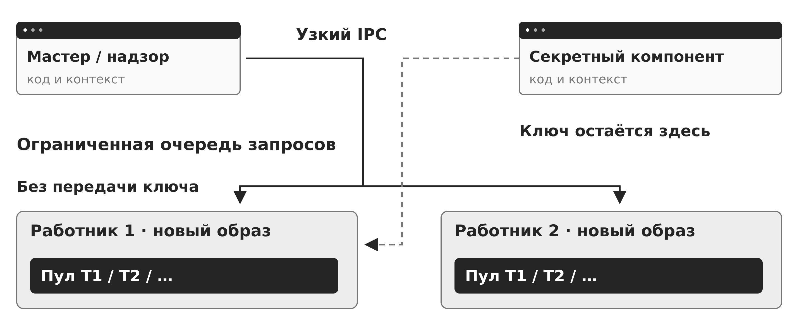

Рисунок 27 — Мастер, работники и секретный компонент

## Сравнение процессов и потоков

В таблице 6 приведено сопоставление: сравнение процессов и потоков.

Таблица 6 — Сравнение процессов и потоков

| Критерий | Отдельные процессы | Потоки одного процесса |
| --- | --- | --- |
| Адресное пространство | Раздельное по умолчанию | Общее |
| Регистры и стек | У каждого потока процесса свои | У каждого потока свои |
| Обмен данными | IPC, отображения, сокеты, каналы | Прямой доступ к общей памяти |
| Стоимость создания | Обычно выше | Обычно ниже |
| Локализация сбоя | Сбой чаще ограничен процессом | Сбой затрагивает весь процесс |
| Разные полномочия | Назначаются естественно | Обычно общий контекст процесса |
| Лучшее применение | Границы доверия и восстановления | Тесно связанный параллелизм |

## Сравнение алгоритмов планирования

В таблице 7 приведено сопоставление: сравнение алгоритмов.

Таблица 7 — Сравнение алгоритмов

| Алгоритм | Сильная сторона | Основное ограничение | Типичная задача |
| --- | --- | --- | --- |
| FCFS | Простота и порядок поступления | Эффект конвоя | Пакетная модель без требований к отклику |
| SJF / SRTF | Хорошее среднее ожидание | Нужна оценка длительности, риск голодания | Теоретический анализ и предсказуемые работы |
| Round Robin | Отзывчивость и понятное разделение | Зависимость от кванта | Интерактивная многозадачность |
| Приоритетный | Учёт важности | Голодание и инверсия | Системы с классами обслуживания |
| MLFQ | Адаптация к поведению | Сложная настройка | Смешанная интерактивная нагрузка |
| EDF / RM | Работа со сроками | Требуется анализ допустимости | Системы реального времени |

Связи и последовательность показаны на рисунке 28.

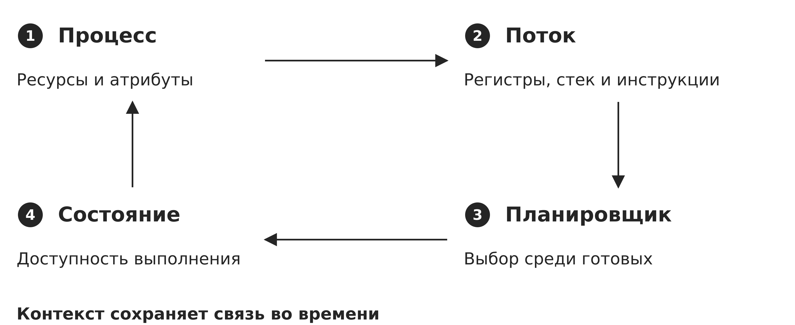

Рисунок 28 — Единая модель управления выполнением

## Итоги лекции

- Процесс является контейнером ресурсов и контекста безопасности, а поток — единицей выполнения внутри контейнера.

- PCB и потоковый контекст позволяют ядру приостанавливать и продолжать вычисление.

- Состояния готовности и ожидания различаются наличием события, а не наличием программы или памяти.

- Потоки быстрее обмениваются через общую память, но разделяют область отказа и требуют синхронизации.

- Процессная граница лучше подходит для разных полномочий, недоверенного кода и управляемого восстановления.

- Планировщик оптимизирует конфликтующие критерии и не может компенсировать неограниченный поток работ.

- FCFS, SJF, Round Robin и приоритетные схемы демонстрируют разные компромиссы отклика, ожидания и справедливости.

- Многоядерное планирование учитывает баланс, кэш, NUMA и аффинность, а реальное время требует анализа всей цепочки задержек.

- Контекст безопасности включает идентификаторы, capabilities, метки, пространства имён, лимиты и наследуемые объекты.

- Безопасная служба сочетает понижение привилегий, процессные границы, ограниченный пул потоков, квоты и наблюдаемость.

- Очереди дескрипторов связывают состояния с работой планировщика: переход процесса означает контролируемое перемещение его потока между структурами готовности, ожидания и завершения.

- Приостановка отличается от ожидания события и используется для управления памятью, диагностикой и общей нагрузкой системы.

## Вопросы для самоконтроля

- Какие этапы должна выполнить ОС до помещения первого потока нового процесса в очередь готовых?

- Почему для разных причин ожидания ядро ведёт разные очереди дескрипторов?

- Чем состояние «приостановлен-готов» отличается от состояний «готов» и «ожидает»?

- Чем программа отличается от процесса и почему один файл может соответствовать многим процессам?

- Какие сведения логически входят в PCB и какие данные относятся к отдельному потоку?

- Какие ресурсы процесса наследуются при создании потомка?

- Как копирование при записи ускоряет создание процесса?

- Чем состояния «готов» и «ожидает» различаются с точки зрения доступности процессора?

- Почему завершённый процесс может временно оставаться зомби?

- Какие ресурсы разделяют потоки одного процесса?

- Почему потоковая граница не изолирует компонент, обрабатывающий недоверенные данные?

- Когда пул потоков предпочтительнее потока на каждый запрос?

- Чем пользовательские потоки отличаются от ядерных?

- Что входит в стоимость переключения контекста?

- Чем время отклика отличается от времени оборота?

- Почему FCFS создаёт эффект конвоя?

- Как размер кванта влияет на Round Robin?

- Почему приоритетное планирование может вызвать голодание?

- Что такое инверсия приоритетов и как работает наследование приоритета?

- Почему повышение приоритета не устраняет перегрузку?

- Какие компромиссы создаёт миграция потока между ядрами?

- Чем жёсткое реальное время отличается от мягкого?

- Какие атрибуты образуют контекст безопасности процесса?

- Какие полномочия и объекты могут непреднамеренно пережить exec?

- Почему понижение UID недостаточно без проверки capabilities и дескрипторов?

- Какие риски создают сигналы, ptrace и IPC?

- Какие данные нужны для расследования необычного процесса?

## Глоссарий

В таблице 8 приведено сопоставление: термины и определения.

Таблица 8 — Термины и определения

| Термин | Определение |
| --- | --- |
| CPU burst | Порция процессорной работы до следующего ожидания ввода-вывода или завершения; квант может разбить её на несколько интервалов выполнения. |
| PCB | Логическая совокупность структур ядра, описывающих процесс, его состояние, ресурсы и атрибуты. |
| PID / PPID | Идентификатор процесса и идентификатор его родительского процесса. |
| Аффинность | Ограничение или предпочтение выполнения потока на определённых процессорах. |
| Время оборота | Интервал от поступления задачи до её полного завершения. |
| Время отклика | Интервал от поступления запроса до первого наблюдаемого ответа. |
| Вытеснение | Принудительное прекращение текущего использования процессора с переводом потока в готовое состояние. |
| Голодание | Неограниченно долгое ожидание ресурса при продолжающемся обслуживании других задач. |
| Диспетчер | Механизм, передающий процессор выбранному планировщиком потоку. |
| Зомби | Завершённый процесс, статус которого ещё не получен родителем. |
| Квант | Максимальный непрерывный интервал процессорного времени в квантовом алгоритме. |
| Контекст | Регистры, стеки, адресное пространство и служебные сведения, необходимые для продолжения выполнения. |
| Копирование при записи | Совместное использование страниц до первой записи, после которой создаётся частная копия. |
| Планировщик | Компонент ОС, выбирающий следующий готовый поток и процессор для его выполнения. |
| Поток | Планируемая последовательность выполнения с собственными регистрами и стеком внутри процесса. |
| Процесс | Контейнер выполнения, ресурсов и контекста безопасности, управляемый операционной системой. |
| Старение | Постепенное повышение приоритета долго ожидающей задачи для предотвращения голодания. |

## Рекомендуемая литература

- Востокин С. В. Операционные системы: учебное пособие. — Самара: Самарский университет, 2018.

- Таненбаум Э., Бос Х. Современные операционные системы. — 4-е изд. — Санкт-Петербург: Питер, 2015.

- Староверова Н. А. Операционные системы: учебное пособие (электронное издание).

- Операционные системы: конспект лекций факультета ВМК МГУ имени М. В. Ломоносова. — 2024.

- Linux man-pages: fork(2), clone(2), execve(2), wait(2), sched(7), capabilities(7), proc(5), namespaces(7), cgroups(7).

- Документация ядра Linux: scheduler, process management, cgroups и namespaces — для используемой версии ядра.

- Astra Linux Special Edition. Руководства по администрированию, управлению пользователями, процессами и средствам защиты — для используемой версии ОС.

- ОС и С. Лекция 4 «Процессы. Управление процессами»: учебная презентация, использованная для расширения разделов о создании, очередях, состояниях и операциях над процессами.

### Технические первоисточники

Linux man-pages: fork(2), execve(2), wait(2), pthreads(7), sched(7). Microsoft Learn: Creating Processes. Linux kernel documentation: EEVDF Scheduler, CFS Scheduler, cgroup v2. Адреса и связь со слайдами приведены в карте источников комплекта. Дата технической сверки: 7 ноября 2026 года.

- [fork(2)](https://man7.org/linux/man-pages/man2/fork.2.html)

- [execve(2)](https://man7.org/linux/man-pages/man2/execve.2.html)

- [wait(2)](https://man7.org/linux/man-pages/man2/wait.2.html)

- [pthreads(7)](https://man7.org/linux/man-pages/man7/pthreads.7.html)

- [sched(7)](https://man7.org/linux/man-pages/man7/sched.7.html)

- [EEVDF](https://docs.kernel.org/scheduler/sched-eevdf.html)

- [CFS](https://docs.kernel.org/scheduler/sched-design-CFS.html)

- [CreateProcess](https://learn.microsoft.com/en-us/windows/win32/procthread/creating-processes)
