# Лекция 8. Пользователи, группы и аутентификация

**Дисциплина:** Операционные системы. **Специальность:** 10.05.01 «Компьютерная безопасность». **Уровень:** университет, 3-й курс. **Продолжительность:** 90 минут.

Лекция связывает представление пользователя в ОС с проверкой подлинности, доступом к файлам и делегированием административных операций. Практические акценты выбраны с учётом модулей 8–10 учебного курса ALD Pro по Astra Linux [1–3]. Механизмы и примеры уточнены по документации Linux, Linux-PAM, sudo и другим первичным источникам. Раздел о файловых правах и ACL служит содержательным переходом к теме 9 РПД; мандатные модели и метки безопасности подробно рассматриваются в следующей теме.

**Цель:** объяснить, как учётная запись превращается в контекст процесса и как система ограничивает действия этого процесса. После занятия студент должен различать идентификацию, аутентификацию и авторизацию; читать базовые записи пользователей и групп; объяснять UGO и маску ACL; анализировать стек PAM и правило sudoers; связывать отзыв доступа с действующими сеансами. Эти результаты соответствуют ОПК-12.1 и ОПК-12.2 в части управления учётными записями и защищённого администрирования ОС.

## Содержание

1. [Субъект, процесс и решение о доступе](#s1)
2. [Учётные записи и источники сведений](#s2)
3. [Управление пользователями и группами](#s3)
4. [Жизненный цикл и отзыв доступа](#s4)
5. [Файловые права и каталоги](#s5)
6. [ACL и наследование](#s6)
7. [Парольная политика и дополнительные факторы](#s7)
8. [Контекст Linux и токены Windows](#s8)
9. [PAM: сервис, группы управления и стек](#s9)
10. [su, sudo и правила делегирования](#s10)
11. [Окружение, редакторы и зависимости](#s11)
12. [Сквозной пример и аудит](#s12)
13. [Итоги и вопросы для самоконтроля](#s13)
14. [Источники](#sources)

<a id="s1"></a>
## 1. Субъект, процесс и решение о доступе

В многопользовательской ОС недостаточно установить, что программа запущена на данном компьютере. Необходимо определить субъекта, от имени которого она работает, и сопоставить его полномочия с требуемой операцией. Поэтому создание пользователя является только началом управления доступом. Последующие этапы включают проверку входа, формирование контекста процесса и отдельные проверки при обращении к ресурсам.

**Идентификация** обозначает заявленного субъекта. Имя `ivan` позволяет выбрать запись, но само по себе не подтверждает личность. **Аутентификация** проверяет доказательство подлинности: знание секрета, владение ключом или иное предусмотренное подтверждение. **Авторизация** решает, допустима ли операция над конкретным объектом. **Аудит** фиксирует события для контроля и расследования. Эти процедуры связаны, однако успешный результат одной не заменяет остальные.

Человек, учётная запись и процесс также различаются. Человек открывает редактор, редактор выполняется как процесс, а ядро проверяет контекст процесса. Если посторонняя программа действует в том же контексте, она часто может обращаться к тем же данным. Надёжный пароль не делает доверенным каждый запущенный пользователем исполняемый файл.

Для обычной операции удобно выделить три элемента: субъект, объект и действие. Например, процесс пользователя `ivan` обращается к файлу `report.csv` с запросом чтения. Право читать этот файл не означает права изменять его, удалять из каталога или запускать административную программу. На рисунке 1 показан именно этот переход от пользователя к запросу процесса.

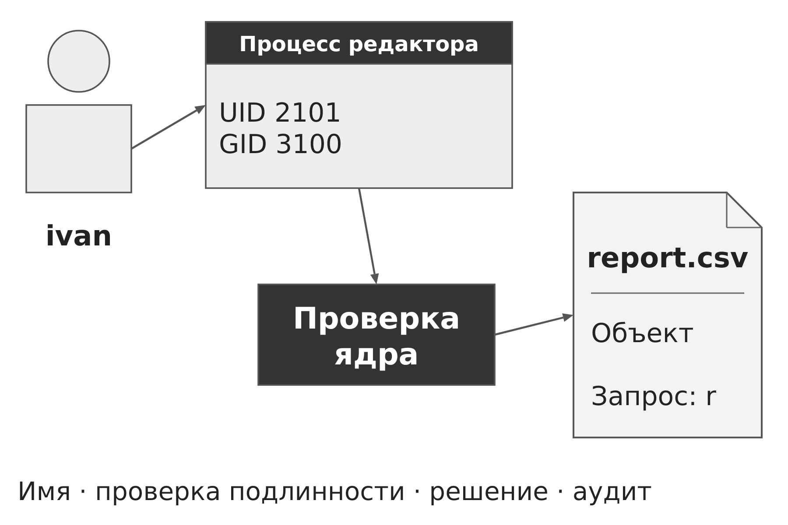

*Рисунок 1 — Контекст процесса и решение о доступе*

Сквозной пример лекции — оператор резервного копирования. Он должен видеть состояние определённого задания и запускать его по разрешению. Из этой функции не следует необходимость получать оболочку root или изменять программу резервирования. Такое разделение позволяет проследить роль всех изучаемых механизмов.

<a id="s2"></a>
## 2. Учётные записи и источники сведений

**Учётная запись** представляет субъекта в системе. Персональная запись связывается с человеком, служебная — с программой, административная — с функцией управления. Для каждой записи необходимо определить владельца, назначение, допустимые способы использования и срок доступа. Служебной записи обычно не требуется обычная интерактивная оболочка, хотя системный менеджер способен запускать процессы от её имени.

В Linux пользователь обозначается числовым **UID** — User Identifier, группа — **GID**, Group Identifier. Имена предназначены прежде всего для человека. При переименовании записи с сохранением UID числовой владелец файлов не меняется. Если же освободившийся UID назначить другому человеку, старые объекты с этим идентификатором могут оказаться связанными с новой записью. Имена не являются достаточной основой для проверки владения.

Для традиционной локальной базы используется несколько файлов. Их назначения сопоставлены в таблице 1, а раздельное хранение сведений поясняет рисунок 2.

**Таблица 1 — Локальные сведения об учётных записях**

| Файл | Назначение | Что важно учитывать |
|---|---|---|
| `/etc/passwd` | Имя, UID, основной GID, комментарий, домашний каталог, оболочка | Обычно доступен для чтения, не предназначен для открытого хранения паролей |
| `/etc/shadow` | Проверочное значение локального пароля и параметры сроков | Доступ к содержимому ограничивают |
| `/etc/group` | Имена групп, GID и списки явно записанных участников | Не заменяет сведения о группах работающего процесса |
| `/etc/gshadow` | Защищённые сведения о локальных группах | Пароли групп не следует рассматривать как обычную замену персональному входу |

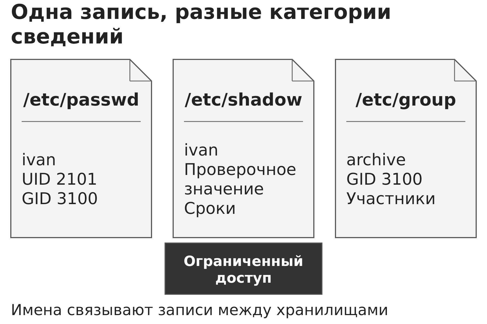

*Рисунок 2 — Раздельное хранение сведений о записи*

Например, условная строка имеет вид:

```text
ivan:x:2101:3100:Иван:/home/ivan:/bin/bash
```

Она описывает пользователя UID 2101 с основной группой GID 3100. Символ `x` в поле пароля означает использование отдельного хранилища проверочных данных; это не пароль и не его хеш. UID и GID принадлежат разным пространствам идентификаторов, поэтому их числовое совпадение допустимо. Комментарий не участвует в подтверждении подлинности. Оболочка и домашний каталог являются атрибутами запуска, а не доказательством разрешённого входа. Состав строки наглядно разобран на рисунке 3 [4].

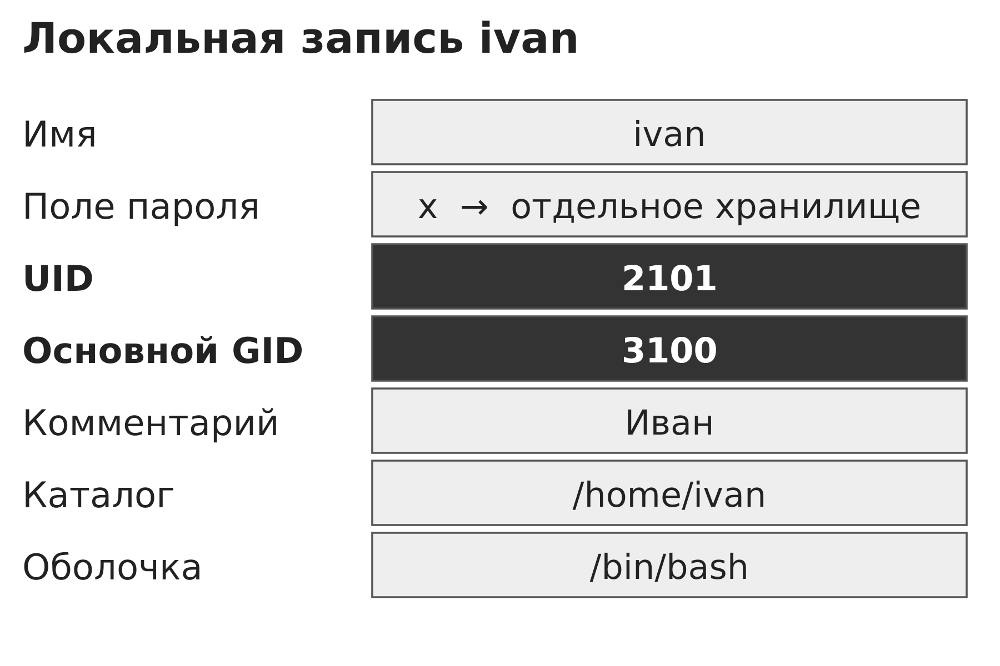

*Рисунок 3 — Поля локальной записи пользователя*

В `/etc/shadow` различаются срок действия пароля и срок действия всей записи. Префикс `!` в парольном поле блокирует использование соответствующего парольного значения. Из этого нельзя автоматически заключить, что запрещены все ключи, способы входа и действующие сеансы. Решение зависит от службы и её проверок [5].

**NSS**, Name Service Switch, выбирает источники сведений о пользователях и группах. Приложение обращается к системному интерфейсу, а ответ может поступить из локальных файлов или подключённого каталога. Поэтому чтение одного `/etc/passwd` и поиск записи в системе решают разные задачи:

```bash
getent passwd ivan
getent group archive
id
id ivan
```

Первые две команды запрашивают сведения через настроенные источники. `id` без имени показывает идентификаторы текущего процесса; `id ivan` получает сведения об указанной записи. Их выводы могут различаться после изменения членства или при использовании кэша каталога. Ошибка поиска может означать отсутствие записи, недоступность источника либо проблему разрешения имён.

<a id="s3"></a>
## 3. Управление пользователями и группами

Создание пользователя включает выбор атрибутов, подготовку домашнего каталога и настройку допустимого входа. В распространённых Linux-системах `useradd` предоставляет низкоуровневый интерфейс к локальным записям. Утилита `adduser` в системах семейства Debian служит более удобным интерфейсом, однако её наличие и значения по умолчанию зависят от дистрибутива. Эти команды не являются встроенными командами оболочки, а конкретная реализация должна проверяться на установленной системе.

Разберём условный пример для локального учебного пользователя. Команды предполагают административное разрешение, наличие выбранной оболочки и локальное управление записями:

```bash
sudo groupadd archive
sudo useradd -m -s /bin/bash -g archive ivan
getent passwd ivan
id ivan
```

Первая команда создаёт группу, если она ещё не существует. Параметр `-m` запрашивает создание домашнего каталога, `-s` задаёт оболочку, `-g` выбирает существующую основную группу. Последние команды проверяют сведения о созданной записи. Само выполнение `useradd` не является настройкой всей политики аутентификации. В доменной инфраструктуре локальные команды также не заменяют управление записью в каталоге.

Особенно важно различать изменение основной группы и дополнительных групп. Параметр `usermod -g` меняет основную группу. Параметр `-G` задаёт список дополнительных групп, а `-aG` добавляет членство к существующему списку. Поэтому визуально небольшое различие между командами существенно влияет на результат [6]:

```bash
sudo usermod -aG archive ivan
```

Эта команда добавляет `archive`. В отличие от неё, `sudo usermod -G archive ivan` задаёт новый список дополнительных групп и может убрать прежние членства, которых в нём нет. На рисунке 4 показаны исходный список и два разных результата. Основная группа в этом сравнении не изменяется.

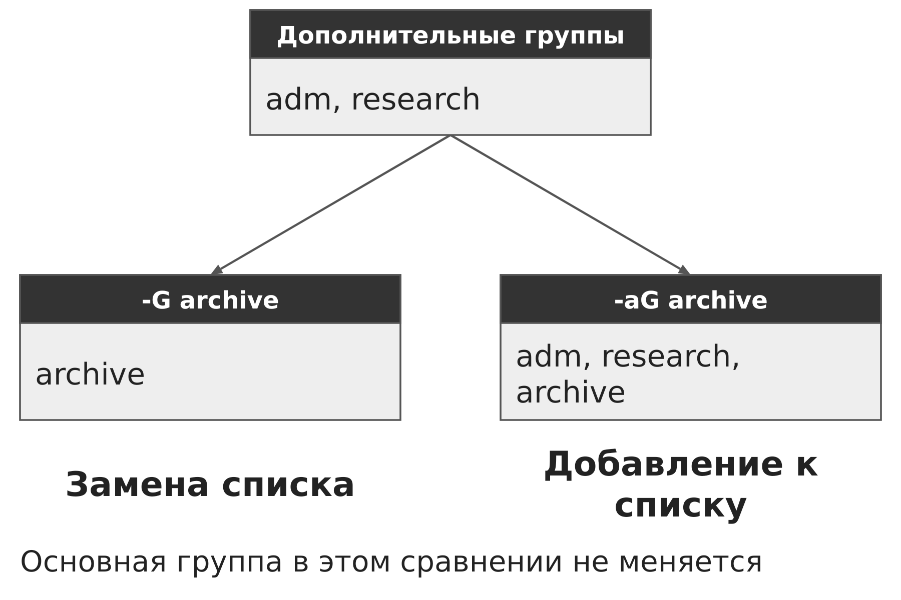

*Рисунок 4 — Добавление и замена дополнительных групп*

После изменения базы уже открытая оболочка обычно сохраняет прежний список групп. Новый вход формирует обновлённый контекст. Обратная ситуация принципиальна для безопасности: исключение из группы не отбирает её идентификатор у каждого работающего процесса. Кроме того, проверка политики sudo может получать сведения о группах отдельно, поэтому поведение файлового доступа и нового вызова sudo нельзя безусловно считать одинаковым.

Параметры записи изменяют штатными средствами, обеспечивающими согласованность данных. Ручная правка без блокировок и проверки связей может оставить несовпадающие записи. Для понимания механизма полезнее установить, какие атрибуты меняются и какие процессы уже получили их копию, чем запоминать длинный перечень ключей.

<a id="s4"></a>
## 4. Жизненный цикл и отзыв доступа

Жизненный цикл включает выдачу доступа, использование, изменение роли, периодический пересмотр и прекращение. При создании записи задают назначение и минимальные полномочия. При смене роли удаляют прежние права: добавление новых групп без удаления старых приводит к накоплению привилегий.

Нужно различать четыре действия: блокировку пароля, запрет новых входов, прекращение активных сеансов и работу с принадлежащими субъекту данными. Они действуют на разные объекты. Например, `passwd -l` или `usermod -L` блокируют парольное значение, но сами по себе не завершают открытый SSH-канал. Отключение записи в каталоге тоже не следует считать немедленным отзывом всех ранее выданных билетов и токенов.

Полный отзыв учитывает текущие процессы, удалённые подключения, ключи и отложенные задания. После этого проверяют владение файлами, передачу служебных данных и оставшиеся способы доступа. Прекращение процессов согласуют с назначением системы, поскольку незавершённая запись данных или служебная операция может требовать корректного завершения. Рисунок 5 поясняет различие между новым входом и существующей работой.

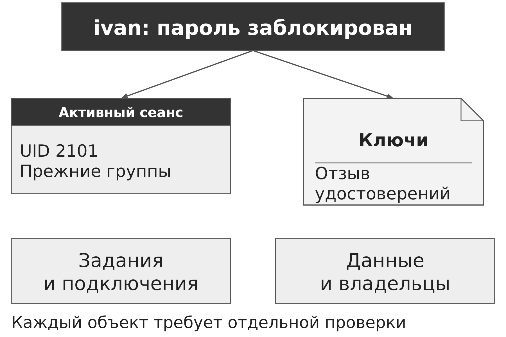

*Рисунок 5 — Объекты полного отзыва доступа*

Пример: оператора исключили из группы `archive`, а его старый редактор продолжает читать уже доступные ему файлы. Это не обязательно означает ошибку изменения базы. Сначала нужно выяснить контекст процесса и способ обращения к данным. Даже последующее изменение прав может иначе влиять на новые открытия файла и на уже открытый дескриптор. Поэтому отзыв рассматривают как управление действующими возможностями, а не как единственную команду удаления пользователя.

<a id="s5"></a>
## 5. Файловые права и каталоги

Для понимания групп необходима связь с файловым доступом. В традиционной модели **UGO**, User–Group–Other, объект имеет владельца, группу-владельца и права для остальных. Биты `r`, `w`, `x` обозначают разрешения чтения, записи и выполнения либо поиска в каталоге. Запись `-rw-r-----` описывает обычный файл: владелец может читать и писать, группа — читать, остальные не получают этих прав.

Числовая запись объединяет биты: чтение имеет вес 4, запись — 2, выполнение — 1. Поэтому `rw-` соответствует 6, `r--` — 4, `---` — 0. Режим `0640` не является рейтингом защищённости: он задаёт разные операции для разных классов. На рисунке 6 права сопоставлены с конкретным файлом и процессами.

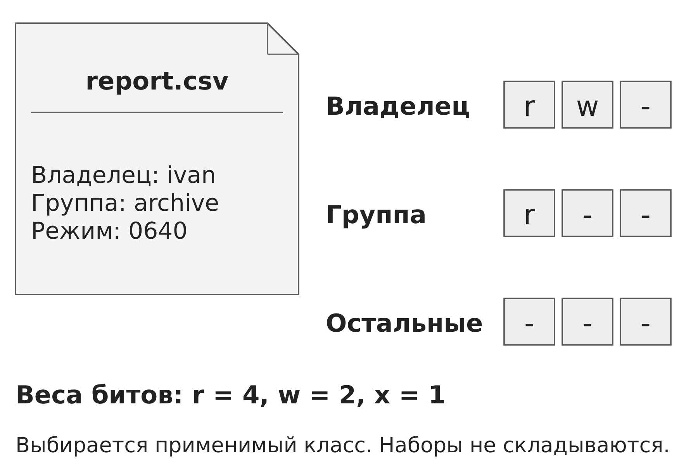

*Рисунок 6 — Проверка классов UGO для файла 0640*

При обычной проверке выбирается соответствующий класс, а не объединяются все три набора прав. Если процесс совпадает с владельцем, недостаток прав владельца нельзя компенсировать более широким набором «остальные». Для расширенных ACL алгоритм подробнее, но принцип выбора применимой записи остаётся существенным. Дополнительные механизмы защиты, параметры монтирования и привилегии также способны влиять на итог.

У каталога значения битов отличаются. `r` позволяет получать имена записей, `x` — выполнять поиск и проходить через каталог по известному имени, `w` — изменять набор записей при наличии необходимых сопутствующих прав. Чтобы прочитать `/srv/archive/report.csv`, процессу нужны права поиска по пути и разрешение чтения самого файла. Право чтения файла не гарантирует возможность пройти к нему через закрытый родительский каталог.

Удаление файла обычно связано с изменением записи в родительском каталоге. Поэтому запрет записи в содержимое файла не равнозначен запрету удаления его имени. Sticky bit добавляет ограничения для операций с чужими записями в общедоступном каталоге. На рисунке 7 отдельно показаны путь, каталог и содержимое файла.

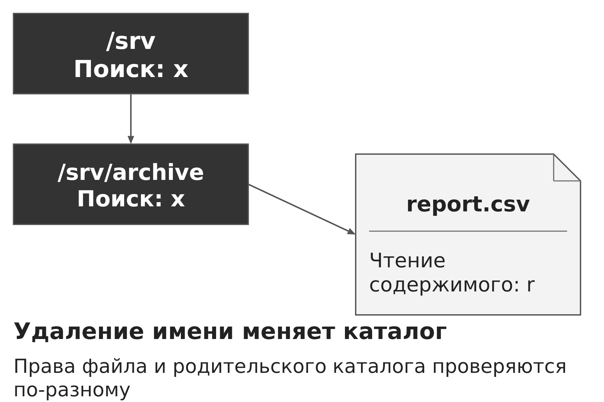

*Рисунок 7 — Путь к файлу и права поиска*

**umask** ограничивает обычные права вновь создаваемого объекта. Без default ACL действует побитовая операция `итог = запрошенный_режим & ~umask`, а не обычное арифметическое вычитание. Если программа запрашивает для файла `0666`, маска `0027` даёт `0640`. Для каталога при запросе `0777` результатом будет `0750`. Маска не добавляет выполнение к файлу, для которого программа его не запросила [7].

```text
Файл:    0666 & ~0027 = 0640
Каталог: 0777 & ~0027 = 0750
```

Особые биты рассматриваются здесь обзорно. SGID на каталоге позволяет новым объектам наследовать его группу по правилам файловой системы. Это не означает автоматического предоставления группе нужных прав. SUID на исполняемом файле может изменить эффективный UID, но действие подавляется при определённых условиях, например `nosuid` или `no_new_privs`. Наличие бита также не гарантирует безопасную реализацию привилегированной программы.

<a id="s6"></a>
## 6. ACL и наследование

Трёх классов UGO недостаточно, когда одному дополнительному пользователю требуется исключение. **ACL**, Access Control List, представляет дополнительные записи управления доступом. В распространённой модели POSIX ACL используются записи владельца, именованных пользователей, группы-владельца, именованных групп, маски и остальных. Структуру можно прочитать командой `getfacl`; изменение выполняет `setfacl`. Эти утилиты и поддержка ACL должны присутствовать в выбранной системе.

Важнейшая часть расширенного ACL — `mask`. Она ограничивает права именованных пользователей, группы-владельца и именованных групп. Для этих записей эффективный набор получается пересечением назначенного набора с маской. Права владельца и `other` этой маской не ограничиваются. Пример показан на рисунке 8 [8]:

```text
user::rw-
user:ivan:rw-       #effective:r--
group::r--
mask::r--
other::---
```

Пользователю `ivan` назначены чтение и запись, однако маска оставляет только чтение. На вопрос «почему запись запрещена?» нельзя ответить по одной строке `user:ivan`. Нужен полный ACL и контекст процесса. При расширенном ACL групповые биты в кратком выводе `ls -l` отражают маску, поэтому они не обязательно равны правам строки `group::`.

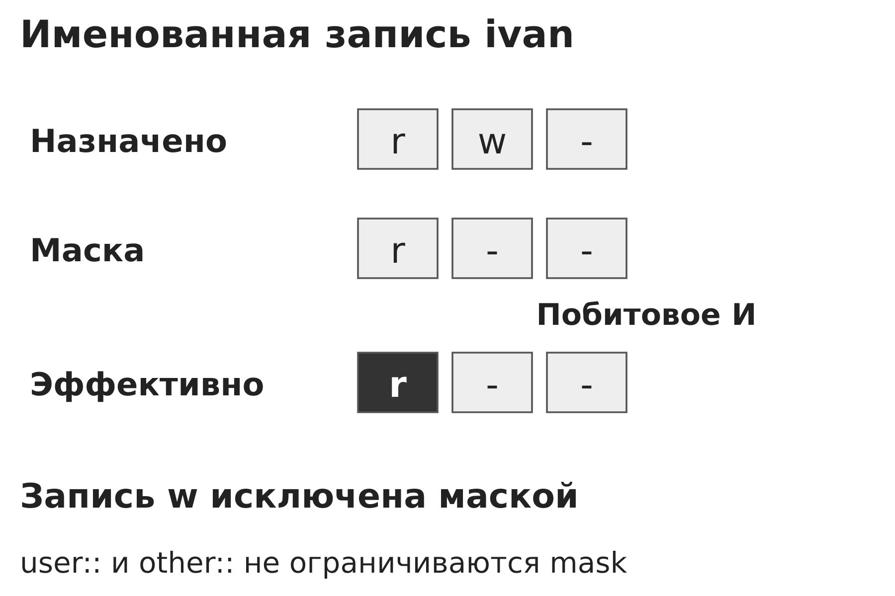

*Рисунок 8 — Назначенные права, маска и эффективный результат*

После изменения ACL маска может пересчитываться утилитой. В частности, `setfacl` обычно рассчитывает её заново, если маска не задана явно и не выбран режим сохранения. Поэтому при анализе важен результат `getfacl`, а не только текст выполненной команды. С другой стороны, `chmod` при расширенном ACL может затронуть маску и изменить эффективные права нескольких записей. Представление «ACL существует независимо от обычных битов» приводит к ошибкам [9].

**Access ACL** управляет доступом к существующему объекту. **Default ACL** каталога задаёт исходную основу ACL новых объектов. Он не распространяет изменения на все ранее созданные файлы. Для нового объекта наследование также ограничивается режимом, который запросила программа: нельзя получить выполнение обычного файла только потому, что `x` встречается в default ACL. При наличии default ACL применяется механизм наследования с ограничением запрошенным режимом, а не упрощённая формула одной umask. На рисунке 9 сопоставлены новый и существующий файлы.

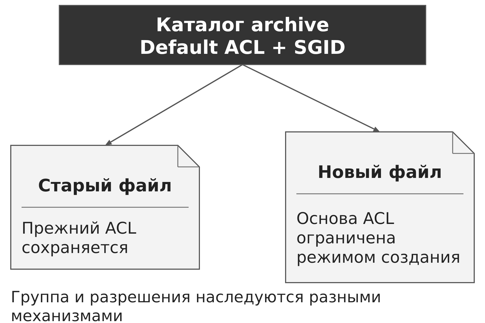

*Рисунок 9 — Default ACL и создание новых объектов*

SGID и default ACL решают разные задачи: первый влияет на группу новых объектов, второй — на исходные записи прав. Например, совместный каталог может передавать файлам группу `archive`, но без подходящих прав эта группа всё равно не сможет изменять содержимое. И наоборот, широкие права не устраняют необходимость контролировать владельца и назначение каталога.

POSIX ACL не следует буквально отождествлять со списками Windows: состав записей, порядок обработки и поддержка явных запретов различаются. Мандатные ограничения Astra Linux также не сводятся к POSIX ACL. Это граница перехода к следующей теме курса.

<a id="s7"></a>
## 7. Парольная политика и дополнительные факторы

Парольная проверка должна подтверждать знание секрета без открытого хранения самого пароля. Для локальной проверки сохраняют результат специального парольного преобразования с солью и параметрами стоимости. При входе система вычисляет значение для предъявленного пароля и сопоставляет его с сохранённым. Соль является несекретным индивидуальным параметром, а стоимость функции увеличивает затраты на проверку догадок.

При онлайн-подборе атакующий обращается к работающей службе. Задержки и ограничения частоты уменьшают число попыток, журналирование позволяет обнаружить отклонение. При офлайн-подборе по копии базы система уже не видит вычислений атакующего. Поэтому блокировка записи не останавливает такой перебор: важны стойкость секрета и стоимость преобразования. Это различие иллюстрирует рисунок 10.

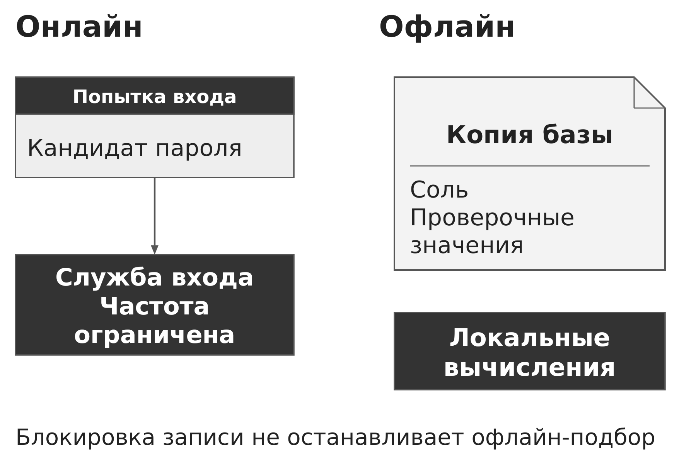

*Рисунок 10 — Онлайн- и офлайн-проверка догадок*

Парольная политика должна учитывать длину и уникальность секрета, распространённые и скомпрометированные значения, ограничения попыток и восстановление. Формальная смесь символов не гарантирует непредсказуемости. Современные рекомендации NIST не рассматривают обязательную периодическую смену без признаков компрометации как универсальную меру. При этом применимые требования организации учитываются отдельно [10].

**MFA**, Multi-Factor Authentication, использует подтверждения разных категорий. Пароль относится к знанию, криптографический ключ или устройство — к владению. Биометрия может применяться для активации аутентификатора. Пароль и секретный вопрос остаются проверками одной категории. Надёжность также зависит от регистрации нового устройства и восстановления: слабый резервный путь может обесценить сильный основной вход.

**TOTP**, Time-based One-Time Password, получает код из общего секрета и временного интервала. Сервер ограничивает время принятия и предотвращает повторное принятие уже использованного значения. Однако фишинговый посредник способен немедленно передать свежий код настоящему сервису. На рисунке 11 показана именно передача в пределах допустимого окна.

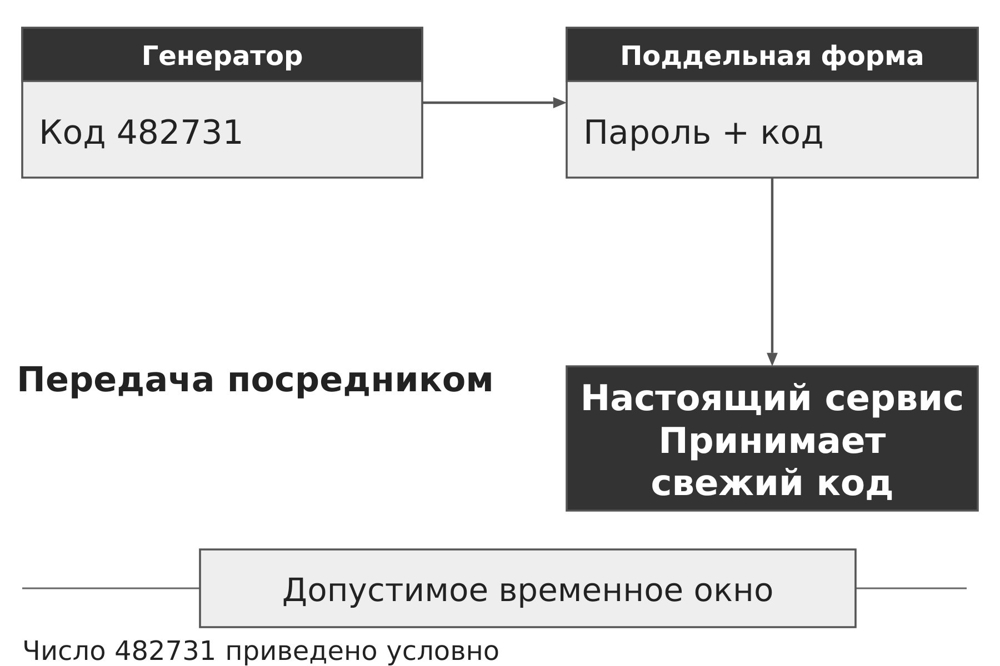

*Рисунок 11 — Временной интервал TOTP и передача кода*

WebAuthn использует криптографические удостоверения и проверку контекста стороны, которой предназначен ответ. Закрытый ключ не передаётся проверяющему сервису, а пригодность ответа зависит от контекста запроса. Это помогает противодействовать типичному фишингу переносимых кодов. Нужно учитывать как аппаратные, так и синхронизируемые удостоверения, а также их восстановление. Защищённый вход при этом не отменяет контроль уже открытого сеанса [15].

<a id="s8"></a>
## 8. Контекст Linux и токены Windows

После входа программа работает с определённым контекстом безопасности. В Linux к нему относятся реальные, эффективные и сохранённые идентификаторы, дополнительные группы и другие атрибуты. Для файловых проверок предусмотрены FSUID/FSGID, обычно совпадающие с эффективными. Дочерние процессы наследуют соответствующие атрибуты, а специальные разрешённые механизмы способны их менять. Запись пользователя в каталоге и действующий контекст процесса нельзя считать одной сущностью [11].

В Windows контекст представлен системным **токеном доступа**. В нём находятся SID пользователя и групп, привилегии и другие атрибуты. **SID**, Security Identifier, обозначает субъект безопасности. Процесс имеет первичный токен; поток при предусмотренных условиях может использовать токен олицетворения для выполнения операции от имени клиента [12].

На рисунке 12 показан состав первичного токена. Это объект ОС, а не строка пароля и не обязательно переносимое подтверждение входа в веб-сервис. Веб-токен проверяется приложением и сам по себе не меняет UID процесса веб-сервера. Поэтому вошедший в браузере `ivan` и служебная запись сервера существуют на разных уровнях управления доступом.

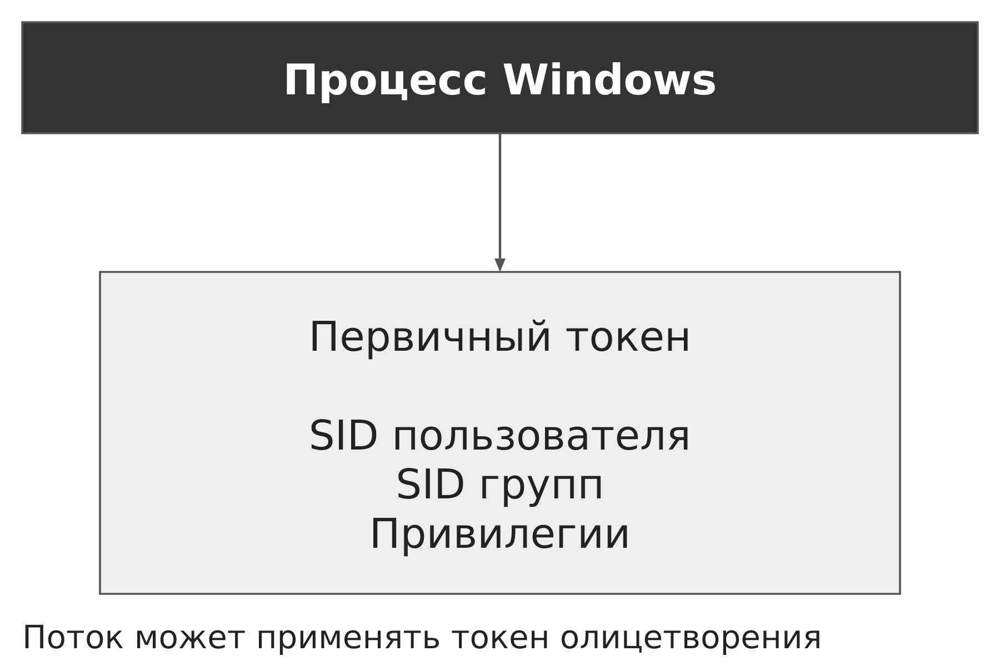

*Рисунок 12 — Первичный токен доступа Windows*

<a id="s9"></a>
## 9. PAM: сервис, группы управления и стек

Если каждая служба самостоятельно реализует все проверки входа, изменение политики потребует переделки многих приложений. **PAM**, Pluggable Authentication Modules, позволяет подключать проверки через общий интерфейс. Поддерживающее PAM приложение выбирает имя сервиса, библиотека читает конфигурацию и вызывает модули согласно стеку. NSS ищет сведения о записи, PAM организует проверки использования сервиса; эти функции не взаимозаменяемы.

Обычно конфигурации Linux-PAM находятся в `/etc/pam.d/`. Имя файла соответствует сервису, например `sudo` или `sshd`. Использование PAM зависит от программы и выбранного способа входа. Например, SSH может подтвердить владение ключом собственным механизмом, а связанные проверки состояния записи и сеанса выполнить через PAM. Поэтому утверждение «вся аутентификация Linux всегда выполняется одним стеком» неверно. На рисунке 13 связаны приложение, конфигурация и модули; точный порядок проверок задаёт конфигурация.

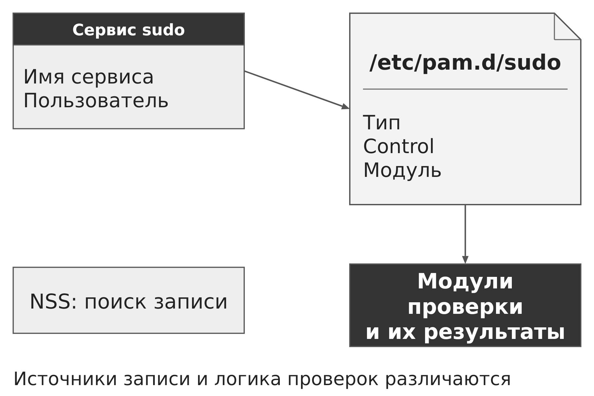

*Рисунок 13 — Приложение, конфигурация PAM и модули*

Четыре группы управления сопоставлены в таблице 2. Это категории вызовов, а не требование выполнять четыре шага подряд при каждом входе [13].

**Таблица 2 — Группы управления PAM**

| Тип | Назначение | Пример |
|---|---|---|
| `auth` | Подтверждение подлинности и связанные операции с удостоверениями | Проверка предъявленного секрета |
| `account` | Допустимость использования записи | Проверка срока или ограничения входа |
| `password` | Изменение аутентификационного секрета | Обновление пароля |
| `session` | Действия при открытии и закрытии сеанса | Ограничения ресурсов, регистрация событий |

Разобранный пример: пароль подтверждён, но запись просрочена. Группа `auth` может дать успех, а `account` — отказать. Это закономерный результат раздельных проверок. Изменение пароля через `password` представляет другую операцию. Ошибки частичного открытия сеанса требуют корректного завершения уже выполненных действий.

Строка конфигурации обычно включает тип, управляющее условие, модуль и аргументы:

```text
auth required pam_unix.so
```

Она показывает синтаксис, но не является готовой заменой реального стека. `required` учитывает обязательный отказ, обычно продолжая обработку. `requisite` при отказе прекращает обработку. `sufficient` может досрочно завершить стек успешно при отсутствии предшествующего обязательного отказа. `optional` обычно не определяет итог при наличии других значимых проверок. Расширенные конструкции задают действия по кодам возврата и могут пропускать следующие модули.

Следовательно, наличие двух строк проверки ещё не доказывает MFA. Если первый успех завершает стек, второй фактор может не запрашиваться. На рисунке 14 показана требуемая логика двух обязательных факторов. Все четыре сочетания исходов сведены в таблицу 3; после успеха `auth` проверка `account` остаётся отдельной.

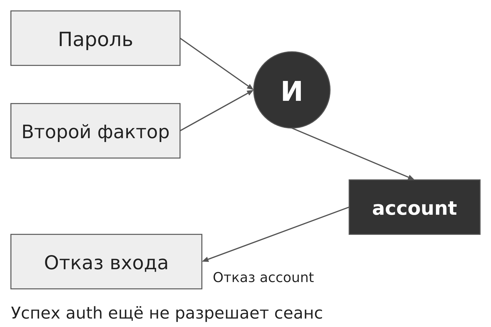

*Рисунок 14 — Два обязательных фактора и отдельная проверка account*

**Таблица 3 — Два обязательных фактора в учебной модели**

| Пароль | Второй фактор | Результат подтверждения подлинности |
|---|---|---|
| Успех | Успех | Успех |
| Успех | Отказ | Отказ |
| Отказ | Успех | Отказ |
| Отказ | Отказ | Отказ |

В Astra Linux стек может включать модули подсистемы PARSEC, необходимые для действующей политики. Поэтому нельзя переносить чужой минимальный пример с удалением штатных проверок. Перед изменением учитывают редакцию ОС, включаемые файлы, установленные модули и все используемые пути входа. Сохраняют рабочий административный канал и предусматривают консольное восстановление. Успешная проверка одного входа не подтверждает обработку отказов.

<a id="s10"></a>
## 10. su, sudo и правила делегирования

**su** переключает контекст пользователя и обычно запускает оболочку. В типичном локальном сценарии вызывающий подтверждает возможность перехода с помощью секрета целевой записи, однако реальная проверка зависит от политики и PAM. Вариант `su - имя` формирует окружение, приближённое к входному сеансу целевой записи. Сохранение и очистка переменных без дефиса зависят от реализации и настройки, поэтому значения проверяют, а не предполагают.

**sudo** запускает разрешённую операцию в целевом контексте согласно политике. При этом отдельно решаются три вопроса: разрешена ли команда, требуется ли подтверждение подлинности сейчас и от имени кого она будет выполнена. Обычно проверяется вызывающий пользователь, но политика допускает и другие варианты. Действующая временная отметка может устранить повторный запрос секрета; отсутствие запроса не означает отсутствия проверки разрешения.

Из этого следует, что правильный пароль не позволяет выполнить запрещённую команду. И наоборот, `NOPASSWD` меняет требование подтверждения подлинности для разрешения, но не предоставляет все административные возможности. На рисунке 15 отдельно показаны решение политики, подтверждение подлинности и запуск целевого процесса.

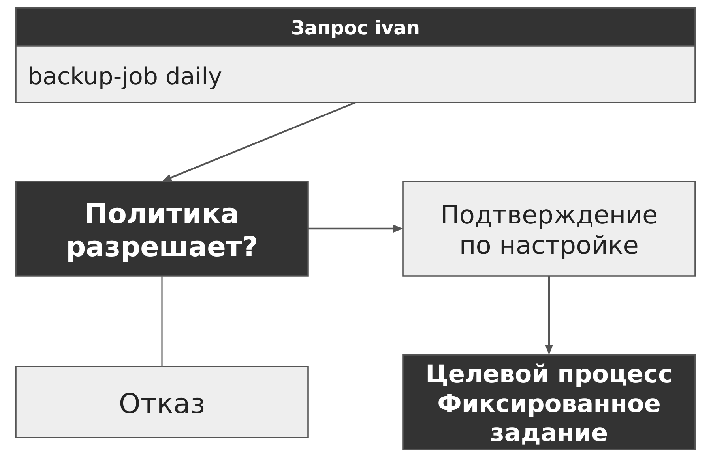

*Рисунок 15 — Разрешение, подтверждение и целевой запуск*

В традиционной политике `sudoers` правило задаёт вызывающего пользователя или группу, хост, целевого пользователя и группу, теги и команду с аргументами. Разберём условную запись для заранее установленного и защищённого посредника:

```sudoers
%backup-operators ALL=(root) /usr/local/sbin/backup-job daily
```

Здесь `%backup-operators` обозначает группу инициаторов, `ALL` — область хостов в данном правиле, `(root)` — целевую запись. Разрешён конкретный исполняемый файл с фиксированным аргументом `daily`. Эта строка описывает политику, а не существование программы: посредник должен быть реализован, проверен и недоступен оператору для изменения. На рисунке 16 выделены смысловые части правила.

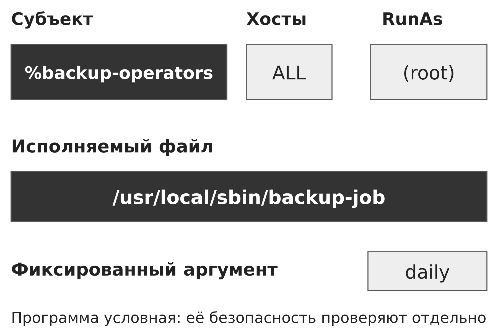

*Рисунок 16 — Смысловые части правила sudoers*

Отсутствие явно заданных аргументов у команды в sudoers обычно означает возможность передавать любые аргументы. Специальная пустая строка `""` задаёт запрет аргументов для соответствующего правила. Синтаксис регулярных выражений и другие возможности зависят от версии sudo, поэтому их сверяют с локальным руководством. Политика также может приходить из централизованного источника, а не только из локального файла.

Для просмотра действующих возможностей полезны `sudo -l` и сведения о версии `sudo -V`. Проверка синтаксиса выполняется `visudo`, в том числе `visudo -c`. Синтаксически допустимое правило всё ещё может давать избыточные полномочия.

<a id="s11"></a>
## 11. Окружение, редакторы и зависимости

Безопасность делегирования определяется достижимыми действиями программы. Редактор, интерпретатор или оболочка обычно позволяет больше операций, чем следует из названия одного файла в правиле. Символы подстановки в аргументах способны расширять допустимый запрос. Поэтому политика требует анализа фактического сопоставления, а не только внешне узкой строки.

**sudoedit** предназначен для редактирования разрешённых файлов с запуском редактора в непривилегированном контексте пользователя. Используются временные копии и контролируемая запись изменений. При этом sudoedit не является универсальным валидатором синтаксиса произвольной конфигурации. **visudo** решает специальную задачу редактирования и проверки синтаксиса sudoers. Даже проверка синтаксиса не доказывает безопасность смыслового содержимого файла [14].

Изменяемая конфигурация сама может являться административным полномочием. Например, если оператор не может вызвать root-оболочку, но способен изменить сценарий, который root запускает по расписанию, фактические возможности шире исходной задачи. Следует проверять права на посредник, его родительские каталоги, подключаемые модули, сценарии и конфигурацию. На рисунке 17 показаны именно зависимости разрешённого запуска.

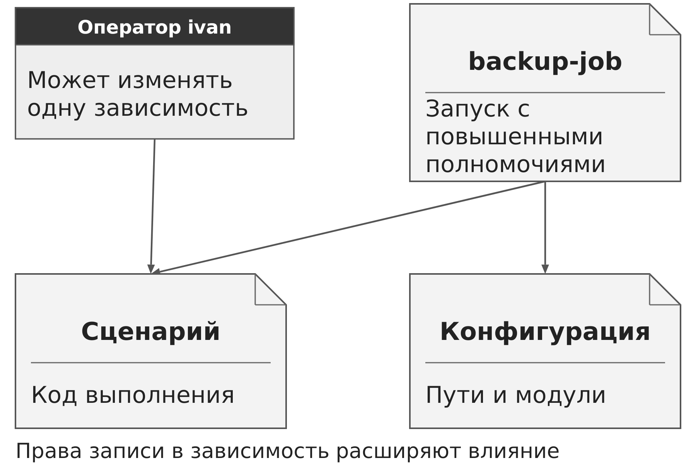

*Рисунок 17 — Цепочка доверия привилегированной программы*

Переменные окружения, рабочий каталог и поиск программ также влияют на поведение. Ограниченное окружение и доверенные пути уменьшают риск, но не исправляют программу, которая сама принимает опасные команды или загружает доступный пользователю код. Механизм ограничения выбирают после анализа функции, а не используют общий запретительный список как доказательство полноты защиты.

<a id="s12"></a>
## 12. Сквозной пример и аудит

Вернёмся к оператору резервного копирования. Пользователь `ivan` входит под персональной записью и проходит назначенные проверки. Дополнительная группа `backup-operators` связывает его с конкретной административной ролью. Для чтения отчётов используется группа файлового доступа либо ограниченный ACL. Для запуска задания действует отдельное разрешение sudo.

Служба `backupsvc` выполняет резервирование с набором прав, необходимым её функции. Посредник принимает только допустимый идентификатор задания, а оператор не может изменить исполняемый файл, конфигурацию и источники команд. Если резервирование требует чтения защищённых данных, это полномочие принадлежит ограниченной службе или проверенному механизму, а не автоматически всем программам персонального пользователя.

**Принцип наименьших привилегий** требует связать доступ с функцией и временем. Недостаточно создать разные имена, если всем записям выданы одинаковые права. Полезно проверять, какие действия станут возможны при компрометации каждого компонента. В конце раздела схема соберёт разделение инициатора, посредника и исполнителя; перед этим рассмотрим наблюдаемость их действий.

Аудит должен позволять сопоставить вход, контекст, запрос повышения, запуск и результат операции. Набор полей зависит от настроенных источников. Журнал sudo сам по себе не доказывает, что определённый файл изменился: для этого нужны события ОС или приложения. Синхронизация времени, защита журналов и установленная реакция помогают расследованию. Пароли, одноразовые коды и закрытые ключи в журнал не помещают. Рисунок 18 иллюстрирует анализ событий.

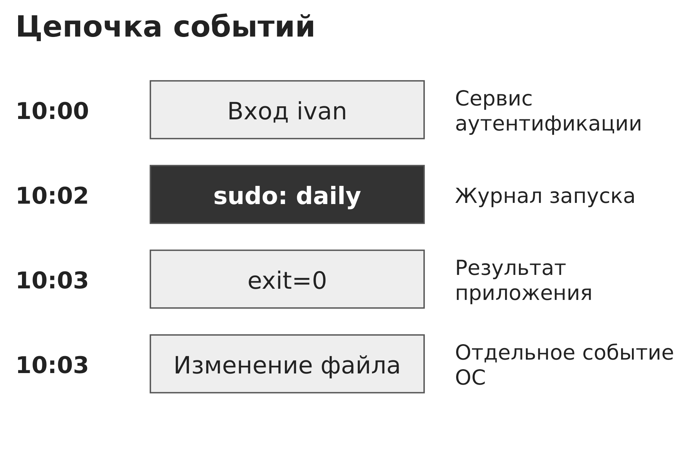

*Рисунок 18 — Сопоставление событий аудита*

После смены роли исключение из группы дополняют проверкой сеансов, ключей и заданий. Данные передают новому владельцу, а результат отзыва подтверждают по фактическому состоянию системы. Таким образом, управление пользователем, файловые права, PAM, sudo и аудит образуют согласованную архитектуру, представленную на рисунке 19.

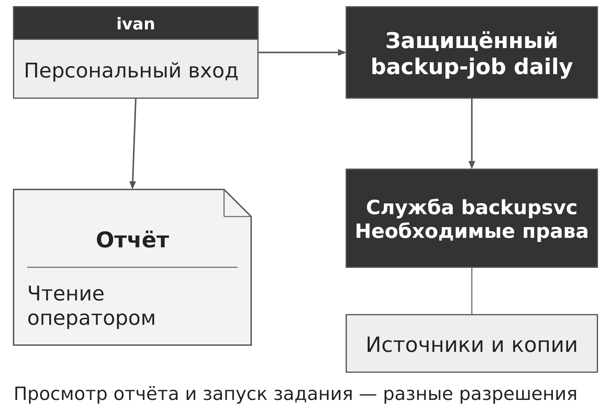

*Рисунок 19 — Разделение оператора, посредника и службы*

Разберём два характерных отказа. В первом `getent` показывает новое членство, а старая оболочка не читает файл. Возможны прежний список групп процесса, недостаток `x` на пути или ограничение маски ACL. Во втором пароль принимается, но вход запрещён: проверяют состояние записи, второй фактор и открытие сеанса. В обоих случаях изменение случайного параметра без определения этапа отказа затрудняет диагностику.

<a id="s13"></a>
## 13. Итоги и вопросы для самоконтроля

Учётная запись представляет субъекта, а действие выполняет процесс с определённым контекстом. Сведения о записи и действующие полномочия могут обновляться в разное время. Файловые права и ACL определяют допустимые обращения к объектам; PAM организует проверки использования сервиса; sudo делегирует установленную операцию. Надёжность системы зависит от всей цепочки выдачи, использования и отзыва доступа.

1. Чем идентификация отличается от аутентификации и авторизации?
2. Почему переименование пользователя и изменение UID имеют разные последствия?
3. Что означает `x` в парольном поле `/etc/passwd`?
4. Почему `getent passwd ivan` и чтение `/etc/passwd` могут давать разные сведения?
5. Чем `usermod -G` отличается от `usermod -aG`?
6. Почему исключение из группы не всегда немедленно меняет файловый доступ старого процесса?
7. Что означают `r`, `w`, `x` для каталога? От чего зависит удаление имени файла?
8. Почему нельзя объединять права владельца и остальных при выборе класса UGO?
9. Какова роль umask и почему побитовую операцию нельзя заменять вычитанием?
10. Какие записи ограничивает маска ACL? Почему `user:ivan:rw-` не гарантирует запись?
11. Чем access ACL отличается от default ACL? Что меняется для существующих объектов?
12. Чем онлайн-подбор отличается от офлайн-подбора?
13. Почему два секрета одной категории не образуют два разных фактора?
14. Чем токен Windows отличается от веб-токена?
15. Какие задачи решают группы `auth`, `account`, `password`, `session`?
16. При каких условиях `sufficient` может исключить выполнение второго фактора?
17. Почему пример минимального стека нельзя переносить поверх штатной конфигурации Astra Linux?
18. Чем разрешение sudo отличается от подтверждения подлинности при его вызове?
19. Какие части содержит правило sudoers и чем опасны произвольные аргументы?
20. Почему sudoedit и visudo не являются взаимозаменяемыми средствами проверки?
21. Как доступ на запись к зависимости расширяет возможности оператора?
22. Какие события нужны, чтобы подтвердить изменение объекта после запуска sudo?
23. Какие действия входят в полный отзыв полномочий оператора backup?

<a id="sources"></a>
## 14. Источники

1. ALD Pro. **Модуль 8. Управление пользователями и группами**. <https://www.aldpro.ru/professional/ALSE_Module_08/users_and_group_management.html>.
2. ALD Pro. **Модуль 9. Работа с правами доступа, ACL**. <https://www.aldpro.ru/professional/ALSE_Module_09/ACL_access_rights.html>.
3. ALD Pro. **Модуль 10. Система аутентификации PAM и управление правами SUDO**. <https://www.aldpro.ru/professional/ALSE_Module_10/PAM_and_SUDO.html>.
4. Linux man-pages. **passwd(5)**. <https://man7.org/linux/man-pages/man5/passwd.5.html>.
5. Shadow utilities. **shadow(5)**. <https://man7.org/linux/man-pages/man5/shadow.5.html>.
6. Shadow utilities. **usermod(8)**. <https://man7.org/linux/man-pages/man8/usermod.8.html>.
7. Linux man-pages. **umask(2)**. <https://man7.org/linux/man-pages/man2/umask.2.html>.
8. Linux ACL Project. **acl(5)**. <https://man7.org/linux/man-pages/man5/acl.5.html>.
9. Linux ACL Project. **setfacl(1)**. <https://man7.org/linux/man-pages/man1/setfacl.1.html>.
10. NIST. **SP 800-63B-4: Authentication and Authenticator Management**. <https://pages.nist.gov/800-63-4/sp800-63b.html>.
11. Linux man-pages. **credentials(7)**. <https://man7.org/linux/man-pages/man7/credentials.7.html>.
12. Microsoft Learn. **Access Tokens**. <https://learn.microsoft.com/en-us/windows/win32/secauthz/access-tokens>.
13. Linux-PAM. **pam.conf(5)**. <https://man7.org/linux/man-pages/man5/pam.conf.5.html>.
14. Sudo Project. **sudo(8), sudoedit(8), sudoers(5)**. <https://man7.org/linux/man-pages/man8/sudoedit.8.html>; <https://www.sudo.ws/docs/man/1.9.14/sudoers.man.pdf>.
15. W3C. **Web Authentication: Level 2**. <https://www.w3.org/TR/webauthn-2/>.

Исходная учебная программа: предоставленная РПД по дисциплине «Операционные системы», темы 8–9. Дата проверки электронных материалов: 22 октября 2026 года. Конкретные команды, пути и доступные механизмы сверяются с установленной версией Astra Linux и локальной политикой.
