# Лекция 9. Модели разграничения доступа

**Дисциплина:** «Операционные системы». **Специальность:** 10.05.01 «Компьютерная безопасность», специализация «Безопасность компьютерных систем и сетей». **Уровень:** университет, 3-й курс. **Продолжительность:** 2 академических часа, 90 минут.

Лекция продолжает тему пользователей, групп и аутентификации. Теперь предмет изучения — решение об операции уже установленного субъекта. Материал охватывает дискреционное, мандатное и ролевое управление, ACL, capabilities, SUID/SGID, метки и информационные потоки; он подготавливает к теме 10 об архитектуре безопасности Astra Linux и связан с практическими темами 5 и 9.

DAC (Discretionary Access Control) означает дискреционное управление; MAC (Mandatory Access Control) — мандатное; RBAC (Role-Based Access Control) — ролевое. ACL (Access Control List) — список контроля доступа. Эти термины обозначают разные уровни описания: организационная политика определяет допустимое поведение, модель формализует его, а механизмы ОС исполняют правила.

Сквозной пример — учебный проект с разработчиком, службой резервного копирования и аудитором. Одни и те же субъекты и объекты помогут сравнить модели по тому, какие операции они разрешают и какие риски оставляют.

## Оглавление

- [Учебная цель и план занятия](#lecture-plan)
- [9.1. Матрица доступа и базовые принципы](#sec-9-1)
- [9.2. Дискреционное управление доступом в Linux](#sec-9-2)
- [9.3. Мандатное и ролевое управление доступом](#sec-9-3)
- [9.4. SUID/SGID, Linux capabilities и комбинирование политик](#sec-9-4)
- [Прикладной разбор](#case)
- [Итоги лекции](#summary)
- [Вопросы для самоконтроля](#questions)
- [Глоссарий](#glossary)
- [Источники](#sources)

<a id="lecture-plan"></a>


## Учебная цель и план занятия

**Цель лекции:** сформировать целостное представление о том, как операционная система описывает, вычисляет и принудительно реализует права доступа, а также научить различать дискреционные, мандатные и ролевые модели и проверять их фактическое действие.

<a id="intro-0"></a>

### Планируемые результаты

- строить матрицу доступа для заданного набора субъектов, объектов и операций;

- объяснять различие ACL и capability list как двух проекций одной матрицы;

- вычислять эффективные права Linux с учётом UID/GID, mode bits, POSIX ACL и маски;

- различать правила конфиденциальности Bell–LaPadula и целостности Biba;

- проектировать роли, иерархии и ограничения разделения обязанностей в RBAC;

- сопоставлять SUID/SGID и Linux capabilities по масштабу делегируемых полномочий;

- составлять позитивные, негативные и регрессионные тесты для политики доступа.

<a id="intro-1"></a>

### Предварительные знания

Студент должен понимать различие пользователя и процесса, назначение UID/GID, роль системного вызова и базовые свойства файловой системы Linux. Понятия аутентификации и сессии используются как уже изученные: эта лекция начинается с момента, когда субъект установлен и ОС должна решить, допустима ли конкретная операция над объектом.

<a id="intro-2"></a>

### Структура и время

В таблице 1 показано распределение содержания по четырём блокам занятия.

Таблица 1 — Структура лекции и распределение 90 минут

| Блок | Содержание | Время |
| --- | --- | --- |
| 9.1 | Матрица доступа, монитор обращений, ACL и capabilities | 20 мин |
| 9.2 | Дискреционная модель Linux: mode bits, ACL, наследование | 30 мин |
| 9.3 | Мандатные и ролевые модели: Bell–LaPadula, Biba, RBAC | 25 мин |
| 9.4 | SUID/SGID, capabilities, комбинирование и проверка | 15 мин |

На рисунке 1 показано, почему два обращения одного процесса к одному файлу могут получить разные решения.

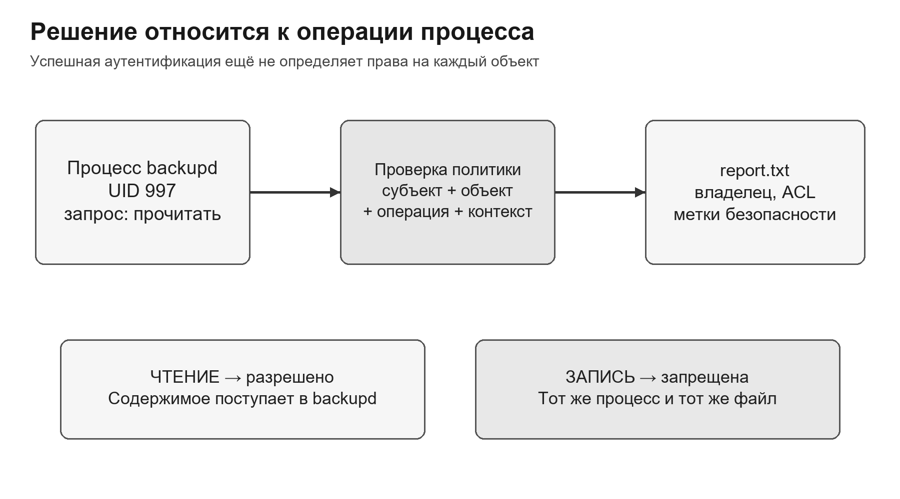

<p align="center">Рисунок 1 — Базовая цепочка контроля доступа</p>

<a id="sec-9-1"></a>

## 9.1. Матрица доступа и базовые принципы

Материалы для углубления: [S1](#source-s1) [S2](#source-s2).

Политика доступа отвечает не на абстрактный вопрос «доверяем ли пользователю», а на точный вопрос: может ли данный субъект выполнить указанную операцию над данным объектом в текущем контексте.

<a id="sec-9-1-1"></a>

### 9.1.1. Субъект, объект, операция и право

Субъектом доступа является активная сущность, от имени которой инициируется обращение: процесс пользователя, системная служба, контейнерный процесс или поток ядра. Пользовательская учётная запись важна, но решение ядра обычно относится к конкретному процессу и его текущим атрибутам. После входа разные процессы одного пользователя могут иметь разные дополнительные группы, capabilities, роли или мандатные метки.

Объект — ресурс, над которым выполняется контролируемая операция. Объектом может быть файл, каталог, сокет, сегмент разделяемой памяти, процесс, очередь сообщений, устройство, интерфейс управления или запись конфигурации. Набор операций зависит от типа объекта: для файла существенны чтение, изменение и исполнение; для каталога — просмотр имён, создание записей и проход по компонентам пути; для процесса — отправка сигнала, трассировка или изменение параметров.

Право доступа — не свойство субъекта само по себе, а разрешённая связь между субъектом, объектом и операцией. Формулировка «Иван имеет доступ» неполна. Корректно: «процесс с эффективным UID Ивана может читать /project/report.txt, но не может изменять его и не может удалить запись из родительского каталога». Последнее уточнение важно: удаление файла проверяется по правам каталога, а не по праву записи в сам файл.

В таблице 2 приведено сопоставление: элементы запроса доступа.

Таблица 2 — Элементы запроса доступа

| Элемент | Пример | Что проверяет ОС |
| --- | --- | --- |
| Субъект | процесс backupd с UID 997 | credentials, группы, capabilities, метка |
| Объект | /srv/project/report.txt | владелец, группа, ACL, тип объекта, метка |
| Операция | open(..., O_RDONLY) | соответствует ли чтению и разрешён ли проход по пути |
| Контекст | служба в отдельном namespace | дополнительные ограничения домена и среды |

<a id="sec-9-1-2"></a>

### 9.1.2. Эталонный монитор обращений

Классическая архитектура контроля доступа опирается на эталонный монитор обращений — компонент, через который проходят все значимые обращения субъектов к объектам. Он вычисляет решение по политике и текущему контексту, разрешает или отклоняет операцию и при необходимости формирует событие аудита. В ОС эту функцию выполняет не одна программа, а совокупность проверок ядра и доверенных служб.

К эталонному монитору предъявляют три требования. Полнота посредничества означает, что обращение нельзя выполнить через альтернативный интерфейс без проверки. Защищённость означает, что непривилегированный субъект не может изменить сам механизм и его данные. Проверяемость требует такой компактности и структуры доверенной базы, чтобы реализацию можно было анализировать и тестировать. Если приложение сначала само проверяет имя файла, а затем передаёт его привилегированной службе без повторной проверки объекта, полнота посредничества нарушается.

Полнота посредничества означает, что разрешение должно быть обосновано политикой в точке контроля. Это не означает повторную проверку файлового ACL при каждом read(). В обычном Linux проверка DAC при open() позволяет получить дескриптор; последующий chmod обычно не закрывает уже открытый доступ. Долгоживущие группы процесса, дескрипторы и кэши решений — разные механизмы, и отзыв должен учитывать каждый из них. Изменение базы групп не является командой переписать credentials существующих процессов. [S4](#source-s4) [S12](#source-s12)

Рисунок 2 связывает три требования к монитору с несколькими путями обращения к ресурсу.

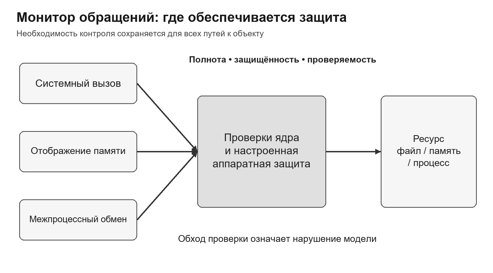

<p align="center">Рисунок 2 — Эталонный монитор обращений и его свойства</p>

<a id="sec-9-1-3"></a>

### 9.1.3. Матрица доступа

Матрица доступа — абстрактная модель текущего состояния политики. Строки соответствуют субъектам или доменам защиты, столбцы — объектам, а каждая ячейка содержит множество разрешённых операций. Матрица не обязана буквально храниться в памяти: это язык описания, позволяющий сравнивать реализации и рассуждать об изменении прав.

Рассмотрим четыре субъекта и три объекта. Алиса разрабатывает проект и может читать и изменять рабочий файл. Бобу разрешено только чтение. Служба резервного копирования читает рабочий файл и записывает архив. Аудитор читает журнал, но не рабочие данные. Такая модель сразу показывает избыточные связи: если backupd получит право записи в project.txt, это будет отдельное расширение поверхности ошибки, а не «техническая мелочь».

Рисунок 3 показывает конкретные ячейки политики проекта; отсутствие write у backupd — самостоятельное ограничение.

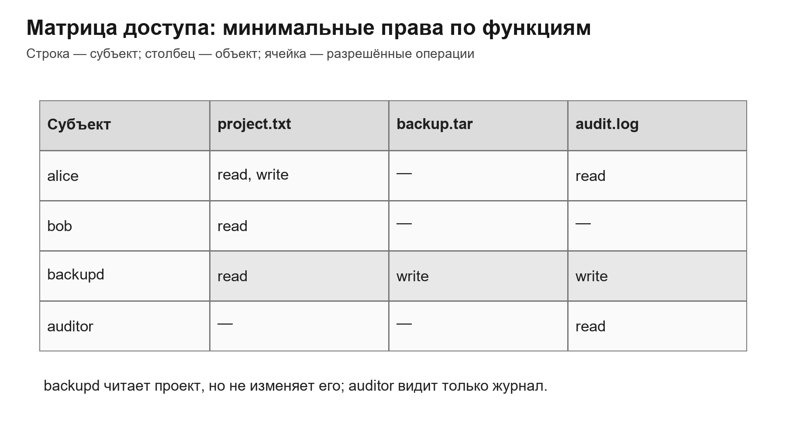

<p align="center">Рисунок 3 — Пример матрицы доступа</p>

В таблице 3 приведено сопоставление: матрица прав учебного проекта.

Таблица 3 — Матрица прав учебного проекта

| Субъект / объект | project.txt | backup.tar | audit.log |
| --- | --- | --- | --- |
| alice | read, write | — | read |
| bob | read | — | — |
| backupd | read | write | write |
| auditor | — | — | read |

Матрица обычно разреженная: из всех теоретически возможных пар субъект–объект лишь малая часть содержит права. Кроме того, она динамична. Создание файла добавляет объект, запуск процесса — субъект, изменение группы или роли меняет множество ячеек. Поэтому реальная система хранит компактные проекции матрицы и правила, по которым состояние вычисляется.

Модель полезна и для анализа передачи полномочий. Если субъект может изменить ACL объекта, создать новый объект с наследуемыми правами или передать capability, он способен изменить будущую матрицу. Следовательно, право управления политикой нужно отличать от права выполнить прикладную операцию.

<a id="sec-9-1-4"></a>

### 9.1.4. ACL и capability list

Разложение матрицы по столбцам даёт список контроля доступа — ACL. У каждого объекта хранится перечень субъектов или групп и разрешённых им операций. ACL естественно отвечает на вопрос владельца ресурса: «кто может работать с этим объектом?». Отзыв права также удобен: администратор изменяет список конкретного объекта.

Разложение по строкам даёт capability list — список объектов и прав, которыми обладает субъект. Capability должна быть защищённым от подделки указателем или токеном полномочия: одно знание имени объекта не должно создавать право. Такой подход естественно поддерживает делегирование и изоляцию по принципу «субъект видит только выданные ему объекты», но отзыв требует дополнительного механизма — косвенности, срока действия, списка отзыва или уничтожения общего посредника.

На рисунке 4 один столбец и одна строка той же матрицы превращены в два разных представления полномочий.

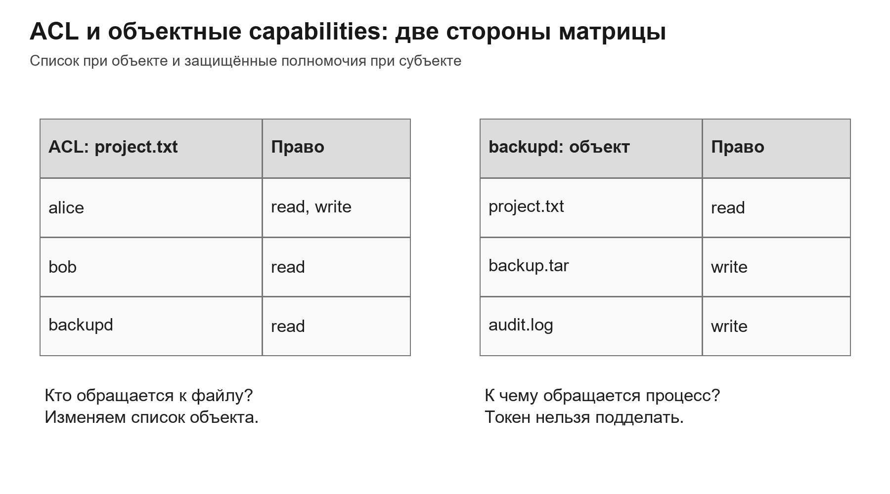

<p align="center">Рисунок 4 — ACL и capabilities как две проекции матрицы</p>

В таблице 4 приведено сопоставление: сравнение acl и объектных capabilities.

Таблица 4 — Сравнение ACL и объектных capabilities

| Критерий | ACL | Capability list |
| --- | --- | --- |
| Где хранится решение | рядом с объектом | в защищённом контексте субъекта |
| Основной вопрос | кто имеет доступ к объекту? | какие объекты доступны субъекту? |
| Отзыв | изменить ACL объекта | потребовать срок, отзыв или косвенность |
| Делегирование | изменение списка владельцем/администратором | передача защищённой capability |
| Риск | ошибочно широкая запись или наследование | утечка или неконтролируемое распространение capability |

Linux capabilities, рассматриваемые в разделе 9.4, исторически используют то же слово, но решают более узкую задачу: дробят полномочия суперпользователя на отдельные категории. Их не следует смешивать с общей capability-based security, где capability обозначает защищённое право на конкретный объект.

<a id="sec-9-1-5"></a>

### 9.1.5. Домены защиты и переходы

Домен защиты — множество пар «объект, допустимые операции», доступных выполняющемуся субъекту. Домен можно связать с пользователем, процессом, ролью, контейнером или режимом работы программы. Один и тот же человек может работать в обычном домене и временно активировать административную роль для ограниченной операции.

Переход домена меняет множество доступных объектов и операций. При разрешённом execve() исполняемого файла с SUID меняется эффективный UID; sudo запускает команду в целевом контексте после проверки своей политики; активация роли добавляет разрешения роли в сессию. Пространство имён меняет видимость ресурсов, но само по себе не является универсальной заменой проверки полномочий. Условия запуска, аргументы, окружение и доступные дескрипторы входят в анализ перехода.

Принцип наименьших полномочий требует не выдавать процессу весь максимальный домен на всё время жизни. Полномочие должно появляться максимально поздно, действовать только для необходимой операции и сниматься как можно раньше.

<a id="sec-9-1-6"></a>

### 9.1.6. Изменение политики и проблема безопасности состояния

Статическая матрица показывает один момент времени, но не гарантирует, что будущие изменения сохранят ограничение. Если субъект может копировать право, назначать владельца, менять ACL или создавать исполняемые файлы в каталоге доверенного поиска, он способен косвенно расширить доступ. Поэтому анализируют не только текущие ячейки, но и правила перехода между состояниями.

Для учебных задач полезно разделять права на прикладные операции и административные метаправа: grant — выдать право, revoke — отозвать, own — управлять объектом, control — менять домен другого субъекта. Ошибка часто возникает, когда право записи в каталог фактически позволяет заменить доверенный исполняемый файл и получить влияние, которого нет в ACL самого файла.

Матрица доступа задаёт общий язык. ACL, capabilities, роли и метки — способы представить или вычислить её фрагменты. Реальная защита требует контролировать и обращения, и изменение самой политики.

<a id="sec-9-2"></a>

## 9.2. Дискреционное управление доступом в Linux

Материалы для углубления: [S3](#source-s3) [S4](#source-s4) [S5](#source-s5) [S6](#source-s6) [S12](#source-s12).

DAC связывает решение с идентичностью субъекта и атрибутами объекта, а владелец может делегировать доступ. Гибкость DAC одновременно является его сильной стороной и источником риска распространения прав.

<a id="sec-9-2-1"></a>

### 9.2.1. Credentials процесса: что действительно проверяет ядро

Credentials — это атрибуты безопасности выполняющегося процесса. UID (User Identifier) и GID (Group Identifier) обозначают числовые идентификаторы пользователя и группы; PID (Process Identifier) — идентификатор процесса. Linux различает реальные, эффективные, сохранённые и файловые UID/GID. При файловых проверках используются fsuid и fsgid, обычно совпадающие с эффективными идентификаторами, а также дополнительные группы. Поэтому далее упоминание UID в алгоритме файлового доступа подразумевает соответствующий идентификатор проверки. [S4](#source-s4)

Real UID отражает исходного пользователя и полезен для учёта. Effective UID участвует в проверках и может измениться при привилегированном exec. Saved UID позволяет корректно временно сбросить и затем вернуть полномочие в специально спроектированной программе. Наличие нескольких идентификаторов требует осторожности: программа должна понимать, в каком контексте она проверяет объект и в каком выполняет действие.

Дополнительные группы наследуются процессом при запуске сессии. Если администрация включила пользователя в группу, уже работающая оболочка может не получить новое членство до создания новой сессии. Обратная ситуация ещё важнее: исключение из группы не отзывает группы у уже запущенных процессов. Следовательно, отзыв доступа может требовать завершения сессий, а не только редактирования каталога пользователей.

Рисунок 5 показывает атрибуты работающей службы, которые нельзя подменять сведениями об интерактивной учётной записи.

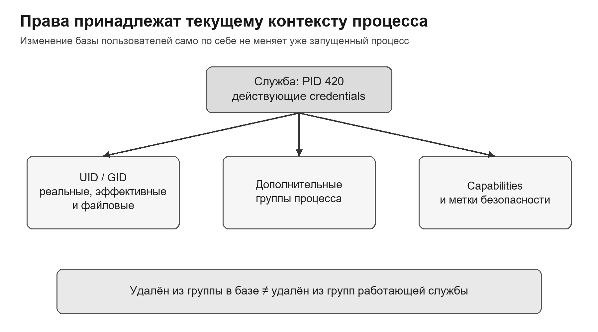

<p align="center">Рисунок 5 — Атрибуты процесса, влияющие на решение доступа</p>

```bash
id
ps -o pid,user,group,groups,comm -p 420
cat /proc/420/status | grep -E "^(Uid|Gid|Groups|Cap)"
```

Команда id показывает контекст нового процесса текущей оболочки. Для расследования конкретной службы нужно проверять credentials именно её PID, а не учётную запись администратора.

<a id="sec-9-2-2"></a>

### 9.2.2. Mode bits: owner, group, other

Классическая Unix-модель хранит три тройки битов: владельца, группы-владельца и остальных. Для каждого класса задаются read, write и execute. Без расширенного ACL и специальных привилегий проверка выбирает один класс: совпал файловый UID с владельцем — owner; иначе совпала группа-владелец с файловой или дополнительной группой — group; иначе other. Права выбранного класса не дополняются правами последующих классов.

Ситуация, когда владелец имеет r--, а группа rw-, не означает, что владелец получит запись через членство в группе: совпадение владельца завершает выбор класса. Это контринтуитивный, но важный пример алгоритмического характера проверки.

Для обычного файла r разрешает чтение содержимого, w — изменение, x — исполнение как программы. Для каталога r разрешает получить список имён, w — изменять записи каталога, а x — проходить по компоненту пути и обращаться к известному имени. Поэтому чтение файла требует x для всех каталогов пути; удаление файла зависит прежде всего от w+x родительского каталога.

На рисунке 6 сопоставлены биты файла и каталога и выделена причина независимости удаления имени от записи содержимого.

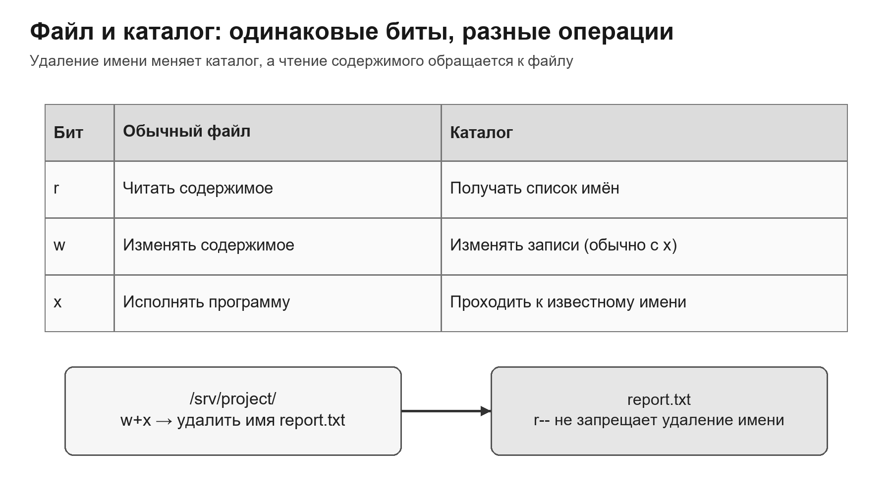

<p align="center">Рисунок 6 — Семантика r, w и x для файла и каталога</p>

В таблице 5 приведено сопоставление: права для операций с каталогами и файлами.

Таблица 5 — Права для операций с каталогами и файлами

| Сценарий | Нужные права | Почему |
| --- | --- | --- |
| прочитать /a/b.txt | x на / и /a; r на b.txt | нужно пройти путь и прочитать содержимое |
| увидеть имена в /a | r на /a | получить список записей |
| прочитать известный /a/b.txt без listing | x на /a; r на b.txt | r каталога не обязателен при известном имени |
| удалить /a/b.txt | w+x на /a | меняется запись каталога, а не содержимое файла |
| создать /a/new.txt | w+x на /a | создаётся новая запись каталога |

<a id="sec-9-2-3"></a>

### 9.2.3. chmod, символическая и восьмеричная запись

Восьмеричная запись кодирует сумму битов: r=4, w=2, x=1. Режим 640 означает rw- для владельца, r-- для группы и отсутствие прав у остальных. Запись компактна, но при изменении одного класса легко нечаянно заменить весь режим. Символическая форма chmod g+w file добавляет конкретный бит и лучше отражает намерение.

Рекурсивное chmod опасно из-за различной семантики x для файлов и каталогов. Команда chmod -R 644 tree снимет x с каталогов, после чего путь станет непроходимым. Конструкция X в символической форме добавляет execute только каталогам и уже исполняемым файлам, поэтому часто безопаснее: chmod -R u=rwX,g=rX,o= tree.

```bash
chmod 640 report.txt          # rw-r-----
chmod g+w report.txt          # добавить запись группе
chmod -R u=rwX,g=rX,o= tree/  # X сохраняет проходимость каталогов
stat -c "%A %a %U:%G %n" report.txt
```

Проверка режима должна сопровождаться проверкой владельца, группы и ACL. Вывод ls -l показывает знак + при наличии расширенного ACL, но не раскрывает его содержание. Поэтому заключение только по строке rwxr-x--- может быть неверным.

<a id="sec-9-2-4"></a>

### 9.2.4. umask и безопасные значения по умолчанию

Без default ACL приложение при создании объекта передаёт желаемый mode, а umask снимает из него биты. Типичные базовые режимы: 0666 для файла и 0777 для каталога; execute для обычного файла автоматически не появляется. При umask 0027 новый файл обычно получает 0640, каталог — 0750.

umask не является окончательной политикой: приложение может запросить более узкий режим, ACL каталога может повлиять на наследуемые права, а программа может позже вызвать chmod. Тем не менее umask — важный контроль безопасного состояния между созданием и последующей настройкой. Временно широко доступный секрет уже может быть прочитан другим процессом.

```bash
umask 0027
# 0666 & ~0027 = 0640 для обычного файла
# 0777 & ~0027 = 0750 для каталога
```

Для системной службы umask задают в её unit-файле или конфигурации запуска, а не полагаются на интерактивную оболочку администратора. Проверять следует фактически созданный службой объект.

<a id="sec-9-2-5"></a>

### 9.2.5. Специальные биты: SUID, SGID и sticky

SUID (Set User ID) на исполняемом бинарном файле при соответствующем execve() меняет эффективный UID на UID владельца файла. SGID (Set Group ID) аналогично меняет эффективный GID. Это не безусловное повышение: no_new_privs, nosuid и трассировка могут исключить такой эффект; Linux не применяет SUID/SGID самого интерпретируемого сценария как для бинарного файла. SGID на каталоге означает другое: новые объекты наследуют группу каталога, а новые подкаталоги — также SGID. [S6](#source-s6)

Sticky bit на общем каталоге ограничивает удаление и переименование записей: помимо обычных прав на каталог необходимы владение файлом, владение каталогом либо соответствующая привилегия, например CAP_FOWNER. Он не скрывает имена и не запрещает читать или изменять содержимое, если файловые права это допускают. Эти ограничения дополняются мандатной политикой и другими условиями ОС.

В таблице 6 приведено сопоставление: специальные биты режима.

Таблица 6 — Специальные биты режима

| Бит | Где | Эффект | Основной риск |
| --- | --- | --- | --- |
| SUID | исполняемый файл | effective UID = владелец файла | ошибка ввода становится привилегированной |
| SGID | исполняемый файл | effective GID = группа файла | избыточные групповые полномочия |
| SGID | каталог | наследование группы новыми объектами | неправильная группа проекта |
| Sticky | каталог | ограничение удаления/rename чужих записей | не защищает чтение содержимого |

<a id="sec-9-2-6"></a>

### 9.2.6. POSIX ACL: структура и маска

POSIX ACL расширяет три классических набора. Access ACL объекта содержит owner entry, named user entries, owning group entry, named group entries, mask и other entry. Маска задаёт верхнюю границу эффективных прав для всех named users, owning group и named groups. Owner и other маской не ограничиваются.

Именно маска объясняет частую ошибку: запись user:ivan:rw- существует, но getfacl показывает effective:r--, потому что mask::r-- снимает запись. Команда chmod g-w может изменить маску и тем самым ограничить не только группу-владельца, но и именованных пользователей. Поэтому mode bits и ACL нельзя администрировать как независимые механизмы.

```text
# file: report.txt
# owner: alice
# group: project
user::rw-
user:ivan:rw-             #effective:r--
group::r--
mask::r--
other::---
```

Знак + в ls -l сигнализирует о расширенных данных, но вычисление требует getfacl. После изменения ACL полезно проверять и краткий mode, и полный список, потому что mode group bits визуально отражают маску, а не только entry группы-владельца.

<a id="sec-9-2-7"></a>

### 9.2.7. Алгоритм POSIX ACL

Алгоритм POSIX ACL последовательно выбирает владельца, именованного пользователя, групповой класс либо other. Пусть Q — набор запрошенных прав. Разрешение в выбранной ветви возможно, только если она покрывает весь Q; отказ в совпавшей ветви не даёт права перейти к более широкой записи other. Для групп нужен отдельный нюанс: хотя разные группы могут разрешать отдельные действия, для одного совместного запроса все требуемые биты должны присутствовать в одной совпавшей групповой записи и в mask. [S3](#source-s3)

Рисунок 7 фиксирует порядок выбора ветви ACL и условие для совместного запроса нескольких прав.

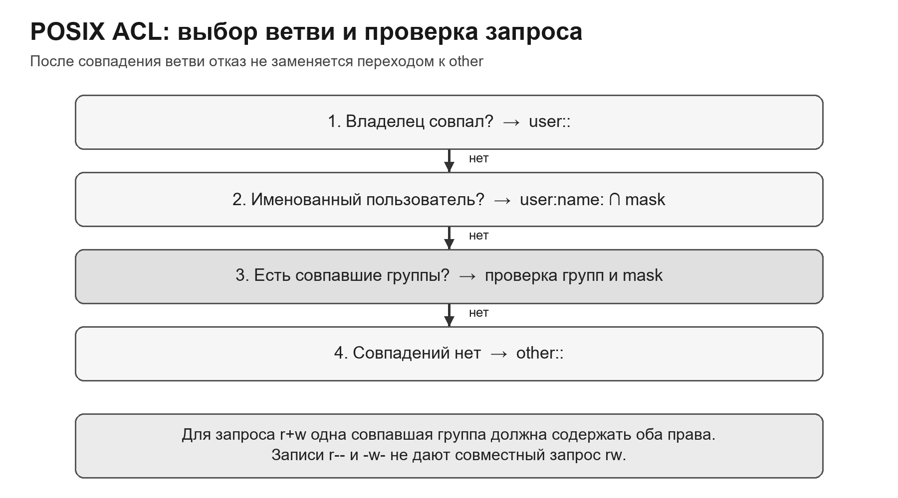

<p align="center">Рисунок 7 — Порядок выбора записи POSIX ACL</p>

1. Если файловый UID совпал с владельцем, проверить Q по user::; mask не применяется. При недостатке прав — отказ.

1. Иначе, если совпала именованная запись user:name:, проверить весь Q по этой записи и mask. При недостатке прав — отказ, без перехода к группам.

1. Иначе, если совпала хотя бы одна группа, разрешить запрос только при наличии всего Q в одной из совпавших групповых записей и в mask (если она есть). Иначе отказ.

1. Если нет совпадения ни с владельцем, ни с именованным пользователем, ни с группами, проверить Q по other::.

Разобранный пример: процесс состоит в g_read и g_write; записи равны group:g_read:r-- и group:g_write:-w-, маска rw-. Отдельное открытие на чтение проходит по g_read, отдельное открытие на запись — по g_write. Однако совместный запрос O_RDWR требует r+w в одной записи и будет отклонён. Это объясняет, почему выражение «объединить все группы» недостаточно точно для алгоритма. Даже широкое other::rw- не спасает запрос: групповая ветвь уже выбрана.

Иван не владелец; для него есть user:ivan:rw-, но mask::r--. Эффективное право — только r--. Членство Ивана в группе с записью -w- не добавит запись, потому что named user уже выбрал ветвь и завершил поиск.

<a id="sec-9-2-8"></a>

### 9.2.8. Default ACL и наследование

Default ACL существует только у каталога и служит шаблоном для новых дочерних объектов. При создании файла из default ACL формируется его access ACL. При создании подкаталога формируются и access ACL, и новый default ACL, поэтому наследование может продолжаться по дереву.

Наследование ограничивается mode, который запросило приложение. Если default ACL есть, он наследуется, а соответствующие owner/mask/other права ограничиваются mode; umask отдельно по формуле не применяется. Если default ACL отсутствует, используется mode & ~umask. При mode=0666 новый файл не получает эффективного execute; именованная запись может содержать x, но mask его отсечёт. Новый каталог, созданный с mode=0777, может сохранить проход x. [S3](#source-s3)

На рисунке 8 видно, почему общий шаблон ACL даёт разные эффективные права для обычного файла и каталога.

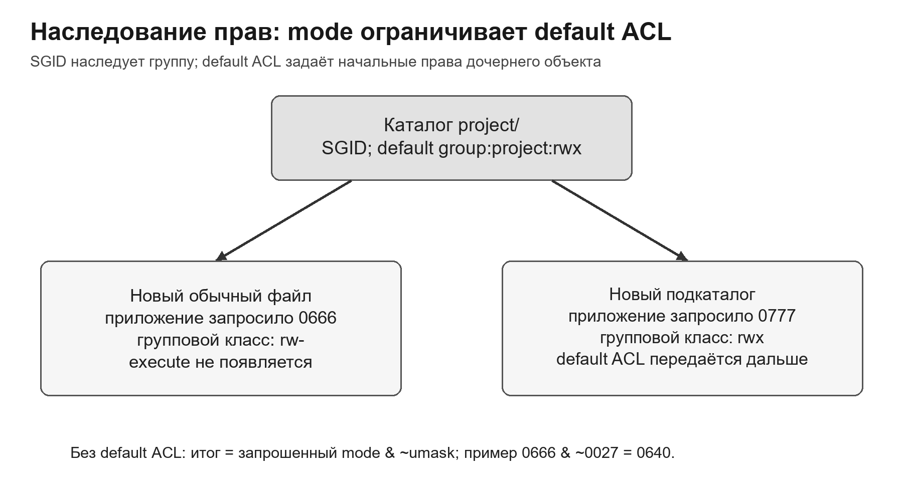

<p align="center">Рисунок 8 — Формирование ACL нового файла и каталога</p>

```bash
setfacl -m g:project:rwX /srv/project
setfacl -m d:g:project:rwX,d:m::rwx /srv/project
getfacl /srv/project
touch /srv/project/new.txt
getfacl /srv/project/new.txt
```

Default ACL проектируют на уровне каталога, где действительно существует общая роль. Раздача индивидуальных записей десяткам пользователей создаёт труднообозримую политику. Предпочтительнее управлять членством в группе project, а ACL связывать с группой.

<a id="sec-9-2-9"></a>

### 9.2.9. Копирование, архивирование и отзыв

ACL обычно хранится в расширенных атрибутах. Способ копирования определяет, сохранятся ли они. Обычный cp в конкретной конфигурации может создать новый объект по политике целевого каталога, а cp --preserve=all или архиватор с поддержкой xattrs — перенести атрибуты. Для резервного копирования важно сохранять не только содержимое, но и владельцев, группы, ACL, capabilities и мандатные метки.

Копирование с сохранением всех атрибутов в другую зону может перенести туда неуместную политику. Обратная ошибка — потерять ACL при восстановлении и открыть данные через более широкие mode bits. Поэтому тест восстановления должен включать контроль эффективного доступа, а не только сравнение хеша содержимого.

Отзыв нужно рассматривать во времени. В момент t₀ процесс успешно открыл файл на чтение. В t₁ владелец убрал read из ACL. В t₂ новое открытие будет запрещено при прочих равных, но чтение через старый дескриптор обычно продолжится. Значит, отзыв новых открытий и прекращение существующего доступа — разные цели. Для второй нужны предусмотренные системой средства завершения сессий, работы с открытыми ресурсами или прикладного отзыва; простая смена имени файла их не заменяет.

DAC обеспечивает гибкое делегирование, но эффективное решение Linux формируется алгоритмом: credentials процесса → семантика объекта → mode/ACL → специальные переходы. Проверка одного chmod недостаточна.

<a id="sec-9-3"></a>

## 9.3. Мандатное и ролевое управление доступом

Материалы для углубления: [S2](#source-s2) [S8](#source-s8) [S9](#source-s9) [S10](#source-s10).

DAC отвечает, кому владелец разрешил операцию. Мандатная политика управляет допустимыми информационными потоками независимо от желания владельца. RBAC связывает полномочия с должностной функцией и активной ролью.

<a id="sec-9-3-1"></a>

### 9.3.1. Почему DAC недостаточно для управления потоками

В дискреционной модели субъект, получивший право чтения, часто может создать собственный объект и передать прочитанные данные другому субъекту. ACL исходного файла больше не контролирует копию. Если заражённая программа выполняется с полномочиями пользователя, она может читать всё доступное пользователю и записывать в любые разрешённые ему каналы. Это классическая проблема троянского коня.

MAC (Mandatory Access Control), или мандатное управление, задаёт обязательную политику, которую обычный владелец объекта не может произвольно отменить. Модели с уровнями и категориями — важный класс MAC; существуют и обязательные политики на основе типов или доменов. Здесь основное внимание уделяется меткам и направлениям информационных потоков, необходимым для понимания защищённых ОС.

Мандатная политика не заменяет DAC. DAC удобно выражает проектные группы и владельцев, а MAC задаёт обязательную внешнюю границу. На практике обращение разрешается только при одновременном выполнении всех применимых политик.

<a id="sec-9-3-2"></a>

### 9.3.2. Метки, уровни, категории и решётка

Метка конфиденциальности может состоять из иерархического уровня и набора неиерархических категорий. Например, уровень «секретно» выше «конфиденциально», а категории PROJECT_A и CRYPTO несравнимы. Субъект доминирует над объектом, если его уровень не ниже и его набор категорий включает категории объекта.

Из-за категорий отношение становится частичным порядком: две метки могут быть несравнимы. Субъект с допуском SECRET{A} не обязан иметь доступ к SECRET{B}. Это позволяет применять принцип need-to-know внутри одного уровня секретности.

Рабочая метка процесса может быть ниже максимального допуска пользователя. Это уменьшает риск случайного смешения: пользователь открывает отдельную сессию на уровне, соответствующем задаче. Переходы уровней и процедуры понижения классификации относятся к доверенным операциям и должны отдельно аудироваться.

<a id="sec-9-3-3"></a>

### 9.3.3. Bell–LaPadula: конфиденциальность

Модель Bell–LaPadula ориентирована на предотвращение раскрытия информации. Простое свойство безопасности запрещает чтение вверх: субъект не читает объект, который не доминируется его текущим уровнем. *-свойство запрещает запись вниз: субъект не переносит данные из более высокого контекста в объект более низкой конфиденциальности.

На рисунке 9 стрелки направлены по движению информации: при чтении от объекта к процессу, при записи от процесса к объекту. Пунктиром показан запрещённый поток.

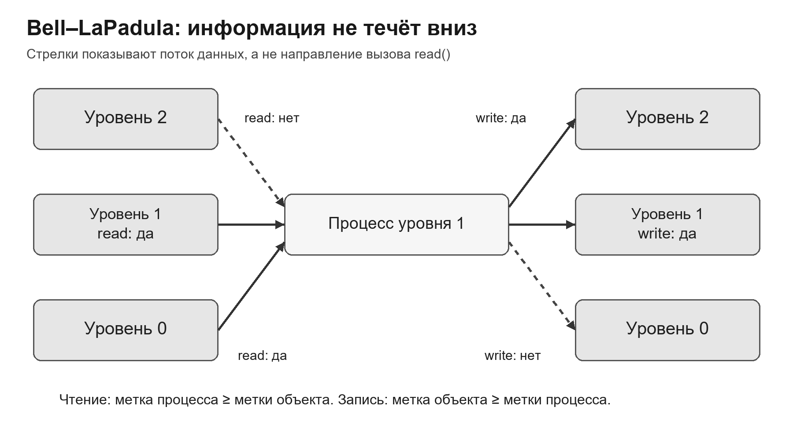

<p align="center">Рисунок 9 — Основные ограничения Bell–LaPadula</p>


Для расчётов используем учебные уровни 0 < 1 < 2 и категории A, B; это условные обозначения, а не перечень правовых грифов. Метка L=(h,C) доминирует над L′=(h′,C′), когда h ≥ h′ и C ⊇ C′. Например, (2,{A,B}) доминирует над (1,{A}), а (2,{A}) и (1,{B}) несравнимы. Высокий уровень не компенсирует отсутствующую категорию.

В принятом здесь упрощении с фиксированной текущей меткой процесса и без доверенных исключений:

```text
read(s,o):   L(s) доминирует над L(o)
write(s,o):  L(o) доминирует над L(s)
read+write:  нужны оба условия; следовательно, метки равны
```

Запись здесь означает передачу данных в объект без чтения его прежнего содержимого. Программа, которая открывает документ для чтения и изменения, требует оба права. Дополнительно должно существовать дискреционное разрешение; правила меток сами по себе права не выдают.

Разобранный пример: у процесса L(s)=(1,{A}), у отчёта L(o₁)=(1,{A}), у публичного файла L(o₂)=(0,∅), у закрытого архива L(o₃)=(2,{A,B}). Чтение и запись o₁ допустимы по меткам. Чтение o₂ допустимо, а запись в него запрещена: так пресекается выгрузка прочитанного отчёта в публичный файл. Запись без чтения в o₃ допустима по правилу потока; чтение o₃ запрещено. Это не инструкция конкретной ОС, а вычисление в явно заданной модели.

Формальная гарантия относится к моделируемым каналам и разрешённым переходам состояний. Если безопасно начальное состояние и все допустимые переходы сохраняют свойства, они сохраняются и в достижимых состояниях. Ошибки реализации, обход доверенного кода и скрытые каналы — например, передача сигнала через задержки общего ресурса — требуют отдельного анализа. Шифрование носителя также не заменяет контроль потока после расшифрования данных.


Правило «не читать вверх, не записывать вниз» описывает направление допустимого потока, но не всю эксплуатационную политику. Нужны доверенные субъекты для контролируемого импорта, экспорта и понижения классификации. Их код и процедуры входят в доверенную базу, а каждое использование требует регистрации и разделения обязанностей.

Модель не решает задачу целостности: субъект высокого уровня может прочитать низкоуровневый объект, который оказался ложным. Для анализа доверенности данных используют другие правила, например Biba.

<a id="sec-9-3-4"></a>

### 9.3.4. Biba: целостность

Модель Biba симметрично рассматривает уровни доверия к данным. В строгом варианте субъект не читает вниз, чтобы недоверенные данные не повлияли на высокодоверенное вычисление, и не записывает вверх, чтобы процесс низкой целостности не изменил объект высокой целостности.

Рисунок 10 использует ту же логику стрелок для шкалы целостности; направление допустимого влияния противоположно модели конфиденциальности.

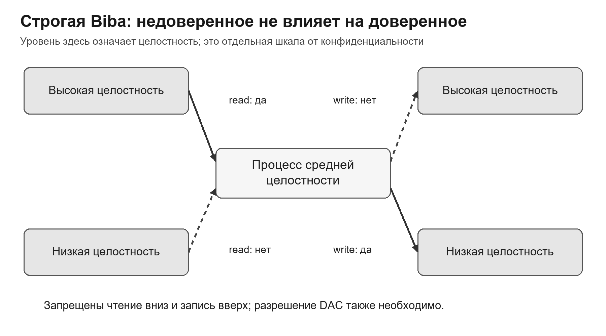

<p align="center">Рисунок 10 — Основные ограничения строгой модели Biba</p>

Пример: высокодоверенная служба формирует эталон конфигурации. Если она напрямую читает произвольный пользовательский файл низкой целостности, строгая Biba запрещает такое влияние. При необходимости импорта архитектура выделяет доверенный механизм повышения доверия: он проверяет происхождение, формат и допустимые значения, после чего по отдельной политике создаёт результат. Обычный валидатор не получает право повысить метку автоматически — это явно разрешённая доверенная операция за пределами обычных переходов строгой модели.

В реальных системах правила конфиденциальности и целостности могут одновременно ограничивать поток в разных направлениях. Проектирование требует явно указать, какое свойство защищает каждая метка. Нельзя объяснять запрет только словом «мандатный» — нужно назвать актив, направление потока и правило.

<a id="sec-9-3-5"></a>

### 9.3.5. RBAC: пользователь, роль, разрешение, сессия

В RBAC разрешения назначаются ролям, а пользователи включаются в роли. Это отделяет жизненный цикл сотрудника от жизненного цикла объектов: при переводе на другую функцию меняется набор ролей, а не сотни ACL. Разрешение следует формулировать как прикладную операцию над классом объектов, например backup:start для утверждённого задания, а не как «полный доступ к серверу».

Рисунок 11 отделяет назначение двух ролей от активации одной из них в конкретной сессии.

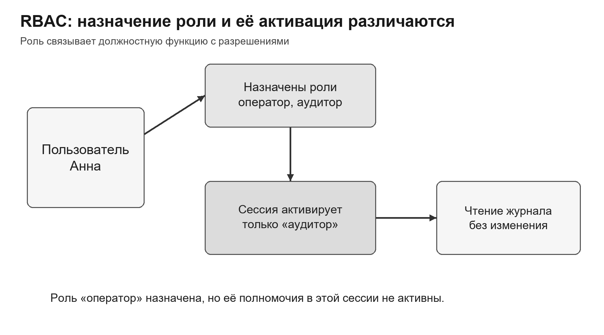

<p align="center">Рисунок 11 — Базовая модель RBAC</p>

Сессия активирует подмножество назначенных ролей. Администратор может войти в обычном режиме и активировать роль сопровождения только на время задачи. Это уменьшает постоянный объём полномочий и улучшает атрибуцию. Активация роли может требовать повторной аутентификации, заявки или подтверждения второго лица.

Иерархия ролей сокращает дублирование: старшая роль наследует разрешения младшей. Однако слишком глубокая иерархия скрывает эффективные права. Для аудита нужна возможность развернуть наследование и показать, от какой роли получено каждое разрешение.

<a id="sec-9-3-6"></a>

### 9.3.6. Разделение обязанностей и ограничения RBAC

Статическое разделение обязанностей запрещает назначение конфликтующих ролей одному пользователю. Например, создатель релиза не должен одновременно иметь роль независимого утверждающего. Динамическое разделение в RBAC ограничивает совместную активацию ролей в одной сессии. Требование «нельзя утвердить собственную заявку даже из другой сессии» сильнее: необходимо хранить автора и историю конкретной операции и проверять их прикладным правилом. Одного запрета совместной активации недостаточно.

RBAC не выражает весь контекст. ABAC (Attribute-Based Access Control) — управление доступом на основе атрибутов. Условие «роль администратора может подключаться только с управляемого устройства в рабочее окно» уже использует атрибуты среды и приближается к ABAC. Современные системы часто комбинируют роли как устойчивую основу и атрибуты как динамические условия.

Главный риск RBAC — превращение ролей в накопительные группы. Если роль не имеет владельца, назначения не пересматриваются, а исключения добавляются без удаления, возникает privilege creep. Поэтому роль должна иметь назначение, владельца, список разрешений, правила назначения, срок пересмотра и события аудита.

В таблице 7 приведено сопоставление: сравнение моделей разграничения доступа.

Таблица 7 — Сравнение моделей разграничения доступа

| Модель | Основание решения | Сильная сторона | Ограничение |
| --- | --- | --- | --- |
| DAC | идентичность и правила владельца объекта | гибкость и естественная файловая модель | владелец может распространить данные/права |
| MAC / Bell–LaPadula | метки конфиденциальности и доминирование | централизованный контроль раскрытия | нужны доверенные процедуры экспорта |
| MAC / Biba | метки целостности | защита доверенных данных от загрязнения | требуется валидатор для повышения доверия |
| RBAC | назначенные и активные роли | соответствие должностным функциям | роль может разрастись и скрыть эффективные права |
| ABAC | атрибуты субъекта, объекта, действия и среды | динамический контекст | сложность объяснения и тестирования |

Bell–LaPadula отвечает за конфиденциальность, Biba — за целостность, RBAC — за организационное назначение полномочий. Эти модели решают разные задачи и не являются взаимозаменяемыми.

<a id="sec-9-4"></a>

## 9.4. SUID/SGID, Linux capabilities и комбинирование политик

Материалы для углубления: [S6](#source-s6) [S7](#source-s7) [S11](#source-s11).

Переход к привилегированному контексту должен делегировать минимальную функцию, а не универсальную оболочку. Любое повышение полномочий анализируют вместе с аргументами, окружением, файлами конфигурации и аудитом.

<a id="sec-9-4-1"></a>

### 9.4.1. Проблема монолитного root

Традиционный UID 0 обходит многие дискреционные ограничения. Если службе нужен один привилегированный шаг — например, привязать низкий сетевой порт, — запуск всего процесса от root увеличивает последствия любой ошибки обработки входа. Принцип минимальных полномочий требует разделить подготовительный привилегированный этап и длительную работу с обычными правами либо выдать узкую capability.

Полномочия процесса оценивают не только по UID. Root внутри user namespace может не быть root хоста; наоборот, доступ к сокету контейнерного менеджера или capability CAP_SYS_ADMIN может дать очень широкий контроль. Следовательно, название учётной записи недостаточно: нужен полный контекст домена.

<a id="sec-9-4-2"></a>

### 9.4.2. SUID/SGID-программы

SUID-программа выполняется с effective UID владельца файла. Она должна считать все входные данные недоверенными: аргументы, stdin, переменные окружения, рабочий каталог, файловые дескрипторы, символьные ссылки и конфигурацию. Опасно проверять путь, а затем заново открывать его по имени: между проверкой и использованием объект может быть подменён.

Безопасный посредник принимает небольшой разрешительный список операций, использует абсолютные пути, открывает объект один раз, проверяет его по дескриптору, очищает окружение, устанавливает предсказуемый umask и как можно раньше сбрасывает полномочия. Чем больше универсальных функций — редактор, shell escape, плагин, произвольный конфиг — тем труднее доказать ограниченность.

SGID-программа несёт сходный риск в пределах полномочий группы. Если группа владеет резервными копиями или журналами, ошибка может быть сопоставима с административной. Поэтому групповые привилегии также требуют отдельной модели угроз.

<a id="sec-9-4-3"></a>

### 9.4.3. Наборы Linux capabilities

Linux capabilities — отдельные категории привилегированных действий ядра, технически атрибуты потока. Permitted (P) содержит привилегии, которые могут стать Effective (E), причём E ⊆ P. Inheritable (I) участвует в правилах передачи при execve(). Bounding (B) ограничивает получение привилегий из permitted-набора файла; это не универсальное равенство «все текущие права входят в B». Ambient (A), где A ⊆ P ∩ I, позволяет при установленных условиях переносить права через обычный непривилегированный exec. Полную формулу перехода задаёт capabilities(7). [S7](#source-s7)

На рисунке 12 вложение Effective в Permitted сопоставлено с отдельными функциями остальных наборов capabilities.

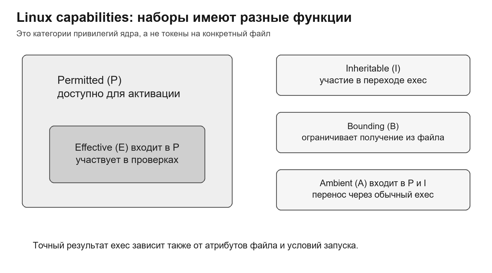

<p align="center">Рисунок 12 — Основные наборы Linux capabilities</p>

Дробление не гарантирует узость автоматически. Некоторые capabilities широки: CAP_SYS_ADMIN включает множество разнородных операций. CAP_DAC_OVERRIDE позволяет обходить файловые проверки и потому требует защиты, сопоставимой с очень привилегированным контекстом. Каждую capability оценивают по объектам и операциям, которые она реально открывает.

```bash
getcap /usr/local/bin/myservice
getpcaps 420
# Пример атрибута файла, а не команда для выполнения:
# /usr/local/bin/myservice cap_net_bind_service=ep
```

<a id="sec-9-4-4"></a>

### 9.4.4. File capabilities и сравнение с SUID

File capabilities хранятся в расширенном атрибуте исполняемого файла и участвуют в формировании наборов процесса при execve(). Это позволяет сохранить обычный UID и выдать конкретную возможность. Для сетевой службы это часто лучше полного SUID root, но остаются риски: подмена файла, небезопасный загрузчик библиотек, неожиданный дочерний процесс и слишком широкая capability.

Рисунок 13 сравнивает масштаб SUID root и одной file capability, не приравнивая последнюю к полномочию на единственный объект.

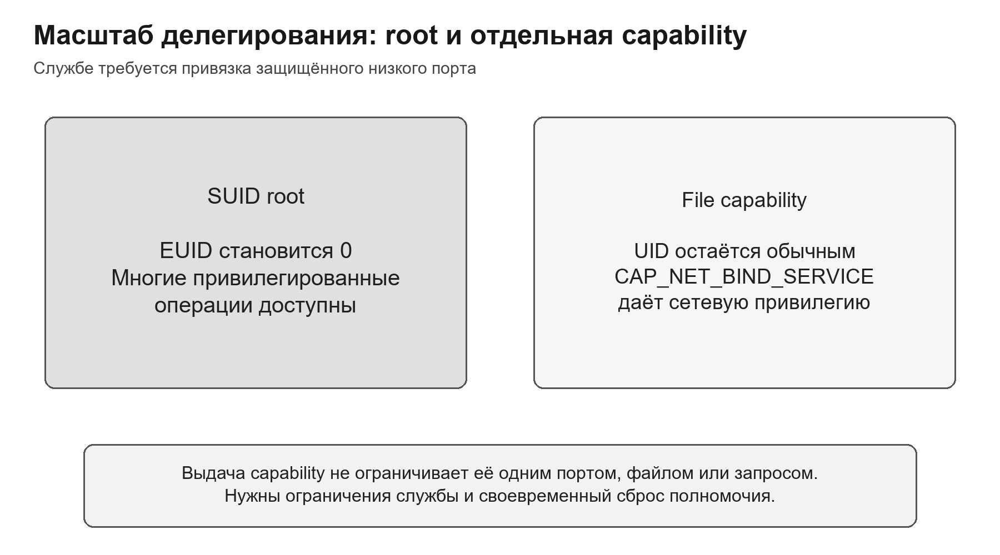

<p align="center">Рисунок 13 — Сравнение масштаба SUID root и file capability</p>

Копирование и архивирование могут потерять security.capability так же, как ACL. После развёртывания проверяют не только хеш бинарного файла, но и его расширенные атрибуты. Изменение файла обычно требует повторной установки capability на новый inode.

Если привилегия нужна только при старте, после действия её удаляют из Effective/Permitted и исключают пути повторного получения, учитывая Inheritable, Ambient и последующие exec. Bounding set сокращают заранее. Снятие бита только из Effective допускает его повторную активацию из Permitted.

<a id="sec-9-4-5"></a>

### 9.4.5. Комбинированное решение и место Astra Linux

Современная защищённая Linux-система сочетает несколько условий. Процесс должен видеть нужный объект; проверки владельца, групп и ACL учитывают применимые привилегии; обязательная политика задаёт дополнительные ограничения; на операцию влияют атрибуты файла, режим файловой системы и другие механизмы. Это логическое сочетание, а не универсальная последовательность вызовов ядра. Пространства имён задают представление ресурсов; seccomp фильтрует системные вызовы и их доступные фильтру аргументы, но не заменяет файловый ACL. Разрешение требуется от всех применимых обязательных механизмов.

Рисунок 14 показывает логическое пересечение условий, а не обещанный порядок выполнения функций ядра.

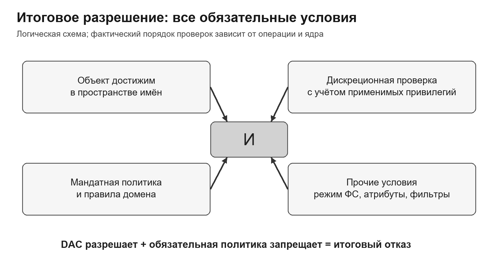

<p align="center">Рисунок 14 — Логическое сочетание условий доступа</p>

В Astra Linux дискреционные права дополняются средствами мандатного управления и контроля целостности. Документация PARSEC описывает метки целостности и ограничения, действующие в том числе для суперпользователя. Нельзя механически отождествлять всю реализацию со строгой Biba или с двумя формулами Bell–LaPadula: фактические правила зависят от режима и версии. Архитектура Astra Linux относится к следующей теме 10; здесь фиксируется принцип: разрешение DAC не отменяет обязательный запрет. [S11](#source-s11)

Сообщение Permission denied само по себе не объясняет слой отказа. Диагностика должна проверить credentials процесса, проход по пути, ACL и mask, capabilities, мандатные атрибуты и соответствующие журналы. Попытка «лечить» отказ командой chmod 777 может увеличить риск и не устранить истинную причину.

<a id="sec-9-4-6"></a>

### 9.4.6. Методика проверки эффективного доступа

Проверка начинается с требования: субъект, объект, операция, контекст и ожидаемое решение. Положительный случай подтверждает требуемое разрешение, отрицательный — обязательный отказ, регрессионный — сохранение соседних функций после изменения политики. Результат системного вызова, действующие credentials и журнал при настроенной регистрации дают разные части доказательства. Ошибка доступа не обязана автоматически создавать запись auditd: это зависит от правил и активных механизмов аудита.

На рисунке 15 разные операции над теми же объектами разделены на ожидаемые разрешения и отказы.

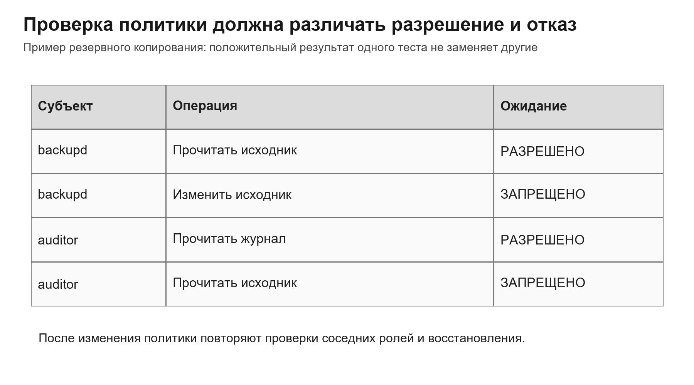

<p align="center">Рисунок 15 — Четыре компонента доказательства политики</p>

Негативный тест особенно важен: успешное чтение Алисы доказывает только доступ Алисы. Оно не доказывает, что Бобу отказано, что доступ невозможен через резервную копию или что служба не унаследовала старую группу. Проверяется каждый существенный обход.

Тест выполняют из того же типа сессии и от имени того же технического субъекта, что и реальная операция. sudo -u полезен для отдельных проверок, но может отличаться по группам, PAM-сессии, окружению и мандатной метке. Для службы надёжнее запускать контролируемое действие в её фактическом контексте или временном эквивалентном unit.

Рисунок 16 связывает ошибку операции с credentials и событием аудита; каждый вид наблюдения отвечает на отдельный вопрос.

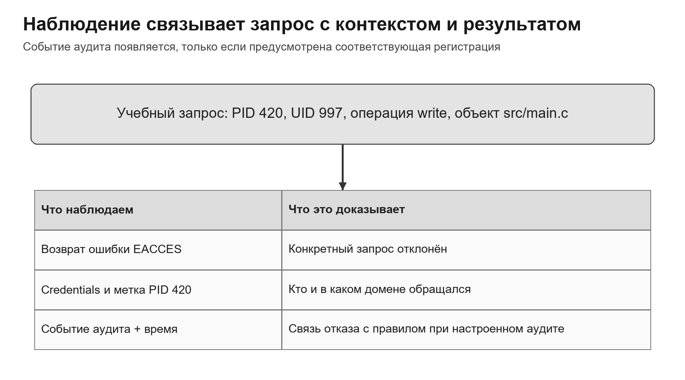

<p align="center">Рисунок 16 — Связь контрольного запроса, результата и аудита</p>


<a id="case"></a>

## Прикладной разбор: исходники, релиз и резервная копия

Рассмотрим завершённый пример политики учебного проекта. Разработчики изменяют исходники; отдельный утверждающий подтверждает выпуск; служба backupd читает исходники и записывает архив; аудитор читает только журнал. Эти функции нельзя безопасно выразить одной общей группой с записью во всё дерево.

Исходники расположены в `/srv/project/src`, утверждённые релизы — в `/srv/releases/approved`, архив — в `/srv/backups/project`, журнал — в `/var/log/project`. Пути в примере условные. Верхние каталоги принадлежат администратору и не доступны разработчикам на запись. Это принципиально: если разработчик может заменить имя каталога `approved` в его родителе, запрета записи в файлы релиза недостаточно.

В каталоге исходников SGID обеспечивает наследование группы project. Access ACL разрешает этой группе чтение, запись и проход, а backupd — чтение и проход. Default ACL определяет начальные права новых объектов; для обычного файла mode=0666 исключает эффективный execute. Применение шаблона только к корню не исправляет ACL уже существующих вложенных объектов, поэтому проектная политика отдельно охватывает существующее дерево.

Утверждённые релизы доступны разработчикам на чтение, а запись выполняет только узкий сервис публикации. «Утвердить релиз» — прикладное действие, которое проверяет роль, автора сборки, хеш и состояние заявки. Право записи в каталог само по себе не проверяет эти условия. Если тому же человеку позволено создавать и утверждать собственную сборку из разных сессий, требование независимого контроля нарушено, даже когда динамический запрет совместной активации ролей выполняется.

Backupd не получает запись в исходники. Создание архива находится в отдельном каталоге, недоступном аудитору. Архив содержит те же чувствительные данные, поэтому разрешение аудитору читать архив сделало бы бесполезным запрет чтения исходников. Удаление старых архивов — отдельное полномочие; устойчивость к повреждению службой требует дополнительной политики хранения или независимой защищённой копии.

Система регистрации принимает события через контролируемый интерфейс. Выдача процессу обычного права write на файл журнала позволила бы не только добавлять записи, но и портить старое содержимое. В абстрактной начальной матрице write обозначало потребность службы передавать события; при реализации её уточняют до разрешённого интерфейса журналирования. Прикладное имя операции не следует автоматически заменять одноимённым файловым битом.

Итог вычисляется на конкретных обращениях. Чтение исходника службой backupd разрешено при выполнении DAC и обязательных правил; попытка изменить тот же файл отклоняется. Аудитор читает журнал, но получает отказ при открытии исходника и архива. Разработчик изменяет рабочий файл, но не заменяет утверждённый релиз. Для подтверждения независимого утверждения дополнительно проверяется автор заявки: одного успешного файлового доступа для этого недостаточно.

Если рабочие данные имеют мандатную метку (1,{A}), выходной архив не может автоматически стать общедоступным с меткой (0,∅). По Bell–LaPadula такое снижение запрещено обычному процессу. Если опубликование очищенного отчёта требуется организационно, это отдельная доверенная процедура с проверкой содержимого, полномочий и регистрацией результата.

Пример показывает связь уровней описания: матрица фиксирует потребности, DAC реализует файловую часть, RBAC задаёт функции, прикладное правило проверяет историю заявки, а MAC удерживает информационные потоки в заданных границах. Проверки из административной оболочки не доказывают поведение службы с другими группами и меткой.


<a id="summary"></a>

## Итоги лекции

- Матрица доступа описывает связи «субъект — объект — множество операций» и служит общей моделью для разных механизмов.

- ACL хранит права со стороны объекта; capability list — со стороны субъекта. У подходов различаются делегирование и отзыв.

- В Linux эффективный доступ зависит от credentials процесса, семантики объекта, mode bits, POSIX ACL, маски и специальных переходов.

- Права каталога нельзя трактовать как права обычного файла; удаление проверяется по родительскому каталогу.

- Default ACL формирует политику новых объектов, а сохранение ACL и capabilities должно проверяться при копировании и восстановлении.

- Bell–LaPadula управляет конфиденциальностью: no read up, no write down. Biba управляет целостностью: no read down, no write up.

- RBAC связывает разрешения с функциями и активной сессией; ограничения разделения обязанностей предотвращают конфликт ролей.

- Linux capabilities уменьшают потребность в полном root, но каждая capability требует анализа реального масштаба.

- В комбинированной системе любой обязательный слой может отклонить обращение; chmod 777 не является универсальной диагностикой.

- Доказательство политики включает положительные, отрицательные и регрессионные проверки; событие аудита сопоставляют с запросом, если его регистрация настроена.

<a id="questions"></a>

## Вопросы для самоконтроля

1. Почему право доступа нельзя описывать только фразой «пользователь имеет доступ»?

1. Какие три свойства требуются от эталонного монитора обращений?

1. Что находится в строках, столбцах и ячейках матрицы доступа?

1. Как получить ACL и capability list из одной матрицы?

1. Почему отзыв capability обычно сложнее изменения ACL?

1. Почему права владельца и группы Linux не складываются?

1. Какие права нужны для удаления файла из каталога?

1. Как umask влияет на запрошенный приложением режим?

1. Чем SGID на файле отличается от SGID на каталоге?

1. Какие записи POSIX ACL ограничивает mask::?

1. Почему named user entry выбирается раньше группы?

1. Как default ACL влияет на новый файл и новый подкаталог?

1. Почему резервная копия содержимого без ACL может быть непригодна?

1. Как DAC допускает утечку через троянскую программу?

1. Что означает отношение доминирования мандатных меток?

1. Какие два правила Bell–LaPadula ограничивают чтение и запись?

1. Как строгая Biba защищает высокодоверенные данные?

1. Какую роль играет сессия в RBAC?

1. Чем статическое разделение обязанностей отличается от динамического?

1. Почему CAP_SYS_ADMIN нельзя считать узким полномочием?

1. Какие входы должна считать недоверенными SUID-программа?

1. Почему разрешение DAC не отменяет мандатный отказ?

1. Что доказывает негативный тест политики?

1. Почему тест из оболочки администратора может не воспроизвести контекст службы?

<a id="glossary"></a>

## Глоссарий

В таблице 8 собраны определения основных понятий лекции.

Таблица 8 — Основные термины

| Термин | Определение |
| --- | --- |
| Субъект | активная сущность, инициирующая обращение к объекту |
| Объект | ресурс, над которым выполняется контролируемая операция |
| Право доступа | разрешённая операция конкретного субъекта над объектом |
| Матрица доступа | модель: строки — субъекты, столбцы — объекты, ячейки — операции |
| ACL | список субъектов и прав, связанный с объектом |
| Capability | защищённое от подделки полномочие субъекта на объект или класс операций |
| DAC | дискреционное управление на основе идентичности и правил владельца |
| MAC | обязательная политика, которую обычный владелец не может отменить |
| RBAC | назначение разрешений через роли и активные сессии |
| Mask POSIX ACL | верхняя граница прав named users и группового класса |
| Домен защиты | множество объектов и операций, доступных субъекту в контексте |
| Доминирование | отношение порядка между мандатными метками |
| SUID | переход effective UID к владельцу исполняемого файла |
| Linux capability | отдельная категория привилегированных операций ядра |
| Негативный тест | проверка обязательного отказа для запрещённого сценария |

<a id="sources"></a>

## Источники

Интернет-источники проверены 25.10.2026. Изложение адаптировано для данного курса; примеры и схемы выполнены для лекции.

<a id="source-s1"></a>

**S1. [Abhi Shelat. L17: Access Control and Social Engineering. Northeastern University, 2020](https://shelat.khoury.northeastern.edu/20s-cyberabhi/L17/).** Найденная университетская лекция: матрица, ACL, объектные capabilities, границы DAC.

<a id="source-s2"></a>

**S2. [Paul Krzyzanowski. Access Control. Rutgers University, 11.10.2026](https://people.cs.rutgers.edu/pxk/classes/419/notes/access-guide.html).** Дополнительная университетская лекция: домены, посредничество, потоки и ограничения моделей.

<a id="source-s3"></a>

**S3. [Linux manual: acl(5)](https://man7.org/linux/man-pages/man5/acl.5.html).** Алгоритм проверки POSIX ACL, маска, наследование.

<a id="source-s4"></a>

**S4. [Linux manual: credentials(7)](https://man7.org/linux/man-pages/man7/credentials.7.html).** Идентификаторы процесса, файловые идентификаторы, дополнительные группы.

<a id="source-s5"></a>

**S5. [Linux manual: inode(7)](https://man7.org/linux/man-pages/man7/inode.7.html).** Права обычного файла и каталога, специальные биты.

<a id="source-s6"></a>

**S6. [Linux manual: execve(2)](https://man7.org/linux/man-pages/man2/execve.2.html).** SUID/SGID, no_new_privs, nosuid и переход к новой программе.

<a id="source-s7"></a>

**S7. [Linux manual: capabilities(7)](https://man7.org/linux/man-pages/man7/capabilities.7.html).** Наборы capabilities и ограничения привилегий.

<a id="source-s8"></a>

**S8. [Bill Young. Lecture 21: Modeling Integrity: Biba. University of Texas at Austin](https://www.cs.utexas.edu/~byoung/cs361/lecture21.pdf).** Строгая целостность, направления чтения и записи, независимость шкал.

<a id="source-s9"></a>

**S9. [NIST. Role Based Access Control: FAQs](https://csrc.nist.gov/projects/role-based-access-control/faqs).** Роли, сессии, иерархии и ограничения.

<a id="source-s10"></a>

**S10. [NIST SP 800-162. Guide to Attribute Based Access Control, редакция с обновлениями 2019 года](https://csrc.nist.gov/pubs/sp/800/162/upd2/final).** Атрибуты субъекта, объекта, операции и среды.

<a id="source-s11"></a>

**S11. [Astra Linux. Мандатный контроль целостности. Документация для разработчиков](https://docs.astralinux.ru/latest/szi/szi/mic/).** Метки целостности и ограничения суперпользователя; переход к теме 10.

<a id="source-s12"></a>

**S12. [Linux manual: open(2)](https://man7.org/linux/man-pages/man2/open.2.html).** Режим открытия, открытое описание файла и файловые дескрипторы.

Основной локальный учебный источник — предоставленная исходная лекция 9; содержание сверено с указанной РПД, тема 9, и результатом обучения ОПК-12.2.
